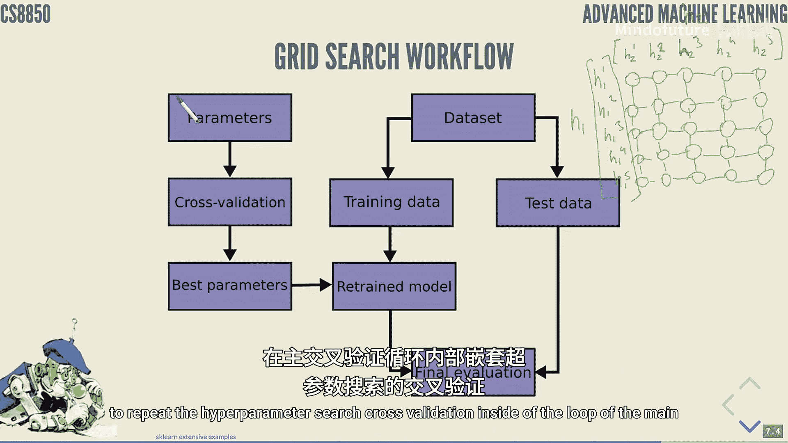
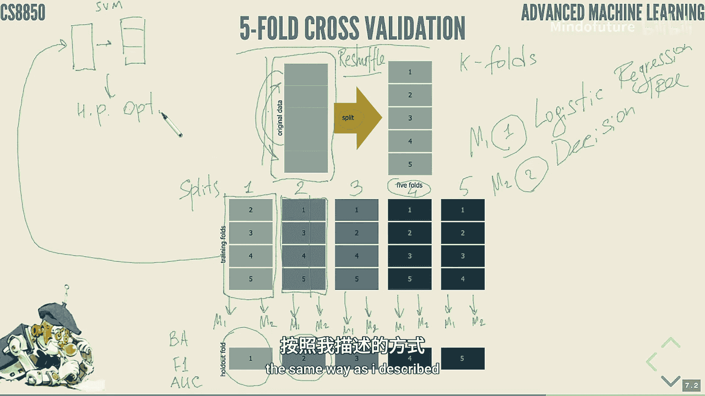
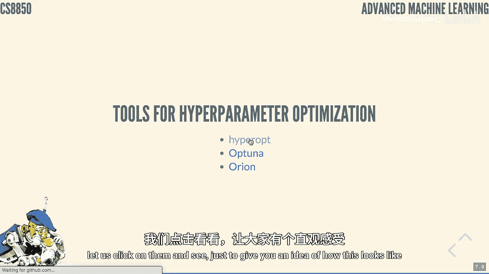
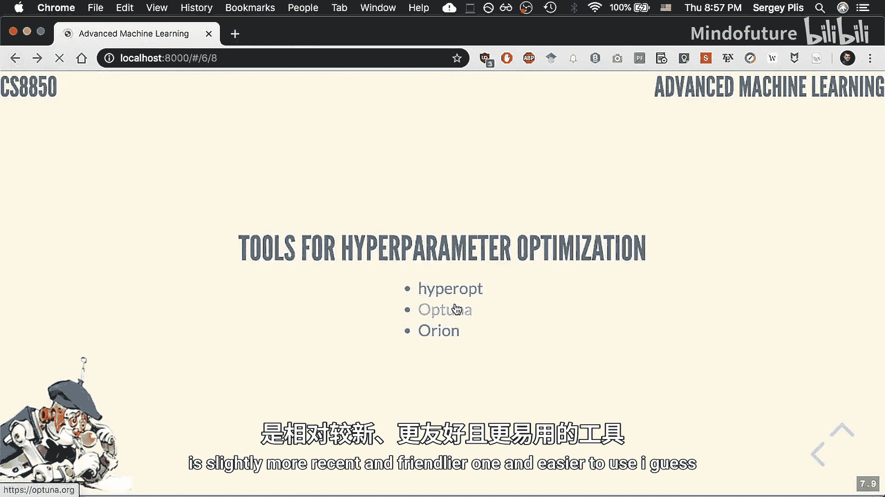
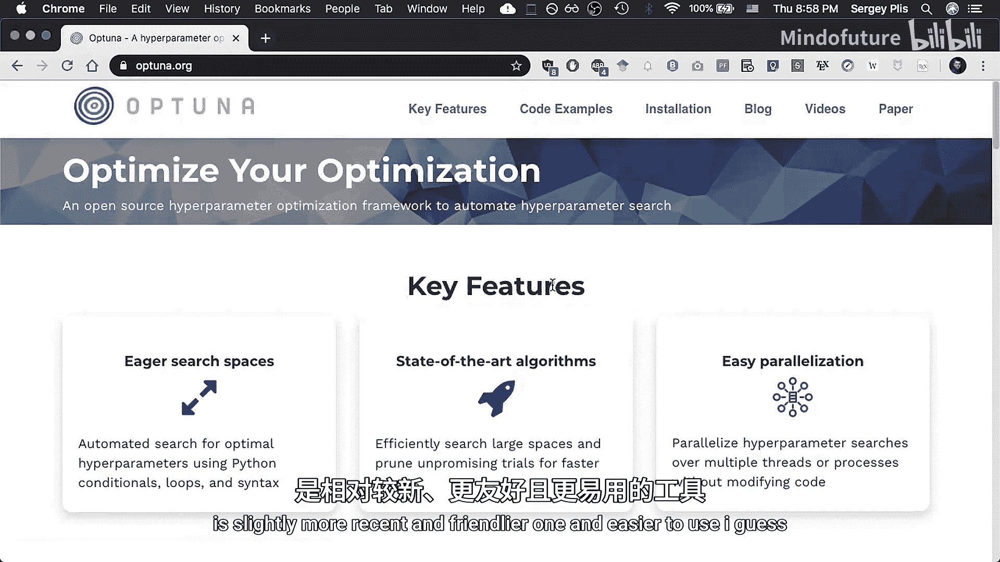
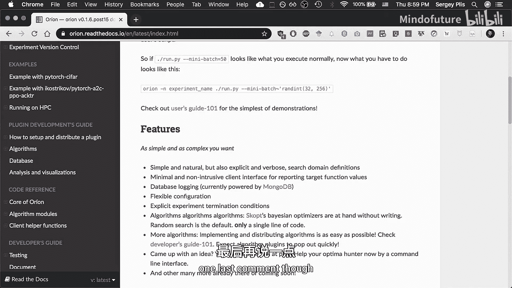
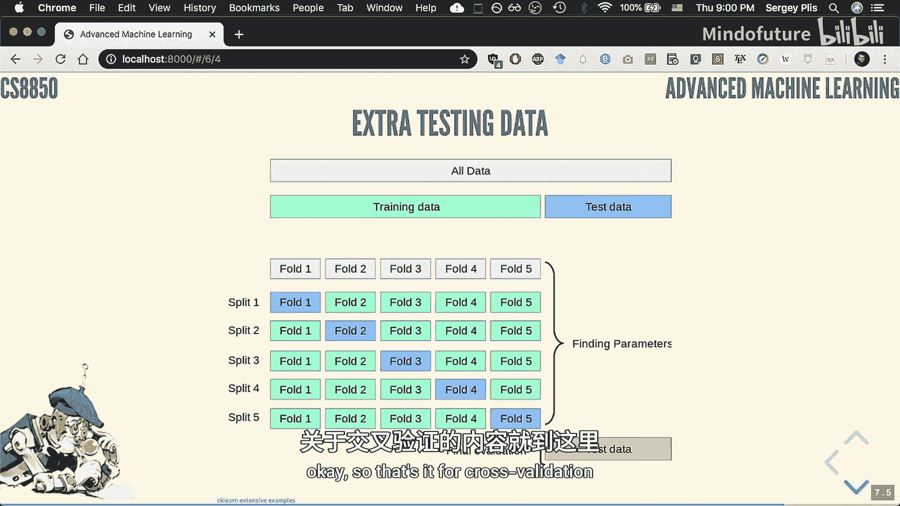

# 061：交叉验证与超参数优化 🎯

在本节课中，我们将学习如何评估机器学习模型的性能并选择最佳模型。核心内容包括交叉验证技术及其在模型选择和超参数优化中的应用。

---

## 概述

当我们拥有一些评估指标，如平衡准确率或F1分数时，面临的问题是：如何选择最佳模型？或者，如何为模型选择最佳的超参数？例如，模型的大小或某些未直接在训练数据上优化的系数设置，如神经网络中的层数或正则化参数。我们需要评估模型性能的变异性。交叉验证技术正是为了解决这些问题而设计的。

上一节我们讨论了模型评估指标，本节中我们来看看如何使用交叉验证来更稳健地评估和选择模型。

---

## 数据分割的局限性

回忆一下，我们最初将数据分割为**训练集**和**测试集**。测试集被完全保留，除了最终检查外，不用于模型的任何操作。此外，还有一个**验证集**，它对于超参数优化和控制过拟合等非常有用。

然而，测试集上的最终性能数字只是一个单一数值。这个数值无法告诉我们结果的变异性。想象一下，即使从相同的数据中，我们也可以选择不同的测试集和训练集。如果我们随机选择另一部分数据作为测试集，性能可能会因偶然性而发生巨大变化。例如，在这个特定的测试集分割中，可能偶然包含了20%从未在训练数据中出现过的困难样本。

我们如何处理这种情况？如何知道这种情况是否发生？交叉验证技术就是为了帮助解决这些问题。

---

## 交叉验证的基本原理

我们的原始数据是完整的。交叉验证的做法是：首先，我们随机打乱数据。然后，将数据分割成所谓的“折”。我们将数据分割成K折。下图示例是5折交叉验证，但也可以是10折。经验法则是通常使用10折，但这实际上取决于数据量的大小。K可以是任意值。

**K折交叉验证**因此得名。在我们的具体案例中，是5折交叉验证。

将完整数据集分割后，我们的目标是：从两个模型中选择一个更好的模型。为了举例，假设模型一是逻辑回归，模型二是决策树。

以下是交叉验证的步骤：

1.  我们有5折，相应地有5次分割（Split 1 到 Split 5）。
2.  我们依次将其中一折作为**保留折**（即测试集），其余折作为训练集。
3.  对于每一次分割，我们使用训练集训练两个模型（逻辑回归和决策树）。
4.  然后，在保留折（测试集）上计算每个模型的性能指标（如平衡准确率或F1分数）。
5.  对每一折重复此过程。

这样，每个模型都会得到K个性能分数。

---

## 模型选择与性能评估

完成上述过程后，我们可以查看结果。例如，在一个10折交叉验证的例子中，我们可能看到逻辑回归的平均性能为64，决策树的平均性能接近69，并且可以看到各自的性能变异性。

现在我们可以选择要使用的模型。但问题是：我们应该选择哪个模型？是选择在某一折上表现最好的那个模型吗？等等，那个模型并没有在完整数据集上训练过，它只在不包含某一折数据的子集上训练过。

因此，标准的模型选择流程如下：

1.  进行K折交叉验证，比较不同模型的平均性能。
2.  选择平均性能最佳的模型（例如决策树）。
3.  **使用完整的训练数据集**重新训练这个获胜的模型。
4.  最后，在独立的测试集上报告该最终模型的性能，以了解其在真实环境中的预期表现。

交叉验证是一个很好的技术，但并非完美无缺。它可能被“欺骗”，例如存在数据泄露或对交叉验证过程本身过拟合的风险。尽管如此，它远比仅在单一分割上进行训练和测试要好得多，因为后者无法提供关于模型稳定性的信息。

---

## 交叉验证用于超参数优化

交叉验证的另一个重要用途是**超参数优化**。例如，我们应该选择两层、一层还是三层的神经网络？每层应该使用10个还是100个隐藏单元？这些关于模型架构的选择都是超参数。

以下是超参数优化的核心方法：

**网格搜索**
这是一种传统方法。假设我们有两个超参数H1和H2。我们为每个超参数预先选择一组候选值（例如，H1有5个候选值，H2有5个候选值）。然后，我们需要为这两个超参数所有可能的组合（共5x5=25种）训练模型并进行评估。之所以称为“网格”搜索，是因为我们需要为超参数值网格中的每个交点运行模型。

在交叉验证框架下进行网格搜索的流程是：
1.  对于每一次数据分割（例如5折中的每一折），在训练集上，使用网格中所有超参数组合训练模型。
2.  在对应的验证折上评估这些模型的性能。
3.  最终，对于每一种超参数组合，我们得到其K次验证的平均性能。
4.  选择平均性能最高的那组超参数作为最佳设置。

---

## 嵌套交叉验证

当我们同时进行模型选择和超参数优化时，会出现一个问题：如果我们在用于模型比较的同一交叉验证循环内选择超参数，那么结果会过于乐观。

**嵌套交叉验证**是解决这个问题的推荐方法。其流程如下：

1.  外层循环：进行K折交叉验证以比较不同模型（或同一模型的不同超参数配置）。
2.  在内层循环中，对于外层每一折的训练集，再次进行交叉验证（例如L折），以优化该特定模型（如SVM）的超参数。
3.  为外层每一折的训练集找到最佳超参数后，用这些超参数训练模型，并在外层该折的验证集上评估。
4.  最终，根据外层K折的平均性能选择最佳模型或超参数配置。

嵌套交叉验证能提供更真实、更少乐观的性能估计。

---

## 超参数优化：网格搜索 vs. 随机搜索

网格搜索存在一个缺点：如果某个超参数对性能影响不大，而另一个影响巨大，那么均匀地对网格采样会浪费大量计算资源在不重要的维度上，并且可能错过重要维度上的最优值。

**随机搜索**是一种更高效的方法。它不从网格中均匀采样，而是在超参数空间中随机采样点。研究表明，随机采样有更高的几率找到性能最佳的超参数组合，尤其是在超参数重要性不均等的情况下。

此外，还有更高级的方法，如基于贝叶斯优化的超参数调优工具（例如 `Hyperopt`, `Optuna`），它们能更智能地探索超参数空间。

---

## 工具与计算考量

现在有许多工具可以简化交叉验证和超参数优化，例如Scikit-learn内置的交叉验证和网格搜索功能，以及专门的库如 `Hyperopt` 和 `Optuna`。这些工具通常只需几行代码即可实现复杂的优化流程。

需要注意的是，交叉验证，尤其是嵌套交叉验证和超参数搜索，计算量非常大。它需要对模型进行多次训练和评估。这种方法的普及得益于近年来相对充足的计算资源。

---

## 总结

本节课我们一起学习了交叉验证与超参数优化的核心内容：

1.  **交叉验证**（尤其是K折交叉验证）是一种评估模型性能、选择模型并估计性能变异性的关键技术。
2.  标准的模型选择流程包括：通过交叉验证比较模型，选择最佳模型后，在完整训练集上重新训练，最后在独立测试集上评估。
3.  交叉验证是**超参数优化**的基础。**网格搜索**是系统遍历超参数组合的传统方法。
4.  为了在模型选择中无偏地优化超参数，需要使用**嵌套交叉验证**。
5.  **随机搜索**通常比网格搜索更高效，特别是在超参数重要性不同的情况下。还有更高级的贝叶斯优化工具可供使用。
6.  这些过程计算密集，但现代机器学习库提供了便捷的工具来实现它们。

掌握交叉验证和超参数优化对于构建可靠、高性能的机器学习模型至关重要。