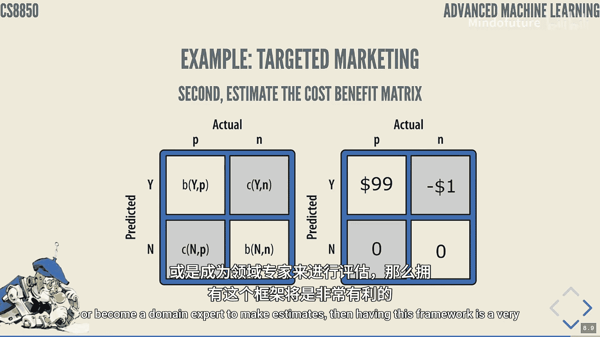

# 062：期望值（利润）框架 📊

在本节课中，我们将学习如何超越简单的分类指标（如准确率），转而使用一个更贴合实际业务决策的框架——期望值（利润）框架。我们将探讨如何将模型的预测结果与实际决策的成本和收益结合起来，从而选择出能带来最大预期利润的模型。

## 概述：为何单一指标不够用？ 🤔

上一节我们介绍了多种基于混淆矩阵的评估指标。然而，没有一个指标是“永远正确”的。不同的领域对同一概念有不同的称呼，例如，统计学中的“第一类错误”对应机器学习中的“假阳性”，而“第二类错误”对应“假阴性”。

混淆矩阵包含了所有信息，但难以用一个单一数字来比较模型。更重要的是，像准确率这样的指标存在缺陷，不仅因为它无法处理类别不平衡，更因为它没有考虑模型部署后所做决策的**后果**——即决策带来的成本和价值。

因此，我们需要一个能够纳入这些成本和价值的框架来辅助决策。答案就是**期望值**。

## 期望值框架简介 💡

期望值是一个概率论概念。对于一个随机事件，其期望值等于所有可能结果的**值**（或收益）乘以其发生**概率**的总和。

其核心公式如下：

**期望值公式：**
`E[V] = Σ_i P(结果_i) * V(结果_i)`

其中：
- `结果_i` 代表第 `i` 种可能的结果。
- `P(结果_i)` 代表该结果发生的概率。
- `V(结果_i)` 代表该结果带来的价值（收益或成本）。

接下来，我们通过一个实例来理解如何应用这个框架。

## 实例：目标营销决策 🎯

假设我们有一款产品，消费者购买价格为200美元，我们的产品成本（制造、运输等）为100美元。为了向一位消费者发送营销材料（如传单），我们需要花费1美元。

以下是两种可能的结果及其价值：
- **消费者响应（购买）**：我们获得利润 `200 - 100 - 1 = 99` 美元。
- **消费者未响应（不购买）**：我们损失了营销成本，即 `-1` 美元。

那么，我们是否应该向这位消费者发送营销材料？这取决于他/她响应的**概率**。

根据期望值公式，发送材料的期望利润为：
`E[发送] = P(响应) * 99 + P(不响应) * (-1)`

只有当这个期望值大于0时，发送才是有利可图的。通过解不等式 `P(响应) * 99 + (1 - P(响应)) * (-1) > 0`，我们可以得到：
`P(响应) > 0.01`

这意味着，只要该消费者响应的概率超过**1%**，发送营销材料就能带来正的预期利润。这个例子展示了如何利用一个能预测“响应概率”的模型，结合业务成本与收益，来做出明智的决策。

## 从模型评估到期望利润计算 🔄

上一节我们看到了如何为单个决策使用期望值。现在，我们来看看如何利用这个框架来评估和比较不同的分类模型。

整个过程可以分为以下几个步骤：

1.  **训练模型并计算混淆矩阵**：在测试集上评估模型，得到混淆矩阵。
2.  **计算联合概率分布**：将混淆矩阵中的计数归一化，得到预测结果与真实标签的联合概率分布。
3.  **定义收益矩阵**：为每一种预测-真实情况的组合（真阳性、假阳性等）赋予一个价值（收益或成本）。
4.  **计算期望利润**：将联合概率矩阵与收益矩阵进行逐元素相乘，并对所有结果求和。

下图清晰地展示了这个流程：

### 步骤详解与计算

假设我们有一个在110个测试样本上得到的混淆矩阵：

|                 | 预测为正 | 预测为负 | 合计 |
| :-------------- | :------- | :------- | :--- |
| **实际为正**    | 56       | 5        | 61   |
| **实际为负**    | 7        | 42       | 49   |
| **合计**        | 63       | 47       | 110  |

**步骤1：计算联合概率分布**
将每个单元格除以总样本数110，得到联合概率：

|                 | 预测为正 | 预测为负 |
| :-------------- | :------- | :------- |
| **实际为正**    | 56/110   | 5/110    |
| **实际为负**    | 7/110    | 42/110   |

**步骤2：定义收益矩阵**
沿用营销案例的数字：
- **真阳性（TP）**：预测购买且实际购买，收益 = 99美元
- **假阳性（FP）**：预测购买但实际未购买，收益 = -1美元
- **真阴性（TN）**：预测不购买且实际未购买，收益 = 0美元（无成本也无收益）
- **假阴性（FN）**：预测不购买但实际会购买，收益 = 0美元（错失机会，但未产生成本）

收益矩阵 `B` 如下：
|                 | 预测为正 | 预测为负 |
| :-------------- | :------- | :------- |
| **实际为正**    | 99       | 0        |
| **实际为负**    | -1       | 0        |

**步骤3：计算期望利润**
期望利润 `E` 是联合概率矩阵 `P` 与收益矩阵 `B` 逐元素相乘之和：
`E = Σ_i Σ_j P(i,j) * B(i,j)`

代入数字计算：
`E = (56/110)*99 + (5/110)*0 + (7/110)*(-1) + (42/110)*0`
`E ≈ (5040 - 7) / 110`
`E ≈ 5033 / 110 ≈ 45.75`

这意味着，使用这个模型来指导营销决策，平均从每个目标客户身上可以期望获得约45.75美元的利润。

### 利用概率分解深入理解

我们也可以利用概率的链式法则来分解期望值，这能让我们更清楚地看到各类别概率和分类器性能指标（如召回率、特异度）所起的作用。

期望值公式可以重写为：
`E = P(实际为正) * [TPR * B_TP + FNR * B_FN] + P(实际为负) * [FPR * B_FP + TNR * B_TN]`

其中：
- `P(实际为正) = 61/110 ≈ 0.555`， `P(实际为负) = 49/110 ≈ 0.445`
- **真正例率（TPR）** = 56/61 ≈ 0.918
- **假正例率（FPR）** = 7/49 ≈ 0.143
- **假负例率（FNR）** = 5/61 ≈ 0.082
- **真负例率（TNR）** = 42/49 ≈ 0.857

代入公式验证：
`E = 0.555 * (0.918*99 + 0.082*0) + 0.445 * (0.143*(-1) + 0.857*0)`
`E ≈ 0.555 * 90.882 + 0.445 * (-0.143)`
`E ≈ 50.44 - 0.064 ≈ 50.38` （与之前计算因四舍五入有细微差别）

这个视角表明，期望利润是正负两类样本的期望收益的加权平均，权重就是它们的先验概率。

## 框架的局限性与挑战 ⚠️

虽然期望值框架非常强大，但在实际应用中面临一个主要挑战：

**收益矩阵极难准确获取。**

在现实的生产环境中，精确量化一次正确或错误预测所带来的金钱价值（或更广义的成本/收益）通常非常困难。这不仅需要猜测具体数字，有时连估计一个合理的范围都颇具挑战。

因此，成功应用此框架的关键在于：
1.  与领域专家紧密合作，尽可能做出合理的估计。
2.  进行敏感性分析，观察当收益/成本在一定范围内变动时，最优决策或模型是否保持稳定。
3.  理解这更多是一个用于结构化思考和比较的**框架**，而非一个提供绝对精确答案的“食谱”。

## 总结 📝

本节课我们一起学习了期望值（利润）框架。
- **核心思想**：评估模型不应只看预测准确性，而应结合其决策带来的实际业务**价值**。
- **关键公式**：`期望值 = Σ (结果概率 × 结果价值)`。
- **应用流程**：从混淆矩阵得到联合概率分布，定义收益/成本矩阵，计算期望利润。
- **优势**：将机器学习模型与商业目标直接挂钩，支持基于预期财务回报的模型选择。
- **挑战**：收益/成本矩阵的确定需要深入的领域知识，且往往是不精确的。

掌握这个框架能帮助你超越单纯的算法优化，从创造实际商业价值的角度来思考和设计机器学习解决方案。记住，没有放之四海而皆准的“最佳指标”，深入理解你的具体问题和业务背景才是关键。