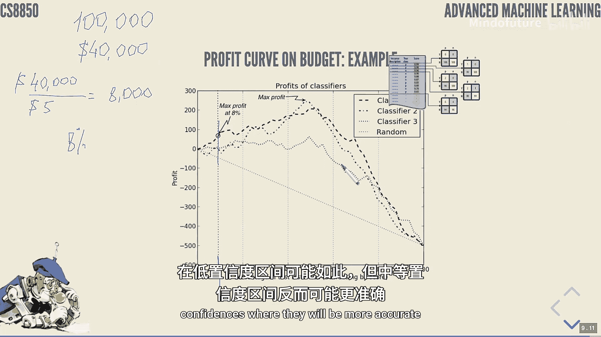

# 063：模型性能可视化 📊

在本节课中，我们将学习如何超越单一数值指标，通过可视化方法来全面评估和比较机器学习模型的性能。我们将探讨为什么单一指标（如准确率）通常不足以描述模型，并介绍如何利用**利润曲线**和**准确率-覆盖率曲线**来做出更明智的决策。

上一节我们讨论了使用单一数值（如期望收益）来衡量模型性能的局限性。本节中，我们将看看如何通过可视化来更全面地展示模型表现。

## 单一指标的局限性

通常不建议使用单一数字来代表模型性能的全部复杂性。更好的做法是尽可能多地展示我们对问题的理解，而模型性能的可视化图表会很有帮助。

此外，即使是对专家而言，如果只展示一个数字，他们也很难理解你的结果。一张图胜过千言万语。

## 决策边界与混淆矩阵

回想一下期望值的计算。我们从一个成本效益矩阵开始，这个矩阵可能来自销售部门的信息。在训练或分类模型后，我们会在测试集上计算**混淆矩阵**，其中包含真正例、假正例、假反例等。

这个过程是确定性的，那么“千个数字”从何而来呢？

考虑贝叶斯决策边界。假设我们有癌症患者（红色曲线）和非癌症患者（绿色曲线）的概率分布。最优的贝叶斯决策边界位于这两条概率密度函数（后验概率）相交的地方。

*   决策边界左侧的红色区域样本将被预测为阴性（无癌症）。
*   决策边界右侧的样本将被预测为阳性（有癌症）。

这样，总体风险被最小化。但假阳性和假阴性通常成本不同。例如，在癌症检测中，我们更不希望出现假阴性（漏诊癌症），因此我们宁愿多检查一些健康人，也不愿让一个癌症患者发展到晚期。

因此，我们可以移动决策边界。如果假阴性的成本更低，我们可以允许更多假阴性出现；如果假阳性的成本更高，我们可以将决策边界右移以减少假阳性。

随着决策边界的移动，我们的**混淆矩阵**也在变化。因此，期望成本或收益（通过成本效益矩阵与概率相乘得到）也会不同。这不仅取决于不同的模型或超参数设置，也取决于我们如何设置那个**阈值**。

## 评分与概率

但并非所有模型都输出概率。例如，支持向量机（SVM）基于样本到决策边界的距离进行排序，这个距离是**评分**，而不是概率。即使我们通过归一化将其映射到[0,1]区间，它仍然不是概率，只是样本属于其类别的置信度得分。

即使是估计概率分布的模型（如使用核密度估计的朴素贝叶斯），也可能因为训练样本不足而无法得到真正有代表性的概率。

那么在这种情况下我们该怎么办？

## 排序分类器与阈值

一个分类器在给定测试集后，可以确定性地产生一个混淆矩阵。当阈值改变时，混淆矩阵也会改变，真正例和假正例的数量会发生变化。

对于一个**排序分类器**（即能输出样本得分的分类器），分类器加上一个**阈值**会产生一个单一的混淆矩阵。

以下是理解此过程的方法：

假设我们有一个测试集，包含若干样本实例，每个样本都有已知的真实类别（正类或负类）。对于一个给定的分类器（例如“分类器一”），我们将所有样本特征输入模型，模型为每个样本返回一个得分。

1.  我们根据得分将所有测试样本从高到低排序。
2.  然后我们在这个得分空间中选择一个阈值。
    *   如果阈值设为最高分（例如1.0），所有样本得分都低于阈值，则全部预测为负类。此时真正例和假正例都为0。
    *   如果将阈值略微降低到0.985，可能只有一个得分最高的样本被预测为正类。如果这个样本的真实类别恰好是正类，那么我们就有了一个真正例，假反例减少一个。
    *   继续降低阈值，更多样本被预测为正类。我们会开始遇到真实类别为负类但被预测为正类的样本，即产生假正例。同时，真正例数量增加，真反例数量减少。

因此，混淆矩阵几乎随着阈值的每一次移动而改变。

不同的分类器会对相同的样本产生不同的得分排序。这意味着，对于“分类器一”，样本有一个特定的排序；当我们应用另一个分类器并根据其得分排序时，样本的顺序会变得不同。

## 如何比较不同模型？

问题来了：我们如何比较不同的排序（即不同的模型）？如何判断哪个更好？如何选择合适的阈值？

答案是使用**利润曲线**。

对于一个排序分类器，我们可以生成一个按得分降序排列的样本及其预测得分列表，然后测量选择列表中每个连续切分点（即阈值）所产生的**期望利润**。

让我们通过一个营销案例来理解利润曲线。

假设我们发送营销材料的成本是每份5美元。每个响应者会支付9美元。因此，每个响应者为我们带来4美元的利润。

你可以暂停视频，尝试自己构建成本效益矩阵。

构建结果如下：
*   **真正例**：带来4美元利润。
*   **假正例**：带来-5美元“利润”（即损失5美元成本）。
*   （注：此例中假反例和真反例的利润为0，因为我们没有对其采取行动，也未产生成本）。

我们考虑三个分类器（分类器一、二、三）以及一个随机分类器（随机排序样本）。

观察利润曲线，我们可以发现：
*   利润可能变为负值。这是因为如果我们向列表下方太多不会响应的人发送优惠，我们在优惠成本上的花费太多，无法收回投资。
*   所有曲线起点（阈值为1，全预测为负）和终点（阈值为0，全预测为正）相同，因为测试集相同。
*   曲线之间的差异在于，由于每个模型对样本的得分排序不同，在中间阈值点上的利润表现不同。

从图中我们可以观察到，最大利润出现在某个点（例如约240美元），这大约对应向50%的测试人群发送优惠。

现在我们可以说：通过叠加我的得分（置信度）轴，我可以找出产生最大利润的阈值。在生产中，我应该使用**分类器二**并配合这个特定阈值。

## 预算限制下的决策

想象另一种情况：你有10万名客户，但市场营销活动预算只有4万美元。你该怎么办？利润曲线也能帮助我们。

4万美元预算，每份材料5美元，意味着我们只能向8000名客户发送优惠。8000/100000 = 8% 的覆盖率。

现在，如果我们观察利润曲线在8%覆盖率处的表现，**分类器一**的利润更高。因此，如果预算有限只能覆盖前8%的客户，我们应该使用**分类器一**。

关于这些曲线，一个重要点是：模型在不同置信度区间（即得分区间）的准确性不同。有些模型在高置信度时非常准确，有些则在中等置信度时更准确。这就是为什么曲线会以不同速率增长和下降。

## 准确率-覆盖率曲线

利润的概念可以转化为利益相关者更熟悉的指标，例如**准确率**。虽然作为研究者，我们知道准确率有很多问题，是一个不好的指标，但如果你的利益相关者已经在所有营销材料中使用准确率，并且这是他们理解和信服的方式，那么你可以用准确率向他们汇报。

我们可以绘制**准确率-覆盖率曲线**。这里的覆盖率与利润曲线中的概念完全相同。我们根据模型的得分对样本进行排序。

假设我们有三个分类器的准确率-覆盖率曲线：
*   分类器A（红色）：开始时准确率高，但覆盖率增加后准确率迅速下降。
*   分类器B（蓝色）：在整个覆盖率范围内保持相对稳定的中等准确率。
*   分类器C（绿色）：开始时准确率一般，但在某个覆盖率点后准确率急剧下降。

问题来了：哪个分类器更好？

这取决于利益相关者对**最低可接受准确率**的要求。
*   如果要求是图中较低的虚线（例如70%准确率），那么**绿色分类器**能在更高的覆盖率下满足要求（点G），其次是红色（点R），蓝色（点B）的覆盖率最低。此时应选择绿色分类器。
*   如果要求是图中较高的虚线（例如90%准确率），那么**蓝色分类器**可能成为最佳选择，因为它能在某个较小的覆盖率范围内达到这个准确率（点B‘），而红色和绿色分类器可能在任何覆盖率下都无法达到90%准确率。

关键在于，当你盲目地在整个测试集上计算一个单一的平均准确率数字时，你丢弃了大量丰富的信息和可能性。通过可视化曲线，你可以根据客户的具体要求（如最低准确率或预算限制），选择最合适的模型和阈值，从而自动化解决他们大部分的手动工作问题。

## 总结

本节课中，我们一起学习了：
1.  **单一数值指标（如准确率）的局限性**，它无法全面反映模型性能。
2.  **决策边界阈值**如何动态影响混淆矩阵和期望利润。
3.  区分模型的**概率输出**与**置信度评分**。
4.  如何利用**利润曲线**在考虑成本和收益的情况下，选择最优模型和阈值，特别是在有**预算限制**时。
5.  如何绘制和解读**准确率-覆盖率曲线**，根据利益相关者对准确率的最低要求，选择能实现最大自动化的模型。

掌握这些可视化工具，能帮助你在实际业务中更有效地评估和部署机器学习模型，确保它们不仅“准确”，而且真正有用且符合业务目标。