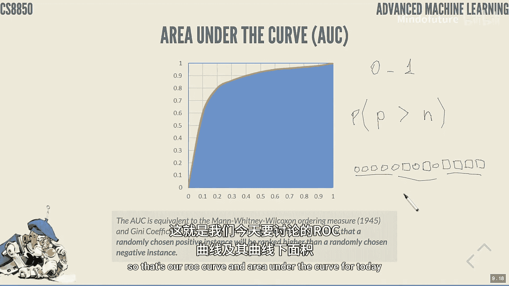

# 064：P64 接收者操作特征曲线 📈

在本节课中，我们将学习一种重要的分类器性能可视化工具——接收者操作特征曲线，简称ROC曲线。我们将了解它的构成、如何解读，以及它与之前学习的利润曲线的区别。

## 从利润曲线到ROC曲线

上一节我们介绍了利润曲线，但利润曲线存在一些问题。为了使利润曲线有效，必须满足两个关键条件：已知的**类别先验概率**和已知的**成本与收益**。如果两者都已知，利润曲线是可视化分类器性能的一个好选择。

然而，在许多实际领域中，情况并非如此。这些条件可能不稳定或不确定。例如，欺诈交易的数量会因地点和月份而变化（类别先验概率波动）；营销活动的预算不同，优惠的成本也不同（成本与收益多变）。这种不稳定性和多变性使得基于利润曲线做出的决策也可能不一致。

一个可能的解决方案是生成多条利润曲线，预先考虑各种条件并规划不同的曲线。但这会带来新的问题：需要存储多少条件和曲线？这些条件很快会变得难以管理、理解和向利益相关者解释。模型的可解释性非常重要，你需要能够解释为什么推荐这个模型，它的好处是什么，不使用其他模型的缺点是什么。

那么，我们能做什么呢？实际上，在第一次世界大战期间，为评估雷达探测敌机的准确性，工程师们开发了一种可视化技术，这就是接收者操作特征曲线。

## 理解ROC曲线

ROC曲线全称为接收者操作特征曲线。它的横轴是**假正率**，纵轴是**真正率**。

为了理解这两个概念，让我们回顾一下混淆矩阵。混淆矩阵包含四个部分：真正例、真反例、假正例和假反例。

*   **真正率**：在所有实际为正例的样本中，被正确预测为正例的比例。计算公式为：`TPR = TP / (TP + FN)`。它也被称为“命中率”。
*   **假正率**：在所有实际为反例的样本中，被错误预测为正例的比例。计算公式为：`FPR = FP / (FP + TN)`。它也被称为“误报率”或“假警报率”。

ROC曲线描绘了当分类器的决策阈值变化时，真正率和假正率之间的权衡关系。

## 解读ROC空间

在ROC空间中，有几个关键点需要理解：

*   **点 (0, 0)**：表示分类器将所有样本都预测为反例。此时没有假警报，但也完全错过了所有正例。
*   **点 (1, 1)**：表示分类器将所有样本都预测为正例。此时抓住了所有正例，但所有反例也都成了误报。
*   **对角线 (从(0,0)到(1,1))**：这条线代表一个**随机分类器**的性能。例如，一个抛公平硬币（50%概率预测为正）的分类器会落在点(0.5, 0.5)附近。一个以90%概率预测为正的随机分类器会落在点(0.9, 0.9)附近。
*   **点 (0, 1)**：这是**理想点**，代表完美分类器：所有正例都被正确识别，且没有任何误报。

一个分类器的ROC曲线越靠近左上角（即越接近点(0,1)），其性能越好。

## 保守型与激进型分类器

根据分类器在ROC空间中的位置，我们可以判断其“性格”：

*   **保守型分类器**：通常位于ROC空间的左下部分。它设置很高的阈值，只有在非常确信时才预测为正例。因此，它的误报率很低，但代价是也会漏掉很多真正的正例（真正率也低）。
*   **激进型分类器**：通常位于ROC空间的右上部分。它设置很低的阈值，只要有一点迹象就预测为正例。因此，它能抓住更多正例（真正率高），但也会产生更多误报（假正率高）。

选择保守型还是激进型分类器，取决于实际问题中**假正例**和**假反例**的成本。哪个错误更严重，就决定了我们更倾向于避免哪种错误。

## 如何构建ROC曲线

ROC曲线通常由输出“置信度分数”或概率的分类器（如支持向量机、逻辑回归）生成。构建步骤如下：

1.  获取模型对测试集中每个样本预测为正例的分数。
2.  将所有样本按预测分数从高到低排序。
3.  将分类阈值设置为最高（高于所有分数），此时所有样本都被预测为反例，对应点(0,0)。
4.  依次将阈值降低到每个独特的预测分数值。
5.  对于每个新阈值，将分数高于阈值的样本预测为正例，计算此时的真正率和假正率，在图上描点。
6.  连接所有点，形成一条阶梯状的曲线（当样本量很大时，看起来是平滑的）。

这条曲线展示了该分类器在所有可能阈值下的所有性能表现。

## 曲线下面积：一个综合指标

为了更方便地比较不同分类器的整体性能，我们引入一个单一指标：**曲线下面积**。

AUC是ROC曲线下方与坐标轴围成的面积。因为整个ROC空间的面积是1（1x1的正方形），所以AUC的值在0到1之间。

AUC有一个非常直观的概率解释：**它等于随机选取的一个正例样本的预测分数，高于随机选取的一个反例样本的预测分数的概率。**

*   **AUC = 1.0**：完美分类器。所有正例分数都高于所有反例分数。
*   **AUC = 0.5**：随机分类器，其性能与抛硬币无异。
*   **AUC < 0.5**：比随机还差，但将预测结果反转（正变反，反变正）就可以得到AUC > 0.5的分类器。

AUC是一个比准确率更稳健的指标，特别是在类别不平衡的数据集上。它衡量的是分类器的“排序能力”，而非绝对的分类正确率。

## 总结

本节课中，我们一起学习了接收者操作特征曲线。我们了解到，ROC曲线通过描绘真正率和假正率在不同决策阈值下的变化，全面展示了分类器的性能。它不依赖于特定的类别先验或误分类成本，因此比利润曲线更具通用性。通过观察曲线靠近左上角的程度，我们可以直观比较分类器优劣。最后，曲线下面积作为一个标量汇总指标，为我们提供了比较分类器整体排序能力的有效工具。掌握ROC曲线和AUC，对于评估和选择机器学习模型至关重要。