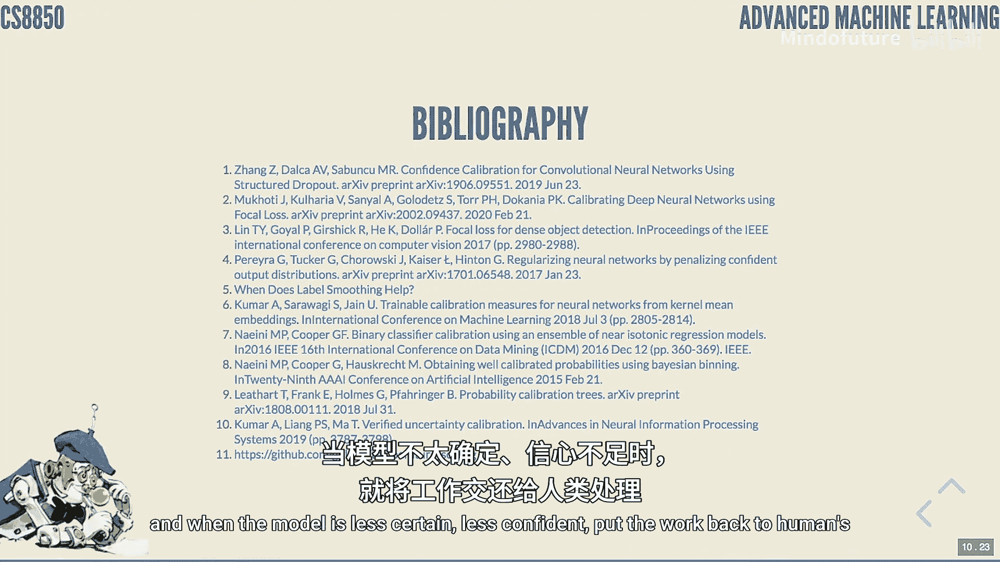

# 065：模型校准 📊

在本节课中，我们将要学习模型校准。模型校准是现代机器学习模型的一个重要特性，它确保模型输出的置信度分数能够真实反映其预测正确的概率。一个经过良好校准的模型，其声称的置信度与实际准确率是匹配的。这对于自动化决策至关重要，因为它能帮助我们判断何时可以信任模型的预测，何时需要将任务转交给人类处理。

## 为什么需要模型校准？🤔

上一节我们介绍了模型校准的基本概念，本节中我们来看看为什么它如此重要。

我们通常使用分类器和模式识别算法来自动化原本由人类完成的任务。人类并不完美，我们也不期望算法完美无缺。与其等待一个在所有输入情况下都表现完美的新方法，我们不如设定一个置信度阈值，只接受高于该阈值的预测。

然而，问题在于，模型输出的置信度分数并不总是与其预测正确的概率相符。这就是模型校准要解决的问题：让模型预测的概率估计能够代表其真实的正确可能性。

我们希望与预测类别标签相关联的概率能够反映其真实正确的可能性。如果模型经过良好校准，我们就知道何时可以信任模型，何时应该将任务转交给人类。回想上一讲的内容，关于哪个模型更适合自动化的问题，答案可能有些矛盾。由于不同的应用需求（例如，对持续准确性的合同要求），我们可能会选择一个在整体测试集上表现更差的模型。我们可能拥有平均准确率更高的模型，但如果这些模型对其预测过于自信，那么对于我们的特定应用场景来说，它们实际上可能更差。这就是我们需要良好校准模型的原因。

模型可解释性是另一个案例。我们希望能够明确指出哪些情况对模型来说更难，哪些更容易。例如，即使我们的模型只在80%的情况下预测正确，但在实际应用中，可能有20%的情况本身就是错误的或根本无法标记的。我们希望模型在这些错误的预测上不要返回高置信度，而是完全不自信（最好为零），这样我们就可以开始调查，找出问题所在（例如，打印机卡纸或某个数据收集站点发送了垃圾数据）。我们希望模型的置信度能够真实反映其准确率。

## 什么是完美校准？🎯

上一节我们讨论了校准的重要性，本节我们来定义什么是完美校准。

考虑一个有监督的分类问题。多维输入数据和多个类别的标签遵循联合数据-标签分布，该分布可以分解为先验证据和条件概率（即后验概率）。神经网络接收特征向量作为输入，返回类别预测 $\hat{y}$ 和置信度 $\hat{p}$。

对于一个完美校准的模型，我们需要在给定置信度下，预测结果正确的概率等于该置信度值。用公式表示如下：

$$
P(\hat{Y} = Y \mid \hat{P} = p) = p, \quad \forall p \in [0,1]
$$

## 如何评估模型校准？📈

上一节定义了完美校准，本节我们来看看如何评估一个模型是否校准良好。

为此，我们可以借助可靠性图（或称校准图）。可靠性图是模型校准情况的可视化表示。这些图表绘制了模型的“预期样本准确率”作为“模型返回的置信度”的函数。

如果模型完美校准，那么在给定置信度下，预测标签是真实标签的概率就等于该置信度。这意味着，可靠性图应该绘制恒等函数，即一条45度的对角线。任何与完美对角线的偏差都代表了错误校准。

以下是可靠性图的一个示例。对于完美校准的模型，这条45度对角线意味着，例如，当模型置信度为0.6时，其准确率也应为0.6；置信度为0.8时，准确率也应为0.8。

在Scikit-learn的帮助文件中，可以找到对逻辑回归、朴素贝叶斯分类器、支持向量机和随机森林的校准图比较。从图中可以看到，逻辑回归的校准曲线（蓝线）最接近完美校准。这并不奇怪，因为逻辑回归的设计目标就是建模训练数据中的概率分布。图中的偏差是因为我们在测试数据上绘图，这反映了逻辑回归的泛化误差。

图中还有频率图（直方图）。这个图告诉我们模型预测的置信度分布。例如，如果模型以0.9到1.0之间的置信度做出预测，我们就把这个预测计入对应的分箱中。对于逻辑回归，其置信度值的分布相对均匀。相比之下，支持向量机（绿线）倾向于在0.5附近（最不确定）做出很多预测。朴素贝叶斯分类器则呈现出双峰分布，对正负预测都表现得非常自信，但仍然会犯错，因此其校准曲线并不完美。

需要注意的是，这些校准图本身并不能告诉我们模型的绝对准确率有多高。它们只告诉我们模型的准确率与其声称的置信度有多接近。

## 现代深度学习模型的校准问题 🔍

上一节我们看了传统模型的校准情况，本节我们关注一个有趣的现象：现代高性能深度学习模型的校准问题。

一篇2017年的论文指出，性能最好的深度学习模型在置信度方面“欺骗”了我们。以LeNet（1998年，5层）和ResNet-110（2016年，110层）在CIFAR-100数据集上的表现为例。虽然ResNet-110的准确率高于LeNet，但其平均置信度远高于其实际准确率。观察可靠性图，LeNet的校准曲线更接近理想对角线，而ResNet的校准曲线则与对角线存在巨大差距。

这表明，模型变得更深、更宽可能降低分类错误率，但会对模型校准产生负面影响。此外，批量归一化等技术的引入虽然加快了训练速度并略微提高了准确率，但也增加了错误校准。训练时使用较小的权重衰减也会对校准产生负面影响。

那么，为什么一个模型预测性能更好、准确率更高，但校准却更差呢？这看起来像是过拟合在作祟。如果我们只关注测试错误率（红色曲线），它会随着训练周期增加而下降。但如果我们观察测试负对数似然，它会先下降到某一点，然后开始上升。这表明，网络在预测准确率方面没有过拟合，但在预测其自身准确率的概率或置信度方面发生了过拟合。这是一个非常有趣的观察。

## 量化校准误差：ECE与MCE 📊

上一节我们通过图表观察了校准问题，本节我们引入量化指标来评估校准程度。

首先定义两个核心概念：分箱内的**预期准确率**和**平均置信度**。
设 $B_m$ 为第 $m$ 个置信度分箱的样本索引集合。

*   **分箱 $B_m$ 的预期准确率** 是该分箱内正确预测的归一化计数：
    $$
    \text{acc}(B_m) = \frac{1}{|B_m|} \sum_{i \in B_m} \mathbf{1}(\hat{y}_i = y_i)
    $$
    其中 $\mathbf{1}$ 是指示函数，预测正确为1，否则为0。$|B_m|$ 是该分箱的样本数。

*   **分箱 $B_m$ 的平均置信度** 是该分箱内所有样本置信度的平均值：
    $$
    \text{conf}(B_m) = \frac{1}{|B_m|} \sum_{i \in B_m} \hat{p}_i
    $$

对于一个完美校准的模型，每个分箱都满足 $\text{acc}(B_m) = \text{conf}(B_m)$。

为了用一个数字来概括模型的校准程度，我们定义**预期校准误差**：
$$
ECE = \sum_{m=1}^{M} \frac{|B_m|}{n} |\text{acc}(B_m) - \text{conf}(B_m)|
$$
其中 $n$ 是总样本数。ECE 是各分箱准确率与置信度之差的绝对值，按分箱大小加权后的总和。

对于一些高风险应用，我们可能希望最小化置信度与准确率之间的最坏情况偏差。为此，我们定义**最大校准误差**：
$$
MCE = \max_{m \in \{1,...,M\}} |\text{acc}(B_m) - \text{conf}(B_m)|
$$

另一个常用的衡量概率模型质量的指标是**负对数似然**。给定一个概率模型 $\pi(y|x)$ 和 $n$ 个样本，负对数似然定义为：
$$
NLL = -\sum_{i=1}^{n} \log(\pi(y_i | x_i))
$$
理论上，当且仅当模型估计的条件分布恢复真实条件分布时，负对数似然的期望值才被最小化。

## 模型校准方法 🛠️

上一节我们学习了如何衡量校准误差，本节我们来看看如何对模型进行校准。

有多种校准方法可用于改善模型输出概率的可靠性，其中许多方法在深度学习兴起之前就已为经典机器学习模型开发。幸运的是，它们大多已在标准库（如Scikit-learn）中实现。

以下是几种主要的校准方法：

*   **直方图分箱**：预先定义固定的分箱边界，将所有未校准的预测划分到互斥的分箱中。为每个分箱估计一个校准分数 $\theta_m$。使用时，若模型的置信度落在某个分箱内，则用该分箱的 $\theta_m$ 替换原置信度。通过最小化平方误差可以求解出最优的 $\theta_m$，结果恰好是每个分箱内正样本的平均比例。

*   **保序回归**：与直方图分箱类似，但保序回归会同时估计分箱的数量、分箱边界以及每个分箱的校准参数。它不要求分箱大小相等，而是寻找一个最优的、单调非递减的分段常数函数来拟合数据。

*   **贝叶斯分箱**：这种方法对所有可能的分箱方案进行贝叶斯平均。它设定一个先验分布来描述不同的分箱模式，然后对所有可能的分箱方案进行积分（或求和），从而得到最终的校准预测。这相当于考虑了所有可能的分箱不确定性。

*   **Platt缩放**：由John Platt提出，最初用于将支持向量机的输出距离转换为置信度。其思想是将模型的原始输出（对于SVM是到超平面的距离）通过一个Sigmoid函数进行变换。这个Sigmoid函数有两个参数（权重 $A$ 和偏置 $B$），通过在保留的验证集上最小化负对数似然来优化。公式为：
    $$
    P(y=1|x) = \frac{1}{1 + \exp(A \cdot f(x) + B)}
    $$
    其中 $f(x)$ 是模型的原始输出。

*   **矩阵与向量缩放（Platt缩放的推广）**：对于多分类问题，可以将Platt缩放推广。不再为每个类别独立应用Sigmoid，而是学习一个权重矩阵 $W$ 和一个偏置向量 $b$，对Softmax函数的输入（logits）进行线性变换：$\hat{z} = W \hat{z} + b$，然后再应用Softmax。为了减少参数，通常限制 $W$ 为对角矩阵。

*   **温度缩放**：这是Platt缩放的一个更简单的特例，也是目前发现对深度神经网络最有效的校准方法之一。它只引入一个正的标量参数 $T$（温度），用于缩放Softmax函数的输入logits向量 $z$：
    $$
    \hat{p}_i = \frac{\exp(z_i / T)}{\sum_{j=1}^{K} \exp(z_j / T)}
    $$
    当 $T=1$ 时，恢复原始概率。当 $T > 1$ 时，会“软化”概率分布，使输出更均匀，降低置信度；当 $T < 1$ 时，会“锐化”分布。温度 $T$ 通过在验证集上最小化负对数似然来优化。关键优势在于，温度缩放**不改变模型预测的类别**（因为argmax不变），因此**不影响模型的准确率**，只调整其置信度使其更符合实际准确率。

实验结果表明，对于各种深度网络（如ResNet, DenseNet, LeNet），简单的温度缩放方法在降低ECE和NLL方面，往往比更复杂的矩阵缩放或直方图分箱方法效果更好。经过温度缩放后，模型的可靠性图能显著更接近理想的对角线。

## 总结 📝

本节课中我们一起学习了模型校准。

*   **模型校准**的核心是让模型输出的置信度分数能够真实反映其预测正确的概率。
*   我们可以使用**可靠性图**来可视化模型的校准情况，完美校准对应一条45度对角线。
*   可以使用**预期校准误差**和**最大校准误差**等量化指标来评估校准程度。
*   现代深度神经网络虽然准确率高，但常常存在**过度自信**和**校准不良**的问题。
*   有多种方法可以对模型进行**事后校准**，包括直方图分箱、保序回归、贝叶斯分箱、Platt缩放及其推广（矩阵/向量缩放），以及简单有效的**温度缩放**。
*   **温度缩放**因其简单性和有效性，成为校准深度神经网络置信度的首选方法之一，它能在不改变模型准确率的前提下，显著改善概率输出的可靠性。

通过校准模型，我们可以更可靠地利用其置信度分数来决定何时自动化处理任务，何时需要人工干预，从而在实际生产环境中安全、有效地部署机器学习系统。