# 066：卷积神经网络构建模块 🧱

在本节课中，我们将学习卷积神经网络的核心构建模块。我们将从卷积操作本身开始，逐步了解其工作原理、关键参数以及各种变体，如池化、上采样和空洞卷积。理解这些基础组件是掌握现代CNN架构及其应用的关键。

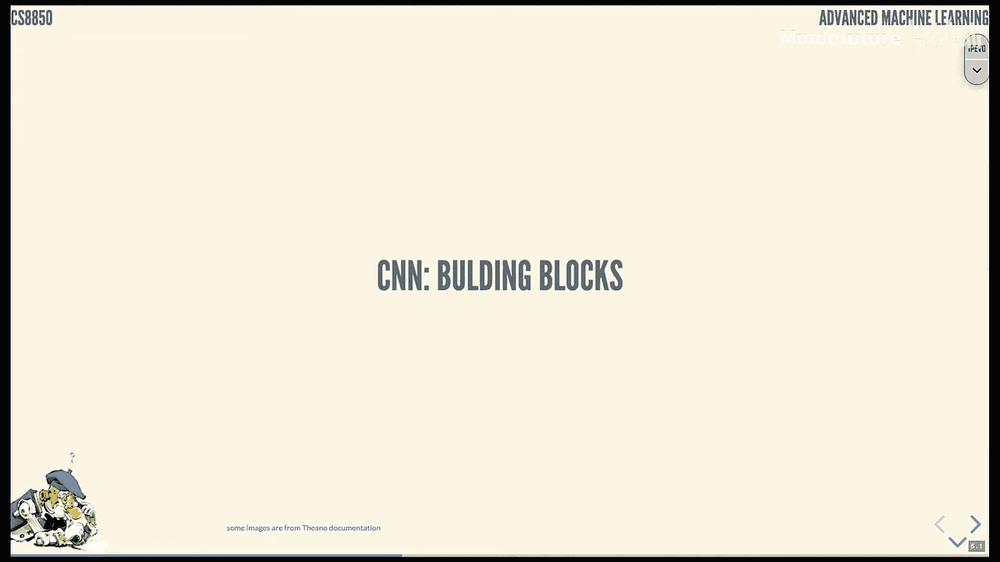

上一节我们回顾了CNN的发展历史。了解系统的演进过程有助于理解其完整功能，甚至发现其不足与改进方向。本节中，我们来看看构成卷积神经网络的基本工具。

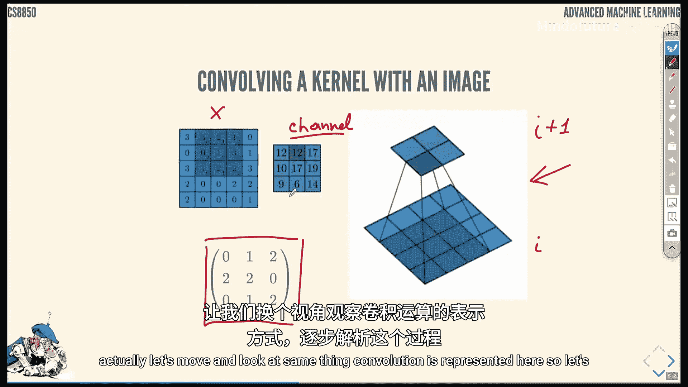

## 卷积操作本身

卷积操作是CNN最核心的组件。我们有一个称为**卷积核**（或滤波器）的小矩阵，它会在输入数据（如图像或前一层的特征图）上滑动。

以下是卷积过程的示意图：

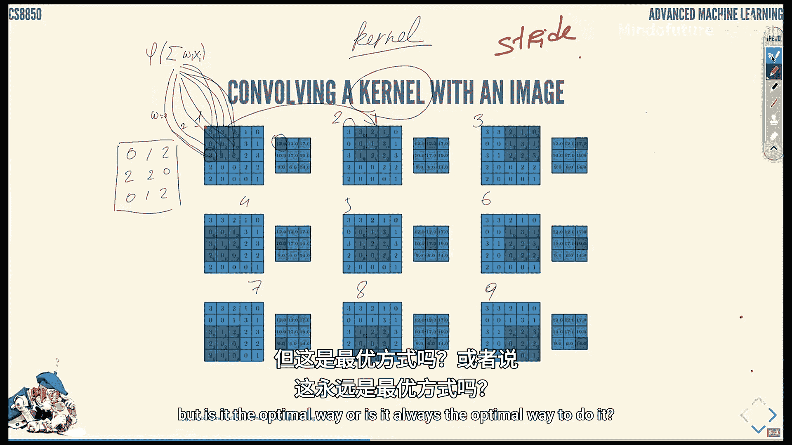

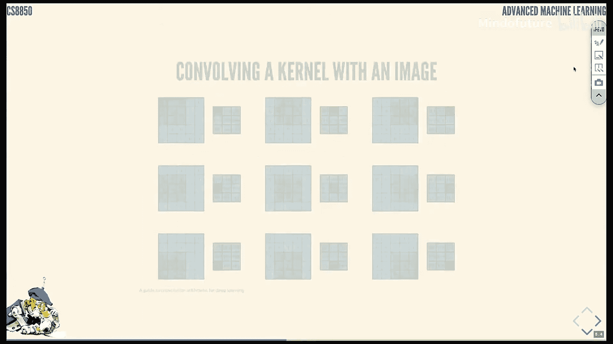

图中左侧展示了卷积核在输入 `X` 上滑动的过程，并生成输出通道。右侧以3D形式展示了同一过程，其中下层是第 `i` 层，上层是第 `i+1` 层。

让我们逐步分解这个过程：

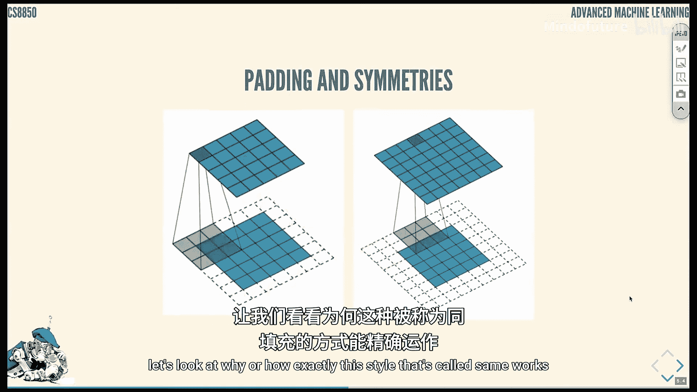

1.  **步骤1-9**：卷积核从输入左上角开始，每次向右移动一步（步长=1），最终扫描完整张图像。
2.  **计算过程**：在每一步，卷积核覆盖的区域与核的权重进行**逐元素相乘**，然后将所有乘积结果**求和**。这个和经过一个激活函数（如ReLU）后，成为输出特征图上的一个像素值。
3.  **数学表示**：输出像素值 `O` 的计算可以表示为：
    `O = σ( Σ (W * I) + b )`
    其中 `W` 是卷积核权重，`I` 是输入对应区域，`b` 是偏置项，`σ` 是激活函数。

在具体实现中，为了提高效率，卷积运算通常被转换为大型**矩阵乘法**，这能充分利用GPU的并行计算能力。

## 填充

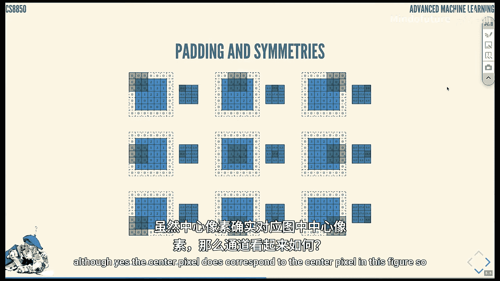

在之前的例子中，卷积核从图像左上角开始对齐。但这是唯一或最优的方式吗？并非如此。

有时我们希望输出特征图的空间尺寸与输入保持一致，或者让边缘像素也能被卷积核中心充分处理。这时就需要使用**填充**。

以下是两种常见的填充方式：

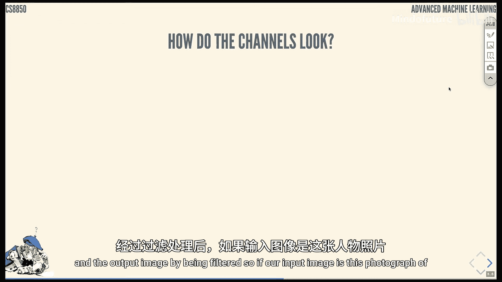

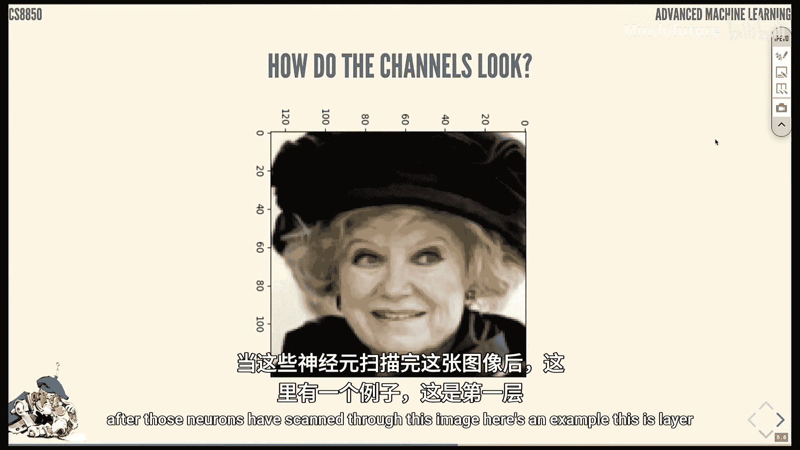

1.  **`same` 填充**：在输入周围填充零，使得卷积核中心能够对准输入图像的每一个像素（包括边缘）。这样，**输出特征图的尺寸与输入相同**。这在图像分割等需要像素级对齐的任务中非常有用。
2.  **`full` 填充**：进行更多的填充，使得卷积核每次只与输入的一个像素完全重叠，然后逐渐“进入”图像。这种填充方式使用较少。

`same` 填充的工作方式可以通过下图更直观地理解：

## 多通道卷积

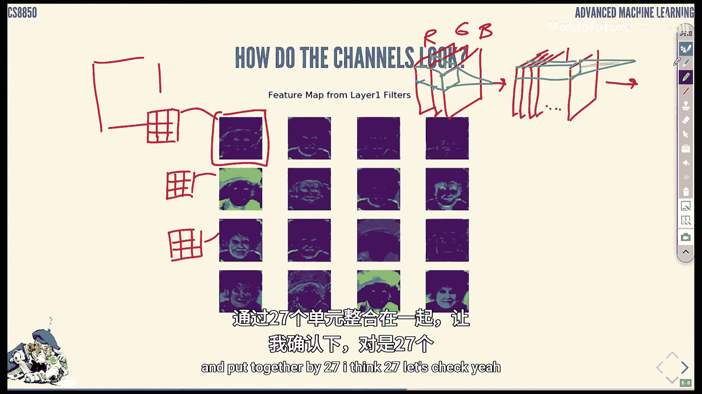

理解了单通道卷积后，我们来看更常见的情况：处理具有多个通道的输入（如RGB彩色图像）。

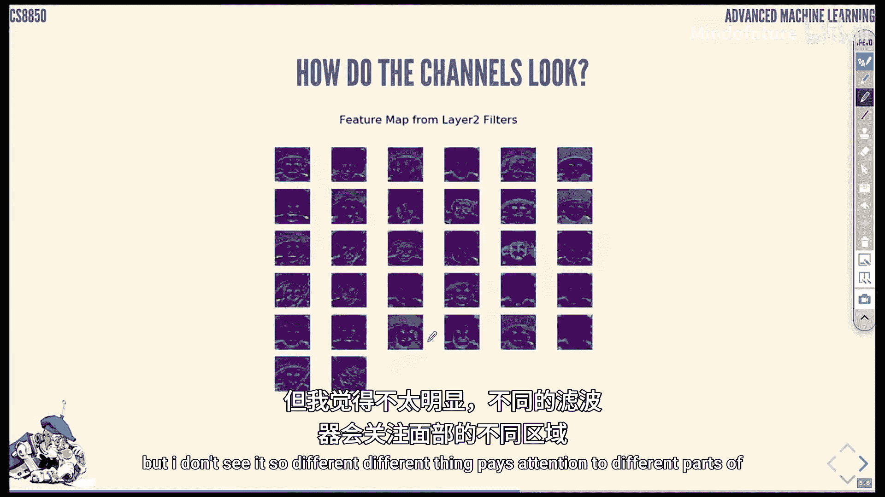

对于多通道输入（例如3个通道：红、绿、蓝），每个卷积核也必须是三维的。假设卷积核尺寸是3x3，那么对于三通道输入，卷积核的深度也是3，其参数总数为 `3 x 3 x 3 = 27`。

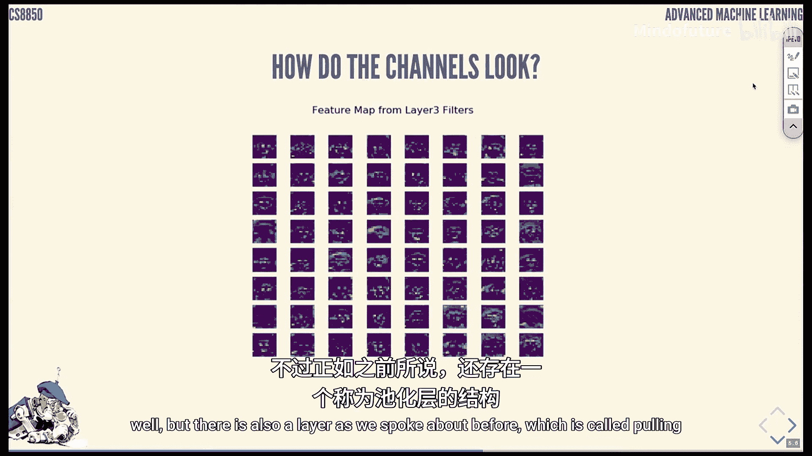

计算时，卷积核在每个通道上独立进行卷积操作，然后将**所有通道的卷积结果相加**，再加上偏置，最后通过激活函数，生成**单个输出通道**的一个像素值。

*一个RGB图像输入到CNN第一层的示例。*

第一层卷积后，我们会得到多个输出通道（特征图），每个通道由不同的卷积核生成，负责检测不同的特征（如边缘、纹理）。

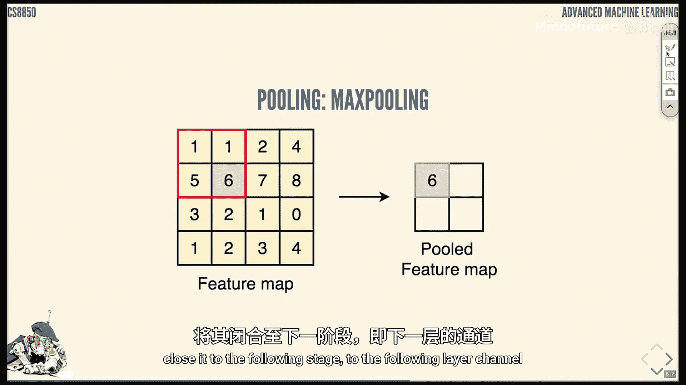

*第一层卷积后生成的16个特征图，每个对应一个不同的3x3滤波器。*

随着网络加深，更高层的卷积会以所有前一层的特征图作为输入，融合更复杂和抽象的信息。

*深层特征图关注更高级的特征（如眼睛、嘴巴等）。*

## 池化层

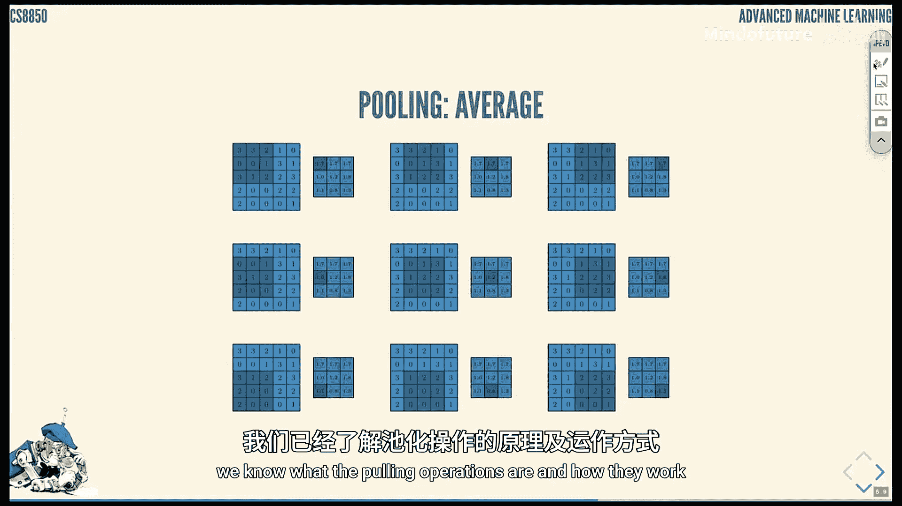

卷积层之后，特征图中相邻区域的信息通常是高度相关的。为了降低数据维度、减少计算量并增强特征的空间不变性，我们会使用**池化层**。

最常见的池化操作是**最大池化**。

最大池化在一个局部区域（如2x2窗口）内选取最大值作为输出。它没有需要学习的参数，只有窗口尺寸和步长两个超参数。

**工作原理**：
*   将特征图划分为不重叠（或重叠）的池化窗口。
*   对每个窗口，取其中所有值的**最大值**。
*   该最大值被传递到下一层。

**反向传播**：在反向传播时，梯度只传递给前向传播中被选为最大值的那个元素，其他元素的梯度为零。

另一种池化是**平均池化**，即取窗口内所有值的平均值。

平均池化是可微的线性操作，反向传播时梯度平均分配给窗口内的所有元素。

## 从卷积特征到分类预测

经过一系列卷积和池化后，我们得到了一个包含高级特征的多通道三维张量。为了进行图像分类等任务，需要将其转换为类别预测。

一种常见的方法是**展平**：

1.  **展平**：将最后一个卷积层输出的所有特征图“拉直”成一个长向量。
2.  **全连接层**：将这个向量输入到一个或多个全连接层中。
3.  **输出层**：最后通过一个输出层（如Softmax）得到最终的类别概率。

## 其他重要构建模块

除了上述基础模块，还有一些重要的变体。

**1x1 卷积**
*   **作用**：虽然核大小为1x1，看似只进行标量乘法，但它作用于所有输入通道上。
*   **用途**：
    *   **跨通道的信息整合与降维**：可以灵活地增加或减少通道数，且计算量小。
    *   在展平操作前使用，可以智能地压缩通道信息，替代简单的展平。

**转置卷积**
*   **作用**：也称为“上卷积”或“分数步长卷积”。它执行与常规卷积相反的操作，用于**上采样**，即增大特征图的空间尺寸。
*   **用途**：在图像生成、语义分割等需要从低分辨率特征恢复到高分辨率输出的任务中至关重要。

**空洞卷积**
*   **作用**：在卷积核的权重之间引入固定的间隔（空洞率）。一个3x3的核，空洞率为2，其感受野等效于一个5x5的核，但参数仍只有9个。
*   **优势**：
    *   **快速扩大感受野**：无需增加卷积层深度或核尺寸，就能让深层神经元看到更广阔的输入区域。
    *   **多尺度信息**：通过堆叠不同空洞率的卷积层，神经元可以在保持局部细节聚焦的同时，捕获更广泛的上下文信息，类似于人眼的“中心清晰，周边模糊”的感知方式。

---

**本节课总结**

本节课我们一起学习了卷积神经网络的核心构建模块。你需要熟悉并理解以下概念：

*   **卷积**：核/滤波器如何工作，如何滑动扫描输入并产生输出通道。
*   **填充**：为什么使用填充，`same` 填充和 `full` 填充的区别与用途。
*   **多通道处理**：卷积核如何处理多通道输入，以及每个输出通道的含义。
*   **池化**：最大池化和平均池化的作用，以及如何实现降维。
*   **从特征到预测**：如何将卷积层的输出通过展平和全连接层转换为最终预测。
*   **高级模块**：
    *   **1x1卷积**：用于跨通道变换和降维。
    *   **转置卷积**：用于上采样和增大分辨率。
    *   **空洞卷积**：用于高效扩大感受野和捕获多尺度上下文信息。

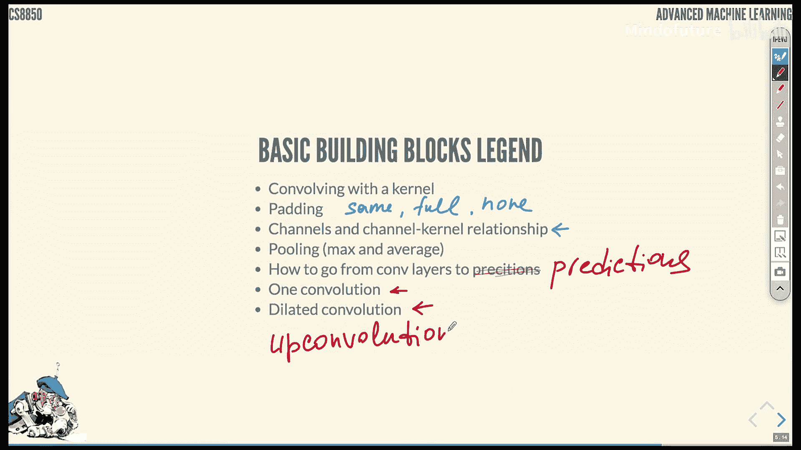

掌握这些基础模块，是理解更复杂的CNN架构（如ResNet, U-Net等）并在各种视觉任务中应用它们的关键。