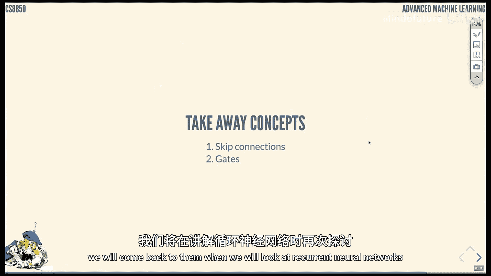

# 067：跳跃连接与残差网络 🧠

在本节课中，我们将学习深度神经网络训练中的一个关键挑战——梯度消失问题，以及如何通过“跳跃连接”这一创新技术来解决它。我们将从早期观察开始，逐步理解“高速公路网络”和“残差网络”的核心思想，并最终看到这些技术如何彻底改变了深度模型的训练方式。

## 背景：深度模型的训练困境

上一节我们介绍了反向传播算法。得益于反向模式自动微分，在前向传播之后，梯度沿着计算图中的路径反向传播。通常，图中的每条边都代表一个计算，例如一个线性变换后接一个非线性激活函数。

然而，在某些边上省略计算，仅使用恒等变换来代替，是有优势的。这个技巧虽然早已存在，但最近被重新发现，并被证明在训练非常深的模型时非常有效。

## 早期观察与“暗知识”

人们很早就推测，更深的模型应该比浅层模型更强大，但无论我们如何努力，都无法有效地训练它们。即使使用智能初始化参数的预训练方法，也只能在一定程度上有所帮助。训练深层网络的困难令人沮丧。

直到2013年，Rich Caruana观察到以下现象。他训练了一个在当时看来较深（可能3到5层）的模型，我们称之为“教师”网络。在训练完成后，他取教师网络在最终预测层（Softmax层）之前的输出层，并将其作为“学生”网络（一个浅层网络）的训练目标。学生网络的目标是，在相同的输入数据上，最小化其输出与教师网络该层输出之间的差异。

令人惊讶的是，这个学生网络的性能与当时的深层网络一样强大。Jeff Hinton（一些人称之为深度学习之父）对此提出了解释，他称之为“暗知识”。其核心观点是：网络不仅仅学会了预测输入的类别，还学会了训练数据中各类别之间的规律和关系（例如，“椅子”与“长凳”更相似，与“花”则相差甚远）。这些隐含的相似性知识被编码在了网络的中间层中。

从这个观察出发，我们评估模型的方式也发生了变化，开始关注“Top-K准确率”，即模型预测概率最高的前K个类别中是否包含正确标签。

## 高速公路网络：引入门控机制

基于Caruana的观察和Hinton的解释，Yoshua Bengio的团队利用“暗知识”来训练深层但较窄的网络，他们称之为“FitNets”。这个过程分为两步：先训练一个较宽但不特别深的“教师”网络，然后利用其输出作为目标，来训练一个更深、更窄的“学生”网络。

然而，这种两阶段的师生过程对一些人来说显得有点繁琐。

在2015年，Rupesh Kumar Srivastava、Klaus Greff和Jürgen Schmidhuber提出了一个更精巧的观察：如果我们在前馈神经网络的常规层中嵌入“传输门”和“携带门”，就能让梯度在非常深的网络中顺畅流动。

让我们看看他们是如何做到的。首先，我们重新定义一层网络。通常一层网络可以写作：
`y = σ(W * x + b)`
我们将其简写为 `y = H(x; W_H)`，其中 `H` 代表线性变换加非线性激活。

然后，我们可以为这一层添加门控机制。新的输出 `y` 计算如下：
`y = t(x) ⊙ H(x; W_H) + c(x) ⊙ x`
这里：
*   `t(x)` 是**传输门**，它是一个Sigmoid函数：`t(x) = σ(W_t * x + b_t)`。
*   `c(x)` 是**携带门**，同样是一个Sigmoid函数：`c(x) = σ(W_c * x + b_c)`。
*   `⊙` 表示逐元素相乘。

门控机制的工作原理如下：
*   传输门 `t(x)` 控制有多少经过 `H` 变换的信息能传递到下一层。当 `t(x)` 接近1时，门“打开”，变换后的信息通过；接近0时，门“关闭”，变换后的信息被阻断。
*   携带门 `c(x)` 控制有多少原始输入 `x`（未经变换）能直接“携带”到下一层。

如果所有传输门都打开（值为1），所有携带门都关闭（值为0），那么网络就退化为普通的层叠网络。如果携带门打开，原始输入 `x` 就能直接加到输出上，形成一条信息“高速公路”。

这种设计的巨大优势在于梯度传播。在反向传播时，梯度有两条路径可以回流：一条通过变换函数 `H`，另一条通过恒等连接（即 `x` 本身）。即使通过 `H` 的梯度因为层数过深而消失，通过恒等连接的梯度路径也几乎总是可用的（只要携带门没有完全关闭）。这确保了网络最深层的误差信号也能被传回最浅的层，从而更新其参数。

为了在训练初期确保梯度流动，论文建议将门的偏置初始化为较大的负值，这样Sigmoid门的初始输出接近0，携带门初始为“打开”状态，保证了梯度高速公路的畅通。

实验结果令人鼓舞。传统的“平面”网络随着深度增加（10, 20, 50, 100层），性能急剧下降。而高速公路网络虽然整体性能可能不如最浅的传统网络，但其性能随深度增加而恶化的程度要小得多。更重要的是，深度为100的高速公路网络，其性能与之前需要复杂师生训练的FitNets相当，而这里仅使用了随机初始化和门控技巧。

## 残差网络：简化的飞跃

大约在同一时期（高速公路网络论文在线半年后），微软的研究人员意识到：我们真的需要从头学习这些复杂的门吗？如果我们简单地将传输门 `t(x)` 和携带门 `c(x)` 都固定设置为1，会发生什么？

如果我们这样做，就得到了一个极其简单的结构：
`y = H(x; W_H) + x`
这个公式对应的图示如下：输入 `x` 一方面经过变换 `H`，另一方面通过一条“捷径”（跳跃连接）直接连接到输出点，与 `H(x)` 的结果相加。

这就是**残差网络**的核心单元——残差块。作者将其解释为：网络不再直接学习一个完整的映射 `H(x)`，而是学习一个“残差” `F(x) = H(x) - x`。因此，原始映射被重写为 `H(x) = F(x) + x`。他们认为，学习残差 `F(x)` 比学习完整的映射 `H(x)` 更容易。

残差网络的主要优势和卖点有两点：
1.  **保留了梯度高速公路**：和高速公路网络一样，恒等跳跃连接 (`+ x`) 为梯度回流提供了一条无阻碍的路径，有效缓解了梯度消失问题。
2.  **极其简单**：它比高速公路网络更易于理解、实现和训练，没有需要学习的额外门控参数。

一个需要注意的细节是，为了使加法 `H(x) + x` 可行，`H(x)` 的输出维度必须与 `x` 的输入维度相同。在使用跳跃连接时，我们必须确保维度匹配。

## 残差网络的威力与影响

研究人员构建了一个34层的残差网络（ResNet-34）并与相同深度的普通平面网络进行对比。结果非常明显：
*   **平面网络**：随着深度增加到34层，训练误差和测试误差都显著增大，模型难以优化。
*   **残差网络**：随着深度增加，训练误差和测试误差持续下降，性能得到提升。

残差网络不仅训练更容易，其泛化性能也更好。这背后的一个直观解释是，跳跃连接平滑了神经网络的损失曲面。在超高维的参数空间中，梯度下降像是在一个崎岖的地形上寻找最低点。跳跃连接的加入使得这个地形变得更加平滑，梯度下降的路径更加顺畅，收敛也更容易。

一旦跳跃连接被证明有效，人们开始思考：为什么只跳过一层？于是出现了更密集的连接方式，例如**DenseNet**，其中每一层的输入都来自前面所有层的输出。这种密集连接进一步平滑了优化空间，使得训练更加稳定高效。

## 总结

本节课中，我们一起学习了深度神经网络训练中的关键创新——跳跃连接。
*   我们从**梯度消失问题**和早期利用“暗知识”的师生训练法开始。
*   然后深入探讨了**高速公路网络**，它通过可学习的**传输门**和**携带门**，首次系统性地构建了梯度信息的高速公路。
*   接着，我们看到了其简化版本——**残差网络**，它通过固定的恒等跳跃连接 (`y = H(x) + x`) 实现了同样的目标，并且因其简单高效而成为里程碑式的架构。
*   最后，我们理解了跳跃连接的核心价值：**为梯度回流提供捷径，平滑损失曲面，从而使得训练极深的神经网络成为可能**。门控机制（在高速公路网络中）和维度匹配是理解与实现这些技术时需要注意的重要概念。

这些思想不仅应用于卷积神经网络（CNN），也深刻影响了如循环神经网络（RNN）等其他架构，是深度学习得以向“深度”发展的基石之一。