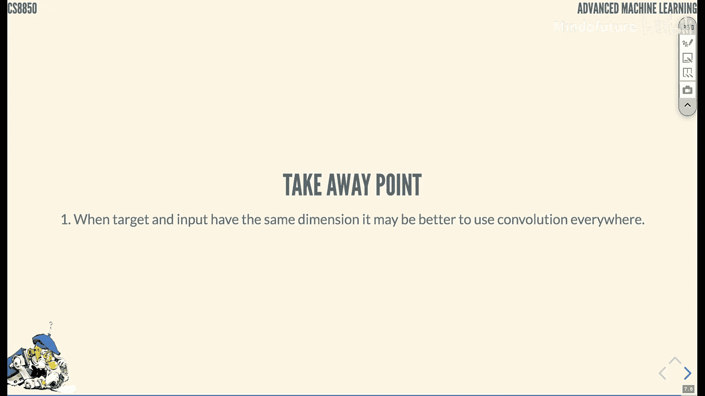

# 068：全卷积网络与语义分割 🧠

在本节课中，我们将学习卷积神经网络的一个重要变体——全卷积网络。我们将探讨其核心概念、工作原理，以及它在语义分割任务中的应用。

---

## 卷积网络的优势

卷积网络是一个富有成效的模型，带来了许多创新和成功。正如之前提到的，它们计算密集，但效率很高。这是因为它们能同时利用GPU的并行流水线。因此，卷积网络具有**高度可并行化**的特性。这使得它们的训练速度可以比循环神经网络等模型更快，遇到的瓶颈更少。

---

## 什么是全卷积网络？🤔

那么，什么是全卷积神经网络？当我们有一个CNN时，它不已经是全卷积的吗？或者它是半卷积的？当你听到“全卷积”这个术语时，到底发生了什么？通过本节简短的讨论，我希望你最终不会感到惊讶，而是能理解其本质。

---

## 语义分割任务

想象一下屏幕上的这个任务：你有一个环境或来自环境的图像/视频，图像的**每个像素都有一个标签**。例如，当一辆汽车行驶时，你的算法（神经网络、卷积神经网络）需要实时预测每个像素属于哪个物体：是树、汽车、道路、人还是自行车？这个任务被称为**语义分割**。

在下图展示的例子中：
*   左侧是**真实标签**。
*   真实标签是X（图像）和Y（标签）的组合。
*   Y是通过手动标注或其他方式获得的，为图像X上的每个像素提供一个标签。
*   我们可以看到哪些像素属于自行车、边界、骑自行车的人以及背景。
*   我们的目标是自动地从图像X构建一个如右图所示的掩码，或者能够实时分割图像。这就是语义分割任务。

---

## 为何需要全卷积网络？

以下是我们的传统模型。我们有几个卷积层（可能带有池化层，也可能没有），它们在中间步骤生成通道。卷积操作实际上发生在这些层之间。整个过程最终以一个全连接层（或称前馈神经网络）结束，该层从K个类别中做出预测。

**那么，我们能否在没有全连接层的情况下做同样的事情？答案是肯定的。**

还记得**1x1卷积**吗？使用1x1卷积（不是13x13或3x3，而是1x1），我们可以替换所有的全连接层。我们需要快速回顾一下这一点。

记住1x1卷积发生了什么。如果你有几层通道，你可以应用一个1x1卷积，它“穿透”所有层，并在下一层产生一个通道。但你不必只使用一个神经元（那会急剧减少维度）。你可以使用比前一层少的神经元，但仍然是多个1x1卷积层。然后，逐步地（不是一步到位，而是通过几个步骤），你可以创建单个输出层，并将其用于预测。

在分类任务中，输出层上的每个“像素”将对应我们想要做出的预测。

---

## 应用于语义分割

但对于语义分割任务，我们需要做什么？我们需要进行**上采样**。上采样是我们之前在某一讲中讨论过的反卷积（转置卷积）操作。

因此，我们从一个高度为H、宽度为W的图像开始，最终得到一个高度为H、宽度为W的图像。我们经过了一系列1x1卷积步骤，并在最后添加了上采样。这样，我们创建了一个相同尺寸的图像输出。这类似于分类任务，只是现在我们是在**逐个像素地进行分类**。

一个值得注意的有趣点是：对于每张图像，如果是H x W分辨率（比如800万像素），我们就有800万个标签。所以现在，与输入是一个D维特征空间、输出是单个标签不同，我们有了**多得多的标签**，并且在单个样本、单个示例中有了**多得多的梯度信号**。因此，训练可以**高效得多**。我们可能不需要数百万个示例来训练网络，这是一个显著的成就。

这就是一个**全卷积网络**。我们可以称之为“朴素”全卷积网络。

---

## 网络结构与训练

完整的网络结构如下所示。我们输入带有真实分割标签的图像，网络输出像素级的预测，误差通过反向传播回传到输入层，并执行梯度下降。

这种方法在2014年被提出。其核心要点是：

**当目标输出和输入具有相同维度时，在所有地方使用卷积可能更好。**

---

## 总结

本节课中，我们一起学习了全卷积网络。我们了解到，通过用1x1卷积替换传统的全连接层，并引入上采样操作，CNN可以转变为处理像素级预测任务（如语义分割）的全卷积网络。这种架构不仅保持了卷积的参数共享和空间层次提取优势，还因为输出与输入同尺寸而获得了更丰富的梯度信号，从而可能提高训练效率。记住其核心思想：**当输入输出尺寸相同时，全程使用卷积是更优选择。**