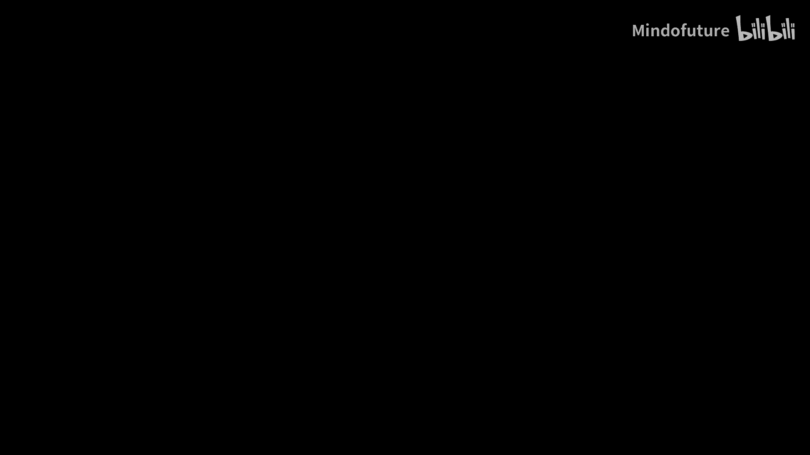
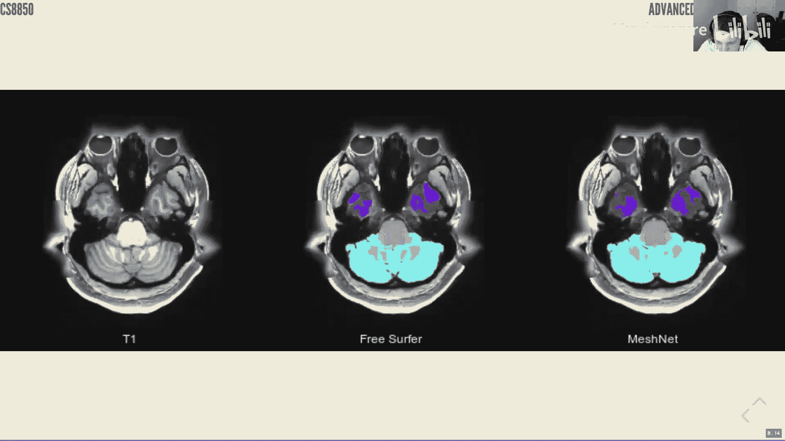

# 069：带扭曲的语义分割 🧠

在本节课中，我们将学习语义分割，特别是两种重要的网络架构：全卷积网络（FCN）和U-Net。我们将探讨它们的工作原理、优缺点，并通过一个实际的脑图像分割案例，了解如何利用这些技术构建更高效、更强大的模型。

---

## 概述

语义分割的目标是为图像中的每一个像素分配一个类别标签。上一节我们介绍了卷积神经网络的基本构建模块。本节中，我们来看看如何将这些模块组合起来，构建用于像素级预测的专用网络。

---

## 全卷积网络（FCN） 🔄

全卷积网络是解决语义分割问题的一种早期且有效的方法。它的核心思想是使用卷积层处理整个图像，并最终通过上采样操作将特征图恢复到原始输入尺寸。

其结构可以概括为：
1.  **编码部分**：一系列卷积和下采样（如最大池化）操作，逐步压缩图像尺寸，提取高级特征。
2.  **解码部分**：使用上采样操作（如转置卷积），将压缩后的特征图逐步恢复到原始输入尺寸。

最终，网络输出一张与输入图像尺寸相同的特征图，每个像素位置对应一个类别预测。训练过程是**有监督的**，使用像素级的真实标签（如分割掩码）来计算损失。

> **注意**：虽然FCN的结构（编码-解码）与自编码器相似，但它们的训练目标和用途不同。FCN用于有监督的分割任务，而自编码器通常用于无监督的特征学习或数据重建。

---

## U-Net：引入跳跃连接 🧬

U-Net是对FCN架构的重要改进，因其形状像字母“U”而得名。它在医学图像分割领域取得了巨大成功。

U-Net的核心创新在于**跳跃连接**。在编码器部分进行下采样时，U-Net会保存中间层的特征图。在解码器部分进行上采样时，它会将对应层级的编码器特征图通过跳跃连接“拼接”过来。

以下是跳跃连接的作用：
*   **融合多尺度信息**：解码器在恢复图像尺寸时，不仅依赖经过压缩的深层语义信息，还融合了来自编码器的浅层、高分辨率细节信息。
*   **改善细节恢复**：这有助于网络更精确地定位物体边界，生成更精细的分割结果。

一个典型的U-Net模型可能拥有数千万参数，模型文件很大（例如2.5GB），这在某些应用场景中是一个挑战。

---

## 案例研究：轻量级3D脑图像分割 🧩

上一节我们介绍了U-Net的强大能力，但它的参数量大。本节中我们来看看如何构建一个更轻量的分割模型，应用于3D脑图像分割任务。

我们面临两个任务：
1.  分割灰质和白质。
2.  分割105个不同功能脑区。

由于获取大量人工标注数据困难，我们采用了一种“师生学习”策略：使用一个现有的、较慢但不完美的自动分割工具（“老师”）来生成训练标签，然后训练我们自己的深度学习模型（“学生”）。

### MeshNet：使用膨胀卷积的网络

为了构建一个参数量少、效率高的模型，我们设计了MeshNet。其关键特点是广泛使用了**膨胀卷积**。

膨胀卷积，有时被称为“带孔卷积”，通过在卷积核的元素之间插入空格（膨胀率）来扩大感受野，而**不增加参数数量或进行下采样**。

在MeshNet中：
*   所有层都使用相同尺寸的`3x3x3`卷积核。
*   通过逐层增加膨胀率来扩大感受野，而不是通过池化来降低分辨率。
*   因此，所有中间特征图保持与输入图像相同的空间尺寸。

**结果对比**：
*   **参数量**：U-Net约2300万参数（~2.5GB），MeshNet仅约7.2万参数（~600KB）。
*   **性能**：MeshNet在保持甚至提升分割精度的同时，推理速度更快（从数小时缩短到不足一分钟）。
*   **权衡**：由于特征图尺寸不变，MeshNet在训练时对GPU显存的需求更高（因为要存储大量激活值）。

### 处理大图像的技巧：子块采样与集成

由于整个3D大脑图像无法一次性放入内存，我们采用以下策略：
1.  训练时，从大脑中心按高斯分布随机采样多个子图像块。
2.  预测时，同样采样多个重叠的子块，分别预测，然后对每个像素的多个预测结果进行**多数投票**，得到最终分割结果。

### 关于噪声标签的重要见解

一个有趣的发现是，我们训练的“学生”模型有时在测试数据上的表现**优于**生成训练标签的“老师”工具。

这是因为深度学习模型是统计模型。如果训练标签中的错误是**非系统性的**（即随机噪声），并且有足够的数据，模型能够学会“平均掉”这些噪声，从而学到更本质的模式。只要错误不是系统性的，带有噪声的标签仍然可以用于训练出强大的模型。

---

## 多模态输入与超人类表现 🚀

深度学习模型的一个工程优势是能轻松处理多模态输入。在我们的案例中，可以同时输入T1、T1-IR和Flair三种不同模式的脑部MRI图像，让模型自动学习融合这些信息，从而免费提升准确率。

此外，在某些任务中，模型甚至表现出**超人类**的准确率。例如，在3D图像上，人类专家需要同时审视多个二维切片并在脑中重建三维结构，容易因疲劳或视角局限而犯错。而模型可以无缝地处理整个3D体积信息，避免这类错误。

---

## 总结

本节课中我们一起学习了语义分割的核心架构。我们从**全卷积网络（FCN）** 的基础开始，了解了其编码-解码结构。接着，我们深入探讨了**U-Net**如何通过**跳跃连接**融合多尺度信息，极大地提升了分割精度，尤其是在医学图像领域。

通过脑图像分割的案例，我们看到了如何利用**膨胀卷积**构建参数高效的**MeshNet**模型，并学习了处理大尺寸图像和噪声标签的实用技巧。最后，我们认识到深度学习模型在处理**多模态数据**和实现**稳定、精细的3D分析**方面的独特优势。

掌握这些基本模块——卷积、池化、上采样、跳跃连接、膨胀卷积——你将能够根据具体任务的需求，设计并构建属于自己的高效语义分割模型。