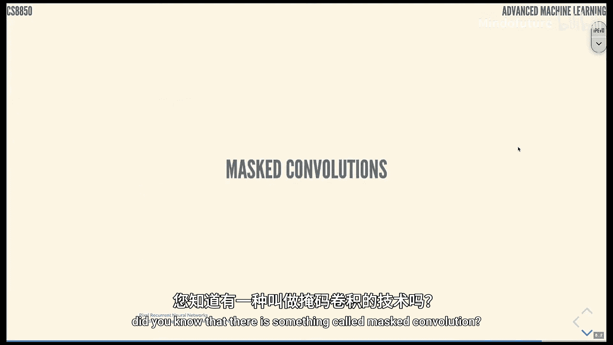
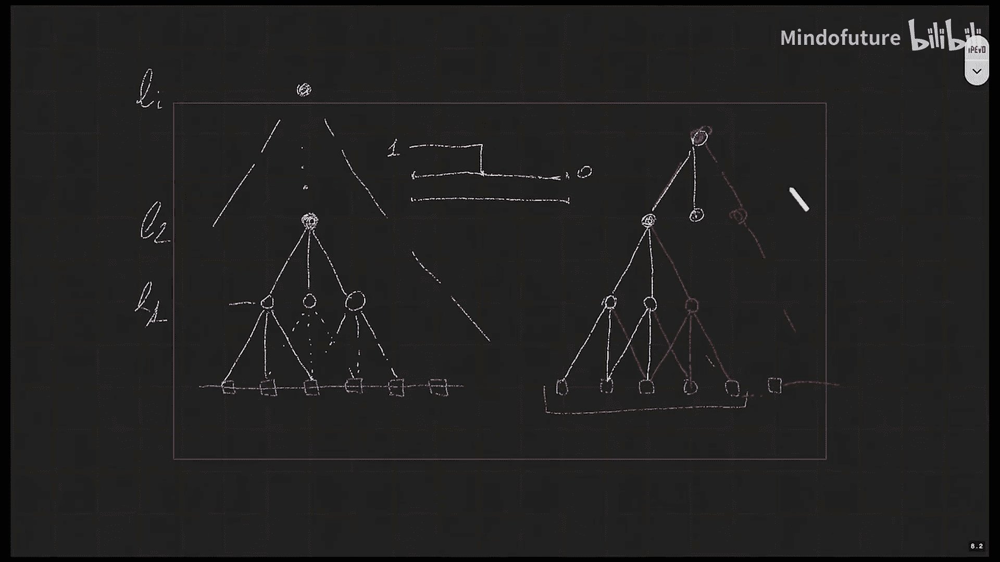
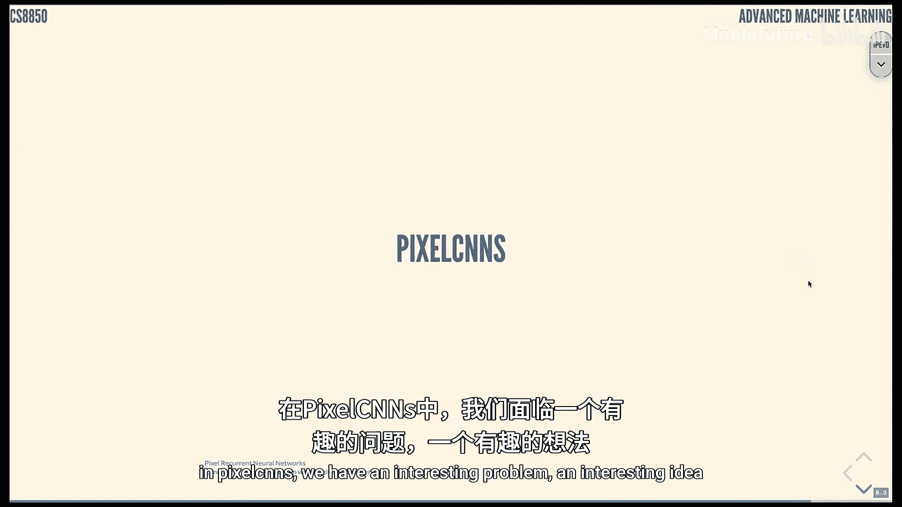
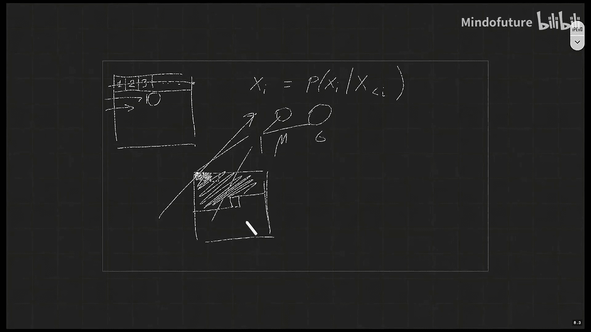
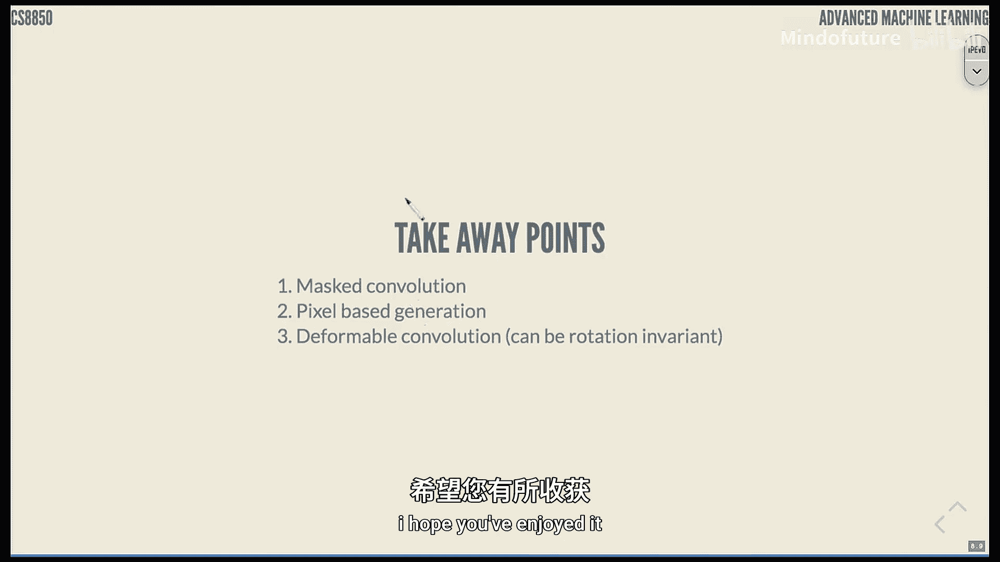

# 070：更多卷积操作 🧠

在本节课中，我们将探讨卷积神经网络中几个进阶但有趣的主题，包括掩码卷积、基于像素的生成模型以及可变形卷积。这些概念扩展了传统CNN的能力，使其能够处理更复杂的任务。

## 掩码卷积 🎭

上一节我们介绍了标准卷积操作，本节中我们来看看一种特殊的变体：掩码卷积。

掩码卷积的工作原理如下。回想一维卷积的情况，我们有一个输入图像（由像素网格表示）。第一层的神经元只能看到其感受野内的几个像素。第二层的神经元通过第一层的神经元，间接“看到”其下方更多的像素。

如果我们想屏蔽掉感受野中的某些像素呢？例如，对于第二层的某个特定神经元，我们只想让它看到一半的输入，而忽略另一半。我们可以通过应用一个掩码来实现。对于我们希望神经元“看到”的像素，掩码值为1；对于希望排除的像素，掩码值为0。

具体来说，我们为感受野内的每个输入像素应用一个掩码。假设我们想屏蔽掉某个顶层神经元感受野的三分之二。我们只需将相同的掩码应用于所有构成该顶层神经元感受野的底层神经元。这样，被屏蔽的底层神经元对顶层神经元的贡献就被消除了，从而实现了对顶层神经元感受野的精确控制。

这个过程可以自然地推广到二维情况。如果我们有一个二维的感受野，并且只希望顶层神经元看到图像的特定部分（例如左上角），我们可以将相同的二维掩码应用于所有相关的二维卷积核权重。

那么，掩码卷积有什么用呢？它在PixelCNN等模型中极其有用。

## 基于像素的生成模型 🖼️

在PixelCNN中，我们面临一个有趣的问题：如何逐个像素地生成一张图像？具体做法是，我们按从左到右、从上到下的顺序枚举所有像素。目标是自回归地生成每个像素，即根据之前所有已生成像素的条件概率分布来采样生成当前像素。

掩码卷积在这里至关重要，因为它能确保网络在预测第`i`个像素时，只能“看到”位置在`i`之前的像素，而无法看到未来的像素。这是通过应用一个特定的三角掩码来实现的，该掩码会屏蔽掉感受野中位于当前像素之后的所有像素。

以下是生成过程的核心步骤：
1.  从第一个像素（或一个起始条件）开始。
2.  网络基于当前可见的像素，输出一个概率分布（例如高斯分布，包含均值 `mu` 和方差 `sigma`）。
3.  从这个分布中采样，得到下一个像素的值。
4.  将新生成的像素加入输入，重复步骤2-3。
5.  最终，逐个像素地生成整张图像。

这种方法可以用于图像修复（恢复被遮挡的部分）或无条件图像生成。令人惊讶的是，以这种方式生成的图像可以非常逼真。

## 从图像到音频：WaveNet 🔊

基于像素生成的思想同样可以应用于音频。音频通常以每秒数千个样本（如16kHz）的波形表示。WaveNet就是一个类似PixelCNN的卷积网络，它用于逐个样本地生成音频波形。

传统的语音合成方法包括参数化模型或拼接合成。WaveNet则不同，它基于之前的音频样本，通过卷积操作预测下一个样本的概率分布，并从中采样。

其效果非常出色，生成的语音听起来非常自然，甚至能模仿出呼吸声、唇齿音等细节。更有趣的是，当WaveNet不基于任何文本条件时，它仍然能生成波形，但输出的是无意义的“胡言乱语”，这证明了模型确实在学习声音的底层结构，而不仅仅是拼接预定义的单元。

## 可变形卷积 🔄

传统卷积核在规则的网格上扫描图像，这使其擅长检测平移不变的特征。但如果特征发生了旋转、缩放或非刚性形变，固定形状的卷积核可能就无法有效识别。

可变形卷积的提出就是为了解决这个问题。其核心思想是：为什么卷积核必须固定在规则网格上？我们可以引入一个并行的子网络（控制网络），来学习每个卷积核采样点的偏移量。

具体来说：
*   对于标准卷积核中的每个采样位置，可变形卷积会为其预测一个二维的偏移量 `(Δx, Δy)`。
*   这个偏移量由控制网络根据输入特征图动态计算得出。
*   然后，卷积操作在原始位置加上预测偏移量的新位置进行采样。

这样，卷积核的形状就变得可以动态调整。例如，它可以学习拉伸以匹配一个被拉长的眼睛，或者旋转以对准一个倾斜的物体。这使得网络能够更灵活地适应几何形变，显著提升了在复杂场景下的特征提取能力。

## 总结 📝

本节课我们一起学习了卷积神经网络的三个高级主题：
1.  **掩码卷积**：通过屏蔽感受野中的部分连接，控制信息的流动，是实现自回归生成模型（如PixelCNN）的关键。
2.  **基于像素的生成**：模型能够逐个像素（或样本）地生成图像和音频，展现了深度模型强大的序列建模能力。
3.  **可变形卷积**：通过动态学习卷积核采样点的偏移，使CNN能够适应特征的几何形变，大大增强了模型的表达能力。

这些发展表明，卷积神经网络的结构仍在不断演进，通过引入更灵活的机制，它们能够解决越来越复杂和多样化的任务。