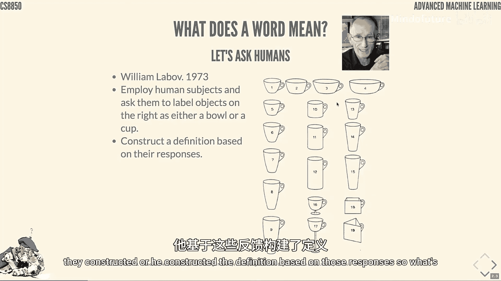
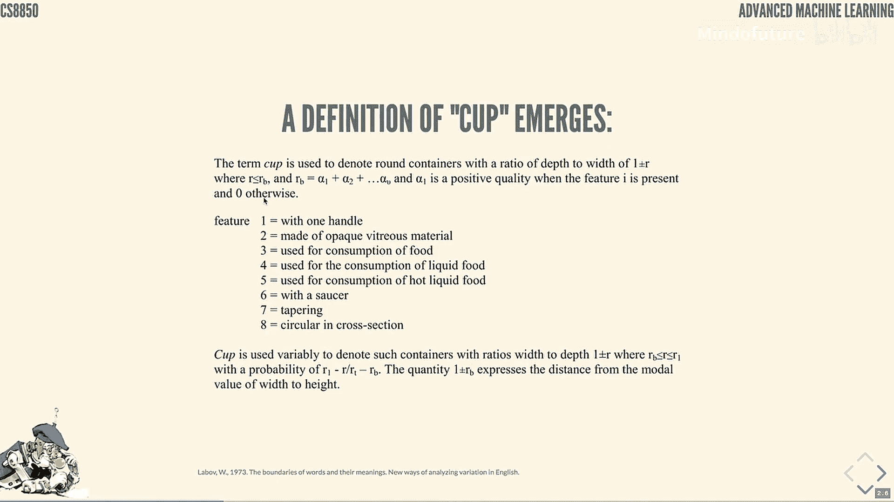
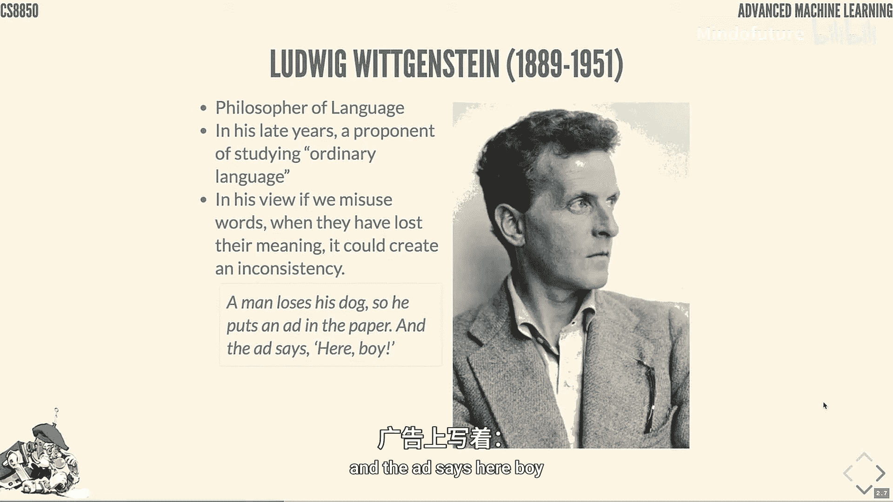
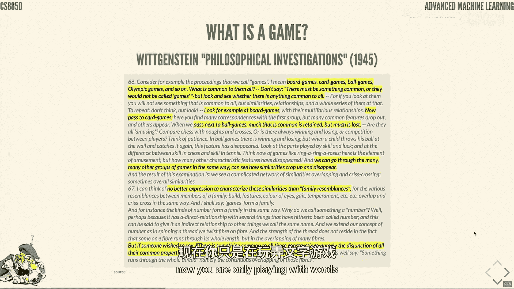
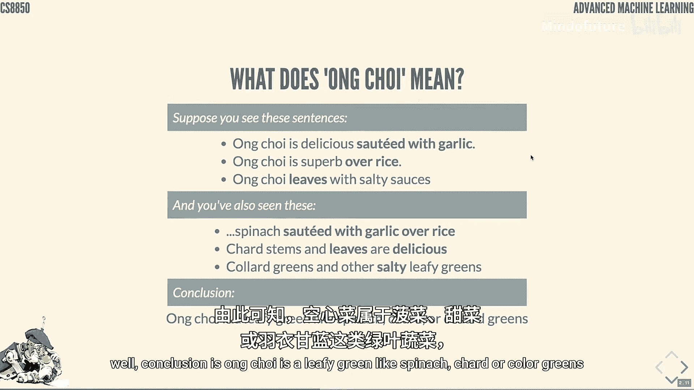
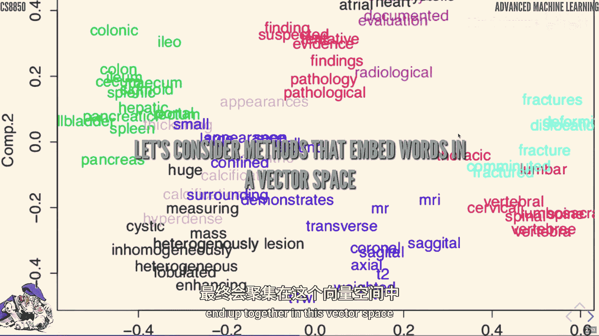

# 071：词嵌入介绍 🧠

在本节课中，我们将要学习词嵌入的基本概念。词嵌入是一种将词语表示为向量空间中的点的技术，其核心思想是：**词语的含义由其上下文决定**。我们将从如何表示数据开始，逐步探讨如何将这一思想应用于词语，并介绍构建词向量的初步方法。

## 从数据表示到词语表示

上一节我们介绍了将传感器数据表示为向量的自然方式。本节中我们来看看如何将类似的思想应用到词语上。

有时数据是从多个独立的传感器收集的。将每次测量或样本的传感器数据组合成一个数组或向量，是表示样本的自然方式。例如，身高、体重、肤色、眼睛颜色、头发颜色等许多关于人的测量值。我们将每个测量值视为一个维度，并可以在由这些测量值表示的所有人的空间中穿行。

通过独立地遍历这些维度，并从表示为向量的样本集合中，我们可以学习这些维度如何相互作用。例如，眼睛颜色和人的身高之间是否存在相关性？我们还可以应用变换，最终可能使我们能够在“人类空间”上构建预测模型，或者我们可以利用现有的强大机器学习模型。

反之亦然。如果我们有向量数据，我们可以将维度分配给卡通面孔的参数，并以一种对我们来说在语义上有意义的方式进行。切尔诺夫面孔就是一种语义化表示多元数据的方式。想象一个操作员控制核反应堆的状态，她不是观察数十个参数，而只是看一张卡通面孔。如果面孔变得不开心，她就进一步调查发生了什么。人类处理面孔大约需要100毫秒。如果能如此快速地评估一个复杂过程的状态，岂不是很棒？

但是，如果我们想根据含义将词语向量化到某种形式的语义空间中呢？

## 定义词语的含义

那么，一个词是什么意思？让我们问问人类。威廉·拉布在1973年设计了一个实验，绘制了相似但有时不同的物体图像，以尝试评估和区分“杯子”和“碗”这两个词的含义。

他们雇佣了人类受试者，要求他们将其右侧的物体标记为“碗”或“杯子”。在收集了所有回答后，他根据这些回答构建了一个定义。

有趣的问题是：杯子类别在哪里结束，碗类别从哪里开始？从图片中你可以看到，这取决于直径。直径越大，它越有可能被认为是碗。我们在这里只绘制了一个参数，但可能还有其他我们可以独立考虑的参数，或者可能存在多个参数。至少我们可以一起看三个。

如图所示，在没有其他信息、没有其他上下文的情况下，这些物体大多数被标记为杯子。但是让我们添加上下文。添加上下文，比如里面是否有食物。然后突然之间，根据上下文，这条分界线发生了戏剧性的移动。因此，对于杯子和碗，相同物体的语义含义之间的边界发生了移动，它们是上下文敏感的。

于是，威廉·拉布开始思考这个有趣的观察，并试图基于此给出杯子的定义。以下是其定义的简化表示：

**定义公式**：`cup` 用于表示深度与宽度之比为 `1 ± R` 的容器，其中 `R < R_B`，且 `R_B = Σ(α_i)`，`α_i` 在特征 `i` 存在时为正值，否则为0。

这些特征包括：有手柄、由不透明玻璃材料制成、用于消费食物、用于消费液体食物、用于消费热液体食物、带有碟子、横截面呈锥形圆形等。

杯子被可变地用于表示宽度与深度之比为 `1 ± R` 的此类容器，其中 `R_B ≤ R ≤ R_L`，其概率为 `(R_L - R) / (R_L - R_B)`。量 `1 ± R_B` 表示宽度与高度之比与模型值的距离。

杯子、碗，还有什么比这更简单的呢？我们却试图创建越来越深入细节的技术定义。现在，至少对人类来说，我们谈论的东西的含义或感觉已经丢失了，尽管我们试图精确地定义我们已经知道或对其有概念的东西。

## 维特根斯坦的语言哲学

基于类似的想法，语言哲学家路德维希·维特根斯坦在其晚年提倡研究日常语言。在他看来，如果我们误用词语，当它们失去意义时，可能会产生不一致。例如，一个人丢了他的狗，于是他在报纸上登了一则广告，广告上写着：“过来，孩子！”

维特根斯坦在他的《哲学研究》中，探讨了“游戏”这个词的定义或含义。他写道：什么是游戏？棋盘游戏、纸牌游戏、球类游戏、奥林匹克游戏等等。它们有什么共同点？不要说“一定有什么共同点，否则它们就不会被称为游戏”，而是去看一看是否所有游戏都有共同之处。例如，看看棋盘游戏，然后转到纸牌游戏，再转到球类游戏，你会发现很多共同点保留了下来，但也失去了很多。我们可以以同样的方式浏览许多其他类型的游戏，可以看到相似性如何出现和消失。没有比“家族相似性”更好的表达来描述这些相似性了。但如果有人想说所有这些构造都有某种共同点，即它们所有共同属性的析取，我会回答：现在你只是在玩弄词语。

那么，一个 radically 不同的方法如何？**一个词的含义是它在语言中的使用**。—— 路德维希·维特根斯坦。这就是他提出的建议：与其客观地试图定义一个词，不如看看它是如何被使用的。这同样是客观的，但它更像是观察性的而非规范性的。只需观察词语是如何使用的，这就定义了词语的含义，而不是某种关于它应该如何的外部规范性定义。

观察到一个有趣的语言学现象：大多数词典是规范性的，它们规定语言的使用方式。但也有更偏向经验观察的词典，它们不规定词语应该如何被使用，而只是观察词语是如何被使用的并报告出来。

因此，根据这种方法，词语是由它们的环境、由它们周围的词语来定义的。

## 分布假说与词语含义

泽利格·哈里斯在1954年说过：如果A和B有几乎相同的环境，我们说它们是同义词。以下是一个例子：“空心菜”是什么意思？

假设你看到这些句子：“用大蒜炒的空心菜很美味。”“加冰的空心菜很棒。”“空心菜叶配咸酱。”然后，在此之前你见过：“用大蒜炒的菠菜。”“加冰的瑞士甜菜叶很美味。”“羽衣甘蓝和其他咸味绿叶蔬菜。”那么，结论是：空心菜是一种像菠菜、瑞士甜菜或羽衣甘蓝一样的绿叶蔬菜。

（注：空心菜，即 water spinach，通菜/蕹菜）

## 词嵌入的目标

我在本讲座中的目标是向你们展示，将词语嵌入向量空间的各种方法，使得**在语言使用或含义上相似的词语**（我们或维特根斯坦这样定义它）在这个向量空间中靠在一起。

## 总结

本节课中我们一起学习了词嵌入的核心理念。我们从数据的向量表示出发，探讨了精确定义词语含义的困难，并引出了维特根斯坦“含义即使用”的哲学观点。这直接导向了自然语言处理中的**分布假说**：词语的含义由其上下文决定。基于此，我们可以通过分析词语在大量文本中的共现模式，将其表示为高维空间中的向量（即词向量），使得语义相似的词语在向量空间中的位置也相近。这就是词嵌入技术的起点。