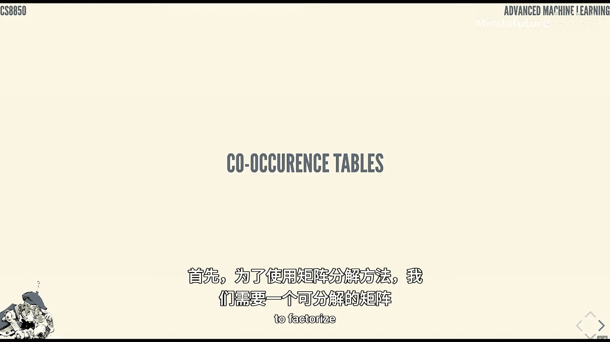
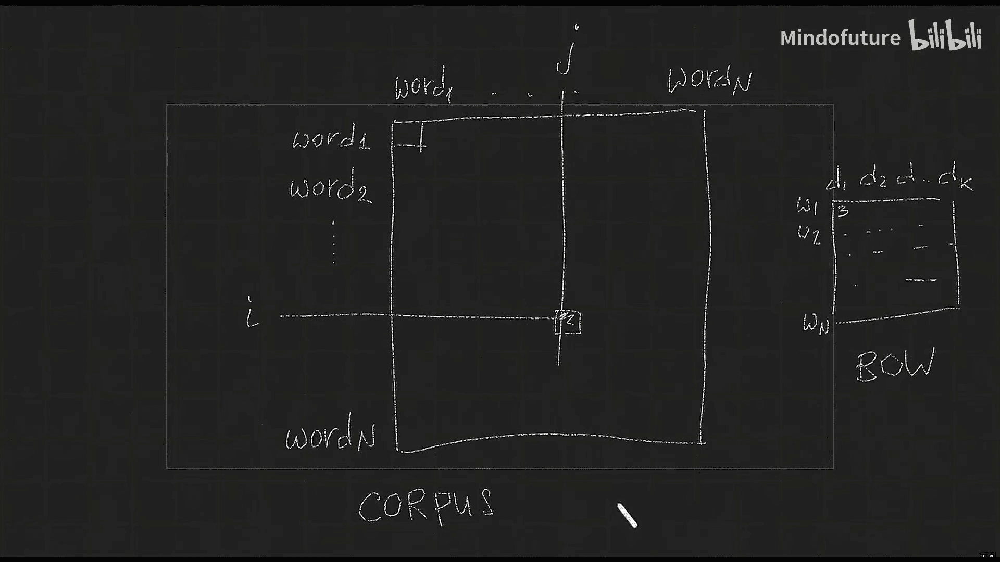
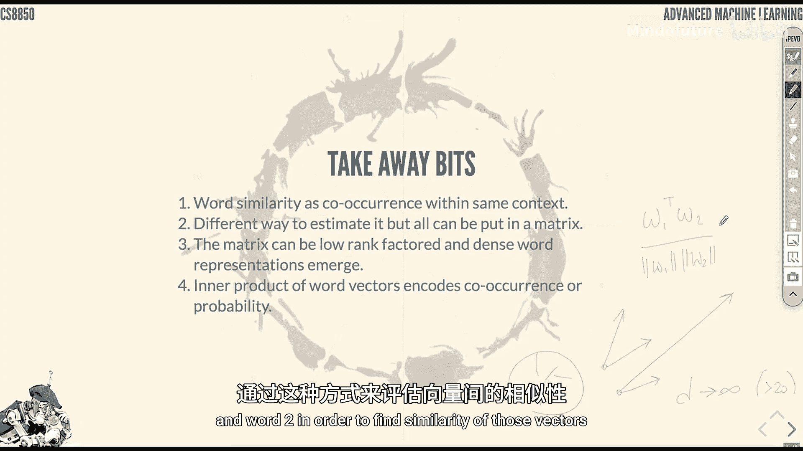

# 072：P72 词嵌入与语义矩阵

在本节课中，我们将学习一种用于生成密集词向量表示的矩阵分解方法。我们将探讨如何构建一个语义矩阵，并通过矩阵分解技术从中提取出有意义的词向量。

## 概述

词嵌入的目标是将词汇表中的每个单词映射到一个低维、密集的向量空间中，使得语义相似的单词在向量空间中也彼此接近。本节课程将介绍一种基于矩阵分解的方法来实现这一目标。我们将从构建一个单词共现矩阵开始，然后探讨如何通过分解这个矩阵来获得词向量。

## 构建共现矩阵

为了使用矩阵分解方法，我们首先需要一个可以分解的矩阵。

假设我们有一个词汇表，包含从单词1到单词n的所有单词。词汇表的大小为V。

我们可以构建一个对称矩阵，其维度为V x V。这个矩阵中的每个单元格(i, j)记录了单词i和单词j在相同上下文中出现的次数。

这里的关键在于“上下文”的定义。如果我们进行文档分析，上下文可以是整个文档。那么我们就可以构建一个“单词-文档”矩阵，其中记录了每个单词在每个文档中出现的次数。这与我们之前学过的词袋模型表示法非常相似。

然而，我们也可以构建一个“单词-单词”矩阵。在一个文本语料库中，我们可以定义上下文为一个固定大小的滑动窗口（例如，窗口大小w=5）。然后，我们统计词汇表中每对单词在这个滑动窗口内共同出现的次数，并将这个计数填入矩阵的相应位置。

## 处理高频词与标准化

这种方法的一个问题是，像“the”、“and”这样的停用词会主导整个矩阵，因为它们在几乎所有上下文中都频繁出现，而这种共现并不具有语义意义。

一种解决方案是预先移除停用词。但有时我们无法预知哪些词是“无意义”的高频词。因此，更通用的方法是使用TF-IDF值来填充矩阵，或者使用点互信息。

点互信息用于衡量两个事件（在这里是单词）共同出现的概率是否高于它们独立出现的概率。其公式如下：

**PMI(w, c) = log( P(w, c) / (P(w) * P(c)) )**

其中，P(w, c)是单词w和上下文c共同出现的概率，P(w)和P(c)分别是它们各自出现的概率。

我们可以通过最大似然估计来计算这些概率：
*   P(w) = 单词w在语料库中出现的次数 / 语料库总词数
*   P(c) = 上下文c在语料库中出现的次数 / 语料库总词数
*   P(w, c) = 单词w和上下文c共同出现的次数 / 语料库总词数

将这些代入PMI公式，我们得到：

**PMI(w, c) = log( (count(w, c) * N) / (count(w) * count(c)) )**

这里N是语料库的总词数。

PMI的值域是从负无穷到正无穷。当两个单词独立时，PMI为0。负值表示它们共同出现的次数比随机预期要少，但这些负值估计通常不可靠。一个常见的技巧是将负的PMI值置零，从而得到正点互信息：

**PPMI(w, c) = max(PMI(w, c), 0)**

PPMI有效地归一化了高频词的影响，但也可能偏向于罕见事件。为了解决这个问题，可以使用加一平滑等技术。

## 矩阵分解与词向量

通过上述方法，我们得到了一个（经过PPMI或TF-IDF加权的）单词共现矩阵M。这个矩阵的维度是V x V，可能非常庞大且稀疏。

我们假设词语的语义存在于一个更低维的潜在空间中。也就是说，矩阵M具有低秩结构。因此，我们可以通过矩阵分解来近似这个矩阵：

**M ≈ W * C^T**

其中，W是一个V x K的矩阵，C是另一个V x K的矩阵，K是远小于V的维度（例如100）。这样，矩阵W中的每一行（一个K维向量）就成为了对应单词的密集向量表示。

在这种表示下，两个单词向量w_i和w_j的内积（w_i · w_j）近似于它们在原始矩阵M中的共现强度（例如PPMI值）。因此，向量之间的内积（或更常用的余弦相似度）编码了单词的语义相似性：语义越相似的单词，其向量夹角越小，内积越大。

## 奇异值分解方法

实现这种分解的一种具体方法是奇异值分解。SVD将矩阵M分解为三个矩阵的乘积：

**M = U Σ V^T**

其中U和V是正交矩阵，Σ是对角矩阵，其对角线上的元素是奇异值。

我们可以将词向量矩阵定义为U Σ（或取其前K个主要成分）。这样，每个单词同样被表示为一个K维的密集向量，并且向量空间的结构反映了单词之间的语义关系。

## 总结

本节课我们一起学习了基于矩阵分解的词嵌入方法。我们首先介绍了如何构建单词共现矩阵，并使用PPMI等技术对其进行标准化以更好地捕捉语义。接着，我们探讨了如何通过假设该矩阵具有低秩结构，并对其进行分解（如SVD），来得到每个单词的密集向量表示。最终，这些向量的内积或余弦相似度能够有效地编码单词之间的语义相似性。这种方法为将离散符号（单词）映射到连续向量空间提供了坚实的数学基础。