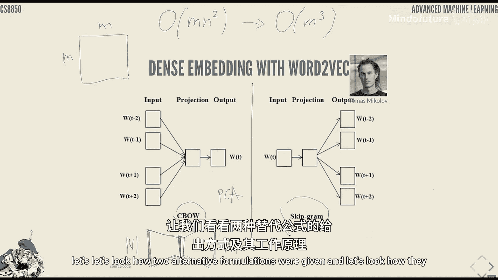
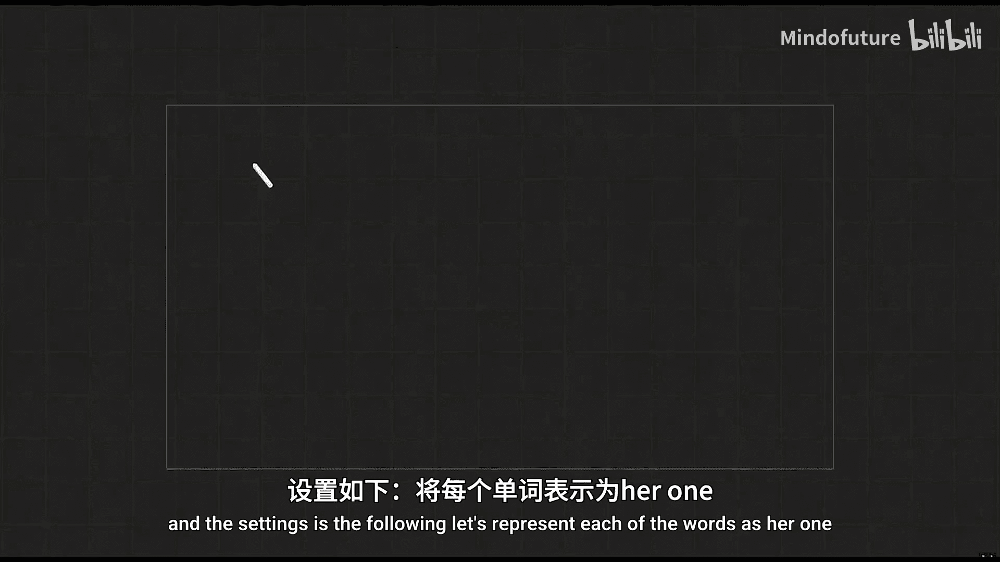
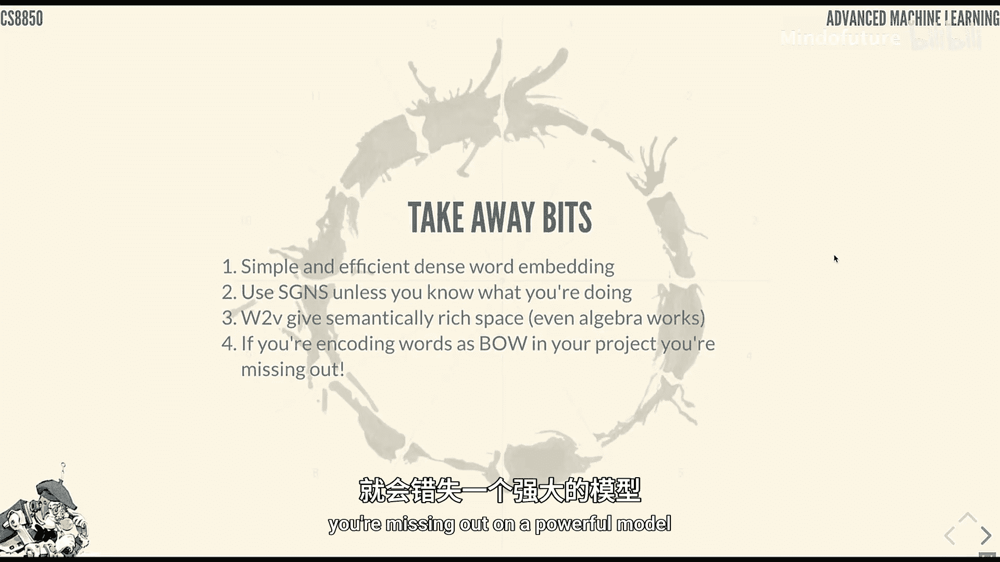

# 073：词嵌入与Word2Vec 🧠

在本节课中，我们将学习词嵌入的核心概念，特别是Word2Vec模型。我们将探讨如何将单词表示为密集向量，以及如何通过上下文共现信息来捕捉单词的语义。课程将涵盖两种主要的Word2Vec架构：连续词袋模型和跳字模型，并重点介绍用于高效训练的负采样技术。

---

## 概述：从语义到向量

上一节我们介绍了语义相似度的向量化表示。我们看到，遵循路德维希·维特根斯坦对词义的定义——即“意义即使用”，词嵌入可以通过单词在相同上下文中的共现来精确地表示有用信息。

这些嵌入向量可以是短向量，更重要的是，它们可以是**密集向量**。因为对于深度学习模型（以及其他机器学习模型），输入需要是密集的。神经网络中的矩阵乘法运算在处理密集输入时效果更好。

为了应对表示问题，并尝试用密集向量表示单词，出现了一种称为**Word2Vec**的方法，由Tomas Mikolov及其同事提出。

理论上，我们可以通过对单词-上下文相似度矩阵进行奇异值分解来获得词向量。但奇异值分解的复杂度在实践中是立方级的。对于一个非对称的M x N矩阵，截断的SVD复杂度是O(M * N^2)量级。当M和N相等（即使用单词本身作为上下文）时，复杂度就是O(M^3)。

那么，Tomas Mikolov及其同事提出了什么呢？让我们来看一个你可能熟悉（或不熟悉）的设置。

---

## 模型设置：从稀疏到密集的表示

我们首先设定模型的基本框架。我们将每个单词表示为一个**独热编码向量**。

设词汇表大小为 `V`。每个单词 `w_i` 被表示为一个 `V` 维向量，其中除了在第 `i` 个位置为1外，其余位置均为0。这将是我们的输入。

我们有一个嵌入矩阵 `W_E`，其维度为 `V x D`，其中 `D` 是我们选择的嵌入空间的维度。当我们用独热编码向量 `w_i` 乘以这个矩阵的转置时，我们实际上只是选取了 `W_E` 矩阵中对应于单词 `w_i` 的那一行，从而得到一个 `D` 维的密集向量 `φ_i`。

这个过程就像一个**线性自编码器**。我们从一个稀疏的高维空间（词汇表大小）投影到一个低维的密集空间（`D` 维），然后再尝试通过另一个矩阵 `W_D`（解码器）投影回原始空间。这类似于我们在主成分分析中见过的线性自编码器。

---

## 连续词袋模型

现在，让我们看看第一种替代方案是如何工作的。首先介绍连续词袋模型。

连续词袋模型的做法很简单。它观察一个目标单词周围的上下文窗口（例如，窗口大小为5）。模型的任务是：给定上下文中的其他单词（例如，目标单词前后的各两个单词），来预测中间的目标单词。

以下是其工作原理的步骤：

1.  **输入表示**：将上下文窗口中的每个单词转换为独热编码向量。
2.  **获取嵌入**：将这些独热向量乘以嵌入矩阵 `W_E`。由于独热向量只有一个1，这等价于取出 `W_E` 中对应行的向量。
3.  **组合上下文**：CBOW模型不是单独处理每个上下文单词，而是将它们的嵌入向量**求和**（或平均），形成一个单一的 `D` 维上下文向量。
4.  **预测目标**：将这个组合后的上下文向量乘以解码器矩阵 `W_D`（维度为 `D x V`），得到一个 `V` 维的分数向量。
5.  **应用Softmax**：对这个分数向量应用Softmax函数，将其转换为一个概率分布，表示词汇表中每个单词是目标单词的概率。
6.  **计算损失**：我们希望目标单词（真实的那个）的概率最大。因此，我们使用**交叉熵损失**来比较预测的概率分布和真实的独热编码目标向量。

用公式表示，对于目标单词 `w_t` 和上下文单词集合 `C`：
*   上下文向量： `c = sum_{w in C}(W_E^T * w)`
*   原始分数： `z = W_D^T * c`
*   预测概率： `y_hat = softmax(z)`
*   损失： `L = -log(y_hat[t])`，其中 `t` 是目标单词的索引。

CBOW模型在概念上清晰，可以通过梯度下降进行训练。然而，它存在一个主要的计算瓶颈：每次前向传播都需要计算一个涉及整个词汇表（`V` 可能达到百万级）的Softmax，这非常耗时。

训练完成后，我们需要的词嵌入就是编码器矩阵 `W_E` 的**行向量**。每一行对应词汇表中的一个单词的 `D` 维密集表示。

---

## 跳字模型

上一节我们介绍了从上下文预测目标的CBOW模型。本节中我们来看看另一种思路：跳字模型。

跳字模型的做法与CBOW相反。它**给定一个中心目标单词，试图预测其周围上下文窗口中的单词**。

以下是其工作原理：

1.  **输入表示**：将目标单词 `w_t` 表示为独热编码向量。
2.  **获取目标嵌入**：将 `w_t` 乘以嵌入矩阵 `W_E`，得到目标单词的 `D` 维嵌入向量 `v_t`。
3.  **预测每个上下文单词**：对于上下文窗口中的每一个单词 `w_c`，我们将 `v_t` 乘以解码器矩阵 `W_D`，得到一个 `V` 维分数向量。
4.  **应用Softmax**：对每个分数向量应用Softmax，得到预测该上下文单词的概率分布。
5.  **计算损失**：模型试图最大化所有上下文单词的预测概率。因此，损失是**所有上下文单词的交叉熵损失之和**。

用公式表示，对于目标单词 `w_t` 和每个上下文单词 `w_c`：
*   目标嵌入： `v_t = W_E^T * w_t`
*   对于每个 `w_c` 的原始分数： `z_c = W_D^T * v_t`
*   预测概率： `y_hat_c = softmax(z_c)`
*   总损失： `L = -sum_{c in C} log(y_hat_c[c])`

跳字模型在实践中通常比CBOW表现更好。然而，它同样面临计算Softmax时词汇表过大的问题，导致前向和反向传播的计算成本高昂。

---

## 负采样：高效的训练技巧

正如我们所见，跳字模型的计算复杂度对于大型词汇表来说难以处理。幸运的是，Mikolov等人提出了一种简化的训练方法，称为**负采样**。

负采样是一种简化版的噪声对比估计。其核心思想是：我们不需要计算整个词汇表的Softmax来学习好的嵌入。相反，我们将问题转化为一系列**二分类问题**。

对于每个（目标单词，上下文单词）的正样本对，我们同时采样 `K` 个**负样本**（即随机从词汇表中选取，通常按其频率加权，且不与目标单词共现的单词）。然后，我们训练模型来区分正样本对和负样本对。

具体操作如下：

1.  对于正样本（目标 `w_t`, 上下文 `w_c`），我们希望模型输出高概率（接近1）。
2.  对于每个负样本（目标 `w_t`, 负样本 `w_n`），我们希望模型输出低概率（接近0）。

我们使用**逻辑函数**（Sigmoid）将两个单词嵌入的内积转换为一个概率：
`P(+ | w_t, w_c) = σ(v_t · u_c) = 1 / (1 + exp(-v_t · u_c))`
其中 `v_t` 是目标单词的嵌入（来自 `W_E`），`u_c` 是上下文单词的嵌入（来自 `W_D`，注意这里 `W_D` 的每一列可以看作上下文单词的嵌入）。

模型的优化目标是最大化正样本的对数概率，同时最小化负样本的对数概率。损失函数如下：
`L = -log σ(v_t · u_c) - sum_{i=1}^{K} log σ(-v_t · u_{n_i})`

这个损失函数的关键优势在于：
*   每次梯度更新只涉及 `K+1` 个单词（1个正样本，K个负样本），而不是整个词汇表 `V`。
*   我们只更新与这些样本相关的嵌入向量（`W_E` 和 `W_D` 中的特定行/列）。
*   这本质上是一种**度量学习**：拉近共现单词的嵌入，推开不共现单词的嵌入。

这种学习方式被称为**自监督学习**，因为我们没有使用人工标注的标签，而是利用文本数据本身的结构（单词共现模式）来构造监督信号。

跳字模型配合负采样非常高效，并且有多个实现（如原始Word2Vec C代码、Gensim、SpaCy等）。训练完成后，我们通常使用编码器矩阵 `W_E` 的行作为最终的词向量。

---

## 词向量的应用与特性

在获得了词向量之后，我们可以用它们做什么呢？答案是非常多。

有趣的是，词向量空间展现出丰富的代数结构和语义关系：

*   **类比推理**：我们可以进行向量运算。例如， `vec(“king”) - vec(“man”) + vec(“woman”)` 的结果向量在空间中最接近 `vec(“queen”)`。同样， `vec(“Paris”) - vec(“France”) + vec(“Italy”)` 最接近 `vec(“Rome”)`。
*   **语义方向**：像 `man -> woman`， `uncle -> aunt`， `king -> queen` 这样的向量差（关系）在空间中大致指向同一个方向，代表了“性别”这一语义概念。
*   **语法规律**：比较级和最高级（如 `slow, slower, slowest` 或 `strong, stronger, strongest`）的向量也呈现出规律的模式。

这些特性都仅仅从单词的上下文共现信息中学习而来，印证了维特根斯坦的观点：语言的意义蕴含在其使用之中。

我们甚至可以利用词向量研究语言随时间的演变。例如，通过分析不同年代书籍中的词向量，可以追踪像“gay”、“broadcast”、“awful”等词语义的变迁。

---

## 总结与要点

本节课中，我们一起学习了词嵌入和Word2Vec模型的核心内容。

我们了解到：
1.  Word2Vec提供了一种简单高效的**密集词向量**表示方法。
2.  主要架构包括**连续词袋模型**和**跳字模型**，后者通常表现更佳。
3.  **负采样**技术通过将问题转化为二分类，极大地提高了跳字模型的训练效率，是实际应用中的首选。
4.  学习到的词向量空间具有丰富的**语义和语法结构**，支持向量运算和类比推理。
5.  这种从无标签文本中自行构造监督信号的学习方式属于**自监督学习**。

**关键要点**：如果你在项目中仍在使用词袋模型表示文本，你将错过词向量所蕴含的强大语义信息。使用预训练的词向量可以为你的模型（如情感分析、文本分类）提供一个高信息量的起点，让模型无需从零开始学习这些语言结构。