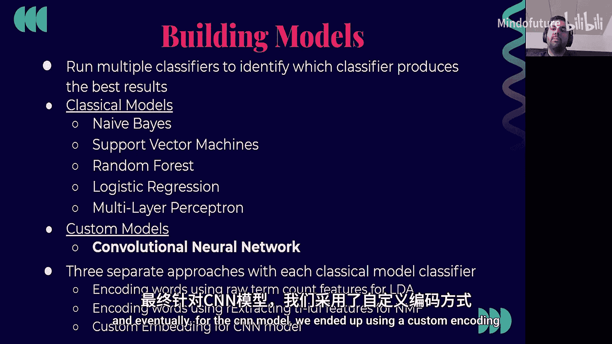
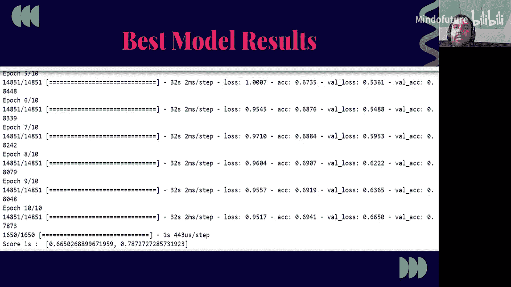

# 076：P76 新闻黑手党最终项目演示 🎯

## 概述
在本节课中，我们将学习一个关于奇切瓦语新闻文章多标签分类的机器学习项目。该项目由“新闻黑手党”小组完成，旨在探索针对资源匮乏语言（如非洲的奇切瓦语）的文本分类技术。我们将从项目介绍开始，逐步深入到数据处理、模型构建、结果分析，并最终得出结论。

---

## 引言

我们的项目主题是马拉维新闻分类。这是一个针对奇切瓦语新闻文章的多标签分类任务。奇切瓦语属于班图语系，在非洲南部、东南部和东部广泛使用，是马拉维和赞比亚的官方语言。

我们的目标是预测来自马拉维新闻出版物的、用奇切瓦语撰写的文章主题。

### 项目动机
处理奇切瓦语这类资源匮乏的语言存在许多挑战。我们希望通过此项目，改进针对该语言的文本分类算法，从而为市场、文化和政治研究等领域开辟新的研究方向。

### 项目假设
在开始之前，我们为项目设定了几个基本假设：
1.  所有文章中的文本均使用奇切瓦语撰写。
2.  所有文章的主题都属于我们数据集中列出的类别，不存在其他主题。
3.  所有类别（主题）是互斥的，即每篇文章只能属于一个主题。

---

## 数据探索、预处理与模型

上一节我们介绍了项目的背景和目标，本节中我们来看看具体使用的数据、预处理步骤以及尝试的模型。

### 数据概览
我们使用的数据来自一个马拉维新闻出版物。数据集被分为训练集和测试集。
*   **训练集**：包含 41,436 篇新闻文章。每篇文章有ID、文本和对应的标签。整个数据集涵盖 20 个不同的类别（如政治、体育、娱乐等），并包含 551,137 个独特的奇切瓦语单词。
*   **测试集**：包含 6,621 篇文章，格式与训练集类似，但不包含标签列。

以下是数据集的示例：
| 文章ID | 文章内容 |
| :--- | :--- |
| ... | （包含约15-16个句子的奇切瓦语文本）... |

### 数据预处理
预处理的目的是将文本转化为更易于分析和预测的形式。我们进行了以下操作：
1.  **文本处理**：将所有字母转换为小写，并删除标点符号。
2.  **数据重排**：对文章句子和对应的标签进行随机重排，这有助于后续的随机批次训练。
3.  **标签编码**：使用了两种编码技术将类别标签转换为模型可读的格式：
    *   **标签编码 (Label Encoding)**
    *   **独热编码 (One-Hot Encoding)**

### 模型构建
我们尝试了多种模型，并从失败的尝试中吸取经验，最终确定了一个表现最佳的模型。

以下是我们在项目中尝试的主要模型类型：
*   **经典机器学习模型**：朴素贝叶斯、支持向量机、随机森林、逻辑回归、多层感知机。
*   **最终模型**：一个自定义的卷积神经网络，它取得了最好的结果。

在文本编码方面，我们也尝试了不同技术：
*   **词频统计**
*   **线性判别分析**
*   **TF-IDF**
*   **自定义词嵌入**（用于最终的CNN模型）

---

## 模型分析与结果

在尝试了多种模型后，本节我们将详细分析它们的结果，并了解为何卷积神经网络脱颖而出。

### 基于TF-IDF的经典分类器
TF-IDF用于评估单词对于整篇文章的重要性。使用此方法时，模型的平均准确率并不理想。

以下是基于TF-IDF的不同分类器的表现总结：
*   **平均准确率**：35.06%
*   **最佳模型**：逻辑回归分类器，准确率为 37.4%

由于准确率较低，我们需要寻找更好的方法。

### 基于LDA的经典分类器
线性判别分析是一种降维技术，能在保留数据关键信息的同时减少特征数量。此方法的表现优于TF-IDF。

以下是基于LDA的不同分类器的表现总结：
*   **平均准确率**：49.5%
*   **最佳模型**：多层感知机分类器，准确率达到 58.6%

### 卷积神经网络模型
我们自定义的卷积神经网络模型取得了最佳结果。该模型包含约20万个可训练参数，并使用了十折交叉验证和自定义词嵌入。

模型结构包含以下关键层：
*   `Embedding`：词嵌入层
*   `Dropout`：随机失活层，用于防止过拟合
*   `Conv1D`：一维卷积层
*   `MaxPooling1D`：最大池化层
*   `Dense`：全连接层
*   `Activation`：激活函数层（如ReLU, Softmax）

**一个重要的发现是**：最初在没有使用交叉验证时，模型在测试集上的准确率仅为20.4%。但在引入**十折交叉验证**后，准确率显著提升至 **78.2%**，远高于其他所有模型。

---

## 结论与未来展望

本节课我们一起学习了如何为奇切瓦语新闻构建分类模型。现在，我们来总结项目的成果并探讨未来的改进方向。

### 项目总结
我们成功构建了一个能够较为准确预测奇切瓦语文章主题的模型。在对比了TF-IDF、LDA等多种方法后，**自定义的卷积神经网络模型结合十折交叉验证**取得了最佳效果（78.2%的准确率）。

这个项目凸显了处理资源匮乏语言时的特殊挑战，例如无法直接使用针对英语等语言的常用预处理技术（如停用词过滤、词形还原等）。

### 未来工作
基于本次项目的经验，未来可以在以下几个方向进行探索：
1.  **开发更深的模型**：尝试使用残差网络等更先进的架构。
2.  **识别停用词**：为奇切瓦语乃至其他非洲语言构建停用词表，这将极大提升模型性能。
3.  **使用更多评估指标**：除了准确率和F1分数，引入其他评估指标来更全面地衡量模型性能。

### 项目资源
项目的代码、看板和工作报告均可在GitHub仓库中找到。团队目前正在对代码进行最后调整，以提交至Kaggle竞赛。

---
**感谢阅读！** 希望本教程能帮助你理解针对特定语言的文本分类项目的完整流程。