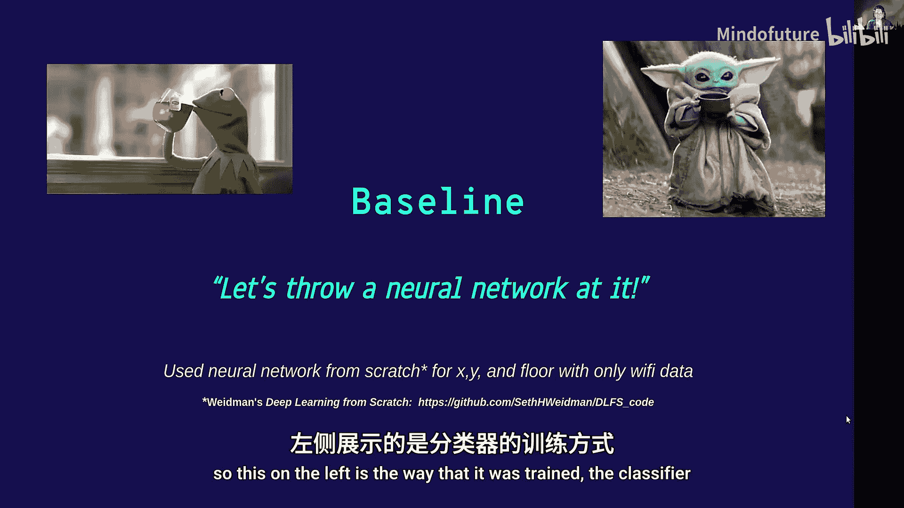
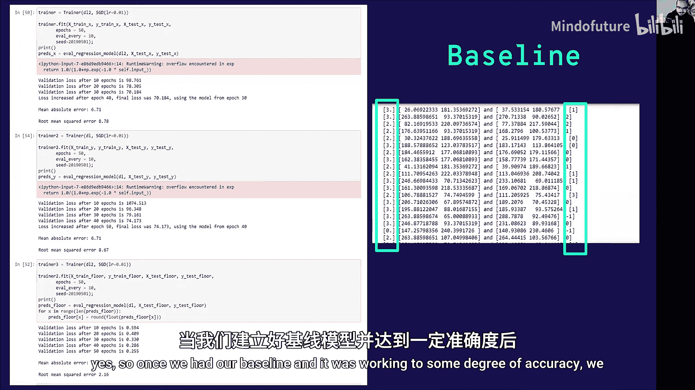
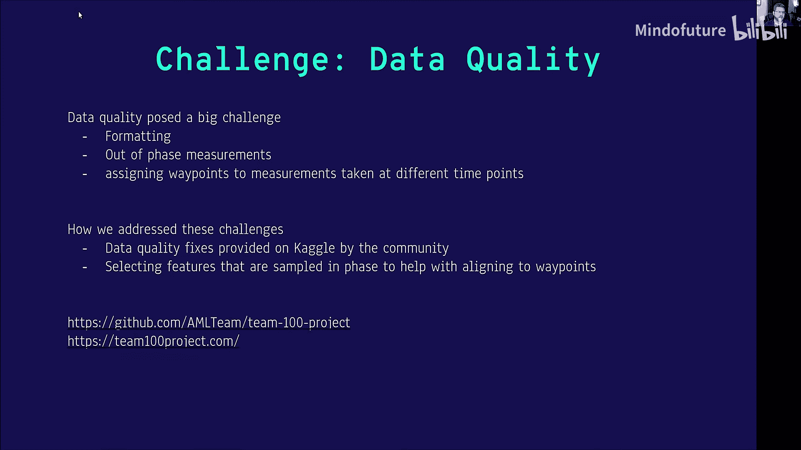
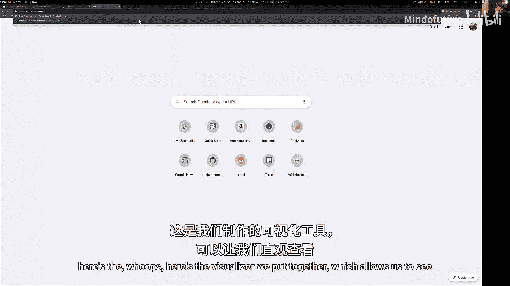
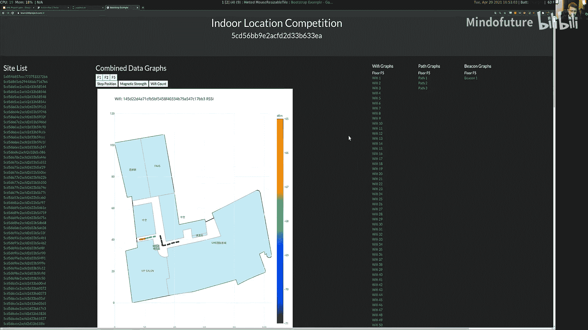
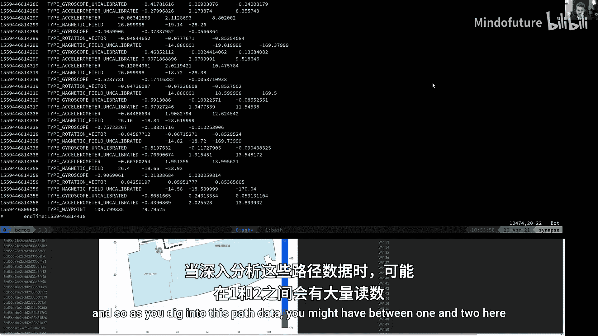
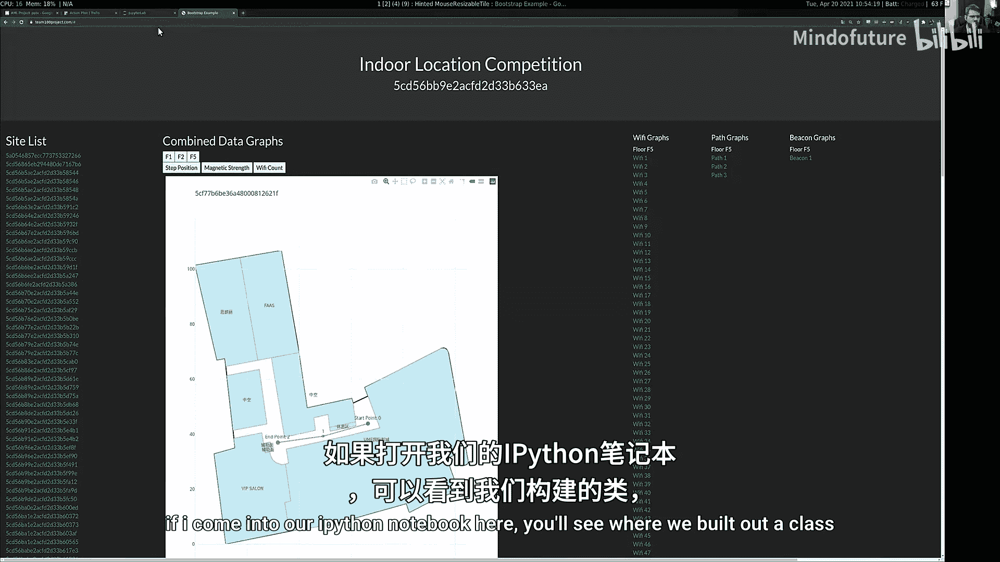
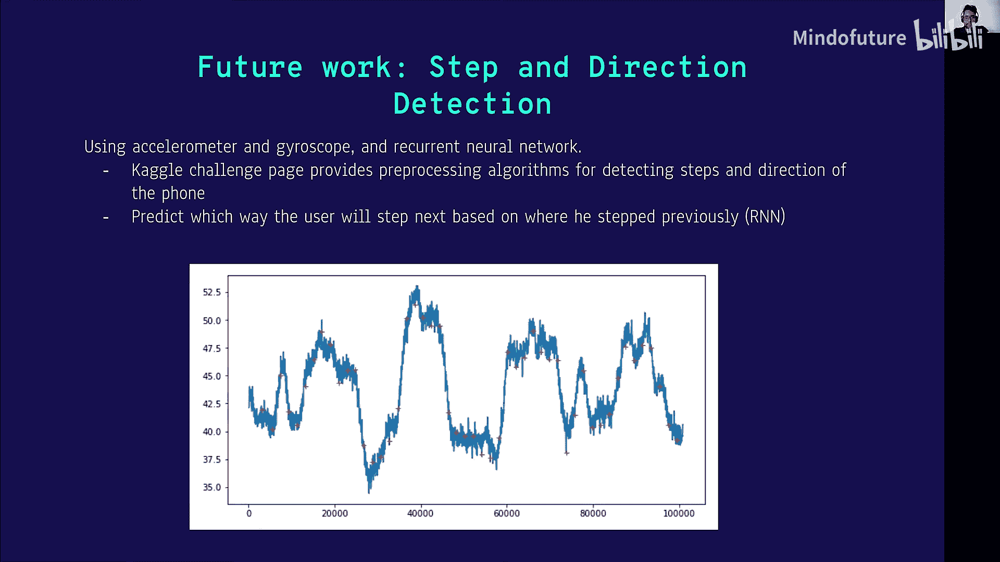

# 077：室内定位与导航教程 🧭

## 概述
在本教程中，我们将学习如何利用智能手机传感器数据，通过机器学习模型实现室内的精确定位与导航。我们将从项目背景、数据处理、模型构建到未来改进方向，系统地介绍整个流程。

---

## 项目背景与目标 🎯

我们团队的项目专注于室内定位与导航。其重要性在于提升室内定位的准确性，并改善紧急服务的响应时间。

该项目的优势包括：帮助用户在商场内快速找到特定店铺（如阿迪达斯或丝芙兰），以及在博物馆导览或机场导航等场景中提供辅助。

上一节我们介绍了项目背景，本节中我们来看看项目的具体目标。

我们的目标是预测手机在建筑物内移动轨迹的时间序列，包括X和Y坐标以及楼层号。例如，当用户寻找店铺时，系统能精确找到店铺坐标并像室内GPS一样规划路径。

训练数据中提供了真实路径点（地面实况），我们需要预测的是代表路径的绿色点。

---

## 数据收集与挑战 📱

市面上已有一些软件可以辅助数据收集。例如，面向Android的AR Core应用和面向iPhone的AR Kit应用。AR Kit需要付费，而AR Core是免费的。另一款类似的应用是AR Plan 3D，同样需要付费，它可以测量房间尺寸。

这些应用（AR Core和AR Plan 3D）通过手机摄像头实时采集环境数据。

接下来，我们将深入了解数据本身，这被证明是本次竞赛中最大的挑战。

数据表面上很简单：它来自智能手机，几乎记录了所有传感器的读数。我们拥有一个约50GB的大型数据集，包含数百个不同地点（主要是商场）的数据。

关键在于，每个楼层都需要建立独立的模型，并拥有独立的数据集。

数据特征包括手机上的所有传感器：陀螺仪、旋转矢量、磁场、Wi-Fi、蓝牙和加速度计等。

我们最初假设在每个位置点，所有传感器都会有一组读数，从而构成一个整齐的特征向量；或者假设数据会以均匀的时间间隔（例如每秒）记录。但我们发现这两种情况都不成立。

在后续演示中你会看到，这些传感器似乎以近乎随机的时间间隔记录数据，且彼此从不对齐。因此，如何获取一致的特征，以及如何分割、平均或聚合这些数据，以得到一个能够输入机器学习库的平整特征向量，成为了巨大的挑战。

此外，我们找到了一些他人已标准化处理的数据集，但问题在于如何提交到Kaggle平台。因为Kaggle提交要求使用原始的不规则时间戳间隔和随机位置点。所以，即使我们获得了质量良好的规整数据，将其转换回可提交给Kaggle的格式也是一项真正的挑战。

---

## 基线模型与流程 🧱

在克服了初步的数据挑战后，我们开始构建基线模型。本节将介绍我们的基线模型以及后续的完整预测流程。

我们决定采用一个简单的基线方法：将所有数据输入一个神经网络。我们为每个楼层的X坐标、Y坐标和楼层号分别训练了独立的神经网络。

这个神经网络模型来自一本我阅读的书籍，它是从头开始实现的，因此我可以清楚地看到所有步骤。我们认为这是一个非常简洁的方案，并且得到了不错的分数。

左侧图表展示了分类器的训练方式：最上方是X坐标网络，中间是Y坐标网络，底部是楼层网络。我们基本上是把所有数据都扔了进去。

右侧是基线模型的结果对比。通过肉眼观察，可以看出楼层预测效果不佳，而X和Y坐标的预测虽不是最差，但正如Benjamin之前提到的，我们在这方面也遇到了困难。

（左侧是我们预测的结果，右侧是真实情况。）

一旦我们的基线模型达到了一定的准确度，我们就可以构建完整的预测流程来展示如何解决这个问题。

完整的预测流程如下：首先，一个楼层检测（或分类）算法会识别出当前楼层，并为该楼层选择相应的路径点检测网络。

我们使用聚类算法进行楼层检测，最初尝试了K-Means。

一旦楼层确定，用于每个楼层的路径点检测器是多层感知机。

但需要注意，使用普通前馈网络的一个缺点是，它没有考虑预测之间的序列关系。因为可以想象，你在商场中的位置，在某种程度上是你几秒钟前位置的函数。这类信息我们目前忽略了。

---

## 数据预处理与模型训练 🔧

上一节我们概述了预测流程，本节中我们将深入探讨数据预处理以及分类器和网络训练的具体细节。

以下是我们对数据进行的预处理步骤：

对于给定的每个建筑的每个楼层，我们仅选择Wi-Fi信号强度和磁力计读数作为特征。

这些特征是同步采样的，这意味着每次我们有Wi-Fi读数时，也会有一个磁力计读数。实际上，磁力计的采样频率是Wi-Fi的三倍，因此有时我们只有磁力计读数而没有Wi-Fi读数。

关于Wi-Fi读数：其结构是，假设一个楼层有上千个Wi-Fi接入点，手机会记录到每个接入点的信号强度。因此，特征是各个接入点，值是对应的信号强度。

我们丢弃了仅包含磁力计读数的数据行（因为磁力计采样频率是Wi-Fi的三倍），并将Wi-Fi信号强度中的NaN值填充为0。

接着，对于每个建筑，我们创建了一个包含该建筑所有楼层的统一数据集，并保留了所有楼层共有的接入点对应的列。这样做的思路是，如果某个接入点在第三层，而你在第一层，你接收到的信号强度可能远低于在第三层的人。

然后，我们训练了楼层检测器：针对每个建筑，我们基于所有楼层共有接入点的信号强度，训练了一个K-Means聚类楼层检测器。

对于路径点检测器，我们为每个建筑的每个楼层训练了多层感知机回归器。

---

## 模型效果与改进 🚀

楼层预测的分类效果在使用K-Means时并不理想。主要问题是它将同一个楼层分配给了许多不同的聚类，这使得我们很难判断哪个聚类应该对应哪个楼层（例如，哪个聚类是地下负一层）。因此，楼层预测效果很差，我们需要更好的方法。

然而，路径点预测的效果要好得多。使用我们的多层感知机回归器，左侧列显示预测值，中间列显示真实坐标，误差是均方误差。

可以看到，这些预测值相当接近，除少数例外，误差相对较低。平均而言，我们距离正确预测点差9.9个单位。这个结果实际上相当不错。

但我们需要解决楼层分类器的问题。

这个问题的答案非常令人惊讶。我们再次重申为此所做的数据处理：我们仅使用Wi-Fi作为特征，移除了磁力计读数等其他数据。

我们使用了K近邻模型来预测每个建筑的楼层。思路是，如果一个区域有三个相似的值，那将有助于提高分数。就像Dan所做的那样，我们根据模型为每个楼层设置了路径点检测。

我们尝试了基线中提到的神经网络，效果不是很好。我们也尝试了线性回归，其结果与从头实现的模型输出相似。然后我们再次使用了MLP回归器。

结果显示，K近邻模型在测试数据上完美地识别出了楼层，这令人惊讶。同时，MLP回归器的路径点预测结果也如前所述。

---

## 挑战与未来工作 💡

数据质量仍然是一个重大挑战。即使我们有了一个有效的模型，能够将结果提交回Kaggle也是一项真正的挑战，因为我们使用的是预先聚合的数据集。

我们严重依赖Kaggle社区的帮助，因为有很多人分享了关于如何预处理数据或解决这些问题的各种想法。

我们面临的是一个序列数据问题。因此，对于未来的工作，我们计划实现循环神经网络作为模型。

众所周知，RNN在处理序列数据上比传统神经网络表现更好。在RNN中，神经网络不同层的节点被压缩形成单层。RNN的工作原理是保存特定层的输出并将其反馈给输入，以预测该层的输出。这可能有助于解决我们的序列数据问题。

RNN面临的一些问题包括梯度衰减（可以通过LSTM解决）和梯度消失（可以通过使用ReLU等激活函数解决）。因此，使用循环神经网络可能有助于解决序列数据问题。

下一步，我们将使用加速度计和陀螺仪作为新特征，结合循环神经网络。图表显示了每一步的步态检测以及加速度计的特征。红点代表人的步伐。

---

## 总结

在本教程中，我们一起学习了室内定位与导航项目的完整流程。

我们从项目背景和目标出发，了解了利用智能手机传感器数据实现精准室内定位的价值。

我们深入探讨了数据收集的挑战，特别是多传感器数据在时间和空间上不对齐带来的巨大预处理困难。

我们构建了基线模型，采用了简单的神经网络方法，并建立了包含楼层分类和坐标回归的完整预测流程。

通过详细的数据预处理（包括特征选择、缺失值处理和数据集整合），我们训练了K-Means楼层分类器和多层感知机路径点回归器。

我们发现K近邻模型在楼层分类上表现惊人，而MLP在坐标预测上取得了不错的效果（平均误差9.9个单位）。

最后，我们总结了项目面临的主要挑战（数据稀疏性、格式转换），并展望了未来方向——引入循环神经网络来处理数据的时序特性，并融合加速度计等更多传感器特征。

这个项目深刻地表明，在机器学习应用中，数据准备和预处理往往占据了绝大部分精力，是模型成功的基础。