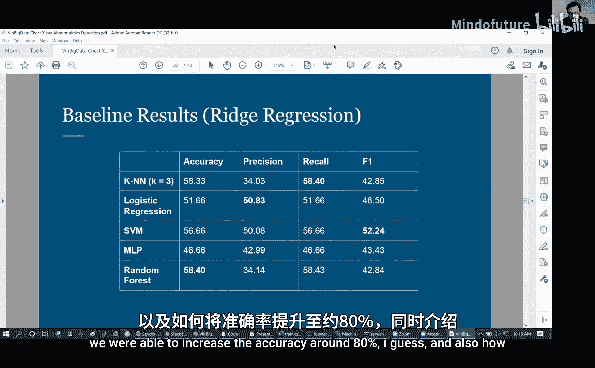
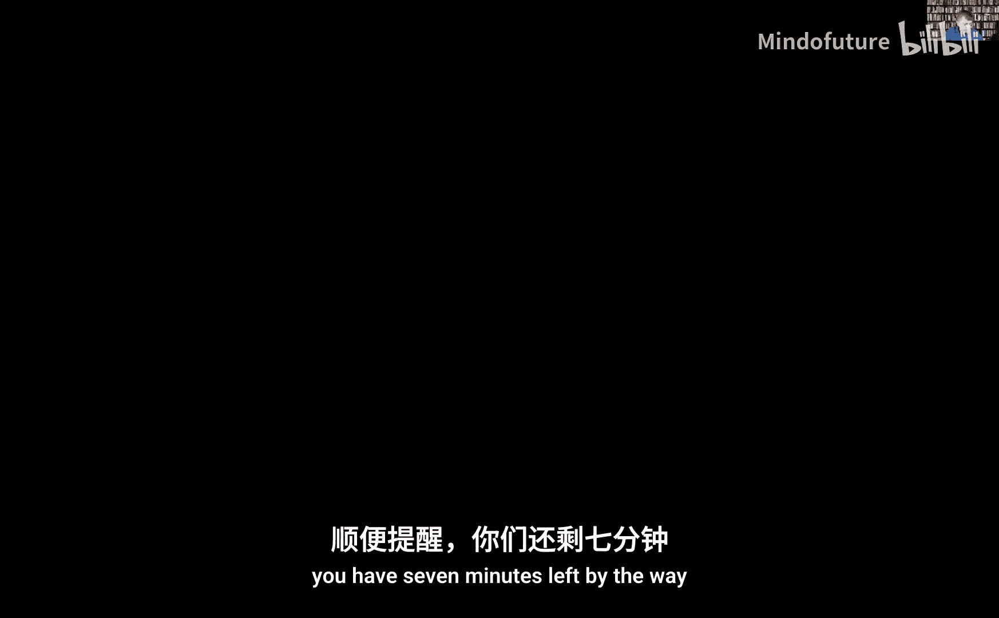
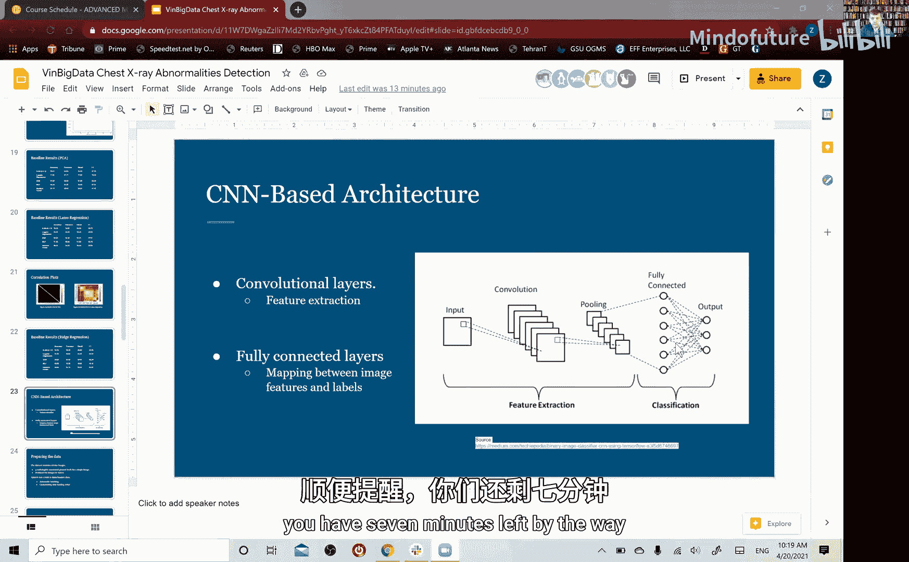
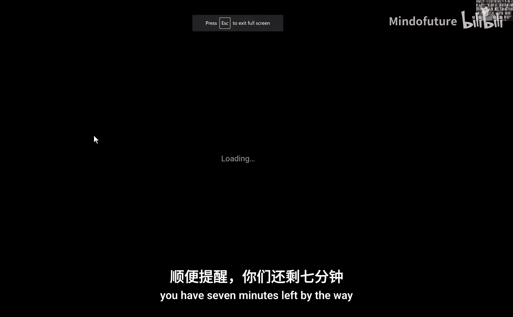
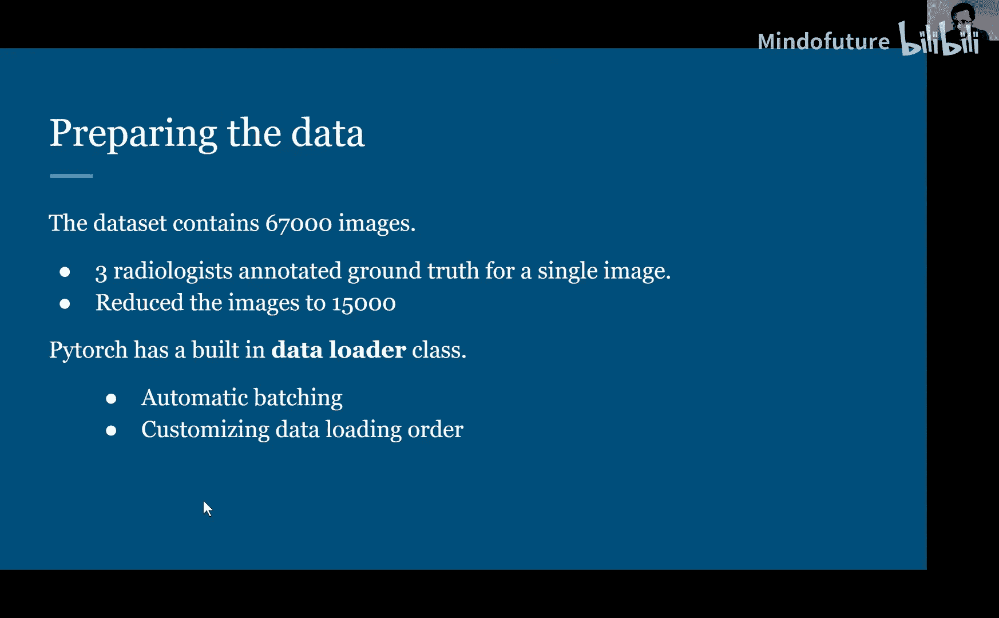
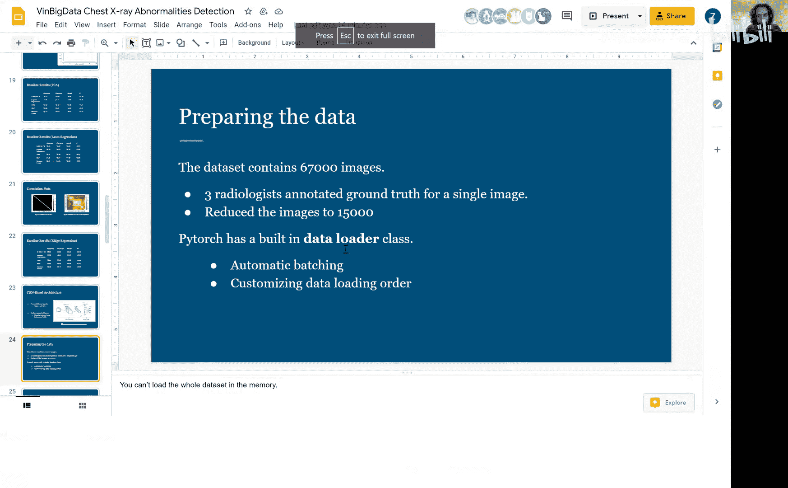
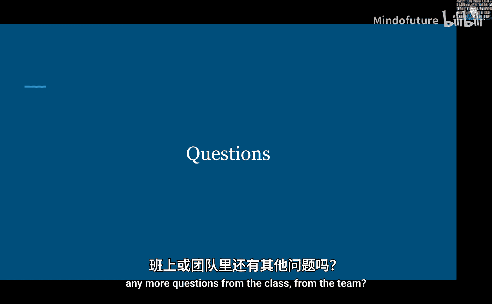

# 078：胸部X射线异常检测 🩻

## 概述
在本节课中，我们将学习一个基于深度学习的胸部X光片异常检测系统。该系统旨在自动定位和分类X光图像中的异常区域，以辅助放射科医生进行诊断。我们将从项目背景、数据处理、基线模型构建，到最终的深度学习解决方案，系统地介绍整个流程。

---

## 项目背景与问题定义 🎯

上一节我们介绍了课程的整体目标，本节中我们来看看项目的具体背景和需要解决的问题。

现有的医学影像诊断系统通常只能给出分类结果，而无法精确定位异常所在的位置。这在临床诊断中可能产生误导，因为病灶的位置信息对于判断病情至关重要。

我们计划构建一个基于深度学习目标检测模型的自动化系统。该系统能够对胸部X光扫描图像中的异常进行**分类**和**定位**。这可以为放射科医生提供有价值的第二意见，并有助于减少误诊。

我们使用的数据集来自越南的两家医院，包含约18,000张DICOM格式的胸部X光图像。其中15,000张用于训练，3,000张用于测试。训练图像已由经验丰富的放射科医生小组进行了标注。

以下是数据集中目标类别的概述，共有15个不同的类别，每个类别对应一种特定的异常或“无发现”状态：

*   **0:** Aortic enlargement
*   **1:** Atelectasis
*   **2:** Calcification
*   **3:** Cardiomegaly
*   **4:** Consolidation
*   **5:** ILD
*   **6:** Infiltration
*   **7:** Lung Opacity
*   **8:** Nodule/Mass
*   **9:** Other lesion
*   **10:** Pleural effusion
*   **11:** Pleural thickening
*   **12:** Pneumothorax
*   **13:** Pulmonary fibrosis
*   **14:** No finding

数据集中类别分布高度不平衡，其中“无发现”（类别14）的样本数量远多于其他异常类别。

---

## 基线模型与特征工程 ⚙️

在明确了问题和数据后，我们首先尝试了一些传统的机器学习方法作为基线模型。本节将介绍我们如何进行特征工程并评估不同分类器的性能。

我们的基线模型主要解决分类任务。基本流程包括：将图像缩放至统一尺寸（823x927），将像素展平为特征向量，应用降维技术，最后使用分类器进行预测。

我们尝试了以下分类算法：
*   卷积神经网络
*   逻辑回归
*   支持向量机
*   多层感知机
*   随机森林

我们使用了三种降维技术来减少特征数量并尝试提升模型性能：

1.  **主成分分析**：我们选择了20个主成分，因为在超过20个后，所解释的方差比例增长非常有限。
    *   `n_components = 20`
2.  **LASSO回归**：通过引入L1惩罚项，可以将某些特征的系数压缩至**恰好为零**，从而实现特征选择。我们最终保留了1316个特征。
    *   目标函数：`Min(Σ(y_i - ŷ_i)^2 + λ * Σ|β_j|)`
3.  **岭回归**：通过引入L2惩罚项，可以将特征的系数**压缩至接近零**。这种方法保留了更多的特征（远多于LASSO）。
    *   目标函数：`Min(Σ(y_i - ŷ_i)^2 + λ * Σβ_j^2)`

以下是不同降维方法与分类器组合得到的性能结果（以准确率为例），所有模型均采用70/30的划分进行训练和测试：

*   **PCA + 多层感知机**: ~59%
*   **LASSO + 支持向量机**: ~58%
*   **岭回归 + 随机森林**: ~57%

基线模型的性能普遍不高，最高准确率也未超过60%，且没有一种方法在所有评估指标上明显胜出。这表明传统的机器学习方法在处理此类复杂的图像分类任务上存在局限。

---

## 基于深度学习的解决方案 🧠

由于基线模型效果有限，我们转向了更强大的深度学习模型。本节将详细介绍我们用于分类和目标检测的卷积神经网络架构。

我们采用基于CNN的架构。CNN通常包含用于特征提取的卷积层和用于最终分类的全连接层。

### 数据预处理
首先对数据进行预处理。原始标注由三位放射科医生完成，共计约67,000条记录。由于他们的标注共识度很高，我们进行了去重，最终使用15,000张独立图像。我们使用PyTorch的`DataLoader`来批量加载数据，并将所有图像缩放至256x256。同时，需要根据缩放比例调整边界框的坐标：
*   `scale_x = new_width / old_width`
*   `scale_y = new_height / old_height`
*   新坐标：`x_new = x_old * scale_x`, `y_new = y_old * scale_y`

为了增强模型泛化能力，防止过拟合，我们应用了数据增强，包括水平翻转和随机亮度/对比度调整。

### 分类模型
我们首先尝试了不包含定位的纯分类任务。使用了ResNet-18架构，其跳跃连接有助于在反向传播时梯度平滑流动。
我们训练了20个周期，最终训练准确率达到**75%**，测试准确率达到**77%**。这表明模型具有良好的泛化能力。训练损失曲线显示模型在学习初期快速下降，随后趋于平缓。

### 目标检测模型
对于需要同时定位和分类的任务，我们采用了Faster R-CNN目标检测模型。我们使用了在COCO数据集上预训练的模型，并在此基础上进行微调。

为了确保评估的稳健性，我们采用了**分层五折交叉验证**，以保证每个折叠中各类别的样本比例与整体数据集一致。

Faster R-CNN的工作流程如下：
1.  使用ResNet等卷积骨干网络提取图像特征图。
2.  区域提议网络在特征图上滑动窗口，生成一系列可能包含目标的锚框。
3.  RPN输出每个锚框的类别得分和边界框坐标修正值。
4.  最终网络对提议区域进行分类和边界框精修。

我们使用**平均精度均值**作为评估指标。其核心是交并比，用于衡量预测框与真实框的重合程度：
*   `IoU = Area of Overlap / Area of Union`
我们设定IoU阈值为0.5。若预测框与真实框的IoU大于0.5，则视为真正例；否则为假正例。

实验结果显示，在五折交叉验证中，mAP值大约在0.5至0.7之间波动，平均mAP约为**0.64**。

我们将模型在测试集上的预测结果（包含图像ID、类别标签、边界框坐标和置信度）提交至Kaggle竞赛平台，获得的得分为**0.21**。

---

## 总结与未来工作 📝

本节课中我们一起学习了构建一个胸部X光异常检测系统的完整流程。

我们首先分析了任务背景和数据特点，然后建立了传统的机器学习基线模型。在基线模型效果不佳的情况下，我们转向了深度学习方案，使用ResNet-18进行图像分类，并使用Faster R-CNN进行目标检测。分类模型取得了约77%的测试准确率，目标检测模型获得了约0.64的mAP值。

**总结如下：**
1.  **分类任务结果较好**，模型未出现过拟合。
2.  **目标检测的mAP有提升空间**。类别不平衡问题可能影响了检测性能。
3.  传统方法在复杂图像任务上存在局限，深度学习模型展现出更大潜力。

对于未来工作，可以从以下几个方面进行改进：
*   **超参数调优**：进一步微调学习率、批次大小等超参数。
*   **探索其他模型**：尝试YOLO、RetinaNet等其他先进的目标检测架构。
*   **改进激活函数与正则化**：使用LeakyReLU等激活函数或不同的正则化策略。
*   **处理类别不平衡**：在损失函数中引入类别权重，或使用过采样/欠采样技术。

通过本项目的学习，我们掌握了将深度学习技术应用于实际医学影像分析的基本方法，并对模型开发、训练、评估的全过程有了更深入的理解。