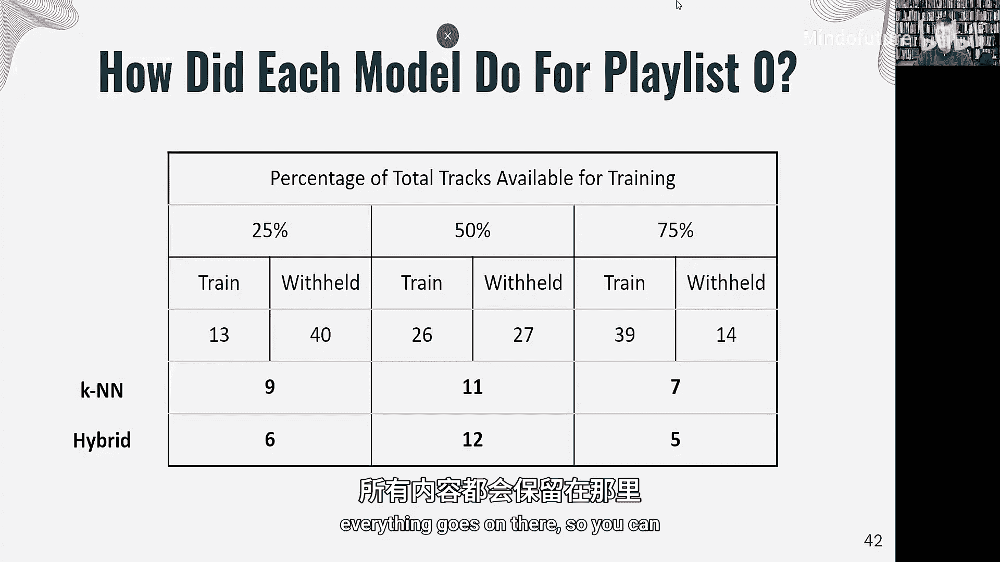

# 079：Spotify百万播放列表挑战赛 🎵

在本节课中，我们将学习如何为Spotify的“百万播放列表挑战赛”构建一个音乐推荐系统。我们将探讨三种不同的方法：基于词向量（Word2Vec）的协同过滤、K最近邻（KNN）算法，以及一个结合了协同过滤与内容过滤的混合模型。

---

## 概述：挑战与数据集

Spotify用户非常喜爱创建播放列表，目前已有超过40亿个播放列表。每个播放列表都承载着用户的特定意图或情感。为了深入研究如何基于播放列表推荐歌曲，Spotify发布了“百万播放列表”数据集。

我们的核心挑战是：为数据集中一百万个播放列表的每一个，推荐500首新歌曲。系统必须能处理各种情况，例如：只有标题没有歌曲的播放列表、歌曲数量很少的播放列表、没有标题的播放列表，以及元数据不完整的播放列表。一个额外的挑战是：如果每个播放列表中有部分歌曲被隐藏，我们能否在推荐的500首歌曲中包含这些被隐藏的歌曲？

简而言之，输入是一个用户创建的播放列表（包含标题、曲目信息等元数据），输出是一个按相关性排序的、包含500首候选推荐曲目的列表。

为什么这个挑战很重要？推荐算法不仅用于音乐服务，还广泛应用于搜索引擎、文档校对等日常自动化任务中。一个优秀的推荐算法经过调整，可以解决完全不同的任务，推动更多繁琐工作的自动化进程。

该数据集包含一百万个由Spotify用户创建的播放列表，总计约200万首曲目，涉及超过30万名艺术家。每个播放列表包含标题和曲目信息。数据集的特别之处在于，它包含了1万个信息不完整的播放列表（例如只有标题，或只有少量曲目），部分曲目还被特意隐藏，增加了挑战性。

数据清洗是必要的步骤，因为原始数据集大小为33GB，被分割成1033个JSON文件。为了方便模型训练和测试，我们创建了一个方法，将JSON播放列表文件转换为CSV格式。转换后的文件不仅包含基本的元数据信息，还包含了通过Spotify API获取的额外信息，如歌曲流派、节奏、能量值等。

---

## 方法一：基于Word2Vec的协同过滤 🎧

上一节我们介绍了挑战的整体背景和数据集。本节中，我们来看看第一种方法：基于Word2Vec的协同过滤模型。

协同过滤的基本思想是：如果用户A和用户B喜欢许多相同的歌曲，那么用户A可能也会喜欢用户B喜欢的其他歌曲。这种方法不依赖于歌曲本身的特征（内容），而是基于用户行为的相似性。

在我们的实现中，我们将每个播放列表视为一个“句子”，将每首歌曲的ID视为“单词”。这样，我们就可以使用Word2Vec技术为每首歌曲生成一个向量表示。

我们采用了连续词袋模型（CBOW）。在这个无监督学习中，我们设定了一个“伪目标”：给定一首歌曲的上下文（即播放列表中它前面和后面的歌曲），来预测这首歌曲本身。通过训练，我们得到了一个从输入层到隐藏层的权重矩阵，这个矩阵最终为我们提供了每首歌曲的向量表示。

有了歌曲向量，我们就可以进行数学计算，例如计算向量之间的余弦相似度。相似度越高，表示两首歌曲越相似。

以下是使用该模型为单个播放列表寻找相似歌曲的步骤：
1.  将目标播放列表中的歌曲转换为向量。
2.  计算播放列表中歌曲向量与整个歌曲库中所有歌曲向量的余弦相似度。
3.  根据相似度得分，返回最相似的500首歌曲。

为了直观展示，我们使用PCA和t-SNE将256维的歌曲向量降维到2维并进行可视化，可以观察到不同流派的歌曲会形成不同的簇。

**该模型的优缺点如下：**
*   **优点**：其原理与Spotify等平台的实际推荐逻辑相似，对于包含大量歌曲的播放列表效果良好。
*   **缺点**：无法处理没有任何歌曲的播放列表（冷启动问题），因为无法为空的“句子”生成有意义的向量。

---

## 方法二：K最近邻算法 🎼

上一节我们介绍了基于Word2Vec的协同过滤模型。本节中，我们转向另一种经典方法：K最近邻算法。

KNN算法根据特征之间的相似度（距离）对新数据点进行分类。对于一首待推荐的歌曲，算法会计算它与已知播放列表中所有歌曲的特征距离，然后根据其“邻居”（最相似的歌曲）的类别来进行推荐。

我们最初的做法是仅使用数字特征参数（如能量值、节奏）来构建特征数组，并为这些参数分配权重。但性能不佳。于是我们改进了方法，加入了歌曲流派信息。

我们将文本类型的流派（如“摇滚”、“流行”）转换为有组织的数字参数。相似的流派被赋予相近的数字编码（例如，摇滚和流行数字接近，乡村音乐则距离较远）。这样处理之后，模型的性能得到了提升。

以下是KNN模型的工作流程：
1.  **数据准备**：从原始数据集和Spotify API获取数据，构建CSV文件。
2.  **特征矩阵构建**：基于曲目ID、元数据（数字特征）和编码后的流派信息，构建一个特征矩阵。例如，对于1000个播放列表，我们可能得到一个有5000行（歌曲）和31列（特征）的矩阵，这是一个稀疏矩阵。
3.  **模型运行**：将目标播放列表（不完整的播放列表）输入KNN模型。
4.  **输出结果**：模型输出一个为该播放列表推荐的曲目列表。

我们测试了在不同“保留比例”下的模型命中率（Hit Rate）。保留比例是指将播放列表中一定比例的歌曲隐藏起来，只用剩余部分来训练模型，然后看模型能否在推荐列表中找回被隐藏的歌曲。
*   当只用25%的歌曲时，命中率约为20%。
*   当使用50%的歌曲时，命中率提升到40%-50%。
*   当使用75%的歌曲时，命中率增长放缓，甚至略有下降，这可能是因为信息过多导致推荐不够精确，产生了一定的过拟合。

**该模型的优缺点如下：**
*   **优点**：模型简单直观，在此前的播放列表补全竞赛中也有应用。
*   **缺点**：KNN是一种“懒惰学习”算法，需要存储所有训练数据，在应对大规模数据时非常耗费时间和存储空间。为了更高效，它需要与其他分类模型结合使用。

---

## 方法三：混合推荐模型 🤖

前面两节我们分别介绍了协同过滤和基于内容的KNN方法。本节中，我们来看一个结合两者优势的混合模型。

这个混合模型针对两种不同情况采取不同策略。

**情况一：播放列表仅有标题**
这种情况下，我们严格使用协同过滤。
1.  **关键词提取**：从标题中提取连续的单词组合。例如，“我的超棒Eminem播放列表”会提取出“我的”、“超棒”、“Eminem”、“播放列表”、“我的超棒”、“超棒Eminem”、“Eminem播放列表”等。
2.  **关键词评估**：用小样本用户播放列表测试每个关键词，根据歌曲在流派和艺术家上的接近程度，为每个关键词生成一个相关性数值。例如，“Eminem”和“Eminem播放列表”是强相关关键词，而“我的”、“超棒”则相关性较弱。
3.  **搜索与推荐**：按照关键词的相关性顺序，搜索包含这些关键词的用户播放列表，提取其中的歌曲作为推荐候选，并记录相关艺术家的名字以扩展搜索。

**情况二：播放列表既有标题又有歌曲**
这种情况下，我们结合协同过滤和内容过滤。
1.  **协同过滤步骤**：提取播放列表中所有艺术家的名字，搜索包含这些艺术家的用户播放列表，并记录其中出现的歌曲及其频率（存入`collab_tracks`字典），同时也记录这些歌曲的艺术家及其频率（存入`collab_artists`字典）。
2.  **内容过滤步骤**：对每首候选歌曲进行评分，评分标准包括：
    *   **流派/年份/艺术家**：看该歌曲的流派/年份/艺术家在原始播放列表中的常见程度（频率）。
    *   **音频特征**（如节奏、能量值）：为播放列表的每个音频特征中位数创建一个区间，检查候选歌曲的特征值是否落在区间内。
    *   **协同过滤贡献**：检查候选歌曲的艺术家是否在`collab_artists`中高频出现，歌曲本身是否在`collab_tracks`中高频出现。

该模型的目标是在流派、艺术家、音频特征等多个维度上“镜像”原始播放列表的特征分布。例如，对于一个播放列表，我们希望推荐的500首歌在各类流派上的比例与原始列表尽可能接近。

**该模型的优缺点如下：**
*   **优点**：能够从多个维度综合模拟目标播放列表的特征，应对信息不完整的播放列表。
*   **缺点**：在找回被隐藏歌曲的命中率上表现不稳定，有时很高，有时较低。此外，初始运行速度较慢。

---

## 模型比较与总结 🏆

现在，让我们比较一下上述模型在一个具体播放列表（ID为0）上的表现。该播放列表有53首歌，其中27.4%来自Jesse McCartney, Chris Brown, Beyoncé等艺术家。

我们比较了在不同数量歌曲被隐藏（保留比例不同）的情况下，KNN模型和混合模型的命中数：
*   隐藏40首歌（用13首训练）：KNN命中9首，混合模型命中6首。
*   隐藏27首歌（用26首训练）：KNN命中11首，混合模型命中12首。
*   隐藏14首歌（用39首训练）：KNN命中7首，混合模型命中5首。

可以看到，在数据量很少（25%保留率）时，KNN表现更好；但当数据量增多时，两者表现相近。我们使用R-precision（命中数/隐藏歌曲总数）作为评估指标。

最终，我们向竞赛提交了结果。虽然初次提交在30个参赛作品中排名第17位，但仍有提升空间。

**总结与挑战**
在本节课中，我们一起学习了为Spotify百万播放列表挑战构建推荐系统的三种方法。
*   **模型推荐**：我们建议结合KNN或Word2Vec与混合模型，先进行粗筛，再用混合模型进行精细排序。
*   **遇到的挑战**：
    1.  **数据集规模**：33GB的数据处理对计算资源要求很高。
    2.  **数据转换**：将JSON文件转换为便于处理的CSV格式耗时较长。
*   **未来改进**：如果重新设计，我们推荐采用两阶段架构：第一阶段用快速模型检索出少量候选歌曲；第二阶段用学习排序模型，专注于优化推荐歌曲在列表中的顺序。

通过这次挑战，我们不仅实践了推荐算法，也深刻体会到将机器学习应用于解决实际、大规模问题时所面临的挑战与乐趣。