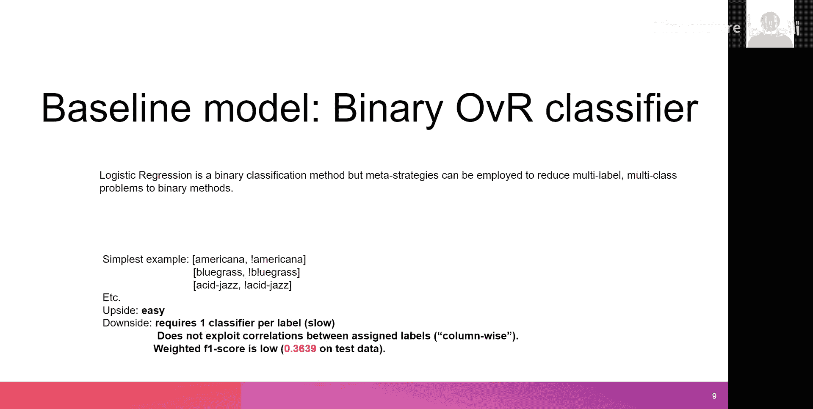
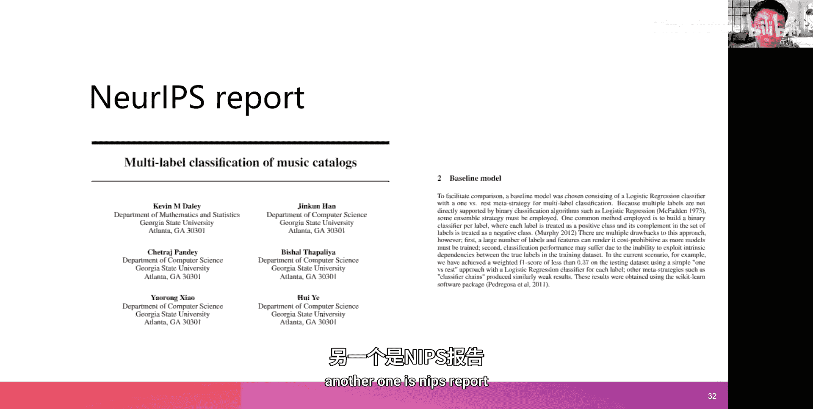
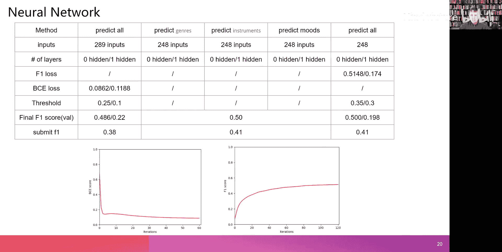

# 080：P80_AI乐队的音乐目录多标签分类 🎵

在本节课中，我们将学习一个关于音乐目录多标签分类的实际项目。该项目旨在解决一个在线挑战：如何根据音乐曲目的特征，为其分配多个标签（如流派、情绪、乐器等）。我们将从项目背景、数据处理、多种模型尝试到最终优化策略，系统地回顾整个流程。

---

## 项目背景与动机 🎯

上一节我们介绍了项目的基本情况，本节中我们来看看项目的具体动机和目标。

我们的项目源于一个在线挑战，其目标是为制作音乐库中的曲目自动分配标签。这与上一个项目（为预定义的播放列表分配标签）恰好相反。

该项目的动机是，一家公司已经拥有一个神经网络，该网络能够为每首曲目生成一个独热编码向量，该向量关联着多个不同的类别（如流派、情绪、乐器等）。这本质上是一种对特定标签的模糊分配。

然而，公司需要能够根据神经网络的输出，以离散的方式精确决定为每首曲目分配哪些标签。他们尝试了最朴素的方法——直接对神经网络的输出进行阈值处理，但效果不佳。

他们提出，如果能够利用输入之间以及输出标签之间的相关性，或许可以获得更好的结果。因此，我们决定采用分类器来完成这项任务。

该挑战的目标是：**定义一个分类器，将公司神经网络为每个标签生成的原始概率或模糊值，转换为关于是否分配该标签的实际决策**。评估我们模型性能的指标是**加权F1分数**。

我们尝试了大约五到六种不同的模型，进行了大量调优，试图找出最佳方案。

---

## 数据集概览 📊

上一节我们明确了项目目标，本节中我们来看看所使用的数据集。

数据看起来是这样的：它包含大约90到100种乐器和流派，以及其他一些类别，总共约250个标签。输入特征的数量几乎与输出标签一样多。

输入数据实际上被分成了几大类。它并非网络随机选择的特征，而是由公司神经网络提取的、与标签对应的特征。每一列对应一个标签。

输出同样是为每首曲目分配多个标签，因此这成为一个**多标签分类问题**。从动机角度看，这类问题在许多其他场景中也很有用，例如图像分类、分割和检测算法。一旦一个音频文件中有多个不同物体发出声音，或者任何类似情况，就会变成多标签检测问题。这类问题的准确率往往略低于二分类问题。

以下是数据的具体结构：
*   数据以CSV文件形式提供。
*   每一列代表一个标签或类别的特征。
*   神经网络为每个标签的输出是一个介于0和1之间的值。

因此，几乎不需要进行数据预处理或清洗。我们只需将其加载到NumPy或scikit-learn中即可。

输出变量是类似的，但它们是二进制的（经过阈值处理）。有趣的是，测试集的输出对我们来说是隐藏的。我们拥有训练集的输出，但必须将测试集输入数据的结果提交到网站，才能获得测试集的F1分数。正如我们稍后将看到的，即使是留K折交叉验证的训练分数与实际测试分数之间也存在显著差异。

我们的数据集在标签分布上相对平衡，没有某个标签占据绝大部分空间的情况。当然，加权F1分数本身就有处理标签不平衡的内在方法。

---

## 基线模型与初步尝试 🔬

上一节我们了解了数据集，本节中我们来看看最初尝试的几种模型。

我们使用的基线模型非常简单：**二元“一对多”分类器**。我们也尝试了其他模型，但这是我们能想到的最简单、最好的基线。

具体做法是：我们采用逻辑回归（一种二分类器），并将其应用于每个标签，将该标签作为正类，所有其他标签作为负类。这是处理多标签分类最朴素的标准方法，称为**一对多**。

这种方法需要为每个标签创建一个分类器，速度较慢，并且没有利用已分配标签之间的任何相关性。因此，其加权F1分数可能相当低。在实际测试数据上，它的分数约为0.37。

---

### 方法一：转换为多类分类问题

以下是第一种尝试的方法：
*   我们将多标签分类问题转换为多类分类问题。
*   具体做法是寻找标签的唯一组合，并将其视为一个单独的类别。
*   这种方法非常朴素，因为标签组合的数量可能非常庞大。在我们的案例中，有998,537种唯一的标签组合。
*   训练模型耗时极长，且获得的F1分数仅为0.233，甚至低于我们的基线模型。因此，我们甚至没有将此模型提交到网站。

---

### 方法二：改进的“一对多”分类器

我们继续采用“一对多”方法，尝试使用更多模型来改进基线。
*   我们使用了类似的二元“一对多”分类器，为每个标签单独训练整个数据集。
*   我们使用了高斯朴素贝叶斯和逻辑回归分类器，并分别进行了超参数调优。
*   在提供的测试数据上，我们获得的最佳结果是0.528。
*   当我们将模型提交到网站时，得到了0.397的分数，这比之前实现的逻辑回归分类器有了一些改进。

---

### 方法三：链式分类器

第三种方法是作为对“二元关联”方法的改进而尝试的。“二元关联”方法没有考虑标签之间的相关性。
*   我们决定使用链式分类器方法，其中不同的分类器按链式顺序训练，同时考虑标签之间的相关性。
*   第一个分类器仅使用数据集训练来预测标签Y1。
*   第二个分类器则将标签Y1作为特征，与数据集一起用于预测标签Y2，以此类推。
*   这种方法旨在保持标签之间的相关性。
*   我们再次使用了逻辑回归和高斯朴素贝叶斯分类器，其中高斯朴素贝叶斯获得了最佳结果。
*   测试加权F1分数为0.358，但提交后得到的分数较低，为0.3。

---

## 列式分类与神经网络尝试 🧠

上一节我们尝试了几种基于标签相关性的方法，本节中我们来看看从不同角度处理问题的方法。

在尝试了多种多类分类方法后，我们思考是否可以换一个完全不同的角度来看待数据。既然前三种方法都没有给出相当好的结果，我们决定尝试**列式分类**。

第一种列式分类方法是：我们只考虑音乐标签和交叉标签，为每个音乐标签独立构建一个分类器，而不考虑其他标签，以观察这种方法的得分情况。

我们尝试了逻辑回归和高斯朴素贝叶斯。首先，我们尝试了正则化参数为1.0的逻辑回归（所有分类器的默认值），这相当于构建了249个分类器，准确率为0.36。经过超参数调优后，高斯朴素贝叶斯得到0.35，逻辑回归得到0.37。这是列式分类的第一种方法，结果略有提升。

我们继续采用“二元关联”方法，但这次没有使用所有输入特征，而是只尝试预测与输出标签对应的那41个特征。训练集中有290个特征，标签有249个。网站为我们提供了41个额外的训练数据列。我们尝试将这41个特征与对应的输入一起使用，为每个标签构建分类器。不幸的是，分数仍然下降了。逻辑回归的最高准确率为0.135，高斯朴素贝叶斯为0.134。

于是，我们转向尝试神经网络。

---

### 神经网络实验

基于之前的逻辑回归等工作，我们尝试了神经网络，使用**二元交叉熵损失**进行优化，并关注F1分数。

我们进行了大量实验。由于输入数据是公司神经网络生成的一些结果，我们尝试了以下方案：
1.  **使用全部289个输入特征**：零隐藏层（本质上就是逻辑回归）确实能获得更好的性能，但使用一个隐藏层效果不佳。
2.  **仅使用前248个标签相关特征**：我们认为最后41列可能是某种类别信息，而非确切的输入标签。仅使用前248个特征作为输入，预测对应的248个标签，通过逻辑回归获得了0.41的提交F1分数。
3.  **单特征列式预测**：考虑到输入和输出数据有重叠，且0和1的均值和方差非常相似，仅使用单一特征难以区分。因此，我们增加了输入维度，构建了非常简单的神经网络：一个包含三个神经元的隐藏层。我们为248个标签分别训练了这样的微型网络，由于参数很少，训练速度很快，最终提交获得了0.44的F1分数。
4.  **按类别分组预测**：考虑到音乐可以同时具有多种情绪（如快乐和自信），我们将94种流派、112种乐器和46种情绪分别分组进行预测。这种方法获得了更好的F1分数：0.45。

---

## 随机森林模型与优化 🌲

上一节我们探索了神经网络，本节中我们来看看另一个强大的模型——随机森林。

随机森林分类器是一种集成模型，由大量决策树组成。它准确、稳健，且不易过拟合。该模型的工作原理分为四个步骤：
1.  从给定数据集中随机选择样本。
2.  为每个样本构建一棵决策树。
3.  每棵决策树产生一个结果。
4.  模型选择得票最多的预测结果（多数投票）。

我们将此方法应用于项目，初始结果为0.3632。

---

### 优化技巧一：列式阈值处理

分类器的输出是0到1之间的概率值。我们需要将这些概率转换为二进制的0或1，以便计算F1分数。默认阈值是0.5，但这可能不是最佳选择。

我们采用了**列式阈值搜索**策略来提升性能：
*   为每个标签单独搜索最佳阈值。
*   首先以步长0.1在0到1之间搜索，得到一个初始阈值。
*   然后以步长0.01在初始阈值附近进行精细搜索，以减少误差。
*   将此方法与随机森林分类器结合后，F1分数提升至0.4565。

---

### 优化技巧二：超参数调优

scikit-learn提供了大量超参数。这个过程非常耗时，因此我们无法调整所有参数。我们选择了几个重要参数进行调优：`bootstrap`、`max_depth`、`max_features`和`n_estimators`。

我们获得了最佳参数设置：`bootstrap=True`， `max_depth=50`， `max_features='sqrt'`， `n_estimators=300`。应用此模型后，加权F1分数达到0.4650。

---

## 关键发现与总结 🏆

基于以上所有模型，我们总结出以下关键发现：

1.  **情绪标签的影响**：在流派、乐器和情绪三个类别中，我们发现情绪标签（约46个）包含的噪声在一定程度上降低了模型准确性。这部分标签来自网站公司的模型，其信息可能不够准确。
2.  **列式/标签式处理的有效性**：我们使用了10种不同的模型和策略分析数据，发现列式或标签式处理可以提高准确率或F1分数。
3.  **阈值处理的重要性**：合适的阈值处理对于获得高F1分数至关重要。
4.  **最佳模型**：结合了列式阈值处理和超参数调优的随机森林模型表现最佳，在公开排行榜上获得了0.45的F1分数，位列第二。

从这个项目中，我们可以学习到如何选择模型、如何优化参数，以及面对多标签分类问题时，列式处理有时会大有帮助。在未来的项目中，如果遇到类似数据，我们可以考虑如何使用列式处理和阈值技术。

---

### 团队贡献与材料

团队成员的贡献基本均等。我们使用了协作看板，分配了超过50项任务，每个人都完成了自己的任务。代码托管在GitHub上，每个人都有自己的分支并上传了模型。

在挑战数据的公开排行榜上，我们的最佳成绩是第二名。我们还提交了其他一些模型，也取得了不错的分数。我们还将提交一份项目报告。团队通过Discord群组进行了大量交流，尝试了超过1000次聊天，举行了5次视频会议和超过20次模型讨论，真正实现了资料共享和信息记录。

---

本节课中，我们一起学习了一个完整的多标签分类项目实战。我们从理解业务背景和数据处理开始，逐步尝试了从简单的逻辑回归、链式分类器到神经网络和随机森林等多种模型，并深入探讨了列式处理、阈值优化和超参数调优等关键技巧。通过团队协作和不断迭代，我们最终取得了显著的成果，并总结了宝贵的实践经验。希望本教程能帮助你理解多标签分类问题的解决思路与方法。