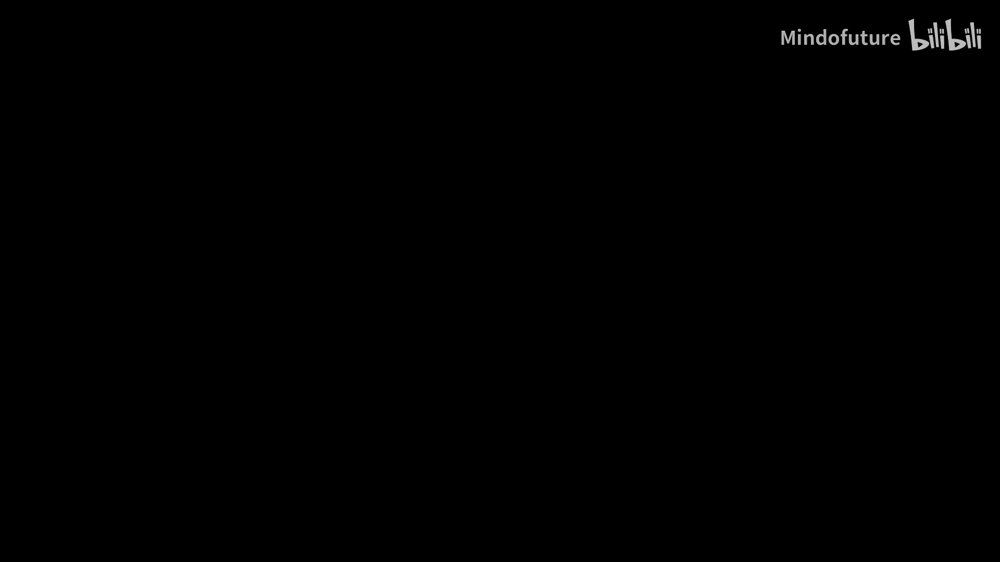
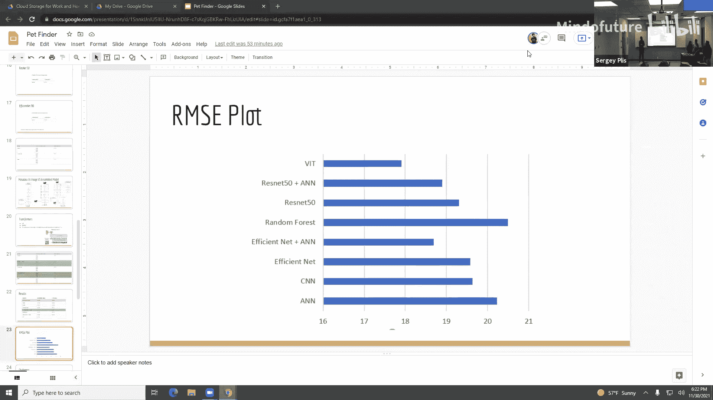

# 081：宠物寻找器项目演示

在本教程中，我们将学习一个名为“宠物寻找器”的机器学习项目。该项目旨在通过分析宠物照片的吸引力，帮助提高动物收容所中宠物的领养率。我们将从项目动机开始，逐步介绍数据处理、模型构建、结果分析以及面临的挑战。

## 动机与问题定义

每年，美国有超过90万只宠物（包括猫和狗）因无人领养而被安乐死。PetFinder 是一个在线领养平台，用户可以通过浏览宠物照片来寻找领养对象。平台目前使用一个基础模型为上传的宠物照片评分，该分数被称为“流行度”或吸引力分数。

我们的核心问题是：**如何让宠物照片更具吸引力，从而提高其被领养的可能性？** 更具体地说，我们需要构建一个模型，能够根据输入的宠物图像预测其吸引力分数（一个介于1到100之间的值），并以R²分数作为主要评估指标。

## 数据探索

我们获得了两种类型的数据：图像数据和元数据。

**元数据**：一个包含9000多条记录的表格，每条记录对应一张图像，描述了图像的特征。这些特征大多是二进制的（0或1），例如：
*   `subject_focus`: 宠物是否对焦清晰。
*   `eyes`: 眼睛是否清晰可见。
*   `face`: 面部是否清晰。
*   `near`: 宠物是否离镜头近。
*   `action`: 宠物是否在活动。
*   `accessory`: 是否有配饰。
*   `group`: 是否有多只宠物。
*   `collage`: 是否是拼贴画。
*   `human`: 是否有人类出现。
*   `blur`: 图像是否模糊。
*   `popularity`: 目标变量，吸引力分数。

**图像数据**：超过9000张原始的宠物照片。

以下是数据的关键观察结果：
*   吸引力分数（`popularity`）的分布集中在20-40分之间，少数图像分数接近100。
*   通过相关性分析发现，目标变量`popularity`与各个特征之间的相关性非常弱。然而，特征之间本身存在一些相关性，例如`face`（面部）和`eyes`（眼睛）呈正相关。
*   数据没有缺失值和明显的异常值。

上一节我们了解了数据的概况，接下来我们看看如何为模型训练准备这些数据。

## 数据预处理与增强

对于元数据，由于已是规整的数值数据且无缺失，我们直接将其用于模型输入。

对于图像数据，我们进行了标准化预处理，包括调整图像尺寸和像素值归一化。

数据增强是提升模型泛化能力的关键步骤。然而，由于我们的元数据包含了对图像内容的具体描述（如是否模糊、是否靠近镜头），我们不能使用会改变这些语义信息的增强方式。

以下是我们可以安全使用的图像增强技术列表：
*   **随机旋转**：将图像旋转一个随机角度。
*   **水平/垂直翻转**：沿轴线翻转图像。
*   **色彩调整**：微调图像的对比度、亮度和饱和度。

这些变换不会实质性地改变“模糊”、“靠近”等元数据标签所描述的状态。例如，对一张“清晰”的图片进行小幅旋转，它仍然是一张“清晰”的图片。

## 模型构建与实验

我们尝试了多种模型，从基线模型开始，逐步过渡到更复杂的架构。

### 基线模型：基于元数据的回归

首先，我们仅使用元数据训练模型，将其视为一个回归问题。我们尝试了多种经典机器学习模型：
*   **线性回归**
*   **Lasso回归**
*   **随机森林回归**
*   **支持向量回归（SVR）**

这些模型的表现都不理想，测试集R²分数大约在0.20到0.21之间。随机森林表现稍好，但预测值倾向于集中在平均值附近，说明元数据本身对吸引力分数的预测能力有限。

我们还尝试了一个简单的**人工神经网络（ANN）**，结果类似（R²约0.203），未能显著提升。

### 图像模型：卷积神经网络

鉴于元数据效果不佳，我们转向图像数据本身。我们首先构建了一个基础的卷积神经网络（CNN），但效果甚至比元数据模型更差。

于是，我们采用了预训练的深度学习模型，利用它们在大型图像数据集上学到的通用特征。
*   **ResNet-50**：一个包含50层残差块的经典CNN模型。公式上，残差块实现了恒等映射：`H(x) = F(x) + x`，这有助于缓解深层网络的梯度消失问题。
*   **EfficientNet-B0**：通过复合缩放（Compound Scaling）统一优化网络深度、宽度和分辨率的高效模型。其设计原则可以概括为寻找最优的复合系数φ：`Depth: d = α^φ, Width: w = β^φ, Resolution: r = γ^φ`，其中α, β, γ是通过网格搜索确定的常数。

使用5折交叉验证进行评估，ResNet-50取得了显著更好的效果，平均验证R²分数约为0.193，远高于基线模型。

### 集成模型：结合元数据与图像

为了充分利用所有可用信息，我们构建了集成模型，将元数据模型（ANN）和图像模型（ResNet-50或EfficientNet）的输出进行融合。

集成模型的架构如下：
1.  **元数据分支**：输入元数据，经过L2正则化和多个全连接层（Dense Layers）处理。
2.  **图像分支**：输入增强后的图像，通过预训练的CNN（如ResNet-50）提取特征，接全局平均池化层和全连接层。
3.  **融合层**：将两个分支的输出向量拼接（Concatenate）起来。
4.  **预测层**：在拼接后的向量上添加额外的全连接层，最终输出预测的吸引力分数。

这种架构允许模型同时从图像视觉内容和结构化元数据中学习信息。

### 探索性模型：视觉Transformer（ViT）

我们还探索了前沿的视觉Transformer模型。与CNN主要关注局部特征和纹理不同，Transformer模型通过自注意力（Self-Attention）机制能够捕捉图像中所有区域（包括背景）之间的全局依赖关系。

简要原理：
1.  将输入图像分割成一系列不重叠的图像块（Patches）。
2.  将每个图像块线性投影为一个向量，并加上位置编码。
3.  将得到的向量序列输入标准的Transformer编码器。编码器核心是多头自注意力层，其计算可表示为：`Attention(Q, K, V) = softmax(QK^T / √d_k)V`，其中Q（查询）、K（键）、V（值）均来自输入序列本身。
4.  在序列前添加一个可学习的分类标记（`[CLS] token`），其最终状态用于回归预测。

## 结果与挑战

### 结果总结

下表总结了不同模型在验证集上的平均R²分数（基于交叉验证）：

| 模型 | 平均验证R²分数 | 说明 |
| :--- | :--- | :--- |
| 随机森林（仅元数据） | ~0.204 | 基线模型 |
| ResNet-50（仅图像） | ~0.193 | 最佳单图像模型 |
| EfficientNet-B0（仅图像） | ~0.094 | 表现一般 |
| **集成模型（ResNet-50 + ANN）** | **~0.188** | **我们获得的最佳结果** |
| 集成模型（EfficientNet + ANN） | ~0.142 | 次于ResNet集成 |

集成模型（ResNet-50 + ANN）取得了我们最好的成绩，在Kaggle竞赛私有排行榜上获得了约0.188的R²分数。视觉Transformer模型仍在实验和调优中。

### 面临的主要挑战

在项目过程中，我们遇到了以下挑战：
1.  **Kaggle环境配置**：在Kaggle Notebook中协调代码、依赖和GPU资源时遇到了不少技术问题。
2.  **团队协作**：作为忙碌的学生，我们利用Kanban板进行任务管理和每周同步会议，以保持项目进度。
3.  **从分类到回归的思维转换**：初期不熟悉如何将常用于分类的神经网络（如使用Softmax输出）适配用于回归任务。
4.  **探索新架构**：理解和实现EfficientNet、视觉Transformer等相对新颖的模型需要投入大量学习时间。

## 未来工作与总结

### 未来工作方向

尽管取得了一定进展，仍有改进空间：
*   **处理类别不平衡**：吸引力分数的分布不均匀（低分样本多）。未来可以尝试为不同分数区间的样本赋予不同的权重（样本权重），让模型更关注稀有高分样本。
*   **探索更先进的Transformer**：如Swin Transformer，它在多项视觉任务中展现了卓越性能，可能带来精度提升。
*   **进一步调优**：对现有最佳集成模型进行更细致的超参数优化和训练技巧调整。

### 课程总结

在本节课中，我们一起学习了“宠物寻找器”项目的完整流程。我们从实际问题出发，进行了数据探索与分析，并系统性地尝试了从传统回归模型、卷积神经网络到集成模型乃至视觉Transformer等多种机器学习方法。结果表明，结合了预训练图像特征和元数据的集成模型效果最佳。这个过程不仅锻炼了我们的建模能力，也深刻体现了处理真实数据、团队协作和探索新技术的挑战与乐趣。