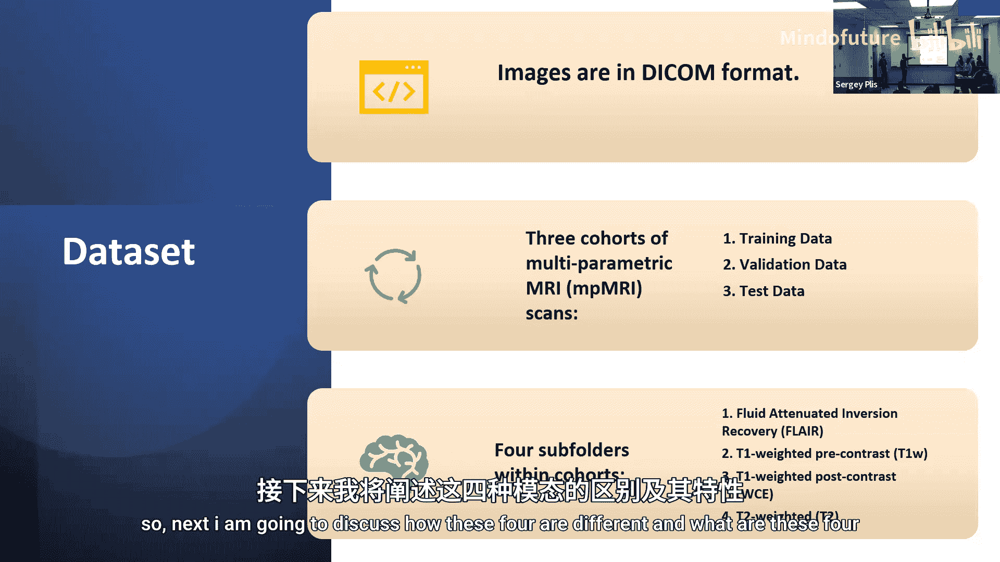
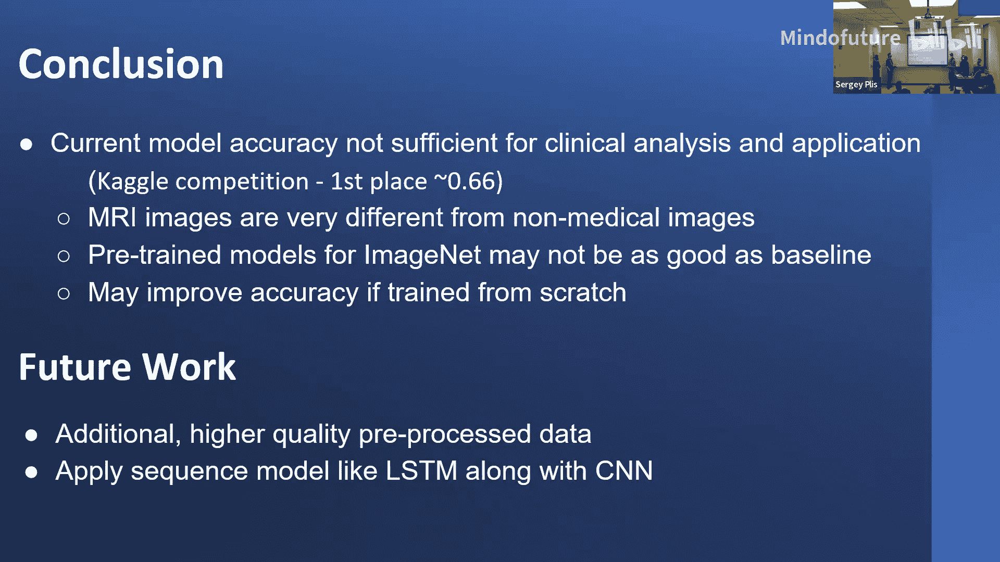
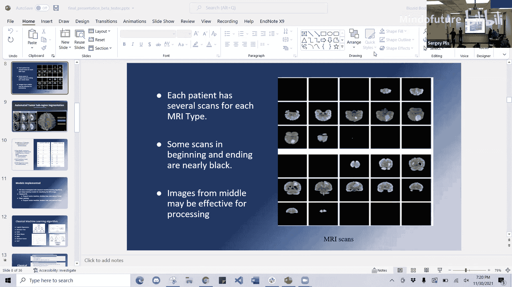

# 082：脑肿瘤分类与MGMT启动子甲基化预测 🧠

在本教程中，我们将学习如何利用机器学习，特别是深度学习模型，通过脑部核磁共振（MRI）图像来预测胶质母细胞瘤中MGMT启动子的甲基化状态。这是一个关键的生物标志物，能帮助判断患者对化疗的敏感性，从而指导个性化治疗。

## 背景与问题定义

大脑是人体最复杂的器官，负责感知、思维等多种功能。有时，大脑细胞会因基因突变而失控生长，形成肿瘤。脑肿瘤可分为良性或恶性，也可根据起源分为原发性（始于大脑）或继发性（从身体其他部位扩散而来）。存在超过150种脑肿瘤，本教程重点关注**胶质母细胞瘤**。

胶质母细胞瘤是一种侵袭性很强的恶性肿瘤，在成年人中最为常见。其治疗方法包括手术、放疗和化疗。本项目的核心是预测**MGMT启动子甲基化**状态。MGMT是一种DNA修复酶，如果肿瘤细胞的MGMT启动子被甲基化（即“沉默”），则其对化疗药物替莫唑胺更敏感。因此，预测MGMT状态是评估治疗效果和预后的独立有利因素。

传统上，这需要通过手术获取肿瘤组织进行活检分析，过程具有侵入性且耗时。我们的目标是开发一个模型，仅通过患者的MRI扫描图像就能预测MGMT状态，从而实现更快速、非侵入性的诊断。

## 数据集介绍

我们使用的数据集来自一项回顾性研究，收集自多家机构。由于成像协议不同，数据存在异质性。根据竞赛要求，数据分为三个队列：
*   **训练集**：用于训练模型。
*   **验证集**：用于调整模型。
*   **测试集**：由竞赛主办方私有持有，用于最终评估模型。

每个病例包含四种不同类型的MRI序列图像：
1.  **FLAIR**
2.  **T1w**（平扫）
3.  **T1wCE**（对比增强，注射钆造影剂后）
4.  **T2w**

这些序列从不同物理特性（如弛豫时间）突出显示脑组织，有助于识别肿瘤的不同特征（如水肿、增强区域）。

对于每位患者，每种序列都提供了一系列2D切片图像。初始和末尾的切片可能为空白，因此我们通常从中间选取连续的切片进行处理。基于此数据集，我们可以执行两类任务：
*   **自动肿瘤亚区分割**：识别并分割肿瘤的不同子区域。
*   **MGMT启动子甲基化状态分类**：本项目的主要任务，即预测MGMT是“甲基化”还是“非甲基化”。

## 方法概述：从经典机器学习到深度学习

为了完成分类任务，我们尝试了多种方法。首先，我们建立了一些经典的机器学习模型作为基础。随后，为了追求更高的性能，我们转向了更先进的深度学习模型。

### 经典机器学习流程

以下是我们在经典机器学习方法中遵循的标准流程。

**数据预处理与特征工程**
首先，我们对原始数据进行了清洗和准备。我们发现有三名患者的图像数据不完整，因此将其从训练集中移除，最终剩下582个样本。预处理步骤包括：
*   将图像转换为数值数组。
*   从每种序列的中间选取固定数量（如20张）的切片。
*   将所有图像缩放至统一尺寸（如256x256像素）。

经过预处理，每个样本的特征维度非常高（例如约37万个特征）。为了应对“维数灾难”，我们采用了**主成分分析（PCA）**进行降维。我们从每种图像类型的特征中提取前100个主成分，然后将它们合并，最终得到一个维度为 `(样本数, 400)` 的特征矩阵。

**模型训练与比较**
在降维后的特征上，我们训练并比较了七种经典的分类算法：
1.  逻辑回归
2.  决策树
3.  支持向量机（SVM）
4.  K近邻（KNN）
5.  随机森林
6.  梯度提升
7.  多层感知机（MLP）

我们使用ROC曲线下面积（AUC）、准确率、精确率和召回率等指标来评估这些模型的性能。

### 深度学习模型：卷积神经网络（CNN）基线

在探讨了经典方法后，我们引入深度学习模型。首先，我们建立一个简单的卷积神经网络作为性能基线，用以判断后续更复杂模型是否带来了实质提升。

卷积神经网络是处理图像数据的标准选择，因为它能有效提取图像的局部空间特征。其核心操作是**卷积**，使用一个小的滤波器（**kernel**）在图像上滑动，计算局部区域的加权和，从而生成特征图。公式可以简化为：
`输出特征图 = 卷积(输入图像, 滤波器) + 偏置`

我们使用PyTorch库实现了一个简单的CNN基线模型。该模型包含3个卷积层，使用ReLU激活函数和最大池化层。为了保持基线模型的简单性，我们没有进行复杂的超参数调优。优化器选择了Adam。

### 先进的深度学习架构

基线CNN模型的结果并不理想，这促使我们尝试更强大、更高效的现代网络架构。然而，由于计算资源有限，我们选择了两个在ImageNet数据集上预训练的优秀模型进行迁移学习。

**EfficientNet**
EfficientNet通过一种复合缩放方法，均衡地调整网络的深度、宽度和分辨率，在计算效率和准确率之间取得了良好平衡。我们将其作为特征提取器。

**ResNet50**
ResNet50引入了**残差连接**，允许梯度直接流过网络，有效缓解了深度网络中的梯度消失问题，使得训练非常深的网络成为可能。

**我们的实现方案**
1.  **输入处理**：对于每位患者，我们从四种MRI序列中各取中间20张切片，分别处理。每张图像被缩放至224x224像素。
2.  **模型调整**：我们移除了预训练模型顶部的分类层，将其输出连接到一个自定义的小型分类网络（通常包含全连接层和Dropout层）。
3.  **训练**：我们冻结了预训练模型的大部分底层参数，只训练顶部的自定义层和模型最后几层，以适应我们的脑肿瘤MRI数据。

## 结果与分析

现在，让我们来看看不同方法所得到的结果。

**经典机器学习结果**
在经典机器学习模型中，支持向量机（SVM）取得了相对最好的性能，AUC约为59%，准确率、精确率和召回率均在0.6左右。这表明经典方法有一定的预测能力，但性能有限。

**CNN基线模型结果**
我们实现的简单CNN基线模型，其表现并不比随机猜测（抛硬币）好。这可能是由于模型过于简单、缺乏调优，或者输入数据处理方式（如使用单张切片而非3D体积）未能充分利用数据信息。

**EfficientNet与ResNet结果**
我们绘制了不同MRI序列（T1w, T1wCE, T2w, FLAIR）上使用EfficientNet训练时的损失曲线和AUC曲线。
*   在部分序列上，训练损失和验证损失曲线接近，AUC曲线也有重叠，表明模型有一定学习能力。
*   但在另一些序列上，验证损失远低于训练损失，或AUC曲线出现抖动且不重叠，这可能是**过拟合**的迹象，即模型过度记忆了训练数据中的噪声，而未能很好地泛化到新数据。
最终，我们获得的分类准确率最高约为57%，未能显著超越经典SVM模型，也低于该竞赛中优胜队伍约66%的准确率。

## 讨论与未来方向

我们的项目结果表明，直接将在自然图像（如ImageNet）上预训练的模型应用于医学影像（MRI）存在挑战。医学影像在纹理、对比度和关键特征尺度上与自然图像差异很大。此外，我们的实现可能存在以下局限：
1.  **数据利用不足**：仅使用中间20张2D切片并简单堆叠成3D输入，可能丢失了重要的三维空间上下文信息。
2.  **模型与数据不匹配**：预训练模型的特征提取器可能不完全适用于MRI图像的独特模式。
3.  **计算限制**：由于资源有限，我们无法对大型模型进行充分的从头训练或精细调优。

**未来改进方向**
*   **使用3D CNN**：直接处理整个3D MRI体积数据，以更好地捕捉空间关系。
*   **领域自适应**：采用更先进的迁移学习或领域自适应技术，让模型更好地适应医学影像域。
*   **多序列融合**：设计更有效的架构来融合四种MRI序列的信息，而不是单独处理。
*   **数据增强**：使用针对医学影像的数据增强策略来增加训练数据的多样性。
*   **尝试时序模型**：如将切片序列视为时间序列，使用RNN或Transformer模型进行处理。

## 总结

在本教程中，我们一起学习了如何利用机器学习进行脑肿瘤生物标志物（MGMT启动子甲基化状态）的分类预测。我们从问题背景和临床意义出发，介绍了所使用的多序列MRI数据集。随后，我们详细讲解了从经典机器学习（包括PCA降维和SVM等分类器）到深度学习（包括简单的CNN基线、EfficientNet和ResNet50）的完整技术流程。通过分析结果，我们认识到将通用计算机视觉模型应用于专业医学影像领域所面临的挑战，并探讨了可能的解决方案和未来方向。尽管我们的模型性能有待提高，但这个过程清晰地展示了AI辅助医疗诊断的潜力和实际工作中需要考虑的关键因素。