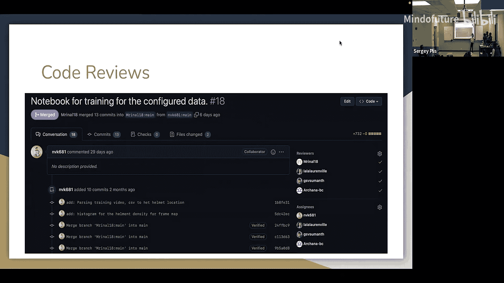
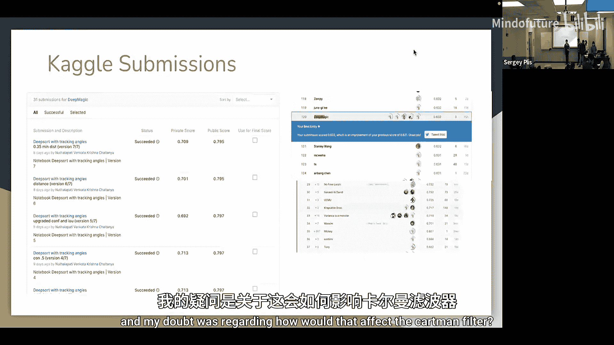

# 083：NFL健康与安全-头盔分配项目教程 🏈


在本教程中，我们将学习如何构建一个自动化系统，用于检测美式橄榄球比赛视频中的球员头盔，并识别潜在的碰撞事件。我们将涵盖从数据处理、模型选择、训练评估到最终集成的完整流程。

---

## 项目动机与数据概述

上一节我们介绍了项目的背景，本节中我们来看看我们使用的具体数据。

NFL（国家橄榄球联盟）自1920年成立以来，已成为全球最成功和受欢迎的体育联盟之一。多年来，联盟一直致力于提升比赛安全性，因为存在大量运动相关损伤。NFL与亚马逊云服务（AWS）合作，希望解决一个工程挑战：自动化其目前手动标注球员并分配ID的流程。这是一个非常耗时的过程。我们的目标是能够正确分配球员头盔，并准确识别它们何时发生碰撞。

我们被提供了MP4格式的视频数据。这些视频是时间同步的，包含两个视角：一个来自边线区域，一个来自端区区域。视频以每秒40帧录制。此外，还提供了一个辅助数据集用于更好的检测，该数据集包含带有头盔标注框的图像，总计近10，000张图像，其中约8，000张用于训练，近2，000张用于测试。

数据还提供了详细的球员追踪信息。以下是追踪数据包含的核心信息：
*   球员位置（X， Y坐标）
*   球员移动方向
*   球员旋转/朝向
*   端区和边线视角
*   总计超过53，000条追踪数据记录

下图展示了边线和端区的视角图像示例。


模型将在5个未公开的视频上进行评估。一个棘手之处是，官方提供的测试集是我们训练集的一个子集，因此我们需要确保我们的方法不会在测试集上过拟合。

---

## 探索性数据分析与预处理

在深入模型之前，我们需要对数据进行理解和清洗。以下是我们在探索性数据分析（EDA）中关注的关键点：

*   **游戏起始点（开球）**：视频在开球前就开始录制。我们裁剪掉开球前的帧，以去除无关信息。
*   **场上与场外人员**：在边线视角中，镜头外可能包含替补队员、教练等。我们只关心每队上场的11名球员。
*   **球员数量一致性**：在某些帧中，可能看不到全部22名球员，因为镜头可能只聚焦在持球区域。我们需要确保模型能处理这种情况。
*   **头盔尺寸变化**：由于镜头缩放，头盔在图像中覆盖的像素面积变化很大，最大约5928像素，最小仅9像素，大多数在150像素左右。

为了进行球员追踪，我们从每个视频中提取帧。我们使用FFmpeg工具来高效提取帧，避免一次性加载所有数据到内存。通过分析球员的X， Y坐标（如下图所示），我们可以追踪每个球员在连续帧中的移动，这对于后续的碰撞判断至关重要。



---

## 模型架构与组件

我们的目标不仅仅是检测物体（头盔），还要在视频序列中追踪它们并判断碰撞。因此，我们采用了多模型协作的管道（Pipeline）。整个流程如下图所示，接下来我们将分解其中的关键组件。



### 1. 基线模型：YOLO（You Only Look Once）

对于目标检测任务，我们选择了YOLO模型。YOLO是一种强大且高效的单次目标检测算法，能够快速在图像中定位和分类物体。

在YOLO中，图像被划分为S×S的网格。每个网格单元负责预测B个边界框（Bounding Box）。每个边界框包含以下信息：
*   中心坐标（bx， by）
*   宽度和高度（bw， bh）
*   该框包含物体的置信度（pc）
*   物体类别概率（c1， c2， ...， ck）

**公式：边界框预测**
每个网格单元的预测输出是一个长度为 `B * (5 + C)` 的张量，其中5代表（pc， bx， by， bw， bh），C是类别数量。

### 2. 追踪组件：Deep SORT

由于我们的数据是视频，我们需要追踪帧与帧之间的同一球员。我们使用了Deep SORT算法，它结合了：
*   **卡尔曼滤波（Kalman Filter）**：用于预测球员在下一帧中的位置，即使球员被短暂遮挡。
*   **匈牙利算法（Hungarian Algorithm）**：用于关联上一帧的检测框和当前帧的预测框，完成ID匹配。
*   **卷积神经网络（CNN）**：用于提取外观特征，辅助关联。

卡尔曼滤波通过结合物体的位置、速度和加速度信息，来估计其下一个状态。其状态方程和观测方程可以简化为：
**代码/公式：卡尔曼滤波预测与更新**
```
# 预测步骤
x_pred = F * x_est  # 状态预测
P_pred = F * P_est * F.T + Q  # 误差协方差预测

# 更新步骤
y = z - H * x_pred  # 测量残差
S = H * P_pred * H.T + R  # 残差协方差
K = P_pred * H.T * np.linalg.inv(S)  # 卡尔曼增益
x_est = x_pred + K * y  # 状态更新
P_est = (I - K * H) * P_pred  # 协方差更新
```
（其中x是状态向量，P是误差协方差，F是状态转移矩阵，H是观测矩阵，Q和R是过程噪声和观测噪声协方差，z是实际测量值）

### 3. 碰撞判断：边界框交并比与运动方向

仅仅检测到两个头盔的边界框相交（高IoU）并不足以判定为有风险的碰撞，因为可能是视角重叠。我们引入了运动方向（角度）作为关键判断依据。

**公式：交并比（IoU）**
`IoU = Area of Intersection / Area of Union`

如果两个球员的边界框IoU超过阈值**并且**他们的运动方向是朝向彼此的（即速度向量的夹角接近180度），我们才将其标记为潜在的碰撞事件。这大大减少了误报。

---

## 训练、测试与集成策略

我们使用了三个独立的模型，每个负责一个特定任务，然后将它们集成到最终的管道中。

### 数据增强与训练
为了增加数据多样性，我们利用了端区视角的图像，并通过翻转等操作进行增强。我们避免使用边线视角数据，因为它包含了太多场外无关人员（如观众），可能干扰模型。

我们使用提供的CSV追踪数据，为视频的每一帧生成带有球员ID的边界框标注，用于训练YOLO模型。由于训练多个模型对计算资源要求高，我们采用分阶段策略：
1.  在一个独立的笔记本中训练YOLO模型，并保存检查点（Checkpoint）。
2.  在另一个笔记本中加载YOLO检查点，然后与Deep SORT等追踪模块结合进行视频序列的训练和测试。

### 超参数调优
我们调整了多个超参数以优化性能：
*   **置信度阈值**：设置为0.4，忽略置信度低于此值的预测框，以平衡精度和召回率。
*   **非极大值抑制（NMS）**：用于去除重叠的冗余检测框。
*   **卡尔曼滤波参数**：调整过程噪声和测量噪声协方差（Q， R），以更好地匹配球员的运动模式。

### 模型集成与提交
最终的管道工作流程如下：
1.  **YOLO模型**：接收视频帧，输出头盔的边界框和置信度。
2.  **Deep SORT**：接收YOLO的输出，跨帧追踪每个头盔（球员），分配唯一ID。
3.  **碰撞判断模块**：分析被追踪头盔的轨迹，计算边界框IoU和运动方向，触发碰撞事件。
我们将所有模块的输出汇总，生成最终的比赛分析结果用于提交。

---

## 模型评估与结果分析

我们使用多种指标来评估模型的性能。

### 模型选择：YOLO vs. Detectron2
我们对比了YOLO和Facebook的Detectron2框架。虽然Detectron2在精度上可能略有优势，特别是在小物体检测上，但它的模型更复杂，训练和推理速度更慢。考虑到我们需要处理大量视频帧并追求实时性，YOLO在速度和精度之间提供了更好的平衡。YOLO也更容易理解和实现。

### 评估指标
官方使用加权F1分数进行评估，同时考虑：
*   **碰撞（Impact）**：实际发生接触并可能造成伤害的事件。
*   **非碰撞接触（Non-Impact）**：球员非常接近但未发生实质性接触的事件。
我们使用`Weights & Biases（W&B）`工具来跟踪训练过程。主要监控三种损失：
*   **边界框损失（Box Loss）**：预测框与真实框之间的回归误差。
*   **物体性损失（Object Loss）**：判断网格内是否有物体的置信度误差。
*   **分类损失（Class Loss）**：物体类别预测的误差。

### 性能结果
通过调整置信度阈值和IoU阈值，我们的模型性能得到了显著提升。最终，我们在测试集上取得了0.713的加权F1分数，这在参赛队伍中排名约第32-33位（共约500队）。混淆矩阵显示，模型对清晰可见的头盔检测效果很好，但对部分遮挡或尺寸很小的头盔检测仍有提升空间。

---

## 项目协作与总结


### 团队协作
我们使用GitHub进行版本控制和项目管理。我们为不同的任务（数据预处理、模型选择、训练、评估）创建了分支和Pull Request（PR），确保所有代码在合并前都经过团队成员的审查。我们也定期在在线看板上同步进度。

### 经验总结与未来工作
在本项目中，我们一起学习了如何构建一个复杂的视频分析管道，涉及目标检测、多目标追踪和事件判断。

**总结关键点**：
1.  **问题拆解**：将复杂的“检测头盔碰撞”任务分解为目标检测、目标追踪和事件判断三个子任务。
2.  **模型选型**：根据问题需求（速度 vs. 精度）选择合适的模型，我们选择了YOLO和Deep SORT的组合。
3.  **数据是关键**：充分的数据探索、清洗和增强对模型性能至关重要。
4.  **迭代优化**：通过超参数调优和集成策略逐步提升模型分数。


**未来可以改进的方向**：
*   **尝试更先进的检测器**：如YOLOv8或DETR，并采用模型集成（如加权框融合， WBF）技术。
*   **利用更多时序信息**：像顶级方案那样，使用更长的帧序列（历史信息）来提升追踪和碰撞预测的稳定性。
*   **融合更多数据源**：更有效地结合边线视角和端区视角的信息，以及原始的球员追踪坐标数据。

通过这个项目，我们不仅应用了机器学习技术，也深刻体会到从研究到实现一个完整、可用系统的全过程。