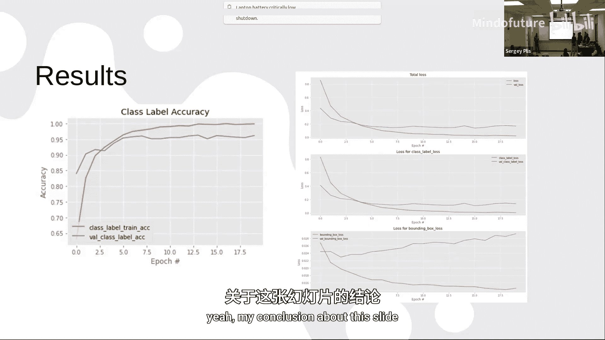

# 084：Passion Fruit 健康状态检测项目教程


## 概述
在本教程中，我们将学习如何构建一个机器学习模型，用于检测和分类乌干达百香果的疾病。我们将从理解问题背景开始，逐步介绍数据处理、模型选择、架构实现以及性能优化的完整流程。本项目旨在解决小农户因缺乏可靠诊断工具而面临的作物减产问题。

## 项目背景与动机
乌干达的许多植物病虫害导致作物减产，并降低了整个农业部门的投资意愿。当地农民多为小农户，收入较低，缺乏足够手段来应对农场中的病虫害挑战。由于无法获取作物健康状况的必要知识，他们难以进行干预以避免灾难性的损失。整体产量的下降和该领域投资的减少可能导致粮食短缺。

麦克马斯特大学的MSML实验室承担了解决百香果疾病缺乏可靠、及时诊断平台的责任。他们正尝试使用Lab5开发一种低成本手持设备，并将此任务作为在线竞赛发布在Zindi平台上，旨在构建一个用于检测百香果健康状况的ML模型。

## 数据集介绍与预处理
以下是数据集的初步介绍和处理步骤。

### 数据集构成
我们获得的数据集包含以下部分：
*   **训练CSV文件**：包含696行和6列。每个图像可以有多个对象，这对应着多个边界框。本项目涉及三个类别：果实褐斑病、健康果实和枯萎病。
*   **测试CSV文件**：包含97行和1列。
*   **图像数据**：我们从3000张图像中获得了2902个边界框。一些图像只有一个边界框，而其他图像可能有多个。

### 数据预处理步骤
为了准备模型训练，我们执行了以下关键的数据预处理步骤：
1.  **删除重复数据**：首先移除数据集中的重复条目。
2.  **标签编码**：将类别从文本字符串编码为数值格式，以便模型处理。
3.  **提取几何信息**：根据项目要求，我们从数据中提取了边界框的宽度和高度信息。

经过这些步骤，我们得到了编码后的类别标签以及图像的几何特征，为后续建模奠定了基础。

## 问题定义与挑战分析
上一节我们介绍了数据的基本情况，本节中我们来看看这个任务背后的核心问题与挑战。

最初，我们以为这是一个简单的图像分类问题，但深入分析后发现了其复杂性：
1.  **可变数量的对象**：一张图像中可能包含1到4个百香果，每个对象都需要被识别。
2.  **对象尺寸不一**：图像中的每个百香果大小可能不同。
3.  **联合任务**：模型不仅需要检测出对象（定位），还需要对每个检测到的对象进行分类。

因此，这是一个**目标检测**问题，它结合了**定位**（找到边界框坐标）和**分类**（判断每个框内的果实状态）的任务。

传统的解决方案（如滑动窗口法）需要为不同位置和尺寸生成特征，计算复杂且耗时。深度学习改变了计算机视觉问题的解决范式。

## 模型架构探索：从R-CNN到Faster R-CNN
理解了问题本质后，我们开始探索解决方案。我们首先回顾了经典方法，然后聚焦于更高效的深度学习模型。

### 经典方法及其局限
我们研究了一些经典的目标检测方法：
*   **DPM（可变形部件模型）**：使用HOG特征，非常复杂且耗时。
*   **HOG（方向梯度直方图）**：结合SVM分类器和多尺度滑动窗口进行检测，速度较慢。

这些方法由于效率问题，不适用于我们的场景。

### 深度学习解决方案演进
深度学习提供了更优的解决方案，其演进过程如下：
*   **R-CNN**：首代方案，使用区域提议方法生成候选框，对每个区域用CNN提取特征，再用SVM分类。缺点是每个提议都要单独计算特征，非常昂贵。
*   **Fast R-CNN**：引入选择性搜索来生成对象提议，提高了效率，但在推理时仍受限于选择性搜索的速度。
*   **Faster R-CNN**：这是我们最终采用的核心架构。它引入了**区域提议网络（RPN）**，与特征提取网络共享计算，极大地提升了速度和性能。

### Faster R-CNN 工作流程
以下是Faster R-CNN的简化工作流程：
1.  **特征提取**：输入图像通过一个卷积神经网络（如ResNet50或VGG16）生成特征图。
    ```python
    # 伪代码示例：使用预训练CNN提取特征
    base_model = VGG16(weights='imagenet', include_top=False)
    feature_map = base_model.predict(input_image)
    ```
2.  **区域提议**：特征图被送入RPN。RPN生成一系列边界框提议，并为每个提议分配一个“对象性”分数，用于判断框内是背景还是感兴趣对象。
3.  **兴趣区域池化**：对RPN提出的边界框进行池化操作，将它们调整为固定尺寸。
4.  **分类与回归**：池化后的特征被送入全连接层，同时执行两个任务：
    *   **分类**：判断边界框内的对象属于哪个类别（如健康、褐斑病）。
    *   **边界框回归**：微调边界框的位置，使其更精确地包围对象。

整个流程实现了端到端的对象检测与分类。

## 备选模型：VGG16 架构
除了Faster R-CNN，我们也探索了VGG16作为基准模型。VGG16是一个深度卷积神经网络，在ImageNet数据集上进行了预训练。

### VGG16 工作原理
VGG16的输入是固定尺寸 `(224, 224, 3)` 的图像。图像经过一系列卷积和池化层：
*   浅层学习边缘等基础特征。
*   深层学习更复杂的特征组合。
最终，图像被压缩成一个一维特征向量，并通过全连接层进行分类。特征图虽然空间尺寸变小，但深度增加，保留了图像的关键信息。

### 模型的调整
由于VGG16原本用于单标签图像分类，而我们需要输出多个边界框及其类别，因此必须对其进行修改。我们调整了网络输出层，使其能同时预测边界框坐标和多个对象的类别标签。

## 数据增强策略
我们的训练数据量相对较少，为了提升模型的泛化能力，防止过拟合，我们广泛使用了数据增强技术。数据增强可以人工扩展训练数据集。

我们使用了 `albumentations` 库，这是一个高效的数据增强工具。以下是我们在项目中应用的一系列增强操作：
*   **水平与垂直翻转**
*   **随机旋转**（如90度或其他随机角度）
*   **亮度调整**
*   **对比度调整**
*   **随机亮度对比度联合调整**
*   **图像缩放**（先下采样再上采样以模拟质量变化）
*   **图像平移**

这些操作通过代码库灵活应用，显著增加了数据的多样性，帮助模型学习到更鲁棒的特征。

## 实验过程与结果分析
现在，我们将所有部分结合起来，回顾实验过程并分析结果。

### 性能提升历程
我们的模型性能经历了多次迭代提升：
1.  **基线模型**：初始尝试准确率很低。
2.  **Faster R-CNN**：转向Faster R-CNN后，准确率提升至71%，我们将其作为主要模型。
3.  **引入数据增强**：应用前述数据增强技术后，性能得到进一步改善。
4.  **资源优化**：我们遇到了计算资源瓶颈。最初使用CPU训练速度很慢，后来转为使用Google Colab的GPU，训练效率大幅提升。
5.  **最终成绩**：经过一系列优化，我们在后期达到了约81%的准确率。如果在竞赛截止前提交，这个成绩大约可以排在25名左右（共约700支队伍），相比最初的114名有显著进步。

### 遇到的挑战与错误
在项目过程中，我们遇到并纠正了一些关键错误：
*   **提交格式错误**：最初，我们错误地只对每张图像预测一个边界框，而忽略了可能存在多个对象的情况，这导致得分异常低（仅24%）。
*   **坐标理解错误**：我们曾混淆边界框坐标 `(x_min, y_min, x_max, y_max)` 的顺序，在修正后得分恢复正常。
*   **问题理解偏差**：最大的挑战在于最初未能正确理解这是一个目标检测问题，而非简单的图像分类问题。这导致我们浪费了时间在错误的路径上。

### 模型比较与反思
我们曾训练VGG16模型，在验证集上获得了很高的准确率（如95%）。然而，我们当时没有及时在测试集上验证其泛化性能，就因其在验证集上的过拟合迹象而转向了Faster R-CNN。事后反思，我们应该更系统地使用交叉验证或保留测试集来评估模型真实性能，而不是依赖单一的验证集结果或直接提交到竞赛平台测试。

## 项目协作与管理
有效的协作对于项目成功至关重要。我们采用了以下工具和方法：
*   **代码管理**：使用Git进行版本控制，主要仓库托管在GitHub上。由于大部分开发在Google Colab进行，我们也利用了Colab自带的版本历史功能。
*   **任务管理**：尝试使用Trello看板来跟踪任务和进度，但在学生团队中完全贯彻有一定挑战。主要的日常协调仍通过WhatsApp和短信进行。
*   **文档与演示**：使用Google Docs和Slides进行方案设计和报告撰写。

## 总结与核心挑战
在本教程中，我们一起学习了构建一个百香果病害检测系统的完整流程。

### 核心学习点
我们从项目动机出发，经历了数据预处理、问题定义（目标检测）、模型选型（Faster R-CNN）、数据增强、实验迭代和错误分析等多个阶段。关键步骤包括：
1.  **精确定义问题**：区分分类、检测、分割任务。
2.  **选择合适的架构**：Faster R-CNN适合可变数量对象的检测与分类。
3.  **利用数据增强**：在小数据集上提升模型鲁棒性。
4.  **系统化评估**：避免过拟合，严谨评估模型真实性能。

### 最大的挑战
本项目最大的挑战在于**最初对问题的正确理解**。将问题误判为图像分类导致方向性错误。这提醒我们，在开始建模前，必须投入足够时间深入分析问题本质、数据结构和任务要求。一旦正确理解了这是需要**定位**和**分类**的**目标检测**问题，后续的模型选择和优化路径就变得清晰起来。



通过这个项目，我们不仅实践了高级机器学习技术，更深刻体会到了问题定义在机器学习项目中的决定性作用。