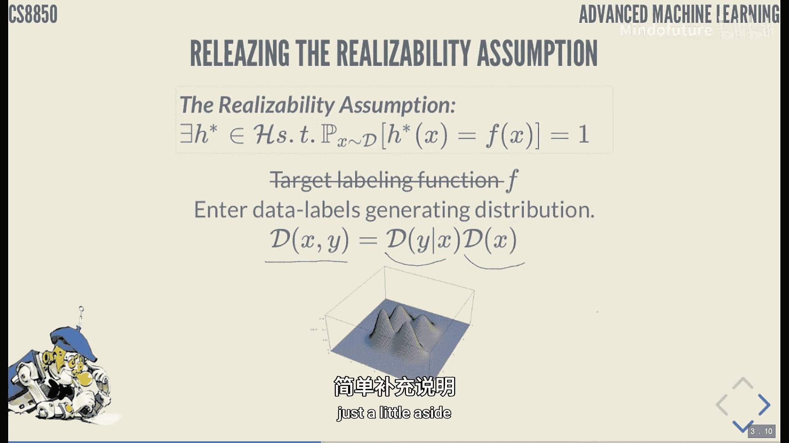
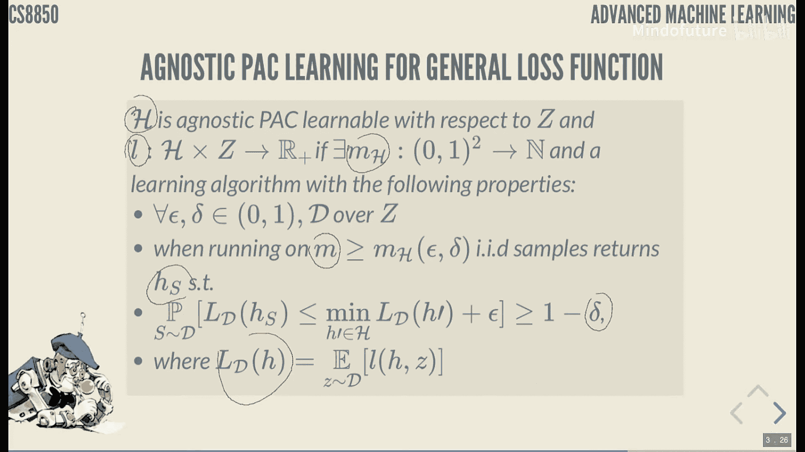

# 085：不可知PAC学习 🧠

在本节课中，我们将深入探讨机器学习理论中的一个核心概念——不可知PAC学习。我们将从回顾PAC学习框架开始，逐步放宽其假设，最终得到一个更通用、更贴近现实的学习理论模型。

---

## 概述

在之前的课程中，我们定义了“概率近似正确”学习，它基于一个关键假设：存在一个完美的目标假设。本节我们将移除这个“可实现性”假设，进入更一般的“不可知”学习场景。我们将学习如何定义在这种更现实设定下的学习能力，并引入广义损失函数来统一处理分类和回归等问题。

上一节我们介绍了在可实现性假设下的PAC学习理论，本节中我们来看看当这个假设不成立时，学习理论该如何构建。

---

## 回顾：PAC学习与样本复杂度

在上一讲的回顾中，我们定义了在训练集上获得一个会导致真实损失失败的最优假设的概率。这个概率就是δ，它恰好是获得一个坏训练样本的概率。

我们之前已经对δ进行了上界估计。获得坏样本的概率小于等于假设集的大小乘以 e 的负精度参数乘以样本数量次方。

让我们对不等式两边同时除以δ。然后，对不等式两边取对数。由于对数函数是单调递增函数，不等式符号不变。我们最终得到右边项，它非负，大于等于零。

由此，我们可以重新排列，得到这个不等式。它表明精度参数ε与样本数量m成反比。这里的含义是：如果你固定ε，那么给定其他参数，你需要更多的样本来达到那个ε。你需要增加样本数量。

另一个问题是：对于一个固定的δ和ε，我们应该取多少个样本？为了达到获得坏训练样本的给定概率，我们应该取至少这么多样本。至少取这么多样本，你将能保证δ和ε。更高的样本数量将导致增加成功概率（1-δ）的更好机会。

由此可以得出：给定一个有限的假设类、一个固定的δ（在开区间0到1之间）和一个正的ε，对于任何标记函数和数据生成分布，只要可实现性假设成立，那么对于大小为M的训练集中任意经验风险最小化假设h_S，其真实损失小于等于ε（即成功）的概率至少为1-δ。

---

## 定义PAC可学习性

从上述结论，我们可以定义PAC可学习性。一个假设类H是PAC可学习的，如果存在一个关于该类别的函数M_H。M_H是一个映射。它接受ε和δ的值，并返回一个自然数。

具体来说，H是PAC可学习的，如果存在这样一个函数M_H和一个具有以下性质的学习算法：对于所有在单位区间内的ε和δ，对于定义在域X上的所有数据生成分布D，以及对于所有将样本映射到{0,1}的标记函数f，当可实现性假设成立时，在运行于m ≥ M_H(ε, δ)个IID样本上时，学习算法返回一个假设h，使得成功（即损失L_D(h) ≤ ε）的概率大于等于1-δ。

这个定义由Leslie Valiant在1984年给出。它定义了一个假设类的可学习性。在我们之前的第二讲中，我们确定它应该是一个有限的类。为了使其成为有限类，我们必须以某种方式构造它。例如，在我们的二维例子中，假设类可以是网格上矩形的类，以使其有限。

---

## 样本复杂度

计算机科学是关于算法复杂性的。我们有运行时间复杂性，空间复杂性。我们将算法组织成不同的复杂性类别，如多项式类、非确定性多项式类、P空间类等，这是一个完整的计算复杂性类层次结构。

但当我们开始谈论机器学习时，有另一个复杂性的概念。当我们想谈论从数据中学习时，我们需要定义样本复杂性的概念。这意味着：为了生成能在特定问题上表现良好的分类器（来自特定类别的特定分类器），需要多少个样本？

样本复杂度是ε和δ的函数，即M_H。它告诉我们保证一个概率近似正确的解决方案需要多少样本。用通俗的话说，就是我之前那句话所说的：我们需要多少样本才能正确学习？但“正确学习”意味着什么？这是未定义的。所以，为了定义一切，我们可以使用PAC学习：我们需要多少样本才能获得通过PAC可学习性定义的“概率近似正确”的解决方案？

许多函数满足这个定义。为了指定唯一一个函数，我们添加一个最小化条件。样本复杂度是满足以精度ε和置信度δ进行PAC学习要求的最小整数。这个定义如何？

---

## 有限假设类的样本复杂度

有限假设类的样本复杂度是多少？回想一下我们之前的一个结论，我们已经建立了这个不等式。一旦我们有了这个不等式，我们就可以建立以下不等式。我们对δ进行了界定，并且能够为有限类推导出m的下界。

对于无限类则不然。显然是有限性决定了可学习性。但对于有限类，我们可以计算|H|，即假设类中可能的假设数量。我们需要一个有限的类。基本上，通过取这个比率的上限，我们可以确定所需的最小样本数量，以满足我们获得好样本的机会是1-δ。样本越多，这个概率就越好。

---

## 超越二元分类：移除可实现性假设

二元分类并不是我们感兴趣的唯一学习问题。我们需要做其他事情，或者以某种方式超越二元分类，进入其他问题，并且仍然对实现给定精度或给定不失败概率（或不获得坏样本的概率）所需的样本复杂性有良好的把握。例如，回归就是其中一个问题。

为了更通用，我们需要移除可实现性假设。可实现性假设告诉我们：存在一个标记器或假设h*，它将在所有样本上返回真实标签。但在所有样本上返回真实标签，在某种程度上假设了每个样本首先可以有一个明确的标签。这并不总是可能的。

假设我们想要训练一个分类器，根据人的轮廓来预测其生理性别变量。生理性别变量可以根据DNA分配给每个人。如果一个人有Y染色体，那么他们的生理性别是男性。在这个情境中，我们实际上可以有一个函数f。但问题是，我们无法访问所有可能的特征，或者我们不知道哪些特征与这种唯一分配相关。所以我们处理的是轮廓，你能从轮廓预测性别吗？正如这张图片所示，我们甚至无法预测它是否是人类、动物或生物。所以，可实现性假设是棘手的。

如果我们想放宽这个假设，即放宽存在这样一个h*的假设，使得我们的函数返回的标签等于真实标记函数的概率为1。那么，我们现在需要摆脱目标标记函数，因为我们不能假设存在一个能正确标记一切的函数。取而代之的是，我们引入数据和标签的联合生成分布。

---

## 引入联合分布与贝叶斯视角

现在我们有一个数据和标签的联合分布，它是我们的条件分布。给定一个x，它以某种概率生成一个y，以及数据上的先验分布。现在，我们进入了贝叶斯世界。我们处理的是联合分布、条件分布和边缘分布。

我们如何得到它？我们有一个分布P(X,Y)，它是联合分布。如果我们固定一个x的值，那意味着我们取了这个分布的一个切片。当我们说固定那个x值时，我们得到的是y的分布。但为了从函数形式得到正确的分布，我们需要将其归一化使其和为1。为了归一化使其和为1，我们需要取联合分布P(X,Y)，对y的所有可能值积分，我们知道这就是边缘分布P(X)。如果我们对y做同样的事情，我们可以很容易地得出贝叶斯定理，但我们将在课程后面进行。

我想说的是，当我们真正用条件概率分布D(Y|X)替换目标标记函数f时，那么我们的真实损失（真实风险）就需要重新定义。以前，真实损失是相对于数据生成分布的概率，即我们的假设返回的标签不等于真实标记函数将返回的标签。但现在我们如何处理呢？让我们重新定义真实损失L_D(h)为相对于联合分布P(X,Y)的概率，即h(x) ≠ y。等价地，它是集合{(x, y): h(x) ≠ y}的概率质量。

在我们的学习过程中，我们想要找到一个预测器h，以最小化新的真实损失。这个愿望的问题是：学习者不知道数据生成分布。在现实世界中，我们很少知道数据生成分布。因此，经验风险的定义保持不变，即训练集中错误分类样本的数量除以训练集中的样本总数。现在，我们的目标是找到一个假设，使其概率近似地最小化真实损失。

---

## 贝叶斯最优预测器及其局限性

如果我们思考一下，答案将是贝叶斯最优预测器。对于数据生成分布（即定义在我们的域与标签集{0,1}的笛卡尔积上的联合分布），最佳预测器如下：一旦我们得到x，如果条件概率P(Y=1|X=x)大于等于1/2，我们返回1；否则返回0。

但这个问题在于：贝叶斯最优预测器是我们没有希望找到的h。贝叶斯误差是最优的，我们无法找到误差更小的h。至少渐近地看是这样。但我们的误差定义为所有数据上的真实损失，所以这个陈述在没有对数据分布D的假设下是严格成立的。然而，我们不知道D，我们不知道数据生成分布，因此我们无法利用贝叶斯最优预测器，因为我们不知道给定数据时标签的条件概率。

相反，我们要做或将要做的，是寻找一个误差不比最佳可能误差大太多的预测器。贝叶斯误差是最佳可能误差，所以我们不希望误差大太多，我们不希望找到一个偏离它太多的预测器。

---

## 定义不可知PAC学习

有了这个基础，我们现在可以定义不可知PAC学习。一个假设类H是不可知PAC可学习的，如果存在一个样本复杂度函数M_H和一个具有以下性质的学习算法：对于所有ε和δ，以及所有数据和标签的联合分布，当我们在m ≥ M_H(ε, δ)个IID样本上运行该算法时，该算法返回一个假设h，使得其真实损失L_D(h)小于等于在假设类H中可达到的最小可能损失（即inf_{h' in H} L_D(h')）加上ε，并且这个事件的概率大于等于1-δ。

这就是不可知PAC学习。我们摆脱了一个强大而严格的假设——可实现性假设，即一切都可以被某个我们未知的真实标记函数正确标记。我们进入了具有分布的贝叶斯世界，现在我们不需要真实标记函数的概念了。

---

## 扩展到多分类与回归问题

但还有其他任务，例如多分类。我们想将文档分类到不同的类别中，或者我们想用脑电图实现脑机接口来制作思维阅读器或思维打字机。我们想将脑电波（作为x）映射到整个字母表加数字，而不仅仅是两个类别。另一个多分类的例子是预测下一个单词。除了多分类，还有一个完全不同的问题——回归问题。

回归问题是拟合数据的问题，是寻找数据之间函数关系的问题。通常，回归问题是指我们想找到x和y之间的函数关系，其中我们的标签y不是二元标签，而是某个因变量或属性。例如，我们想预测年龄（一个连续的有界数字），或者我们想预测温度或任何其他连续数字。

在这个任务中，我们想找到将x映射到y的函数，找到函数依赖关系。回归问题是一个有趣的问题。基本上，当你测量大量数字时，你甚至可能有多个x（x1, x2）。但这个y变量是x1和x2的函数。也许我们测量这个变量时有噪声。但我们需要拟合一条曲线，或者在简单线性回归的情况下，拟合一条具有最小误差并能通过滤除噪声来解释底层过程的直线。

回归是由卡尔·弗里德里希·高斯和阿德里安-马里·勒让德同时发明的。他们都发现了拟合曲线或直线的方法，而不仅仅是回归的一般形式，还有最小二乘法。一个有趣的观察是：从我的描述中你可以看到，他们都发现了一种拟合方法，然而我们称之为“回归”。“回归”这个术语是由弗朗西斯·高尔顿在19世纪创造的，用来描述一种生物现象，即高个子祖先的后代身高倾向于向正常平均值“回归”，也称为“均值回归”。但不知何故，这个名字被用于使用最小二乘法的拟合方法。

这里有不同的例子，展示了将不同模型拟合到同一数据集。你可以使用相同的方法，但模型不同。例如，这里我们使用最小二乘法拟合一条具有截距和斜率的直线方程。这里你从函数中移除斜率，你仍然在最小二乘意义上得到最佳可能的拟合。

---

## 广义损失函数

那么回归的损失是什么？最小二乘损失。回归的损失是真实标签y与我们的假设h(x)输出之间平方差的期望值。由于很难计算期望平方差（记住，我们很少知道分布D），我们使用均方误差，它只是预测值与测量值之间的平均平方误差。

对于任何假设类H和域Z，广义损失函数是一个从假设集与域Z的笛卡尔积映射到非负实数的函数。对于预测任务，Z只不过是定义数据和标签联合分布的域。但我们想更通用，我们希望Z是任何样本域，例如，在无监督学习任务中，Z不能是实例域和标签域的乘积，因为我们没有标签。

我们称这样的函数为损失函数（小写l），它们映射到非负实数。使用广义损失函数l，我们可以重新定义风险函数。我们的真实风险L_D(h)定义为，由数据分布生成的Z的期望损失。同样，经验风险R_S(h)只是平均损失。

我们可以使用这种方法定义0-1损失。我们有样本和标签的对(x, y)。如果h正确预测了x的标签，我们定义损失为0；如果h错误预测了x的标签，则定义损失为1。注意，对于一个二元随机变量，期望损失将等于该变量为1的概率。我们也可以定义平方损失，它只是我们的假设输出与训练集中真实值之间的平方差。这个损失对回归问题很有用。

---

## 基于广义损失的不可知PAC学习

稍微重新表述和重新定义我们基于广义损失函数的不可知PAC学习。一个假设类H关于域Z和广义损失函数l是不可知PAC可学习的，如果存在一个样本复杂度函数M_H和一个具有以下性质的学习算法：对于所有ε和δ，以及Z上的所有数据分布，当我们在m ≥ M_H(ε, δ)个IID样本上运行该算法时，该算法产生一个假设h，使得使用该假设的真实损失L_D(h)小于等于在该假设类中可达到的最小可能损失加上某个允许的精度参数ε，并且这个概率大于1-δ。

δ和之前一样，是获得我们无法从中学习的样本的概率。我们的损失现在定义为广义损失的期望值。

---

## 总结

本节课中，我们一起学习了机器学习理论的核心进阶内容。我们从经典的PAC学习框架出发，回顾了其定义和样本复杂度的推导。接着，我们探讨了其关键限制——可实现性假设，并学习了如何通过引入数据和标签的联合分布来移除该假设，从而定义了更通用的**不可知PAC学习**。

我们了解到，不可知PAC学习的目标不再是寻找零误差假设，而是寻找一个误差不差于假设类中**最佳可能假设**太多的预测器，即满足：
`L_D(h) ≤ inf_{h' in H} L_D(h') + ε`
且概率至少为 `1-δ`。

最后，我们将框架进一步推广，使用**广义损失函数** `l(h, z)` 统一了分类（0-1损失）和回归（平方损失）等问题，给出了最终最一般化的不可知PAC学习定义。这为我们分析更广泛的学习任务奠定了理论基础。