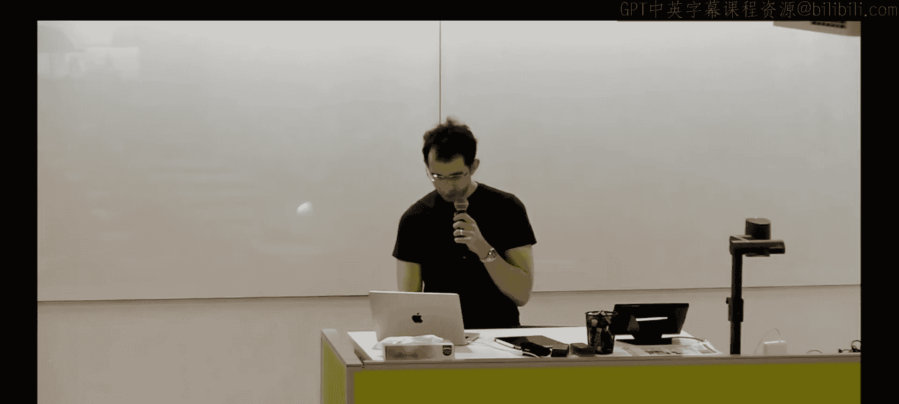
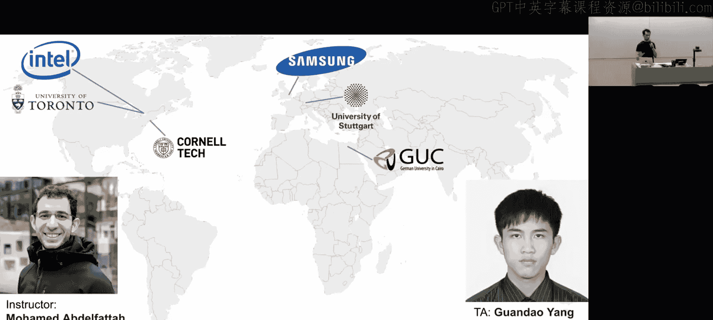
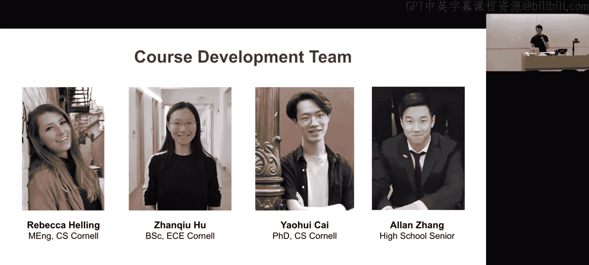
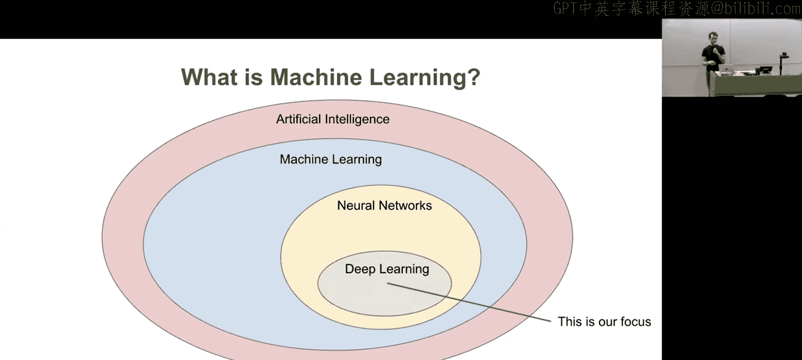
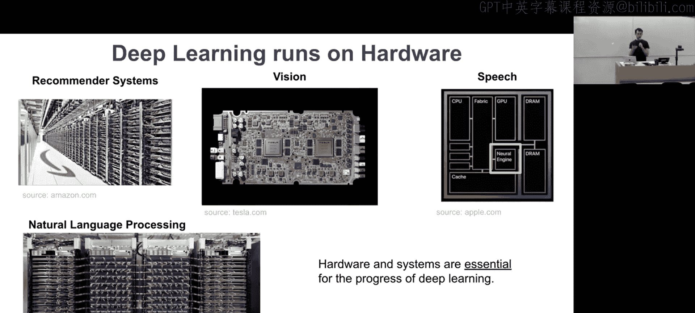
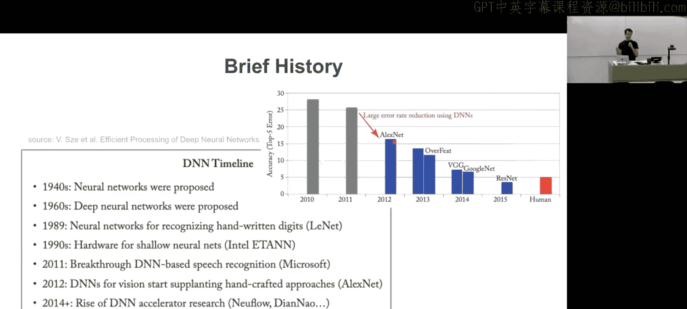
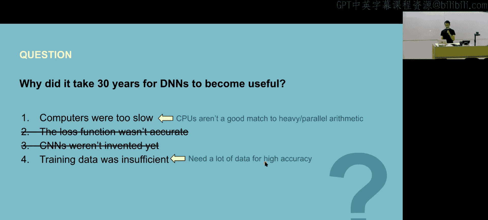
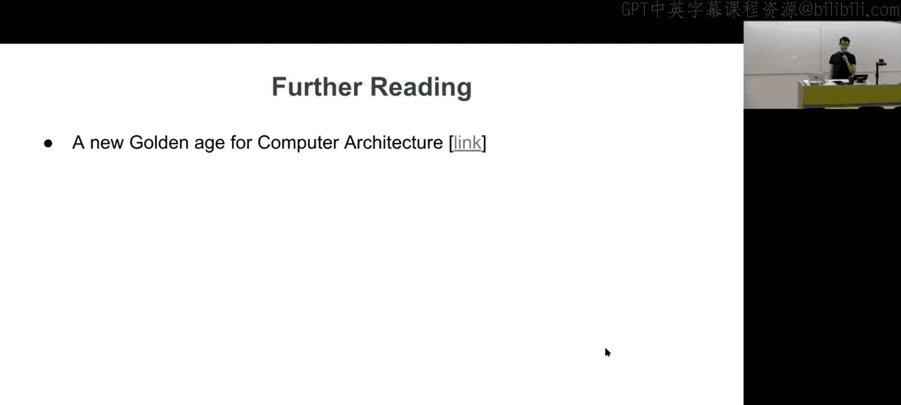

# 001：康奈尔大学《机器学习硬件和系统｜Cornell ECE 5545 Machine Learning Hardware and Systems》中英字幕 p01 -01-Lecture 0_ Introduction.zh_en -BV1CCqPYSEP5_p1-

Everyone， welcome to this course。This is machine learning， hardware and systems。

 it's the first time this course is being offered here。And as I previously said before。

 I'm a new assistant professor at Cornell Tech and so this is actually the first course at each year。

 so I have thought before， don't worry though。So hopefully I can get you excited about machine learning hardware and systems in this course。

 the main idea is that you know you hear about artificial intelligence and deep learning and machine learning and it's making changes across the whole world。

 but the way it actually runs，is through hardware and through systems and through optimizations that we' learn in this class so you know in CS you may take a course that teaches you this stuff at an algorithmic level。

 but how do you actually make it run on a computer and how do you build that computer that runs it is what we will try to learn here。

嗯。So let me try sharing my screen。

O。Okay， so this is lecture zero， you will kind of just go over。You know， logistics of the course。

 feel free to stop me at any point and ask me questions and then a very brief introduction and motivation on why we are kind of here and why we're learning this。

So I'll start by just one small motivation slide， and many of you may know this already。

 but know a few people at Google， very highly paid people， very smart people in 2013。

 they sat down and said， you know， if we have our users use our deep neural networks for speech recognition for just three minutes every day。

Then we will need to double our data center capacity。That means you know。

 going and building you know two times what they have of those huge buildings。

 you know with their power plants beside them or the wind you know， turbines， as you can see here。

 so doubling that whole capacity just to support three minutes of speech recognition。

So what does that tell us， that tells us that a， this thing they want to run is very heavy computational。

You know you need to double your computers just to run three minutes of it， then it's very heavy。

 the second thing is that that it tells us is that existing data centers suck， they don't work。

 they're not good for that type of application。And so and so what the faults at Google did。

 as I said they were very smart and so they didn't do that。

 they didn't go and build you know twice the data centers they had just to support this new application。

 instead they built a custom chip。😊，So that's what led to kind of the TPU being designed and what they achieved by rethinking the hardware that runs this program。

They achieved one to two orders of magnitude improvement。

 so 10 to 100 times improvement in the specific workload speech recognition。

And so compared to existing CPUs and GPUs， so they didn't have to go and build。

 you know twice their data centers， they just created this new chip and put it in their existing data centers and that was enough。

And so to make this chip work， it's not just about designing the hardware。

 it's about a lot of things and you know we will talk about hardware。

 so approximately a quarter of this course is hardware architecture。

 how do we analyze existing hardware and compare existing hardware to each other and see which is better for each workload。

How do we achieve an efficient hardware？archrchitecture as well。

 and we will go a little bit into micro architectureect or how we build the circuit to do the actual math and maybe even memory for these kind of chips。

So a little we'll touch a bit on that as well。So the course is called machine learning hardware and systems。

 so we will also discuss some systems， so once you have this one chip how do you put them together to train deep neural networks in a distributed fashion so distributed training is very important especially for extremely large models that we're seeing these days so how do we do that and what does it entail。

We will also talk about federated learning， which is another way of distributed learning but through kind of which guarantees which has some security guarantees for end users so for example if you have your mobile phone and you have data kind of streaming out of that phone how do you use that data to train a neural network securely and privately and aggregating this data from kind of users all over all over the world with different kind of properties and so on so that's federated learning we will also talk about deep learning systems in terms of also what happens around the neural network so the pre and post processing。

That we have。And finally， we'll discuss some environmental issues as well and kind of the carbon footprint of all of these systems that people are building。

So it's actually not enough to just talk about hardware and systems in isolation because there's a lot of work that's being done in like upper layers of kind of the software and algorithmics tech so at the neural network level we will also discuss how to realize an efficient neural network that is tailored for hardware that works better for specific hardware targets so we will discuss kind of things like quantization so using lower numerical precision for numbers in a neural network we'll discuss pruning and sparsity and techniques like knowledge distillation to create more efficient neural networks and finally automated machine learning specifically neural architecture search or how do you find the best neural network topology for。

That that fits a specific hardware， especially。And finally we will talk about software。

 so hardware is useless without software it's a brick。

 so how do we program these new chips that we will learn how to build and there we will talk a lot about these new domainspec languages and compilers that are sprouting specifically for deep learning and there are domainspec languages and compilers for other applications too。

 for example there are some focused specifically on computer vision but on emerging classes just focused on deep learning tasks more generally and not just for one kind of domain or one modality。

So these are kind of the four course topics and I think every bullet point here kind of translates to one of the lectures。

 so if there are any questions at this point just stop me and let me know。啊。Otherwise。

 we can continue so I told you kind of why it's important to learn about。you know。

 a deep learning hardware and deep learning systems and I told you what we will cover that now I'll try to convince you that I'm the right person to kind of teach this。

 so I'll tell you a bit about myself， so my name is Muhammad Abdu Vata I'm a new assistant professor here in ECE at Cornell Tech and Cornell University。

And I thought I would tell you kind of briefly where I've been in the past few years。So I'm Egyptian。

 I'm from Egypt， and that's where I did my undergrad。If。This animation works。😔。

At the German University in Cairo， so that was a long time ago。

And then after that I went to Germany at the University of Stuttgart， I worked on my master's there。

 and there I started focusing on hardware architecture， especially FPGAs and reconfigurable hardware。

I continued that interest kind of as I went and did my PhD at the University of Toronto and there again。

 I focused on computer architecture， so most of my training and background is in hardware。嗯。

But then after that I didn't want to go straight into kind of an academic job and I thought that I really needed some industrial experience to see what's happening out there and that's kind of when deep learning was exploding and so I started working at Intel in Toronto as well where we built the first deep learningbased accelerator on FPGAs so we built both the hardware。

 the software， the compiler for that I stayed there for two and a half years and then I went to Samsung they were creating this new AI center in the UK so I helped form the team there。

 we worked on automated machine learning and more generally how do you create efficient machine learning models to run on Samsung phones basically。

And that was a lot of fun I stayed there for three years。And then now I'm here， I'm at Cornell Tech。

 and so hopefully throughout the lectures I can also kind of transfer to you some of this industrial experience and what the real problems are that I saw in industry。

So I'm also very fortunate to have a TA with me so that's Guang Dao Yang and he's an expert on computer vision。

 I think he's a third year PhD student at Cornell Tech。

And he will be helping mainly with the assignments。

 especially kind of the heavier assignments that have a lot of kind of moving parts。

 I don't think he's here today but he's a great guy and he has some amazing research papers out in top computer vision conferences so he will be a great resource to ask questions as well。

嗯。So throughout kind of the past term， I also had the help of these amazing four people in just preparing the assignments and the kind of the programming parts of this course。

 so thanks to Rebecca Z she Yaoki and Alan， so they're not part of the course anymore。

 but throughout the past kind of five or six months。

 they helped a lot in kind of shaping what the assignments look like。嗯。

Okay， so the prerequisites for this course， so you should know something about computer architecture fundamentals because we will build on some of that。

 so we will selectively choose some topics that are relevant for deep learning accelerators and build on those。

So you should know something about that right like if you know nothing about computer architecture you should be slightly worried coming into this course and maybe chat with me or drop me a note by email you should also have already kind of taken an introductory course in machine learning or you know something about machine learning because we again we won't cover the fundamentals here but we will build on many of them so you should also have already kind of trained the neural network。

 you should have run a neural network you should ideally no Pytorrch and you know you coded something in it before and so on so if you have any issues with those peerrequisites just let me know upfront so that we can kind of chat about it。

We will use a textbook in this course。But we will also read a lot of papers。

 so the textbook is called Efficient Pro of deep neural networkss。

 I think it was published last year or the year before。

So it's available at the Cornell University Library if you just search that title in the kind of the online library portal you will get to a page where you can just click on this link here and you will be able to download a PDF of it so very simple so you should be able to all access it again if you have any issues with accessing this let me know。

是啊。So evaluation。So this course would be very top heavy。

 most of the grades will kind of be on the assignments that are done throughout the course way before the finals so in finals week for this course you won't be that busy but during the term you will have all of these heavy assignments each one of them is like a mini project。

Where you will get kind of hands on experience of doing these optimizations or doing the compiler stuff or maybe doing some hardware research and so on。

We also have a term paper。So that will account for about 20%。

A presentation which is a 10 minute presentation on one paper ideally hopefully will be in person by then so that will account for 10% we will have weekly paper summaries so I think you should read the papers anyways。

 because then if you don't read the papers you won't get kind of the full pictures of what we're trying to cover in this course but I also ask that you do a very brief paper summary less than half a page。

Every week and it will count for about 5% total and finally class participation。Yeah and as I said。

 this is the first time this course is being offered no one is perfect so if you find any errors or bugs in the lecture notes or the assignment material and I'm talking about major things like not typos or anything but if you find something and you write then you'll get bonus points so if you correct me and something I say or something I put out in the lecture notes you got bonus points everyone's happy so。

嗯。So yeah， I'll go briefly through every one of those and talk about it quickly， but again。

 just stop me if you have any questions about any of those things or if you need some more clarity into it。

So the assignments， as I said， they account for most of the course。

 assignment zero will be out today， it will be sent on your email through a GitHub classroomrooms link。

And it's basically like it's a very simple assignment。

 it's worth two marks and it's just kind of knowing the design tools and the programming tools that we will use so that you kind of know these things upfront and you don't have any issues with them later in more involved assignments。

Assignment one will be focused on hardware， so we will。

Do a lot of hardware benchmarking and some hardware research and plot properties of this hardware on something called the roofline plot that we'll learn about next week。

The third assignment is quite beefy， it involves kind of training and optimizing a neural network model and then actually deploying it to a small MCU。

 a small microcontroller unit that I have up in my office， so you'll borrow that MCU。

 you will deploy the model on it， you will test it with your own voice and see that it works and iterate and do optimizations there。

Assignment three will be focused on kind of software compilation， we will use a tool called TVM。

And assignment for I was hoping it would be hardware design。

 but I realized that if towards the end of the course I get you to learn a whole new thing and to design hardware through something called high levelve synthesis that will be too much so instead we'll do something else which actually turns out to be super interesting as well which is implementation of different and also approximations of different D primitives so there are many ways in which you can implement a convolution algorithmically and so we will implement those different implementations and we will see how they run on different hardware targets。

So it actually turned out to be super interesting。The term paper。

You will kind of go over a topic of your choosing so we will coordinate that topic just funded by me at any point and I will talk about that more during the term and give deadlines and so on。

 but basically it will be kind of a critical assessment of that topic focused on three or four papers and maybe covering at least 10 research papers on that topic and that will be you kind of after finals week so that's at the very end of the course。

You will also do a quick presentation so it will be a 10 minute presentation in class so it should cover one paper or two papers。

 ideally those would overlap with the papers that you select for your final paper so you don't have to do the work twice and also again it should be a topic you're interested in from the things that we're discussing。

Finally paper summaries， so so the reason we have kind of assigned papers every week and these paper summaries is that you know。

This topic is kind of changing every six months so we need to kind of stay on top of research。

 even when I was working as an engineer at Intel we would basically read the paper and implement idea in our deep learning accelerator so it's not a matter of just knowing this stuff in this course and that's it you have to also master kind of reading papers in this topic and staying up to date with research to be able to do well in this whether you're going to an industrial job later or further graduate studies or something。

So yeah， so you only have to do 10 of those or you only have to submit 10 of those paper summaries。

 but feel free to do more。And the top 10 will kind of go towards your grade each one is worth half a percent so it it's kind of just you know you hand it in and that's enough。

 but you should at least cover those questions。And as I said。

 it should be like a maximum a half page， so nothing major。

 I mean if you want to write more than sure， but it doesn't matter regarding the grade。嗯。

So class participation so I'm hoping the class will be interactive so each one of you should kind of contribute an idea or ask a question if you have a question。

 initially I had this thing every week or every class but yeah maybe that's not practical so you don't have to talk in every class but every now and then hopefully you will kind of interact and say something。

Course tech so we're actually using a bunch of platforms but hopefully it should all be streamlined through the course webpage so all the important links will be there so the zoom link is there the discussion link is there the great scopepe link is there and yeah so these are kind of for the logistics and kind of the in class recordings and everything so that should all be accessible through the web page。

I think I will also put the recordings of these lectures on the webage。

 maybe maybe you'd need kind of a Cornell email to access them but yeah everything will be accessible through there I didn't want to use Can really。

 so we won't really use that for much yeah。And then for the assignments。

 we will use GitHub Classroom。And so for that I think I will I will send each of you a link for the assignment as soon as it's out so after this class I'll go out to my office and release assignment zero so I'll take the class roster and send an email to everyone with a link to assignment zero so if you have any issues with that or if you didn't get a link or something by the end of today just let me know and even if you're auditing just let me know and I can send you that link it's no problem I just won't grade it that's fine。

And for coding， we will use Google Collab。And that's mainly for convenience。

 I realized we don't have access to kind of。GPUs for teaching at Cornell Tech yet just something I hope to change。

 but basically until then we will use Google Collab， it's quite convenient。

 it kind of opens up a Jupyter notebook on one of Google servers and you get to kind of basically you know act as if you're on a computer with a GPU basically。

And so I recommend buying CoLab Pro， especially starting assignment2， so it's $10 a month。

 you don't have to and they've definitely went through the assignments myself without buying CoLab Pro。

 but it will help because then you can have models training in the background and so on and so I think this will be quite convenient if you're using for coL for coLab basically it will make it a lot easier for you to kind of go through especially assignment two which has a lot of training pruning and quantization and things that take time on a GPU basically。

嗯。Course philosophy， so as I said before this course needs to kind of stay state of the arts and research heavy so we will be discussing papers in class in the lectures you need to read papers after every lecture to kind of stay up to date with everything that we're talking about all of this stuff is being defined as we speak if you're going to work in this you know hardware or systems for machine learning after you finish your degree here you will be inventing what's happening next you won't be working on something that's already established and so as I said we really kind of need to stay up to date with all of these papers and and all of this research that's going on。

The course is practical， so the assignments have a lot of kind of hands on coding。

And that's on purpose obviously because this is a very applied subject。

 if you learn about something by just being told or reading about it that's not enough you have to go there and see all of the details and code it yourself and that's what you'll be doing。

It should be fun so the assignments I hope will be quite fun hopefully everyone here likes coding otherwise you need to kind of question why you're。

you know， doing a master's degree in ECE or CS， but I think the coding that's assigned here is quite fun。

 we will also maybe have one or two competitions on the submissions of the assignment so we'll kind of have a leaderboard and see who kind of has the best result。

 so maybe this would also be fun。不 yeah。Honor codes。

or all adults don't cheat if you use something cite it and it's okay to discuss ideas with your colleagues that's definitely okay you know I read this research paper it had this implementation this is slightly different than what we learned in class but I think it's interesting but oh I implemented it this way or I had this bug and but then it's very easy to solve it if you use this library。

Something like that， but going again looking at someone else's code copying code that's not acceptable right so there is there is kind of a distinction between discussing ideas and copying code and hopefully you know that distinction if you don't you can click on this link and it has kind of details of what is considered acceptable and what is not。

We will use various tools that check the code and the text of the assignments for plagiarism。

 so please don't copy anything。Yeah， and I think that brings me kind of to the end of the logistics part of this course。

 So here are the topics once again Here is the。Kind of the evaluation how we will grade this course and here's the class website So I want to stop here for kind of a couple of minutes and does anyone have any questions or concerns about any of this or or any comments even。

So yeah， it's it's harder when I can't see people so。嗯。

But assuming silence means everything is quite clear。嗯。Oh chat yes chat。

 all good someone said all good and chat， you can also use chat， I think I know how to access it now。

So thank you， Gonzalo for。Saying all good。O。All right， yeah， at any point again。

 feel free to interrupt me。 this is supposed to be a bit more interactive。嗯。For weekly readings。

 okay so we have a question from Hayden for weekly readings does this only count the academic papers or does this include the book chapters。

 so only the academic papers， so the summaries are for the academic papers。

 the book chapters you should read them anyways because that's the textbook that we're following in at least half or two thirds of this course so I'm hoping to see summaries of the research papers that I link to on the website。

嗯。Okay。All right， I will continue。😔，So now a brief introduction to the course。嗯。1。Okay。Stand past。

 so I think we have time。So I'm sure you saw this many times before。

 but you know what is machine learning， what is deep learning。

 what will we be covering out of that circle that's labeled artificial intelligence？And so， you know。

 a machine learning is a subset， a strict subset of artificial intelligence， right。

 like it's a technique to make machines learn or programs learn how to perform a specific function。

And one of those techniques and one of the prevalent techniques there is neural networks。

And then you have deep neural networks and that's actually what we will be focusing on so the course is called machine learning hardware and systems。

 but we will it could have easily been called deep learning hardware systems because that's what we will focus on how do we take those deep neural networks。

 build hardware software compilers systems for them and train them properly。

So this is where we'll be focusing。So what is so special about deep learning。

 like why are we creating this whole course just to discuss how hardware is built for it and how systems are designed？

What's special is that it's been making breakthroughs in many application domains。

 so recommender systems， any kind of online software that we use now， you know Amazon， Google。

 Facebook， all of these companies their bread and butter is having these recommender systems so getting all your data parsing it in some way and recommending products to you or recommending money making kind of schemes for you and or even telling you what to watch next based on what you already like like on Netflix so these recommender systems are super important and have been increasing in importance throughout the past decade。

And computer vision of course that's where many breakthroughs are being done as well。

 so self-ding cars may be one of those results， things like you know image segmentation。

 image object detection， image classification， these algorithms have exceeded kind of human performance given using these neural networks。

 and so huge breakthroughs there using deep learning。Spee recognition as well。

 we're able to fit that on kind of devices as small as Apple watches or even smaller devices now。嗯。

And then natural language processing as well， which is making huge waves in things that okay like translation and text to speech and things like that but also in application domains that you can't even dream of so I have a friend who's working attroituters which is a news company and what they are doing using those NLP models is automating paralegals so paralegals are kind of they people who help lawyers draft out documents and so on now they're actually replacing these paralegals with NLP models because you know a lot of their work is you know making very standardized templates and things like that and they're able to use these NLP models to parse through thousands or millions of legal documents and draft those new legal documents automatically so NLPs actually a big application has a lot。

Of applications these days in many application domains。There are other applications， of course。

 that maybe I don't know as much about but things like finance。

 definitely in healthcare and computer vision has a huge role to play there in detecting things from various scans like tumors on。

On an Xrayse or things like that。In computer games and graphics and then agriculture as well。

 so so deep learning is making waves in all of these things it's changing the way we think about these applications and it's moving towards kind of a deep learning centric。

Way of doing things so no longer do people write software by hand instead they rely on these deep learning models and they just build a system around it。

So for all of these important applications， we have kind of as I said。

 you can run these systems without hardware， so in the example of the Apple Watch or any kind of mobile system。

 we have the small part of the chip dedicated for a neural engine or an NPU neural processing units。

And so so you know how do we build that hardware， how do we compile software onto that chip so that's super important envision vision of course maybe some of you have heard of Tesla's FSD chip。

 so fullso driving chip and they're not the first people to build a chip dedicated for deep learning on a car so NVDdia has been doing that as well with their drive AGX system mobile eyes another example of a company which builds an ASI dedicated for a car。

For recommender systems， of course we have Amazon and AWS and they have been relying on GPUs for a while but now I hear they're actually also building their own chip specifically for deep learning in their data centers。

 they're also specifically building and use CPU for their own data centers， but that's another story。

And for NLP and other。Applications in the data center。

 there is also this is an image of a TPU pod at Google where you various companies are now building their own chip for that。

And so maybe I said it like three or four times so far。

 but it's important to realize how essential hardware and systems are for the progress of deep learning。

 they basically go hand in hand。

So rewinding a bit back and looking at kind of a very brief history of deep neural networks。

 so they're actually an old invention， they've been discussed and published and talked about and implemented since the 40s。

 which is a very long time ago almost 80 years now， and since the 80s。

 deep neural networks have been making you know tangible impact so through the Lette kind of network in '89 so that was already used for MNIS and worked quite 1 well。

So what's missing， like what happened between the 80s and 2012 that basically really changed the way we think of neural networks。

 making neural networks kind of colloquial， people talk about everyone knows what it is making this huge resurgence in AI and machine learning。

So。And as we can see here at 2012 is when you know Alexnett was introduced and what many people don't know is that one year before that there was a breakthrough neural network that also changed the way we do speech recognition so in 2011 that happened before AlexNet but Alexnett is the one that was way more popularized but anyway so at this point we had this huge kind of improvement in performance and a huge jump just because of this deep learning technique resurfacing really not being reinvented but resurfacing。

So a question for you， so why did it take 30 years for DNNs to become useful？

So let me see if I can do this thing。Okay， I put a class poll， so hopefully when we're in person。

We won't need to do this。Poull， but。For now， maybe if you can give me your responses through that。So。

嗯。It's cool to see kind of responses coming in。So it looks like most people responded by now。没有。Okay。

 so we had a few people saying that， you it might have been。

 the loss function was inaccurate or CNNs weren't invented， but most people actually。

 so these are not the correct results because the loss function was already the same one we're using today and CNNs。

 as I said， were invented back in the 80s with this Lynette。

 which was the first CNN as far as I know anyways。And so the reason is that computers were too slow so we needed new hardware。

 CPUs were focused on kind of branch prediction and building more efficient caches and figuring out the control flow of programs whereas deep learning comes in and it's an immensely parallel kind of way of doing computing you can do all of these multiplications and additions in parallel you don't need to think about if statements or any branches or things like that and so CPUs just weren't a good match and that's all we had。

U。And then the other thing is big data， so training data was also insufficient。

 this was before the time when we had all of these internet users and mobile phone owners generating all of this data that we didn't know what to do with it really。

 and so now we have all of this data and deep neural networks just work way better with more data。

And so so you need a lot of that for good accuracy。 So these are the two reasons。

 So if anyone asks you you know why does deep learning work？

Okay， sure， it's a nice algorithm back propagation is you know is telling us how to do gradient flow through the network and how we can kind of。

Kind of propagate incremental improvements throughout like a heavily parameterized function like a neural network。

But the enabling breakthroughs really are big data and GPUs。So in the case of Alexnet。

Alex figured out how to program a neural network on a GPU and that was just the perfect hit because GPUs are meant to process lots of graphics and so graphics is a very parallel application where you have pixels of an image or pixels of an image in a video where you operate on each of those pixels。

 sometimes independently， sometimes in kind of chunks， so rows of the image or subsets of the image。

And so GPUs are really good at doing that parallel and that's what caused this huge improvement Alex Kvisky was able to kind of scale up the neural network to a much larger size by running it on these GPUs and then it worked much better。

嗯。So yeah so since those breakthroughs so around 2012 we've had kind of an exponential increase in the research in this area。

 so this is showing the number of peerreed AI publications until three years ago and this exponential trend is continuing I can guarantee it。

 so academias everyone that's everything everyone was talking about in the last few years how do we leverage AI or deep learning to improve my application domain。

 as I said whether you're in finance agriculture and so on。

 and the CS community has just been CS and ECE communities have been exploding with research on how do we create more efficient neural networks and how do we create those systems and hardware for that as well。

And you know， sometimes in some topics， it's just academia that's talking about it。

 but this is not the case here。So this plot here shows kind of the global investment in large corporations in artificial intelligence and as you can see over the past five years。

 it's been again doubling from well。More than tripling from kind of 12。75 to 67。

 that's 5 x kind of increase in number of dollars being put behind this technology so it's not just kind of an academic pursuit so it's a real thing that people are using now and paying good money to make sure it works。

So now going back to the。Again， I want to pause again for people to ask any questions or to make any comments。

 I'll stop for 10 seconds。Okay。But but yeah but going back to the kind of example I gave at the beginning。

 which is pe recognition， so why did those folks at Google sit down and say we need to rethink how we're doing computing for this seemingly simple application of you know hey Google whatsoever today or something like that so。

So looking at kind of a deep learning system example， specifically for speech recognition， you know。

 you're sitting by your phone and you' talking into your phone， you ask it。

 what's the weather or you're trying to transcribe some text to send it through a message or something。

So what happens here so nowadays you have some speech data preprocess that's happening。

 so you get your speech you usually generate spectrograms out of that speech data before you send it for further processing so something happens before any kind of fancy deep neural network right。

嗯。And then there is a neural network， but how do you make that run on your phone and what does that do so can you actually use hey Siri or hey Google when you're offline I don't know。

 I think so far we cant maybe with the new pixelix chip on these Google phones you can。

 but I think so far you actually have to transmit that data to a data center to have it processed and then it comes back。

U。But a big focus for my team back at Samsung was actually how do we take those neural networks and make them function on a mobile phone within reasonable kind of battery usage。

 so this is a major thing because if you think about processing in data centers if you're a phone user and you're using Google every time you speak through hey Google or Hy Siri。

 you're making Apple or Google pay some money because there is a power bill for those data centers。

 it's quite a big powerbe and you're using their electricity。

But what all of these companies want is for you to use your own electricity that you charge your phone with at night。

 so they want you to run those deep learning models on your own phone because it's just an expense to them so they want to deliver the same user experience。

 but through your power basically。And then we can also talk about companies like Samsung that don't have a data center。

 so they're in the business of creating smart devices for users and they also want to have kind of a smart assistant。

 the Samsung one is called Bixby， but then every time you talk through your phone to Bixby。

 you're actually sending a request to a server paid for by Samsung that Samsung doesn't own。

 so they pay for both a power of that server and they pay for just the renting that server from a company like AWS or some thirdparty company。

And so running these neural networks on device is a huge topic on its own and how do we optimize them for that device。

 how do we build hardware on that device to run these neural networks。

 and how do we also build the software to compile these neural networks within the mobile programming kind of software framework。

And then another consideration on phones is that there is a lot of sensitive data like this phone。

 you have it next to you almost all day now and you take personal photos you talk which are personal phone calls if anyone still uses phone calls and so how do you train neural networks through the data on your phone without compromising the security or privacy of that data so that's called federated learning。

And that's also something that we'll cover。So you know okay let's say you know we have like a dumb phone that can't do all of these things。

 we then transmit the data to one of Google or you know Facebook's data centers or something。

 and in that transmission itself nowadays there's a lot of AI happening we actually won't discuss that at length but maybe someone will choose that as one of their topics if they're interested in communication。

 but there's a lot of AI based you know communication protocols so doing channel coding。

 compression encryption and things like that using deep learning models that happens even as your data is kind of being transmitted from your phone to a data center。

So that's also quite an interesting and very emerging topic。

And then at the data center itself we have all of those same questions that we asked at the mobile phone endpoint。

 but a data center scale， so what kind of hardware do do we put there。

 how do we make it programmable enough but efficient enough。

 right what software stack works now for the data center。

 how can I use those chips in a very distributed way and there are different examples of doing that in very different ways to train a large model or to map a large model and so on。

And then again， everything that happens around the neural network is often overlooked。

 some people call it the AI tax， some people just call it pre and post processing。

 and this is quite important and needs to be considered when you're architecting your data center。

So in each one of our four topics， you know hardware systems， neural networks and software。

 I just have a further motivation slide to give you a sense of the urgency of these。Of these topics。

 like why they are super important and why we need to kind of start learning about them right now。

What's I think we still， yeah， we still have time。So on the hardware side I'm showing two plots here。

 one of them is showing Moore's law。And one of them is showing the art scaling。

And the summary is that， you， previously we were able to make computers much faster by just manufacturing a chip with smaller transistors。

So Moore's law， what it says is that every two years or every one and a half years or something。

 we will be able to in an economically viable way， double the number of transistors on a chip。

 that means we get an exponential increase of number of transistors which can roughly translate into computing power。

Every。every two years， so that's like you know you're getting a free lunch every two years。

 you you're doubling the size of that free lunch every two years。

But there's obviously a lot more involved here and that's a main constraint there is power and that's what the Nd scaling kind of explains and what the N scaling states is that every time we shrink the size of the transistor the power density stays constant。

So what does that mean so we have double the number of transistors we used to have five transistors in this piece of the chip now we have 10 transistors in that piece of the chip。

 they will use the same power， maybe it's one watt or something as an example。

But that actually started to break down and break down in a very bad way， so we can see here。

 you know we're doubling the number of transistors on chip and power density is staying approximately constant。

 so that's the power per area。Right， but then around 2008， it just goes haywire， it just explodes。

 the power density increases dramatically。And the reason is that。

 we were hitting fundamental technology limits of silicon and of transistors。

We're getting something called a tunneling current and lots of parasitic effects because we're making those transistors so small so you're getting a lot of kind of wasted electrons going off in different places where it's not supposed to go and generating heat。

And basically， that has severely limit limited the utility of those extra transistors that we put on chip。

 So even if we put。You know， I don't know， like a million or 10 million transistors on a chip。

 were only able to use five million of them at the time just because of this power constraint。

So and if we look at the Moore's law curve as well， the actual thing is this red one。

 so it's not really tracking the original 1975 version of the law， I mean Gordon Moore himself。

 he says， you know， there will be fundamental technology limits that slow down this Moore's law。

 all that's to say， you know， we're not getting faster chips for free。

And what does that mean so if we can't get faster transistors through silicon or by improvements in the silicon and the process then we have to resort to architecture we have to think of smarter ways of using the transistors we have on the chip and usually what that leads us to is that we're not creating these general purpose chips anymore so we're not creating a CPU that can run any program right now we're creating these domain specific architectures that are focused on a specific application domain and therefore we get the efficiency that way we specialize at transistors to do only deep learning or only deep neural networks and that's how we can get。

Kind of an an improvement in efficiency。 So we're not getting it through the。

Technology we're getting it through architecture and so hardware architecture is having this huge resurgence now in terms of just a number of people studying it。

 number of people interested in it， the amount of research happening in hardware architecture。

 because basically we have no other choice， we can't just keep making chips faster。

 we have to think of smart ways of putting those transistors together。

And that wasn't the case for the past 50 years， basically。嗯。嗯。And then yeah。

 so that's hardware another topic like I said， we will look at neural network compression and what I'm showing here is you know。

Five years gap between a state of the art like deep neural network for vision。

 for image classification。VGG16 and now the state of the art1 is efficient net。

 maybe at a low flops count anyways， and so we're seeing kind of what is this three orders of magnitude reduction。

In the number of operations then we need to do。So forget hardware。

 like even at the neural network level， just designing how we do these neural network operations。

 we're able to get so much improvement through these techniques listed here。

 so you know quantization pruning， neural architecture search， various scaling methods and so on。

 basically people are still trying to figure out。How to build the topology of those neural neural networks。

 how do we organize the computations in a neural network to get the most efficiency while maintaining accuracy and there is huge potential there。

 we're basically just scratching the surface because if you look at those two neural networks they actually look quite similar okay maybe some of the primitives are a bit different we're using separable convolutions instead of regular ones we have skip connections there is some automated neural architecture search to figure out exactly the parameters of the neural network but this results in a huge drop in in computation same is true for kind of the model size again orders of magnitude smaller and accuracy has actually improved over those past five years and so this is a major area of study and the major source of getting more efficiency for these neural networks one of the projects we worked on at Samsung is doing super resolution so basically Samsung。

s these displays。These TVs， you know8 k and higher and there is no content that runs in 8 k。

 so what do they do， They have a chip inside the TV that takes all of kind of the incoming streams of video and they're automatically upscaling to 8K。

And so how do we run so these super resolution networks are huge， they're very big。

 it's very hard to run them on a TV with the computing that we have on a TV。

 you either stick you know an NviDdia GPU at the back of your TV， which would be very loud， very hot。

 or very warm， it will make your room very warm and it will be very expensive to run as well。

 like your TV will suck so much power， it won't adhere to any standards out there that are set for TV power consumption。

And so the alternative is to build a very efficient chip。

 but also to compress the super resolution neural network。

 so we worked on one of those neural networks and we got a 30 x reduction in flops just based on applying some of these kind of now well-known techniques like pruning and quantization and definitely neural architecture search which I was focused on on Samsung。

 so these techniques really do work even today after all of these hand optimizations have been done。

And it's a major thing that we'll focus on。So software。So I mean， I just。

 I have a bunch of logos here and there are many more out there basically on different frameworks。

 domain specific frameworks domain specific languages and domain specific compilers that are dedicated to deep neural networks and how do we both specify these neural networks at kind of a program level。

 how do we compile them and map them onto hardware as well。And so。So I mean。

 I'll be impressed if someone knows exactly what all of those logos are。

 but at this point I mean in this lecture。But I would be by the end of this course。

 you will know what all of these frameworks are， how they work， well。

 not all of the details of how they work， but basically what the concepts are behind them and why we're even resorting to these domain specific languages。

嗯。And then on the system side， we have many considerations there and two of the ones that we'll focus on is federated learning。

And distributed training so so distributed training is quite interesting because there are many ways to do it。

 as I said， one of them is to replicate the model over multiple computers。

And then split the data because you have so much data as well among those computers。

 so you will have。One computer learning from you know a quarter of the data。

 another computer learning from another quarter and then you'd have kind of four computers cooperating and then the question becomes you know how do you send the gradients during training between those computers how do you divide the workup how do you synchronize all of your parameter updates and so on and then another kind of distributed training is obviously if you have a very large model so all of the parameters can't fit on one device so then you need model level parallelism as well so you split your neural networks into pieces you put each one of them on a different GPU or a different machine doesn't have to be a GPU and then how do you do training in that case as well where you will need to propagate both values during the forward pass and the backward path as well so。

Fedderated learning， which I actually know less about。

 but is quite an interesting topic is you know when you have multiple users all with these security and privacy constraints how do you learn from the data on their devices and so hopefully I might actually get expert on this to give a guest lecture because I know someone working at Facebook who's a great person and an expert on this topic。

 but at the same time I think this kind of research will only increase because of the things I said before。

 data is being generated on the user side in plethora of devices that are in the hands of users and it's in the best interest of these large corporations and large companies like Google and so on to perform a lot of the computations on the device side。

 of course they will tell you is because of security and privacy and I buy that。

But it's also an economic thing on their side where they want you to pay the power bill not them。

Right。Okay so yeah that's again this slide that I made for the topics that we'll cover。

 so this is the order in which we'll cover them， we'll start with hardware。

 move on to neural network optimizations and then software and finally we'll talk about systems this order that I think makes most sense I want you to have a hardware centric thinking throughout this course and that's why we're starting with hardware。

And then yeah， I just think it makes more sense to go this way。嗯。Again。

 if there are any questions so far or any comments。Is maybe someone out there is sitting， oh。

 this is not what I expect this course to be。 And this is really。Or， or no is， is it all。

 Does it all make sense。 Let me see the chat window。Chat window empty， okay。

Assuming silence on Zoom is a good thing。But hopefully， in two weeks time。

 you guys will be here and then I'll be able to read facial expressions as well。I mean。

 behind the masks， of course。嗯。Okay， so I mean I'm basically at the end of this lecture I think we have when we have 10 minutes so the next few minutes i'll just talk about assignment zero quickly so this one is just about knowing your design tools it will be released today so again if you don't get a link or if you're unable to access the assignment or if like if you get nothing basically just let me know。

And it's a very simple getting started assignment as I said we're going to use Google CollLab。

 what that does is that it instantiates a Jupiter notebook on one of the computers that sits in Google data centers。

And what and once kind of you close that tab or your session ends everything disappears and so this assignment zero will go through how you can。

Mount your Google Drive folder to have that as your virtual file system so that any files that you produced during your assignment。

 they get stored there and they don't disappear instead of storing them to this random Google machine which wipes everything once you leave your session。

Does that make sense i'm hoping that make sense so that's one of the things you'll learn how to do there and it's a bit it's not tricky but it's it's a bit annoying to always kind of mount the Google Drive folder and figure out exactly how to do it and where to store stuff and so this assignment just walks you through it and it becomes kind of a standard thing you do at the beginning of every notebook and that will give you more of a local development。

Experience while you're using Google Collab instead of this kind of ephemeral vanishing。

File experience that you get with when accessing kind of a cloud machine and so that's one thing that you'll learn there。

 you'll also learn how to interact between GiHub and your Google Collab notebook so as I said the assignments will be on Github Classs。

And there you will submit all of the code， so basically you will get an assignment template repository that will have you know all of the steps that you need to go through to complete the assignment。

And then this same repository will also have starter files so a starter Jupyter notebook sometimes sometimes just source files and tests and so on。

 and then you will work on those files and you will commit your code and push it back to this same repository and this is what I out so I will see all of your pushes and all of even you can do a pull request and ask me questions and so on。

 but we can also use Ed discussion for that。But yeah， so this assignment will also focus on you know。

 connecting your Github account to Google Coab， pulling the assignment， working on it。

 making a change， pushing back the changes， and all of this all of these small details。It's also。

 as I said this assignment is worth two marks I'm hoping everyone in this course will take those two marks it's not meant to kind of。

Test you or anything。 So there are questions if we are。Okay。

 let me just finish my thought and then I'll go through these questions。Um。

So think of this assignment as an opportunity to kind of just ask questions early on。

 make sure you understand exactly how your development environment works。

 if you want to pay that $10 for ColAP Pro feel free to do it you can also start paying for that on assignment two that's the main one that will require those $10 but as I said if you don't but it doesn't matter。

 and it's also a subscription thing so if you want to stop it right after assignment two you can always do that but it's cheaper than a textbook think of it that way and it might make your life easier in assignment2。

But but yes， ask all the questions you have about the development environment， use Ed discussion。

 please use it heavily， that's the main way to get in touch with me or the TA or your colleagues。

 which will be a good resource to ask， you know， questions don't give any answers or any kind of things away and want Ed discussion obviously but that goes without saying。

嗯。Yeah， so。I see here a couple of questions so Ethan if we are on the waitlist will we still be able to do the assignment we'll be able to enroll soon。

 so hopefully you'll be able to enroll soon， Ethan。

 if you have any concerns with that please email student services。And CC me so that I can follow up。

I think we don't have many， I think we have five people on the waitlist or something and so I might try to get student services to just add them if the classroom fits。

' I mean I don't mind the extra five people of course。Yes。

 you'll be able to get the assignment if you don't get a link today just email me or post an Ed discussion private post or something。

 let me know and I'll send you the link it's that simple even if you're auditing this course。

 let me know and send me the link when it comes time to grade the assignment I'll only grade people who are actually registered because I mean it doesn't make sense to grade people auditing and stuff they don't need a grade but but you can definitely work on the assignment that's fine。

Any resource you'd recommend to refresh on computer architecture yeah so obviously the canonical textbook is computer architecture Qua approach I think it's called basically the Henessy Patterson book and I might actually assign one of the chapters there for you guys to read but yes。

 so I recommend Henesssy Patterson computer architecture book to brush up on Com Park but yeah。

 so so it's good to read that the first reading is actually quite nice it's called a golden Age for Comp architecture I think。

And then yeah this is the reading it goes through how we shifted from this kind of following Moore's law to these domain specific architecture and it's a good summary and it's written by Hendnessy and Patterson this article by the way。

 so it's a good summary of their book actually so it's like I don't know10 page or five page summary of their book basically but yeah for reference material I really recommend that book as well。

James and are required to use Google Coabab versus local。

You are not required to use Google Coab so the reasonm I'm having you use Google CoLab is just。

So that you have a GPU to access basically if you want to use a local Jupyter notebook and you have access to a GPU by all means please do that I have no problem with that at all for all of the assignments that require knowing which device you're running on and stuff I just ask and the assignment handout you know which device are you're running on like which GPU device or which CPUU device and so on so you can use your own machine the only thing is the course material is designed for Google collab so I will not have two sets of assignments one for collab users and one for non-collab users so everything will be designed for collab users so you have to figure out all of the small details around running it locally yourself basically but if you can figure those out that's fine with me。

And they are very minor things， so if you're used to running neural networks locally and stuff。

 then you'll be fine。嗯。Okay， yeah， I think this brings me to the end of the lecture。

 so I think we have。I actually don't know when this lecture ends， but I think it's in five minutes。

So we have five minutes for questions or discussions or just saying random things。Yeah。

 like whatever。If anyone has anything on their mind， basically。So yeah yeah。

 so this is the first reading one more note is that we will also use grade scopepe。

I don't know if people used it before， has anyone actually used greatcope before？

You can just unmute and let me know。Yes， people say yes， good because I haven't used it before。

 so the assignments will be there each assignment has two sections。

Or two things to hand in really every assignment this doesn't change one of them is a write up so this explains what you've done answers to all of the questions that you know need a text answer and you would also copy a lot of the graphs or numbers you produce in your notebooks into this write up so the write up should be a self-contain thing should be able to sit on my chair。

 read this write up and understand stuff that you know was assigned and so。

All of these write ups will be submitted on grade scope。

And so I already created like a placeholder for a0 and a placeholder for the weekly readings so also the weekly readings this short paragraph summary that should be submitted through Greatcope as well whereas the code should be functional it should include all the code you used to answer the questions in the assignment and that should go on GiHub classrooms okay so two things to hand in GitHub classrooms and Greatcope right up and code so yeah okay。

Okay， yeah， that's all I have。Any any last questions or thoughts？About the course， about me。

 about Cornell tech， about what happens in two weeks。

 so in two weeks you guys should come into class here。

The general policy is that you have to attend class in person。We have a mask mandate， obviously。

 so you should be masked。And if you want， but there will be also the Zoom link will be functional。

 if you want to attend on Zoom， you should have an excuse and you should let me know before that。So。

 so yeah， you should come in person obviously also not coming in person means you have no chance of getting those 5%。

 those almost3，5% of the class participation so。嗯。Exciting course， good。Great， thank you3。

 three thinks the course is exciting and that's good to hear。

 That's the main reason for this first lecture is to get you excited about the course。嗯。Okay。

All right。If you're in any doubt go to the a discussion。

 ask questions there for all of the links and stuff again。

 the course website is your resource and I think we can we can then just end here I think that's everything I have for today。

Okay， okay， thank you everyone and see you in two days。Thanks。

