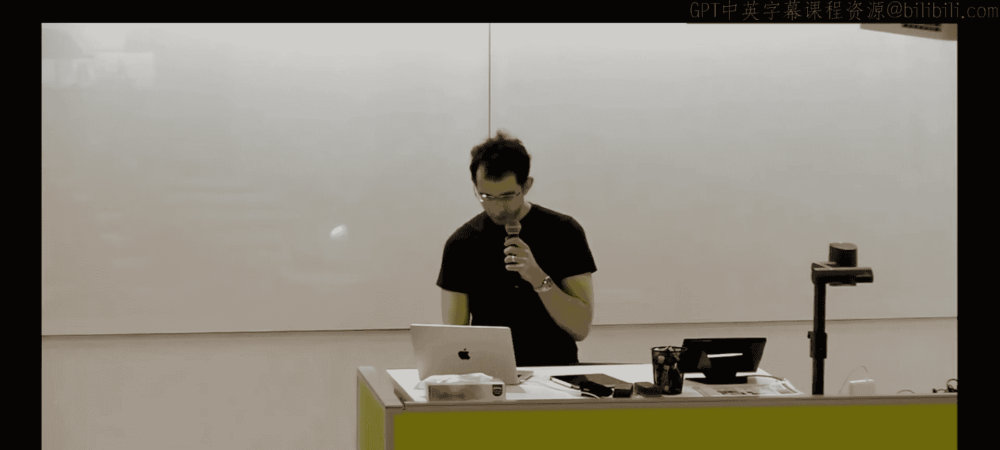
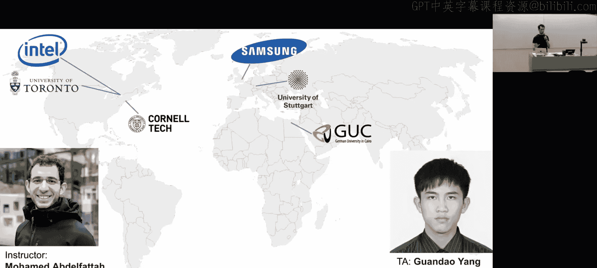
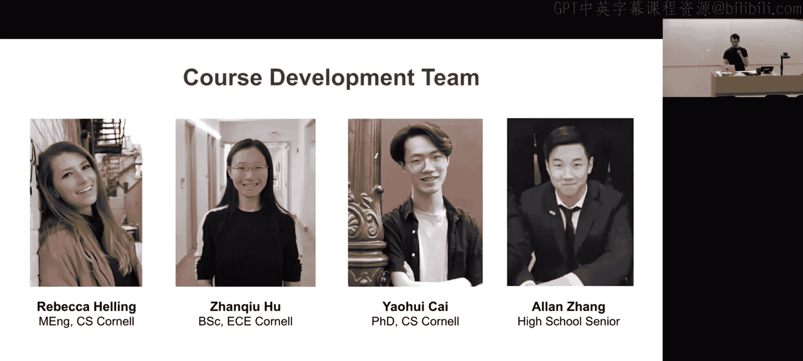
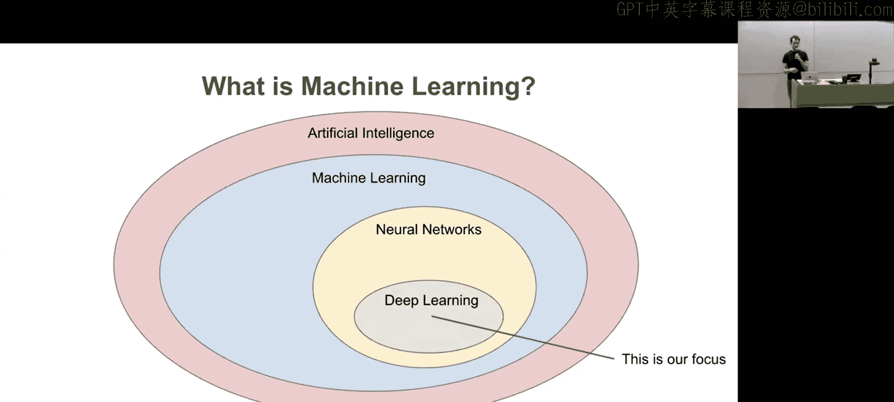
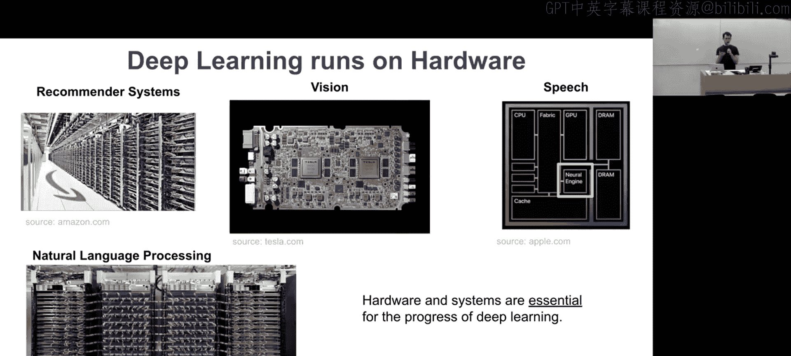
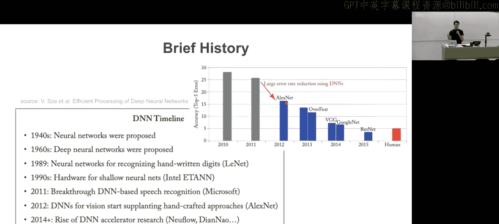
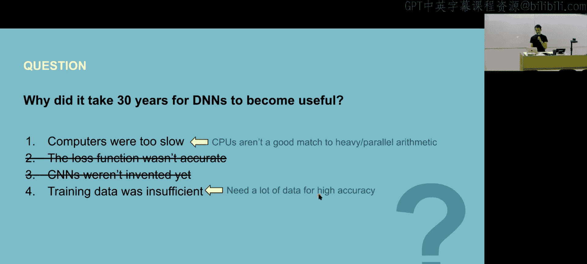
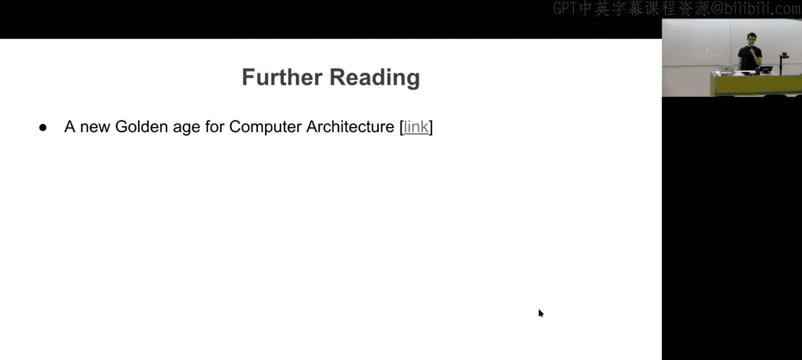

# 机器学习硬件与系统：001：课程介绍 🎯

在本节课中，我们将学习《机器学习硬件与系统》这门课程的整体框架、学习目标、评估方式以及核心动机。我们将了解为什么在算法之外，硬件和系统对于机器学习的实际应用至关重要。

---

## 课程概述与动机

欢迎来到《机器学习硬件与系统》课程。这是本课程首次开设。我作为康奈尔理工学院的新助理教授，这也是我首次授课。希望我能通过这门课程，让大家对机器学习硬件与系统感到兴奋。

核心思想在于，虽然我们常听到人工智能、深度学习和机器学习正在改变世界，但其实际运行依赖于硬件、系统以及我们将在本课程中学到的优化技术。在计算机科学中，你可能学过算法层面的课程，但如何让算法在计算机上实际运行，以及如何构建运行这些算法的计算机，正是我们在这里要尝试学习的。

让我分享一个简单的动机案例。2013年，谷歌的一些顶尖工程师发现，如果用户每天仅使用三分钟的深度学习语音识别服务，谷歌就需要将其数据中心容量翻倍。这意味着需要建造两倍于现有规模的庞大基础设施。

这告诉我们两件事：
1.  这类应用的计算负载非常沉重。
2.  现有的数据中心架构并不适合这类应用。

因此，谷歌的工程师们没有选择扩建数据中心，而是设计了一款定制芯片，即TPU。通过重新思考运行这些程序的硬件，他们在语音识别这一特定工作负载上实现了**10到100倍的性能提升**。相比现有的CPU和GPU，他们无需扩建数据中心，只需将新芯片置入现有设施即可满足需求。

---

## 课程核心内容

为了让这样的芯片发挥作用，涉及的远不止硬件设计。本课程将涵盖以下四个主要方面：

### 1. 硬件架构 🖥️
大约四分之一的课程将专注于硬件架构。我们将学习如何分析现有硬件、比较不同硬件对特定工作负载的适用性，以及如何设计高效的硬件架构。我们也会浅层涉及微架构（如何构建执行实际数学运算的电路）以及这类芯片的内存设计。

### 2. 系统 🚀
课程名为“机器学习硬件与系统”，因此我们也将讨论系统层面。一旦有了单颗芯片，如何将它们组合起来以分布式方式训练深度神经网络？分布式训练对于当今的超大规模模型至关重要。我们还将探讨联邦学习，这是一种具有安全隐私保障的分布式学习方式，例如如何利用手机数据安全、私密地训练神经网络。此外，我们也会讨论神经网络前后的预处理与后处理系统，以及这些系统对环境的影响和碳足迹问题。

### 3. 神经网络优化 🧠
仅孤立地讨论硬件和系统是不够的，因为软件和算法层面也有大量工作。在神经网络层面，我们将讨论如何实现高效的、针对特定硬件目标优化的神经网络。具体技术包括：
*   **量化**：在神经网络中使用更低的数值精度。
*   **剪枝与稀疏化**。
*   **知识蒸馏**等技术。
*   **自动化机器学习**，特别是神经架构搜索，即如何找到最适合特定硬件的最佳神经网络拓扑结构。

### 4. 软件 💻
没有软件的硬件只是一块砖头。我们将学习如何为我们构建的新芯片编程。这部分将重点讨论专为深度学习涌现的**领域特定语言和编译器**。虽然也存在针对计算机视觉等其他应用的DSL和编译器，但我们将关注更通用、不局限于单一领域或模态的深度学习任务。

---

## 讲师与助教介绍

我是穆罕默德·阿卜杜，康奈尔大学电气与计算机工程系的新助理教授。我的背景主要在硬件架构领域，曾在英特尔参与构建基于FPGA的首个深度学习加速器（涉及硬件、软件、编译器），之后在三星英国AI中心工作，专注于自动化机器学习以及为三星手机创建高效机器学习模型。我将尽力在课程中传递这些工业界的实践经验。

我很荣幸有助教**杨光道**（康奈尔理工学院三年级博士生，计算机视觉专家）协助，他将主要帮助处理作业，特别是那些涉及较多部分的作业。

此外，在课程准备阶段，还得到了Rebecca、Z、She、Yaoki和Alan的帮助，他们协助设计了作业和编程部分。

---

## 课程先修要求与教材

### 先修知识
*   **计算机架构基础**：我们将选择与深度学习加速器相关的主题进行深入。如果你对此毫无了解，可能需要与我沟通。
*   **机器学习基础**：你应该上过机器学习入门课程，了解基本概念，实际训练并运行过神经网络，最好熟悉PyTorch并编写过代码。

### 教材
我们将使用教材《Efficient Processing of Deep Neural Networks》，并在课程中阅读大量论文。该教材可通过康奈尔大学在线图书馆获取PDF版本。

---

## 课程评估方式

本课程的评估侧重于学期中的作业和项目：

1.  **作业（占比最大）**：共有五次作业，每次都是一个迷你项目。
    *   **作业0**：熟悉设计工具和编程工具（2分）。
    *   **作业1**：聚焦硬件，进行硬件基准测试和研究，学习使用屋顶图。
    *   **作业2**：训练和优化神经网络模型，并将其部署到微控制器单元上进行测试。
    *   **作业3**：聚焦软件编译，使用TVM工具。
    *   **作业4**：实现和对比不同的深度学习算子（如卷积）算法，并观察其在不同硬件目标上的运行情况。

2.  **期末论文（20%）**：自选主题，对至少10篇相关研究论文进行批判性评估。

3.  **课堂报告（10%）**：10分钟报告，讲解一篇或两篇论文，最好与期末论文主题相关。

4.  **每周论文总结（5%）**：每周提交不超过半页的论文摘要，需涵盖指定问题。

5.  **课堂参与（5%）**：鼓励课堂互动、提问和贡献想法。

**额外奖励**：作为首次开课，如果你发现讲义或作业材料中的重大错误（非拼写错误），或纠正课程内容中的错误，将获得加分。

---

## 课程技术栈与哲学

### 技术平台
*   **课程网站**：包含所有重要链接（Zoom、讨论区、GradeScope）。
*   **GitHub Classroom**：用于发布和提交作业代码。
*   **Google Colab**：用于编码作业，提供方便的GPU访问环境。建议从作业2开始购买Colab Pro（每月10美元），以方便后台模型训练。
*   **GradeScope**：用于提交作业报告和每周论文总结。

### 课程哲学
1.  **紧跟前沿与研究导向**：课程需要保持最新状态，我们将讨论论文，你需要课后阅读以跟上领域发展。
2.  **实践性**：作业包含大量动手编码，因为这是一个非常应用的学科。
3.  **趣味性**：作业设计力求有趣，可能还会举办一两次竞赛。

### 学术诚信
禁止作弊和抄袭代码。允许与同学讨论想法，但直接复制代码是不可接受的。我们将使用工具检查作业代码和文本的抄袭情况。

---

## 深度学习简介：为何需要专用硬件与系统？

### 深度学习的特殊性
深度学习是机器学习的一个子集，而深度神经网络是其中的主流技术。本课程虽名为“机器学习硬件与系统”，但实际聚焦于**深度学习硬件与系统**。

深度学习之所以特殊，是因为它在众多领域取得突破：
*   **推荐系统**（如亚马逊、谷歌、Netflix）。
*   **计算机视觉**（如自动驾驶、图像分割）。
*   **语音识别**（已可部署于手表等小型设备）。
*   **自然语言处理**（如翻译、文本生成，甚至在法律文档自动化等领域应用）。

这些应用都依赖于硬件来运行。例如，手机中的“神经引擎”、特斯拉的FSD芯片、亚马逊的定制AI芯片、谷歌的TPU Pod等，都说明了专用硬件和系统对于深度学习发展至关重要。

### 深度学习的历史与复兴
深度神经网络并非新概念，早在20世纪40年代就已提出，80年代已有成功应用（如LeNet用于MNIST）。那么，为何在2012年（AlexNet出现）才迎来爆发？

关键原因有二：
1.  **大数据**：互联网和移动设备产生了海量训练数据。
2.  **GPU**：Alex Krizhevsky发现如何用GPU编程神经网络，GPU的并行计算特性完美匹配了深度学习的需求。

自此，AI研究和产业投资呈指数级增长。这不仅是学术热点，更是获得巨额投资的现实技术。

---

## 案例深入：语音识别系统

考虑一个语音识别系统（如“Hey Google”）：
1.  **手机端**：语音数据预处理（如生成频谱图）。一个关键挑战是如何在手机端本地高效运行神经网络，以节省数据中心成本和功耗，并保障用户数据隐私（这引出了**联邦学习**）。
2.  **数据传输**：数据传至数据中心的过程本身也可能涉及基于AI的通信协议（如信道编码、压缩）。
3.  **数据中心端**：面临与手机端类似但规模更大的硬件、软件、分布式训练等问题。
4.  **AI税**：神经网络前后的预处理和后处理同样重要，常被忽视。

这个案例展示了在硬件、系统、神经网络、软件每个层面进行优化的必要性和紧迫性。

---

## 各专题的紧迫性

### 硬件：后摩尔定律时代
摩尔定律（晶体管数量每两年翻倍）和登纳德缩放定律（功耗密度恒定）曾让我们免费获得性能提升。但约在2008年后，登纳德缩放定律失效，晶体管微小化导致漏电和发热严重，功耗密度飙升。这意味着我们无法再单纯依靠制程进步来获得更快芯片。

因此，我们必须转向**架构创新**，设计**领域特定架构**，将晶体管专门用于深度学习等特定任务，从而提升效率。硬件架构研究正因此迎来复兴。

### 神经网络：巨大的优化空间
比较五年前的VGG16和现在的EfficientNet等网络，在计算量（FLOPs）和模型大小上出现了**数个数量级的缩减**，同时精度还有所提升。这得益于量化、剪枝、神经架构搜索等技术。我们在三星进行超分辨率网络优化时，仅应用这些技术就实现了**30倍的计算量减少**。神经网络拓扑和计算组织方式的优化潜力巨大。

### 软件：百花齐放的生态
涌现出大量专为深度学习设计的**领域特定框架、语言和编译器**（如图中众多Logo）。理解其背后的概念和必要性至关重要。

### 系统：分布式与隐私保护
*   **分布式训练**：如何跨多台机器分割数据或模型进行协同训练，涉及梯度同步、参数更新等复杂问题。
*   **联邦学习**：如何在保护用户隐私的前提下，利用分散在亿万设备上的数据进行学习，是一个日益重要的研究方向，既有隐私安全考量，也有经济因素（将计算负担转移到用户设备）。

---

## 课程安排与总结

课程将按以下顺序进行：
1.  硬件
2.  神经网络优化
3.  软件
4.  系统

这样安排是为了让大家首先建立硬件为中心的思维方式。

**本节课总结**：
我们一起学习了《机器学习硬件与系统》课程的总体介绍。我们了解了课程的核心动机：在算法突破的背后，专用硬件和高效系统是深度学习得以实际应用和持续发展的关键驱动力。我们明确了课程将涵盖硬件架构、神经网络优化、软件栈以及分布式系统四大板块，并清楚了课程的评估方式、先修要求和技术平台。最后，我们通过历史回顾和案例分析，深刻认识到学习本课程内容在当今后摩尔定律时代和AI普及化背景下的重要性与紧迫性。