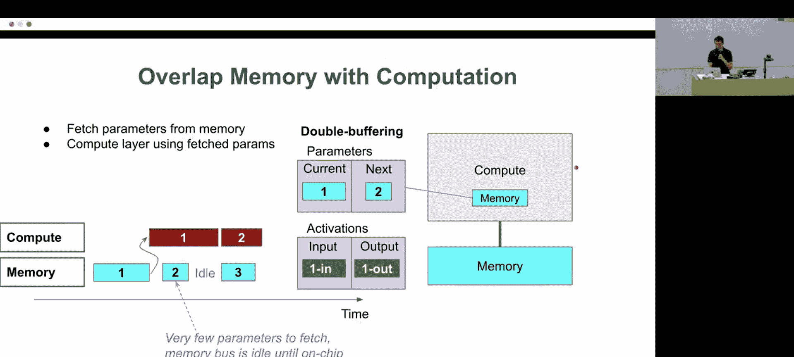
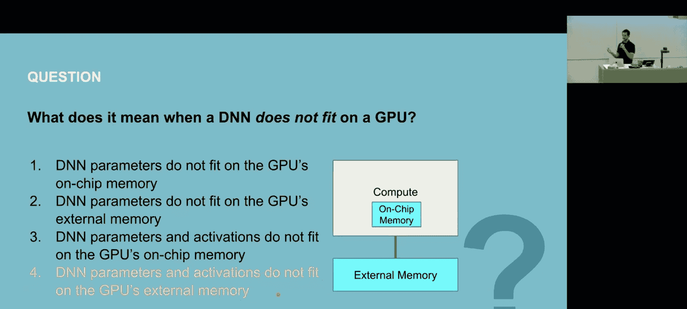
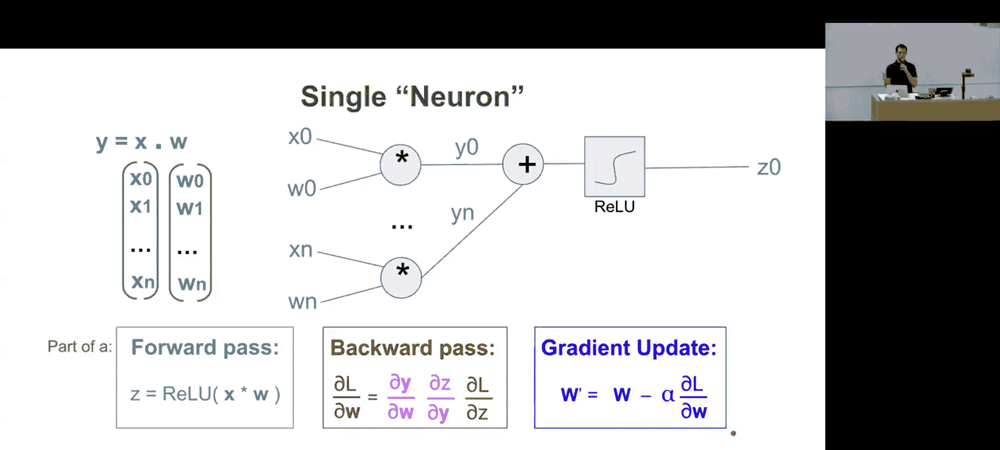
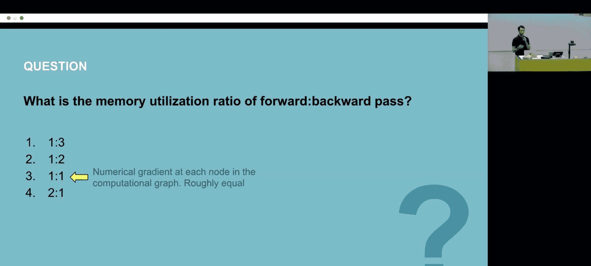
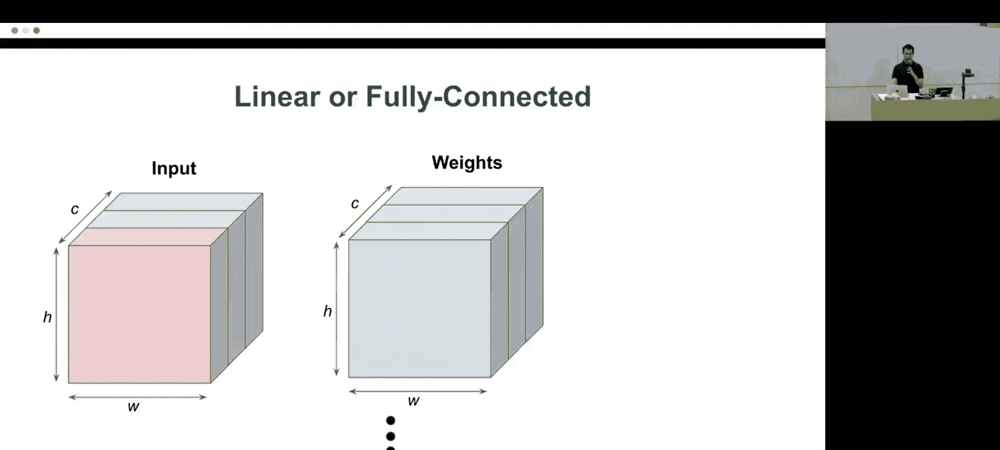
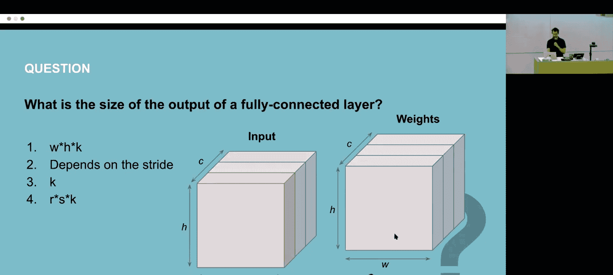
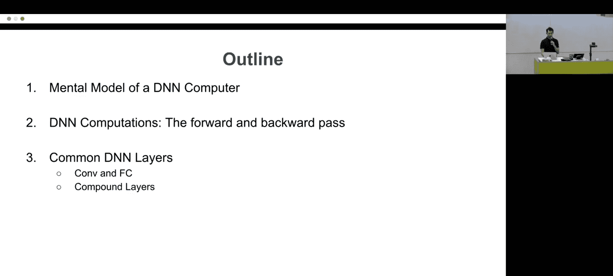
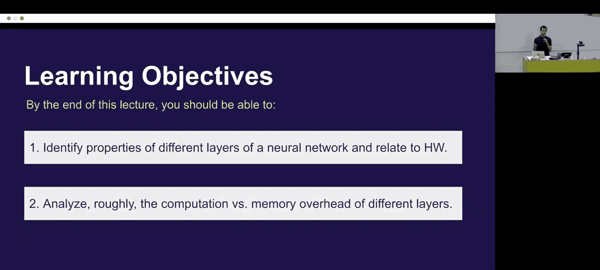
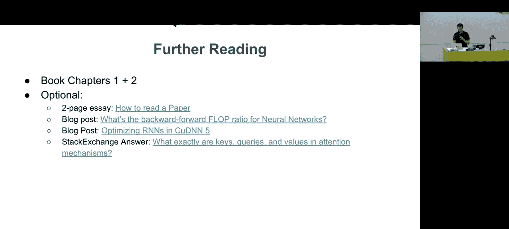

# 机器学习硬件和系统：002：DNN计算概述与核心层分析 🧠

在本节课中，我们将学习如何从计算和内存的角度理解深度神经网络。我们将建立一个简单的“DNN计算机”心智模型，分析前向传播与反向传播的计算/内存开销，并探讨常见神经网络层的计算特性。

---

## 第一部分：DNN计算机的心智模型 💻

上一节我们介绍了课程的基本信息，本节中我们来看看如何为运行深度神经网络建立一个简单的计算机心智模型。

### 冯·诺依曼架构与瓶颈

在计算机体系结构中，一个普遍使用的模型是**冯·诺依曼架构**（或称普林斯顿架构）。其核心组件包括：
*   **中央处理单元**：包含控制单元和算术逻辑单元。
*   **外部存储单元**：存储程序和数据。
*   **低带宽总线**：连接CPU和外部内存。

该架构的瓶颈在于**冯·诺依曼瓶颈**：计算单元必须通过低带宽总线从外部内存加载数据和指令，这通常成为性能的主要限制。

为了缓解此瓶颈，现代计算机采用了多种技术：
*   在芯片上集成大容量缓存，将数据预加载到计算单元附近。
*   针对机器学习，新兴芯片设计趋向于**领域专用架构**，例如构建没有外部内存的大芯片，或将计算单元嵌入内存中（即**存内计算**）。

### 内存受限 vs. 计算受限

评估一个工作负载时，关键要判断它是**内存受限**还是**计算受限**。
*   **内存受限**：从外部内存获取数据所需的时间，超过了在芯片上进行计算的时间。此时，即使增加计算单元，也无法提升整体速度。
*   **计算受限**：计算本身所需的时间，超过了数据加载的时间。此时，内存总线可能处于空闲状态。

一个高效的硬件设计应尽可能**重叠内存访问与计算**，以充分利用所有资源。

### 片上内存与双缓冲

由于片上内存容量远小于外部内存（通常相差数个数量级），高效管理片上内存至关重要。一种常见技术是**双缓冲**（或称乒乓缓冲）：
*   当使用缓冲区A中的数据执行当前层计算时，同时通过总线将下一层所需的数据预取到缓冲区B中。
*   计算完成后，交换缓冲区角色，实现计算与数据加载的重叠。

**重要概念**：在GPU上遇到“CUDA out of memory”错误时，通常意味着**模型参数、训练数据和中间激活值无法全部放入GPU的显存（即外部内存）中**，而非片上缓存。

---

## 第二部分：前向传播与反向传播 🔄

上一节我们建立了硬件的基本心智模型，本节中我们来分析神经网络训练过程中两个核心阶段的计算与内存特性。

### 计算开销对比

以一个简化的神经元为例，考察一次乘法和激活操作：
*   **前向传播**：执行一次乘法操作。
*   **反向传播**：为了计算梯度，需要应用链式法则，大约涉及两次乘法操作。

因此，**反向传播的计算量大约是前向传播的2倍**。参数更新（如梯度下降）通常只涉及廉价的加法/减法操作，开销相对较小。

### 内存开销对比

在训练过程中，内存开销主要来自存储中间激活值以用于反向传播的梯度计算。
*   理论上，前向传播和反向传播需要存储的**值数量**大致相同（前者存激活值，后者存梯度值）。
*   然而，**训练时**需要同时存储前向的激活值用于反向计算，因此**峰值内存占用约为单纯推理时的两倍**。

为了节省内存，可以采用**模型检查点**技术：只存储部分层的激活值，在反向传播需要时，根据存储的检查点重新计算中间激活值。这是一种用计算时间换取内存空间的典型权衡。

---

## 第三部分：常见神经网络层分析 🧱

上一节我们分析了训练流程的整体开销，本节中我们深入看看构成现代神经网络的几种核心层的计算与内存特性。

以下是几种关键神经网络层的对比分析：

| 层类型 | 核心操作 | 计算量 (FLOPs) 示例 | 参数量 | 通常属于 | 特点 |
| :--- | :--- | :--- | :--- | :--- | :--- |
| **标准卷积** | 滤波器与输入块的点积 | `2 * H * W * C * R * S * K` | `R * S * C * K` | **计算受限** | 参数复用性高，计算密集。 |
| **深度可分离卷积** | 逐通道卷积 + 逐点卷积 | 显著少于标准卷积 | `R * S * C + C * K` | 趋向平衡 | 高效网络基础，大幅减少计算量。 |
| **全连接/线性层** | 矩阵-向量乘法 | `2 * (输入维度) * (输出维度)` | `(输入维度) * (输出维度)` | **内存受限** | 参数量大，复用性低。可通过**批处理**转为计算受限。 |
| **自注意力层** | Q, K, V 的矩阵乘与缩放点积 | 与输入令牌数的平方相关 | 相对较少 | 通常计算受限 | Transformer核心，序列建模能力强。 |

### 复合层与数据依赖

现代网络由上述基础层组合成更复杂的块，如ResNet的残差块、MobileNet的倒残差块、Inception块等。这些块中的**跳跃连接**会引入数据依赖，影响片上内存的调度策略：需要将跳跃连接的数据在内存中保留更长时间，以供后续分支使用。

循环神经网络（如LSTM）具有更复杂的层内和跨时间步的数据依赖，这使得其在GPU等并行架构上的优化更具挑战性。

### 注意力机制与Transformer

注意力机制，特别是Transformer中使用的**缩放点积注意力**，已成为NLP、语音和视觉领域的基石。其核心公式如下：

`Attention(Q, K, V) = softmax(Q * K^T / sqrt(d_k)) * V`

其中`Q`(查询)、`K`(键)、`V`(值)均是输入的线性投影。尽管注意力机制功能强大，但其计算量随输入令牌数呈**平方级增长**。因此，如何高效地近似或优化注意力计算是当前的研究热点。

---

## 总结 📝

本节课中我们一起学习了：
1.  **建立心智模型**：将DNN计算机抽象为计算单元、片上内存和外部内存，并通过冯·诺依曼瓶颈理解数据搬运的关键性。
2.  **分析训练开销**：认识到反向传播的计算量约为前向传播的2倍，而训练的内存峰值约为推理时的2倍。
3.  **剖析核心网络层**：理解了卷积层通常是计算受限的，而全连接层常是内存受限的，并了解了通过批处理、深度可分离卷积等技术进行权衡。
4.  **认识现代架构**：了解了注意力机制的基本原理以及Transformer如何通过自注意力层和全连接层组合构成。

掌握这些从计算和内存角度分析神经网络的能力，是设计高效硬件和系统的重要基础。在接下来的课程中，我们将学习具体的硬件度量和设计技术，以应对这些计算与内存的权衡挑战。