# 机器学习硬件和系统：003：硬件分析指标与性能模型

在本节课中，我们将深入学习设计深度神经网络加速器时涉及的重要硬件和计算机架构概念。我们将从分析硬件性能的指标开始，逐步深入到用于评估芯片性能的屋顶线模型，并探讨如何优化硬件以获得更高的效率。

## 课程概述与回顾

上一讲我们开始构建硬件加速器的思维模型，主要基于冯·诺依曼架构。这意味着我们有一个计算单元、一个内存单元，它们通过一条低带宽总线连接，这通常被称为冯·诺依曼瓶颈。我们通过添加片上内存来绕过这个瓶颈，让数据更接近计算，并尽可能重叠内存访问和计算。

我们还从计算视角审视了重要的神经网络原语，讨论了卷积、全连接层等组件的内存与计算需求，并简要介绍了注意力机制和更复杂的模块。上一讲的目的不是穷举所有原语，而是改变我们看待这些原语的视角。

今天，我们将思考如何重新设计计算机芯片以专门用于机器学习或深度神经网络。我们将从用于评估芯片的分析和指标开始，然后讨论如何针对深度学习工作负载优化硬件效率，最后通过一些现有或正在开发的芯片案例研究来巩固理解。

## 硬件分析：性能指标

首先，我们需要了解如何衡量一个芯片在深度学习工作负载上的速度。

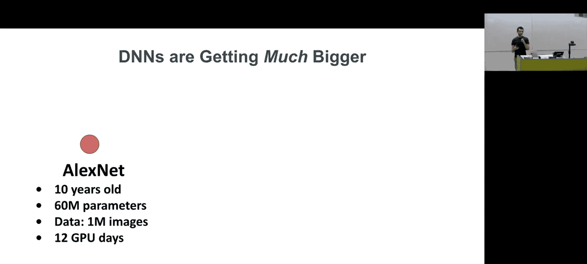

### 计算性能：FLOPS 与 OPS

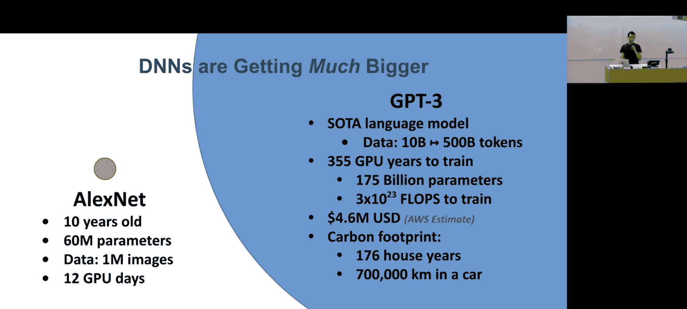

我们常提到 FLOPS，它代表 **每秒浮点运算次数**。这是指硬件每秒能执行的浮点运算数量。在深度学习推理中，常使用降低的数值精度（如8位整数），此时则使用 **OPS**（每秒运算次数）。

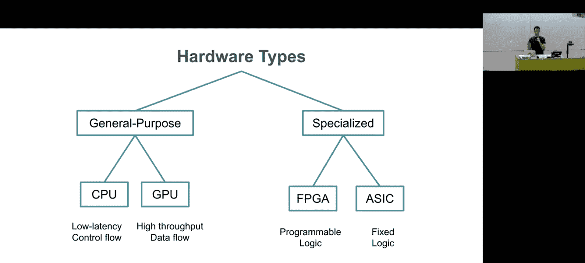

另一个常见指标是 **MAC/s**（每秒乘加运算次数）。因为点积是我们最基本的计算单元，一次乘加运算通常等于两次浮点运算。因此，峰值 MAC/s 通常是峰值 FLOPS 的一半。

**重要概念**：芯片通常标称的是 **峰值 FLOPS/OPS**。这是假设芯片100%利用率时能达到的理论上限。在实际工作负载中，由于各种因素，几乎无法达到峰值性能。

计算每秒运算次数的公式为：
`运算次数/秒 = 时钟频率 (Hz) × 处理单元数量 × (1 / 每运算所需周期数)`

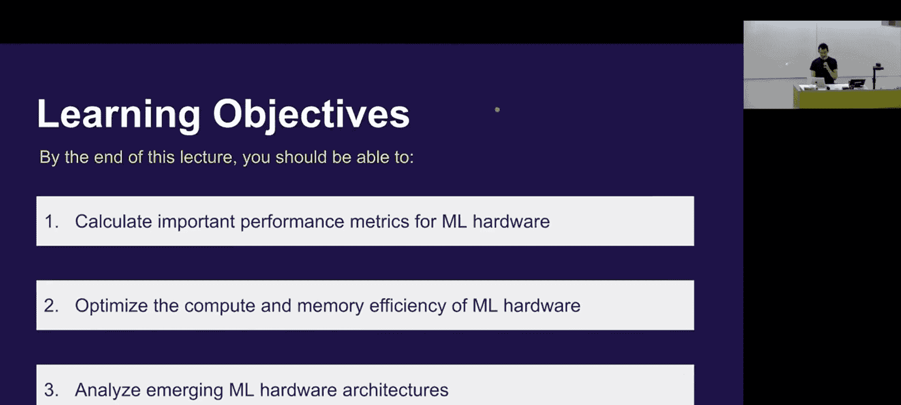

其中，**处理单元** 可以理解为能并行执行乘法运算的单元数量。

### 内存性能：容量与带宽

除了计算，内存同样关键。

*   **内存容量**：指连接到加速器的外部内存能存储多少数据。对于需要大模型的训练任务，内存容量不足会成为瓶颈。现代GPU通常有数十GB的内存。
*   **内存带宽**：指数据从外部内存传输到芯片的速度，通常以 **GB/s** 衡量。这是决定数据供给计算单元速度的关键指标。GPU的内存带宽远高于CPU。

在我们的简化模型中，我们主要关注外部内存。实际上，系统还有复杂的存储层次结构，包括缓存、暂存器和寄存器等。

## 核心分析工具：屋顶线模型

将计算和内存性能结合起来的主要分析工具是 **屋顶线模型**。它对于计算密集型任务（如深度学习）的评估和设计非常有用。

屋顶线图的 **X轴** 是 **运算强度**，这是应用程序的属性，而非硬件属性。它表示 **每字节内存访问所能完成的运算次数**。对于一个神经网络层，运算强度 = 总运算次数 / 总内存访问量（包括参数和激活值）。

屋顶线图的 **Y轴** 是 **性能**，即在特定硬件上实际达到的运算速度（如 FLOPS）。

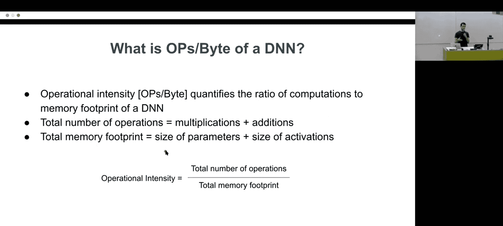

屋顶线图由两条线构成：
1.  **斜线部分（内存带宽限制）**：当运算强度较低时，性能受限于从外部内存读取数据的速度。这条斜线的斜率等于硬件的 **内存带宽**。
2.  **水平线部分（计算性能限制）**：当运算强度足够高时，性能受限于芯片的 **峰值计算性能**。

两条线的交点称为 **平衡点**。在此点，内存带宽和计算性能达到完美匹配。

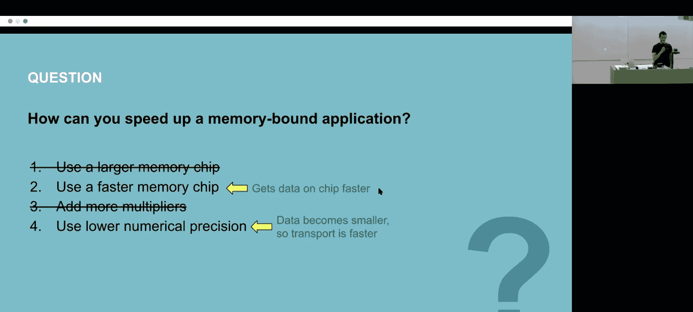

### 屋顶线模型的应用

假设我们有一个神经网络工作负载，其运算强度落在图中A点。从A点向上画垂直线，它与屋顶线相交于斜线部分，这表明该工作负载是 **内存瓶颈** 的。

**如何加速一个内存瓶颈的应用？**
1.  **使用更快的内存芯片**：提高内存带宽，使斜线变得更陡峭，可能将工作负载转变为计算瓶颈。
2.  **改变工作负载本身**：例如，**使用更低的数值精度**。这不会改变运算次数，但减少了需要加载的字节数，从而提高了运算强度（工作负载在X轴上右移），可能使其进入计算瓶颈区域。

相反，如果一个工作负载是计算瓶颈的（如B点），则需要提升芯片的峰值计算性能，例如通过增加处理单元数量或提高时钟频率。

### 实际性能与理论峰值

实际上，达到的性能点通常低于屋顶线。原因包括：
*   **内存访问效率低**：非连续的内存访问无法有效合并，无法达到峰值带宽。
*   **计算利用率低**：计算单元未被充分利用（例如，通道数不是处理单元数量的整数倍）。
*   **控制流开销**：尽管神经网络控制流简单，但仍可能存在数据或控制冲突导致的停顿。

在作业1中，你将实际绘制和分析不同硬件上的屋顶线，以深入理解这些概念。

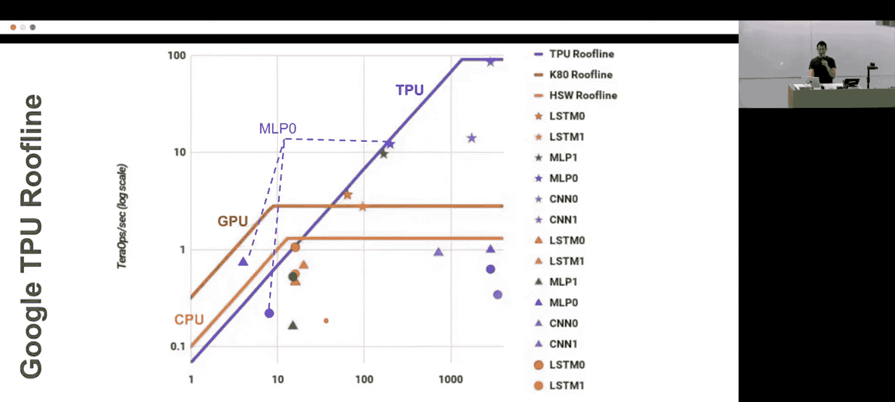

## 硬件效率优化技术

从CPU到专用加速器，我们追求更高的能效。研究表明，在CPU上执行一次加法运算，绝大部分能量消耗在指令缓存、寄存器访问、控制逻辑等“开销”上，实际加法器消耗的能量微乎其微。

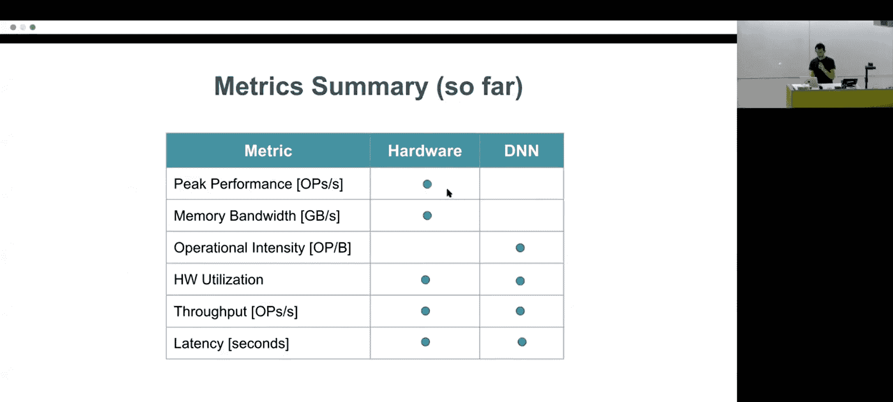

如何提升硬件效率？以下是几种关键技术方向：

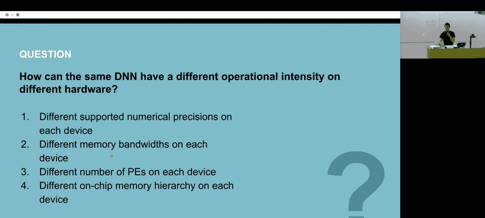

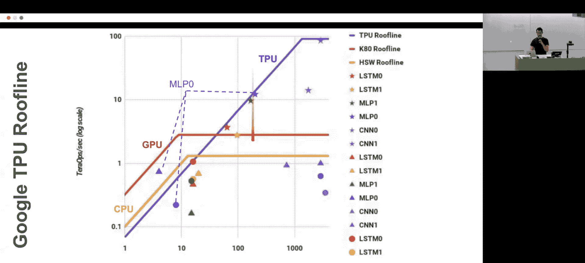

### 1. 算术优化：分摊开销

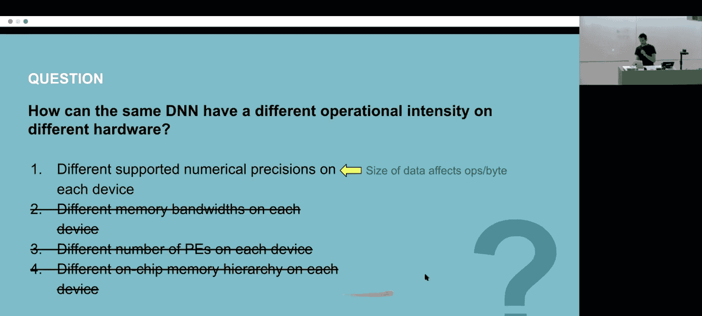

核心思想是：**用一次“开销”执行更多的计算**。
*   **专用指令集**：从单次加法，到融合乘加，再到4元素点积指令，最后到 **矩阵乘法指令**。例如，GPU的Tensor Core和Google TPU的矩阵乘法单元，能在单个指令/周期内完成16x16甚至256x256的矩阵运算，极大地分摊了控制开销。
*   **趋势**：工业界正朝着更粗粒度的操作单元发展，将整个神经网络层（如卷积）作为单个指令来执行。

### 2. 内存优化：利用数据局部性

对于内存瓶颈的应用，关键在于 **数据复用** 和 **数据局部性**。
*   **数据复用**：确保数据被加载到片上后，在被替换出去之前被多次使用（例如，一个权重被用于计算多个输出）。
*   **数据局部性**：通过巧妙的硬件数据流设计，使计算需要的数据总是存放在离计算单元最近的位置（如寄存器或片上缓存中）。

### 3. 跳过无效操作

如果运算结果无效（例如乘以0），理想情况下应跳过该运算以节省能耗和计算资源。如何高效地检测并跳过稀疏网络中的无效操作，是当前深度学习硬件研究的一个开放问题。

### 4. 模型优化

通过改变神经网络模型本身来更好地适配硬件，例如：
*   **减少运算量**：设计更高效的网络架构（如从VGG到EfficientNet）。
*   **调整拓扑结构**：使数据流更符合硬件的并行模式。
这些属于算法-硬件协同设计范畴，将在后续课程中详细讨论。

## 总结

本节课我们一起学习了评估和优化机器学习硬件的基础知识。

我们首先介绍了关键的硬件性能指标：**计算性能** 和 **内存性能**。然后，我们深入探讨了强大的分析工具——**屋顶线模型**，它揭示了工作负载的运算强度如何与硬件的内存带宽和峰值计算能力相互作用，从而确定性能瓶颈所在。

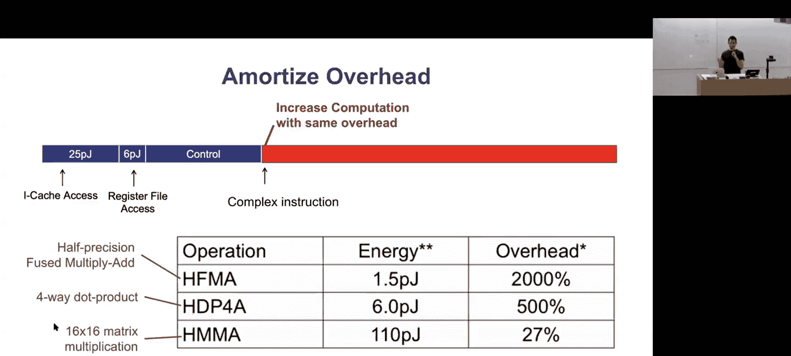

最后，我们概述了提升硬件效率的几种主要技术：通过 **更粗粒度的指令分摊开销**、优化内存访问以利用 **数据局部性**、探索 **跳过无效操作** 的方法，以及进行 **模型优化**。

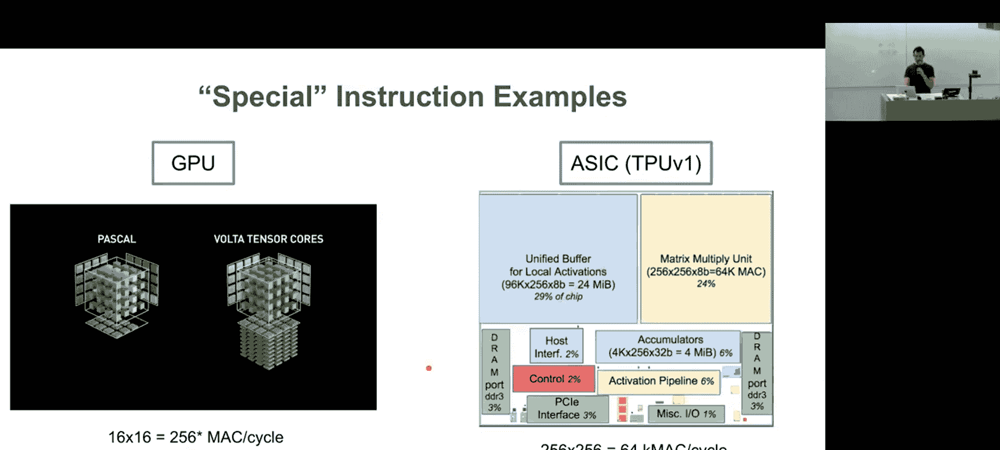

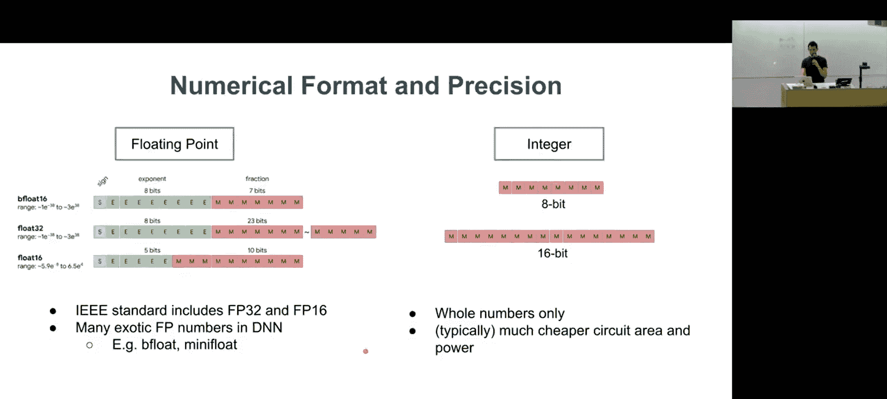

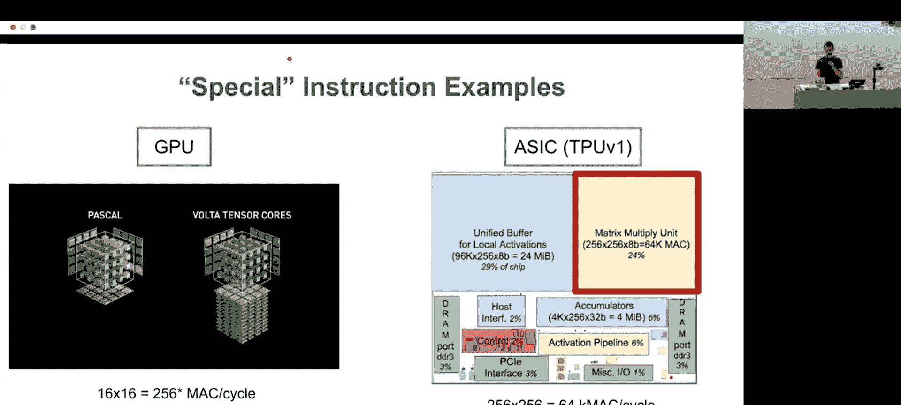

理解这些概念是分析和设计高效深度学习加速器的基石。在接下来的课程中，我们将运用这些知识，深入分析一些具体的现代机器学习硬件架构案例。