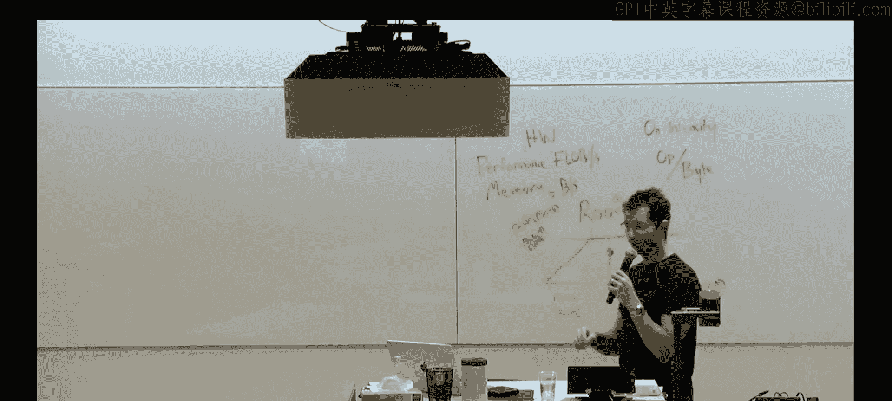
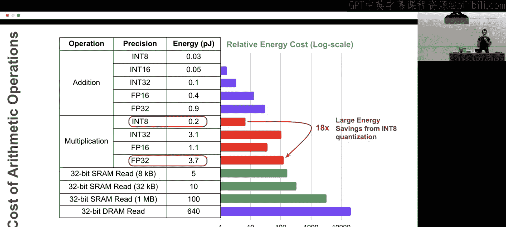
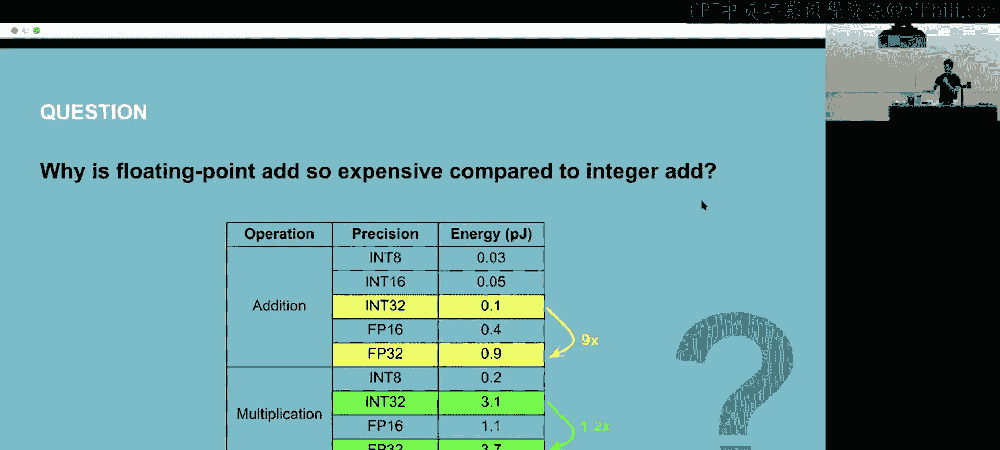
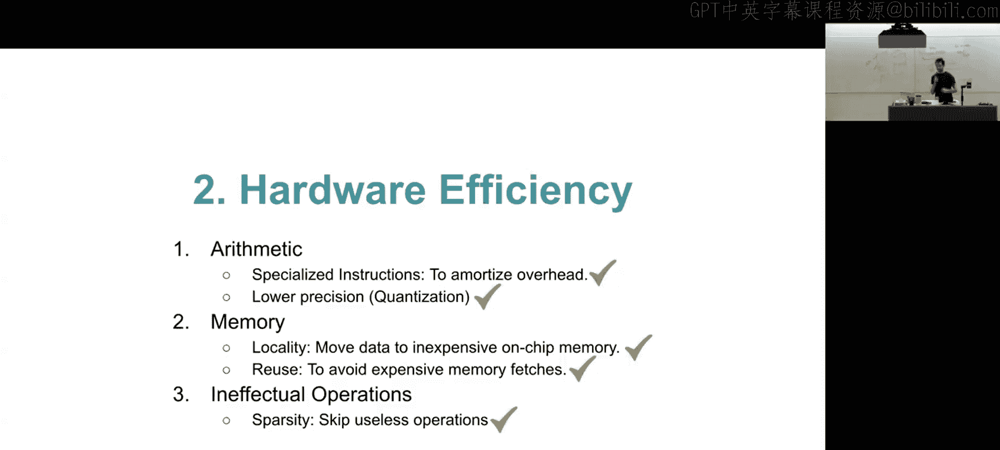

# 004：康奈尔大学《机器学习硬件和系统｜Cornell ECE 5545 Machine Learning Hardware and Systems》中英字幕 p04 -04-Lecture 3_ ML Hardware II (efficiency).zh_en -BV1CCqPYSEP5_p4-

Okay， so last time we started talking about hardware and how to analyze different hardware systems and we briefly touched upon hardware efficiency as well。

 so in this lecture we'll continue with hardware efficiency。

 but first let's do a very quick recap of hardware analysis metrics。

 so the first thing we talked about was performance。So， I'm hoping。

And the unit that we used for performance was flops per second。So。Loopps。Per second。

 So the number of floating point operations that my hardware is capable of doing in the best case per second。

 And then the other thing was memory。 And， of course， memory has many parameters。

 But the main thing that affects my performance that we talked about was the memory bandwidth。

 So usually in some kind of。Btes per second right， so maybe gigabytes， terabytes， whatever it may be。

And that's kind of on the hardware side， so just comparing the peak performance of different hardware to each other。

On the other hand， we said on the workload side， we have this interesting metric called operational intensity。

嗯。Up in ten city。So what is this， this is the number of operations。嗯。

Per unit of memory that I need to fetch from my memory system， so it measured an ops per byte。

So now we have a way to compare hardware， different hardware types to each other。

 we have a way to kind of quantify the compute and memory required for a specific workload。

 how do we know which hardware is best for which workload？And for that。

 we talked about something called the roof line， so that's kind of taking both of those concepts and putting them together on one plot。

And turns out that's very useful especially for deep learning applications where you know compute and memory are your main things。

 you don't really have many control flow things to take into account or things of the like so the main thing is actually the compute you have available and all memory bandwidth you have available。

And so the roof line looks like this。We put operational intensity here。And we put performance here。

And so you know we have a peak performance of a chip which is just computed by getting the number of multipliers on that chip。

 multiplying that by the frequency and dividing by the number of cycles it takes to do each operation right and so usually chips are rated with this peak flops per second。

Peig flops。And of course， you know the performance is measured in flops。P second。

And the operational intensity is ups per bitete。So here we kind of we would draw a straight line。

But but the main thing to take into account is that we can't hit that big performance or even come close to it when my operational intensity is very low because I will always have the bottleneck of external memory bandwidth。

So no matter how much compute I have on the chip， I will always have this bottleneck of I just need to bring data from off chip to on chip so if I have a very low operational intensity that means I need to get a lot of data from off chip and then I would use it to compute very little so you know one operation every gigabyte for example。

 in this regime。So we said that applications that fall here on this specific chip are memory bound。

And applications or workloads that are here would be compute bound。On this trip。Yeah。Um。Yeah。

 the final thing maybe we said about this is that， you know。

 if I have a workload with the operational intensity here。

 don't expect it to kind of intersect with the roof line。

 the roof line is the best possible performance you could get。

 but usually hardware utilization comes into play latency all of these things will make your actual achieved performance somewhere here。

 right。So always build all the roof line in very rare cases would it actually intersect the roof line。

So are there any questions about the roof line before we continue kind of to the next bit？

And actually， can people see this， I'm hoping that people can see it。Yes， we can see this。

Okay， good。All right。

Okay， so。Yeah a couple of admin things so the instant access thing should be sorted out。

 tell me if it isn't and I realized that I didn't post any office hours so just if you want to meet just drop me a line you can do a private post on Ed or you can just send me an email and will schedule some meeting time。

And maybe later I'll put in specific office hours once assignments get a bit more involved。Okay。

 so now on to hardware efficiency， and I'll start from here again where we kind of started by analyzing on CPUs and traditional computers。

 where does the energy go in an addition instruction for example。

 we saw that you know most of it actually goes to overhead， basically fetching memory。

 doing branch prediction， control， all of that stuff。

 and then the addition instruction itself takes very little about 1。

5 picojouleles in this case out of 70。And so we talked about that there are many techniques to improve the hardware efficiency and the first one is to amortize the overhead and what that means is that I want to make my instructions more complex and by doing that I am paying for the same overhead。

 but I'm increasing the computation that's done， given that large overhead。

So we briefly went over some instructions that are now embedded in most the GPUs going from just multiplication and addition as two separate things now to a dot product as a single operation and finally matrix multiplication。

 16 by 16 matrix multiplication as a single operation。

 bringing down that overhead in terms of percentage from 2。

000% or to 100 x to 27% right so a huge improvement。

We also briefly talked about these GPU tensor cores， which do matrix matrix multiplication。

 and we compared that to Ass like the TPU version one。

 which has a single operation that multiplies 256 by 256 big matrices in one instruction。Okay。

 so today we'll kind of pick up from here and move on to talk about another technique for improving efficiency and that is by controlling the numerical format and precision。

So like I briefly mentioned， you know we always used to use floating point arithmetic for scientific applications and that's because floating point numbers you can easily and quite accurately control you know the amount of precision you have and the range for these numbers so they're the closest you can get to representing a real number of course they still have limited precision and range。

 but it is so。The range is so big and the precision is so fine that usually it works very well for scientific applications。

And that's actually why most computers support double precision。

 which is a 64 bit format and single precision， which is a 32 bit format。

And so when deep learning and deep neural networks started。

 people used single precision numbers for it， they said， okay。

 we'll use FP32 and what that looks like is drawn here so you have one sign bit。

You have eight bits to represent an exponent and you have 23 bits to represent a fraction or called a Menisa so is everybody familiar with these numerical formats。

 can you maybe just post in the chat yes no gives me kind of an indication。About。Okay， yes，es， yes。

 lots of yeses。嗯。But basically， this is a representation of a number， which is， you know。Mtia。

Can you see this well you know I'm small now you can see me。

 but basically Mana times two to the power of exponent and it has a sign in front of it so you're representing kind of the number in this scientific format。

嗯。So when people ran these deep learning applications， they realized on deep neural networks。

 they realized actually don't need all of that precision。

 I can easily reduce my precision and maintain the same accuracy。

And so people actually played it around with different things there。

 and the first one is floatloat 16， so floatloat 16 still represents a floating point number。

 but in reduced precision， which means we use fewer bits for the exponent。

 so five bits instead of8 bits and 10 bits for the menissa。So that， you know。

 roughly for multipliers， you would have kind of a quadratic growth with the number of bits in your number。

So here you would have much smaller multipliers when you implement them on chip and so four times that's small because'dtic there is a quadratic relationship and for others you would get kind of a 2x reduction in size and 2x improvement in efficiency。

And so reducing these numerics really helps， but then people realized we don't even need to all of this range。

 so floating point numbers give you a lot of range because you can represent exponents。

 so they went to integer arithmetic and fixed point arithmetic and in some cases。

So integer arithmetic， the popular formats there are 8 bit and 16 bits and here we're representing whole numbers only。

 and so the range is limited by what you can represent in those8 bits so you can go from minus if you have a signed bit you can go from minus two to the power of  seven minus1 to two to the power of seven if it's unsigned。

 you can go from 0 to 256 or0 to two to the power of 8 minus1。

So this is typically also much cheaper in terms of circuit area because computing the addition or the multiplication between those numbers。

 it's like only operating on a menisa， so that's kind of highlighted here by the color of these bits。

 the bits are just a single type of bit which is the menisa and as we'll see it's much more efficient。

And so how much more efficient is it， right？So if we look at this plot。

 it's quite striking because in addition， as we would expect， going from In8 to N32。

 you have a 4X improvement on measured kind of energy costs of adding two into8 numbers versus two N32 numbers。

But in multiplication， it's more striking because as I said。

 there is a quadratic relationship going from when multiplying two numbers。

 most multipliers grow quadraically in circuit size。

So you have a 16 x improvement going from in8 to N32 and that's why you will see like new chips like the TPU for example。

 they support int8 as a first class citizen kind of especially for inference。

 you will also see kind of intensor cores and GPUs where they're also focused on reduced precision。

 I think now they also have FP16 precision intensor course， but the first version only had inte8。So。

And going from in8 to FP 32， so comparing now a reduced precision integer number to a full precision 32 bit number。

 we also have very large energy savings。And usually people will mention you know quantization。

 so that's what of course there are many kinds of quantization。

 but that's usually what happens nowadays in quantization。

 you go from an FP32 model into an in8 model and we'll talk a lot more about quantization later。

So a question now。To for you to answer maybe in the chat or by unmuting so we looked at multiplication and they saw kind of major improvements in energy when doing quantization and when moving from integer precision to floating point format。

 but what about addition so。So it why is it that there is a huge improvement when I do integer addition compared to multiplication？

So so basically what this plot is showing you and it's just kind of a summarized version of the previous table is that。

When I move from int to float in addition， I get a9x kind of increase in energy。

 but when I do the same thing for multiplication， I get just a 1。2 x。

Improvement in efficiency So basically why is floating point addition so expensive compared to integer addition that's my question can anyone venture I guess。

So Amman is saying integer a can be done in a single cycle while integer multiply needs several cycle in itself。

That's true。诶。Lakshmi need to take into account different exponents yes so I think everyone is touching upon so James is saying integer a does not require rounding to the nearest representation of float rounding is important。

 but it's I think it factors less here。But I think people are touching upon the crux of the matter。

 which is when you're doing floating point arithmetic， you're not just multiplying to menissas。

 you also have to play around with the exponents。And actually， when you add two numbers。

In floating point， you need to first align the mentics。

 so they need sorry you need to align the exponents， so if you have a number you know I don't know 0。

5 or one or two times 10 to the power of five and five times 10 to the power of four。

 I need that power to be the same before I add the two numbers。

So I need to shift all of my manticses based on the exponents and align and have a uniform exponent before actually adding those numbers。

And what that means is that floating point addition looks something like this where you have an integer adder somewhere in there。

 but it's a very small portion of the circuit。

You can only perform that integer addition component after you align the two exponents。

Have in your numbers so basically there is so much more involved while for floating point multiplication you can do operations on both the exponent and the menisa so I think you add the exponent you multiply the menisss you do some shifting in the end and that's it but here there is so much you need to align the numbers beforehand before you do the actual integer a so integer add is a very cheap part of the operation。

Aligning usually requires multiplexors and barrel shifters and things that we will hopefully talk about in the next lecture when we talk more about circuits。

 and these are very expensive in terms of hardware area and energy。Okay。

 so so we covered kind of the first part， roughly how can we gain more hardware efficiency from specialized。

the overhead and from lower precision， which is often referred to as quantization in neural networks。

 and usually that's done so far during inference， but people have also looked into using lower precision during training。

And if there are no questions， maybe we can move on to the next part about memory optimizations。

 which are super important as well。嗯。Yeah。Okay。So back to this plot。

 which I really like because it puts things in perspective。I mean。

 one thing I should mention at this point is that this x axis is logarithmic。

And we've been kind of comparing numbers and numerical formats to each other and saying this one is more expensive。

 no that one is more expensive， but we've been ignoring that whole bottom part of the plot。

 which is where the problem actually lies， so does it really matter like how much energy my compute takes。

 it matters much more how much energy my memory accesses take。

So this first row here in the memory part。Shows the cost of accessing a 32 bit number from an on chip SM。

 so we're not even going off chip， we're talking about an on chip cash or an on chip buffer。

So in this case， accessing that 3 number， third 32 bit number is more expensive than multiplying 232 bit numbers。

Which is the most expensive arithmetic operation here， right？

And that cost grows if your SRAM or if your on chip RamM is bigger。So if I have an8 kilobyte s Ram。

 that's how much it costs and 8 kilobytes is very small。

 usually we have bigger s RamMs I think you would have megabytes now and on。On ML chips。

 you would go up to 100 megabytes on a single chip。

I think and we'll talk about one chip which has gigabytes， but that's an exception。

 but usually in the order of tens of megabytes in your on chip memory。

And so if you go up to a 32 kilobyte tram， accessing that same 32 bit number costs twice as much now。

 right？And if you go up to a one megabyte Ramm on chip we still haven't gone off chip that same thing same 32 bit number axis now costs 100 picojoules。

 so so clearly memory is the issue right and so far we've been talking about on chip memory we're not going off chip we're not going to DRAM which is way more expensive because now you're paying the cost for getting off the chip for accessing that other chip which is powered on its own and so on and so if we access that same number from external DRAM or HBM memory or something that's connected off the chip now it costs way more 640 picojoules。

So what can we do about that， right？So the first thing we can do is to try to get data as close as possiblepitation。

Basically， the farther the data is the bigger the RA it will live in。

 and that means I need to pay for moving it more。Right。So， so that's called locality。

The second thing we can do is reuse and we again， we briefly touched upon reuse when we talked about convolutions。

 but basically once data is close to you， close to your multiplier or where you'll do the computation。

Make sure to reuse it as much as possible。 So these are the two techniques here。But。

And that's part of the reason why we have a memory hierarchy to begin with right so in the previous images I just showed this one block in external memory and I mentioned oh we may have on chip memory as well but we have this memory hierarchy basically because the closer you get to your compute the smaller the chip area you have afforded to so you need to now create smaller smaller buffers so often the stuff that's very close to the compute units is called you know register files or private memory or local memory and these are typically very small。

Whereas when you go a bit farther you have this big block of memory that makes sure that the data is on chip and again these are usually called you know shared memory or caches or on chip buffers or on chip memories or SRAM and I mean the reason i'm kind of just labeling all of the different names for it here is that you will hear people use these things interchangeably and so you should know the terminology。

And so and finally you would have this chip that's connected you know through a PCB usually。

 but now often in the same package as well， but basically it's a different chip called external memory。

 sometimes main memory， global memory off chip memory or DRAM， there is also HBM now。

 which is a stacked form of DM， a stacked version of the。So in most cases， your model lives here。

 your deep neural network lives in external memory， I need to bring chunks of it。

 put it in the shared memory， and then I break that down into my computation unit and put it in my PEs or my processing elements。

And so the goal is to kind of get data as close as possible and compute on it there。

 but the problem is obviously we don't have much storage here， so once we get it that close。

 we need to make sure that we make the most used out of it before we evict it into a more expensive form of memory like shared or external memory。

Yeah and this just a quick note that usually you know your external memory in the order of gigabytes while your on chip memory usually doesn't exceed kind of tens of megabytes and finally registers or register files and private memory that's in the kilobytes range。

嗯。So this is an interesting plot because so far what I've been saying is that the closer you get。

 the more expensive it is and that's why you know in CPUUs you see this pyramid where external memory is huge but it has very low memory bandwidth while the closer you get your compute。

 your register file becomes really small but has extremely high memory bandwidth。

 and what that means is that it can move data really quickly but it's a very small thing。

So on GPUs this is different and for good reason， so GPUs are focused on compute。

 so if you have you know hundreds of kuda cores on your GPU， you can't actually have those coud。

External memory， enough onshift memory around them。By the way， is my voice breaking up？

Or can you hear me okay using this mic？Oh sorry it's fine for me so it's fine okay because I can also hear my own voice in the room that keeps breaking up so maybe it's just the the speakers in the room it so someone said it broke up a little yeah。

I don't know， this is a new room， it's IT issues days。Anyways， so on。Sometimes gets interrupted。

 Yeah I think there's something wrong with this room as well。没。Although this battery is fine。

 anyways， I think it's too late and I'm probably the wrong person to fix it anyways。

So we'll just have to make do。So yes， so there is this memory inversion phenomenon that happens on GPUs because you have so much compute on the chip。

 you can't actually feed all of that compute without having a huge set of registers。

 to store the intermediate values to store the opera and to store the results near the computation。

And so that's exactly what you see in NviDdia GPUs and that's a reason for。

For its success and in kind of computing in making large computations。 So whenever you have a。

Whenever you have lots of compute， you need to feed it with lots of private memory or lots of registers basically。

So like me， is that clear， does that make sense because you're asking in the chat？Yes。

 okay so so basically it's a necessity， you need all of those registers near your multipliers to be able to keep your multipliers busy as much as possible。

 if you don't have them then might as well not build those multipliers or could aor in this case。

Okay， so we talked about locality， how to get data quote to my compute。

And we mentioned basically the。And having。Having private memory really close to the computation units。

The other thing we want to talk about is reuse so once data is close enough we want to reuse it as much as possible and what that means is that I want to reuse that data either temporal so you know read the data once from memory and then use the same data multiple times by the same PE so in this case。

You know when I have memory， I'm loading this three into my PE private memory。

But then to avoid paying for another movement of a number from memory to my private memory。

 I keep that three there and I just keep you know loading different numbers。

 multiplying it by that three。And so basically what I'm doing is， you know。

 I'm reusing this entry multiple times from a single memory read。

 and that means I only pay for a single memory read。

 but I use it for a bunch of computations which balances the energy overhead for memory and compute a bit。

The other data reuse is。Special reuse。So what that means is that when I read something from my memory。

 I don't just send it to a single PE for computation， I send it to multiple PEs。

And then when and so I pay for the memory read once。

I do a broadcast operation and then I can multiply it to you know different elements in each of those different PEs so again if a computation costs much less than memory access usually this results in a benefit in terms of overall energy utilization。

So I'm pasting this example here of temporal reuse and what it means for us when we're actually doing this in practice。

 so this is a one- dimensional convolution， so I have this activation here and this filter and I need to sweep that filter across this activation in blue here to produce this result。

And so if I just do it naively， if I just take this and sweep it across this。

 then I would want to multiply you know the zero by the zero， one by the one， two by the two。

 and so on。And so this zero is loaded at the first time step。

 but then the next time it's used is way over here。So that means I'm not reusing it。

 I'm reusing it only at a distance of five or four maybe it's four， so a distance of four。

So this kind of defines the term of reuse distance。

So how many operations are between the uses of that specific piece of data？

And so here is another scheme where instead of having a reused distance of four。

 so every four cycles I will reuse that up end， I have a reus distance of one and it's producing the same results just in a different order and so by reorganizing my computations here。

 I'm able to reuse the zero multiple times。And so what impact would this have on my hardware system？

And on my memory hierarchy， so the people can people venture a guess。嗯。

So if I have a large reuse distance， what's the problem？嗯。Why would I want a smaller reuse distance？

James is saying latency， Lakshmi saying reffetch， Alexander is saying need to reload the same data over and over。

When he's saying cache of data， so all of these answers are correct in a way。Less instructions。

 so not quite less instructions but so people mentioned this idea of reffetching the data right so I need to go back to my main memory and refetch the data to put it in my private memory so that's correct so that's one reason to have that that's one reason why a large reuse distance is bad because I do the computation and then I throw away the data and I need to ref it from external memory another reason is while this you know memory hierarchy here shows just one slot or one location for private memory or or you know register so it has one register per PE but if I have a large reus distance I can also get around that by having four registers per P。

So as people correctly pointed out， it's either a cost of reffeing that data because I need to dump it back to a cache or some scratch pad or some on chip buffer。

Or I would need to design my hardware such that it has a larger number of registers close to my PE to be able to cache like four offerings at the same time。

To do my computation， so say basically it's bad in one of two ways so。

So here is a spatial reuse example as well。So what we're doing here is， let me see。

This picture always confuses me for some reason。嗯。Operation ordering one right。

 so we have four consumers here and by consumer， we just mean pes again。

And so I'm plotting here at the time and what data is being used in which consumer。

 so if I have you know this specific operation ordering。

 then I can load this zero once and broadcast it to all consumers so it's a single memory axis。

Now if I have this operation ordering， I have two memory aes to fill those slots of the consumers and then here because this reuse distance is now much larger。

You know， I need three memory accesses to fill those elements or even four in this case。

 so basically it's the same idea once we。Once we have a larger reuse distance even for spatial reuse that means we need to do more operations to be able to fill those consumers or those PEs with data so how can we get those PEs filled with that data we can use more memory port so memory port just mean a port from which you read memory right so here this illustration is showing like a single memory port there's one wire coming out of this memory I can have four of them right but each memory port costs actually quite a lot it's not just a matter of adding a wire it's a matter of replicating the memory and being able to add all the addressing logic and so on。

嗯。Or I can do it over time so I can load one， two three and four for a very large reus distance and in that case I would just have more latency and more power and I would need to figure out a way to hide that latency or it will impact my throughput of my application and so on so like getting a small reus distance and having data close together is very advantageous for application efficiency。

And so this idea of reuse kind of sprouted this term of station。To keep。In your application。

 so you have your activations， you have your weights and then you have the results so then new activations so inputs。

 weights and results or output and usually people design their compute hardware such that you have one of those things not moving basically so they would have them stationary in your PEs they stay there until they don't need them anymore。

 so we would achieve a reus distance of one for one thing whether it's the weights or the inputs and so on。

And so here I'm showing a weight stationary organization where I'm loading the weights from my global buffer or my local buffer or some buffer that's away from the PEs。

 and then I'm multiplying it by the activations in a systolic fashion。And so。

Usually I' would have students kind of think about this for a bit and try to fill in the blanks but let me do the first one at least so in this case what activations do we load in which PE and how do we do the computation while we're trying to do a dot product so we have you know a0 times w0 plus a1 times w1 plus a2 times W2 and so on so in this simple example I would keep W0 to W7 stored in the PEs and then I would load the first set of activations do the addition and then load the second set of activations and do the addition and so on so this is weight stationary。

On the flip side， my other opera end is the input， so can people take a minute to think about what should go in those boxes now。

 so if my input is stationary here， then what else do I load from external memory and how do I do my computation in this case？

Yeah， I mean， I ideally youd have kind of a piece of paper in front of you where you write this out。

 but， but if we just。Yeah I mean it's the same thing basically。

 so we now have our activations stationary in those boxes and then we load new weights multiplied by the activations and we do the addition to get the result so it's the same picture as before。

 but now when I load in a new set of opera ends it won't be a new set of activations but it would be a new set of weights。

诶嗯。And so in what case would I like to have input stationary versus weight stationary。

 So that's one question。So for example， in the case of convolutions， if people can type in the chat。

 which is better to have stationary， the inputs or the weights。是嗯。Okay。

 so everyone is saying weights。And that's correct because I'm loading the same weight and'm multiplying it by many activations。

So can people think of a scenario where I would want to do the opposite。

 I want to load the input and multiply it by many weights。嗯。嗯。

I'm actually trying to think of a scenario as well。嗯。Yeah， I mean。

 running inference on several DNNs and averaging outputs， that's， I mean， I think that's valid。

It's interesting because if you run on different deep neural networks。

 then we're talking about end to end running and usually you can't kind of keep the activations or the inputs cached in your PEs for that long。

 usually it's on a per layer basis or even per tile basis， so a piece of a layer。

Connect the layer in question into multiple tails。Potentially so again。

 I would say these larger macro control flow issues of either a model on a model scale or even on a compute primitive like a convolution or a linear layer scale。

 I think that would be less important think tiles， think computation tiles that I have within my operation。

 so like a dot product， a piece of a matrix multiplication or a piece of a convolution。

A compound model with different branches。So again that you're thinking a bit too macro I think everyone but it's all in the right direction so I mean I would say just in linear layers right so you have your input and you usually need to multiply by different weights so at batch one fully connected layer you would actually reuse your input across all of those weights because remember it's a matrix vector multiplication where rows of that。

You know， weight tensor each row is multiplied by your activation vector。

 so if you have batch one fully connected layer， that might be a real useful thing to have your activation cache Township。

 for example。But， but the answers are。Are actually very creative and relevant。

 so maybe at some point we will also discuss Tling in more detail so in the mapping lecture I think。

And in that case， we will see ways of actually tiling a model such that we are breaking up the computation of two layers at once。

 but that's for later lectures。Okay， the final kind of stationery is output stationery。

So what does that mean？So that means you know I have a dot product。

 I'm multiplying a0 b0 plus a1 b1 plus A2 B2 and there is a partial sum being produced so at first it's a0 b0 plus A1 b1。

 then it's plus A2 B2， S plus A3， b3 and so on。And。

So output stationery just means I'm keeping that partial sum cached in my PEs and that's how I organize it。

 so in this case it would look a bit more like this where you know we're loading both activations and weights。

 we're putting them in the PE， we're computing a partial sum and then we're caching that partial sum。

 loading A1 W1 and then putting it in the PE doing the multiplication and then adding it to that partial sum。

And so I will say that most of the architectures that。

I worked with were either weight stationery or output stationery。

 so many of the well known accelerators that we have now are one of those two things。Yeah。

So it's probably worthwhile now to quickly。Talk about even a different kind of thinking of these computations。

 and the first one is SD ST。So that stands for single instruction。

 multiple data or single instruction multiple threads in GPUs。

And what that means is that you know I have a single instruction and then I load multiple pieces of data and they do that single instruction on them。

 so add 100 elements， so that's Cindy right and usually how it's organized within an accelerator chip is like this so we would have kind of some kind of memory loading a register file and then once data is in my register file it kind of gets broadcast or forwarded to all of the ALUs。

 the result would be computed and then the result would be written back in that register file which can then be used again by all of the ALUs。

So what you realize about this architecture is that the main point of contention and point of contact is this register file。

 and that's part of the reason why GPUs have a very large register file to account basically to absorb all of that bandwidths of all of those coUa cores or all of those AUs or all of those PEs。

 right？Because data will have to pass by that register file before it goes to the next computation in 90% of the cases right there are the tensor cores now which work a bit differently。

 there are more compound instructions where it's not just multiply or add obviously we talked about matrix small as a single instruction where data doesn't have to go back to the kind of central register file for that for that core。

 but in most cases that's how synchronization happens or that's how the computation happens。

 register file AU register file。So that's one kind of architecture， and by the way， so Cindy。

 there is this Flint taxonomy， I don't know if people are familiar with it。嗯。If people can see this。

 so Flint's taxonomy is you know we have data on one side。And instructions on the other side。

 and then they're single。Multiple。Single。And multiple。So there's single instruction， single data。

A singleing， no。Multiple instruction， single data。Multiple， no single instruction， multiple data。

 so that's Cindy。Yeah， and then multiple instruction， multiple data。

So these are different kinds of computers that you can build and some of them actually refer to computer systems。

 so usually things in multiple instruction， multiple data。That would be a whole computer system。

 right a distributed system that computes multiple instructions on multiple data。

 a very interesting one is multiple instruction single data and that's when you actually have your instructions laid out spatially。

So you would have something like you know， instruction one。Instruction 2。Strstruction three，struct4。

 and then you have your data streaming through it in a pipeline fashion。And then you get your result。

 right？So can people think of some kind of hardware that does multiple instruction single data？嗯。

If you can think of one， type it in the chat。Yeah。Yeah。Yeah。

 it's not straightforward because it's not a type of hardware that exists。

 but it's a hardware you can build and usually people build that in a custom AI or on an FPGA or something like that。

So you would lay out your instruction spatially you would pipeline it and that's how you can get the efficiency of complex applications that don't really work well in the SD fashion。

 so SID is great and GPUs are great when you have literally a single instruction that needs to be performed on multiple pieces of data so that's true for graphics where you have a huge image with multiple channels and you need to you know perform a convolution on that whole thing so you have so many independent multiplications and additions that you just need single instructions and to operate on all of those multiple data。

 but when you have a more complex algorithm。FPGAs and ASIics come into play because you really sometimes do need to go to this multiple instruction single data paradigm。

 so examples of applications that really need this。

 things like compression and encryption and things that need high throughput。

 but at the same time have complex control flow dependencies， which can be resolved this way。Anyways。

 that's actually a sidetrack because now we're comparing the two prevalent architectures of deep learning and the first one is CMD。

 obviously GPUs fall into CMD。And yeah， fall into Cindy。

 and then the other kind is called spatial architectures or data flow processing。

So that's similar to MID multiple instruction single data， you can think of it that way。

 but often in deep learning you would have that instruction be the same it still so it's not quite multiple instruction single data but the way it's different from CD is that。

If you compare the two images you no longer have a central register file that I need to write everything back to right that's connected to most of my PEs in some way right now when I compute a result in this ALU here what I do is that I forward that result to enablinging ALU and then that computes another partial result and forwards it and so on so that's why it's called dataflow processing basically as soon as you compute the data you don't need to write it back to a central location you just forward it to the next computation that needs to happen and here the next computation happens to still be a general ALU operation it's either multiply or add or multiply accumulate still especially for the kind of things that we're looking at for deep neural networks。

But in general， that is quite related to Miy， multiple instruction， single data。

 where I have this data flow architecture， I have my data flowing through a bunch of instructions laid out spatially on a chip。

 right？So again， and the prevalent way of using data flow processing or data flow architectures in deep learning is using something called systolic arrays。

And so that's what's used in the TPU chip， for example。

 that's what's used in most of the NPUs in mobile phones。

 that's what we used at Intel when we built an FPG accelerator。

 theto arrays are very successful at multiplying matrices or doing convolutions。

And so I'll show here two matrices， so here's one， here's another， so a02 a。

 so two by two3 by3 matrix， I multiplied by three by3 matrix。

 how can I multipied it using this systolic array？So just going one step at a time first。

 I'm multiplying a0 times b0 here。And then I'm forwarding a0 times b0 or that first partial no actually I'm not forwarding the first partial product I'm forwarding the first up end which is a0 to my next PE so I've already used a0 to multipplied by B0 I'm now forwarding that to the next PE to multipplied by B1 and the same happens here I already used B0 and my first PE。

 I'm forwarding B0 to the next P to multiply by a1。

And you keep doing that until you multiply out the whole of the two matrices。

 so here again I'm forwarding B01 B00 made it all the way down here to be multiplied by a20。

And so on。So once we kind of get through this， we get the resulting matrix stored into this systolic array。

 basically， so can people now tell me what kind of stationery is this。

 what remains stationary during this operation？So it's one of three。

It's one of three options actually let me do a poll so please no one choose fourth option let's say the first option is input stationary。

Second is weight。And third is output stationery。And fourth is don't choose it。嗯。嗯。Okay。So。Yes，68%。

Complete。Okay。So basically， as I was describing how data is flowing here， I briefly said。

 you know the input is moving from one PE to the other。

 so that's a0 was moving from the first PE to the second PE and so on。Whoops。

So the A's and the B's are moving if the A's are the weights and the B's are the inputs， for example。

 they're both moving across my data flow systolic array right so they're both moving to be multiplied by the next thing in the systolic array。

And so it's neither input nor weight stationary because those two things are moving。

 so I think half of the people answered so a quarter of the people answered each of those。

 but then half of the people answered output stationary。

 which is what it is because I'm keeping my partial sum stored in each PE at any given time。

So if you look at this first box， this is the partial sum and then I'm adding to it something。

 then I'm adding another thing and so on， so this is output stationary。嗯。And so。Yeah。

 so it's neither input nor weight stationery you will find like I said。

 both output and stationery are quite common and you'll find weight stationery prevalent in especially mobile chips where you do a lot of convolutions basically so you have a lot of reuse of weights and so you would store the weights and perform convolutions very efficiently。

Okay， so now we touched upon two ways of gaining hardware efficiency。

 and I realized we just have 10 minutes to go to the third method， which is in effectual operations。

嗯。And so we talked about arithmetic， you know， amortized overhead。

 used lower precision where possible， talked about memory， locality and reuse are the main things。

 and never forget that memory is the highest cost in terms of energy when doing a computation。

And finally， ineffectual operations， so how do we skip useless operations。

 operations that don't contribute to my result？So I mean， we're talking about generally dot products。

 but for example， matrix multiplications， and so what are the kinds of sparsity that we can get？

So we can have activations parrssity。Which means my activation has zeros and because we are doing a multiply accumulate operation。

 any multiplication by zero will result in a zero， so it's it's always。It's always ineffectual。

 it's inconsequential， it doesn't add to my computation in any way and it doesn't affect the downstream computations。

So that's activation sparssity， and usually activation sparsity is achieved either by luck or by activation functions like Relu。

 which zeros out all of the negative numbers or any activation function that has a big zero output basically。

And then you have weight parrsity， so most of the weight values are usually restricted in range either through normalization methods or other methods so batch normalization or other normalization methods and that sometimes results that again by chance you have some zeros。

 some kind of regularizations during training things like L1 norm， for example。

 would induce a lot of zeroes as well in your weights would basically shift the training into some kind of minimum in which you have a lot of zeros in your weight tensor。

 and that's called weight parrsity。Right， or parameters parsity。And finally。

 we also have fine grain parrsity where zeroes are kind of scattered around your activations and weights。

 and we also have blocks parrsity。And block parrssity is much easier to deal with simply because our compute all of our compute chips are SD or data flow。

 so they operate on large chunks of data at any given time we saw that the TPU operates on 256 by 256 chunks so if my block is smaller than that and I can't easily take advantage of this parrssity for Tensor cores it's 16 by 16 chunks and this case I need my block of zeros to be that big in order to leverage parsity in a very simple way。

嗯。Yeah， so so usually， as I said， activation sparsity comes from sparse activation functions like Relu and weight sparsity can be induced either by regularization or by pruning。

 which is a method remove or to remove unusful weights basically。And then， yeah。

 so so so this blocks parsity is how I can actually。Improve my runtime as a result of those zeros。

So usually I operate on blocks of this input， so I've been talking about dot products and matrices。

 so usually if I have a weight tensor like this one or this is a matrix I guess。

I would take a block of it， so maybe this is eight by8 weights。

 and then I would perform a dot product with those 64 weight times 64 activations。

 so a 64 times 64 dot product or matrix model or something。

And so now if I have like fine grainined zeros scattered all over the chip。

 I can't skip one of those blocks， my smallest computation block here is compute 64 multiply accumulates per cycle。

 so what I need is actually a weight tensor or a weight tensor which has zeros organized into blocks of 64 by 64。

 so it would look something like this。Because in this case， I can now skip all of those blocks。

 so instead of kind of computing all of those computations。

 I would need to go over all of these blocks of 64 or tiles of 64 in my weight tensor。

I can skip this first one， the second one， all of those zero blocks basically because I know they won't。

 they will give me a zero， I already know what the result is。

And the reason that blocks parsity works so well is that I don't need much overhead realize where the zeros are。

 I can basically encode those zeros in my matrix using just a single bit。

This block is a zero or this block is not a zero and I need to do the computation。

So my overhead here is you know a single bit for every eight by eight block that I do the computation for。

 which means it's like a 1。6% overhead， it's very small。Right？And what does that mean。

 that also means that- so that's a 1。6% overhead in terms of memory overhead in what I need to store with this tensor to identify where the zeros are。

 and then I would have very simple control logic which takes the single bit and decides to either skip the operation and output in all zeros result or it actually has to do the computation because I don't have zeros。

How is it determined that the block will be zero beforehand Samuel is asking and that's a great question and I've kind of labeled this by weights so far for that reason。

 so we're talking about you know pre-trained weights and in the scenario where we're doing inference and I already have the weights trained and I know the results so it's all predetermined before I do the computation。

嗯。And so obviously the other type of sparsity is fine grain sparsity。And until very recent。

You couldn't the hardware that supports fine grains parrsity， right。

 but NviIDdiaA is focusing on this and they started to add them to their NviDdia GPUs。

And their kind of sparsity that they support in their tensor cores is， you know。

 they support having two elements out of every block of four can be zero。

So it's not quite fine grade sparsity。It's what's the word， it's like restricted fine grain sparsity。

 or it's a specific form of fine grain sparssity。And so the way they can do that is that they have their own sparsity aware training that induces those zeros in every block of four。

 you would have two elements that are zeros and two elements that are not。

And so what's the overhead of this right like it sounds a bit weird right but instead of storing that whole you know matrix as a dense matrix。

 you know you will have lots of zeros， so now you can store it and have the size。

 in fact you know you will have exactly half the entries here as zeros。

But you also need to store this companion matrix， which tells me where the zeros are in this block of four。

 so it can tell me that the zero is in know entry 0，1， two， or three。

 so you need two bits to indicate what the indices of those zeros are in my matrix。

So we already have not like for the course grain sparsity， we computed like a 1% or 1。

5% overhead in terms of memory for sparsity here I already have 12。

5% memory overhead just because of sparsity。But what about the control logic。

 this also seems like a more complex way of identifying zeros。

 so how much power savings am I actually getting out of this and。I would like you to guess again。

Relaunch poll。😔，launch， Okay， so do you reckon， you know， this is 5，50% fine grain parrsity。

 So in the best case， I'll get 2 x improvement。 Do you reckon we can achieve that whole 2 x improvement in terms of energy efficiency and even just performance for all performance or would it be less or would it be more。

Yeah。嗯嗯。So yeah in the best case scenario， I'd get a 2x improvement in my computation because I'm saving 2 x of the flops。

 but so most people answer two which is 1。5x but it was kind of evenly split between2 and3 and so I think people realized that you know because of these overheads to identify where those zeros are you will not get the full benefit of skipping those zeros the number is actually closer to 1。

2x so I took this from their marketing material。Where the performance per watt。

 depending on the batch size yeah。Basically， if we take an average kind of relative improvement。

In terms of raw performance it's usually less than 1。

2x actually if you can see here everything is below 1。2x is closer to 1。

1x in terms of performance in terms of performance per watt it really depends on your batch size and maybe a fair average would be 1。

2x but in most cases at high batch size it's smaller than 20% improvement at low batch sizes performance per watt can be a bit higher than 20% improvement but all of this to say that fine grain parrsity is very hard to take advantage of and even when people try it and spend a lot of time in making it work the performance benefits aren't what you'd expect so here they're shooting for 2x and that's their upper bound but they only get 1。

2x。Or were 20% improvement。And so that brings me to the end of this second piece of the lecture。

 I actually thought we'd be able to finish the third piece as well but maybe you'll do that next time。

 a quick note is that I posted this book it's an optional reading but I highly recommend going through it so these guys the first reading was from them as well。

 but then they wrote a whole book chapter to add to their kind of canonical book on computer architecture which hopefully most of you already kind of went through before but they added this chapter 7 which is a really nice systematic qua through of what it means to move towards those domainspecific architectures with examples of the TPU which they designed an other examples as well。

 I'd recommend kind of at least skiming through that chapter it's it's a fun read and there are lots of kind of nice nuggets of information there as well。

I posted the book to the Ed discussion because I realized that our library has an older version which didn't have that last chapter yet。

 so you can use it for educational purposes， no problem。

But yeah so I'll stop here again I'll hang around for five minutes if anyone has any questions and I'll see people next Monday hopefully in person。

 so that's what I'm excited about that。All right， thanks。

