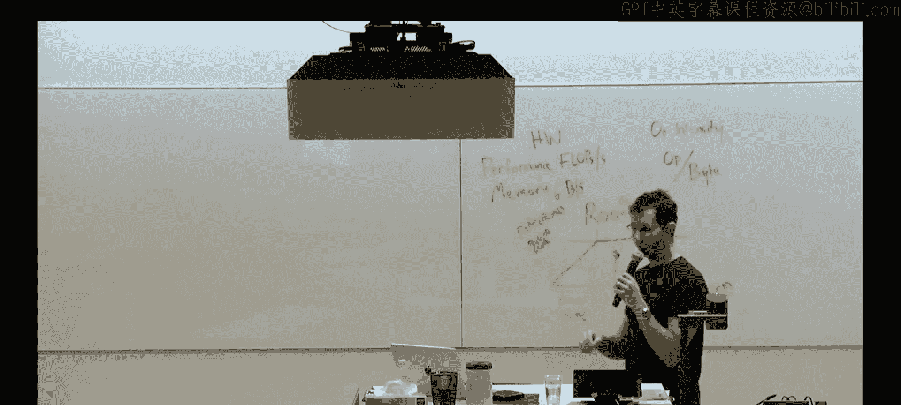
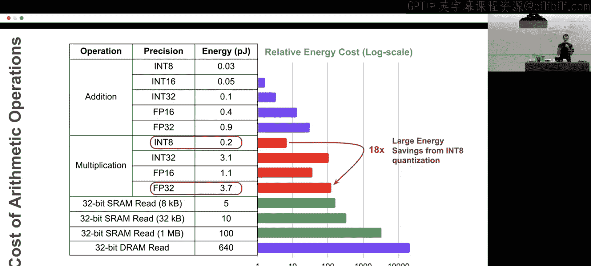
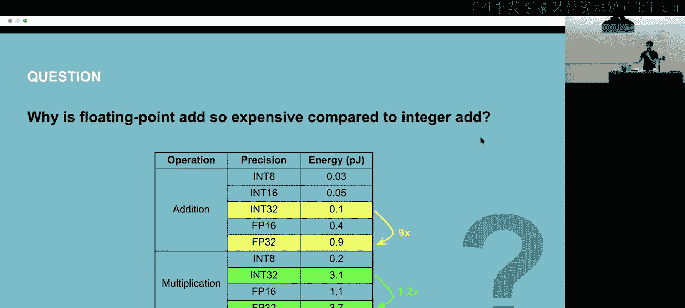
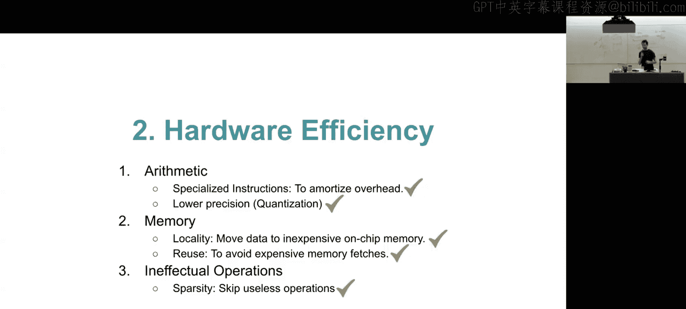

# 机器学习硬件和系统：004：硬件效率（下）

在本节课中，我们将继续探讨如何提升机器学习硬件的效率。我们将重点介绍通过控制数值格式与精度、优化内存访问以及跳过无效计算这三种核心方法来提升能效。

上一节我们介绍了屋顶线模型，它结合了硬件峰值性能与工作负载的计算强度，帮助我们判断应用是受限于内存带宽还是计算能力。本节中，我们将深入探讨提升硬件效率的具体技术。

## 数值格式与精度优化

提升硬件效率的第一个关键技术是控制数值格式和精度。传统上，科学计算和深度学习通常使用浮点数（如FP32），因为它能提供宽广的动态范围和足够的精度。

一个FP32数由1个符号位、8个指数位和23个尾数位组成，其数值表示为：`(-1)^s * (1.m) * 2^(e-127)`。

然而，人们发现深度学习模型通常不需要如此高的精度。降低精度可以显著减少硬件（尤其是乘法器）的面积和能耗，因为乘法器的电路规模通常与位数的平方成正比。

以下是几种常见的低精度格式：
*   **FP16**：使用5位指数和10位尾数。与FP32相比，其乘法器面积和能耗大幅降低。
*   **INT8/INT16**：使用纯整数或定点数表示，仅包含尾数部分（无指数）。其动态范围有限（例如有符号INT8的范围是-128到127），但计算能效极高。

从FP32量化到INT8，在乘法运算上能带来巨大的能效提升。一个关键问题是：为何浮点数加法比整数加法昂贵得多？这是因为浮点数加法需要先对齐两个操作数的指数（通过移位尾数），然后才能进行尾数相加，最后可能还需要规格化结果。这个对齐和规格化的过程需要复杂的硬件（如桶式移位器、多路复用器），远超出简单整数加法器的成本。

## 内存访问优化

提升硬件效率的第二个关键技术是优化内存访问。我们必须认识到，在能耗方面，**数据搬运的成本远高于计算本身**。

下图清晰地展示了不同操作的近似能耗。访问一个32位数，即使是从片上SRAM读取，其成本也可能高于进行两个32位数的乘法。随着内存容量增大或访问片外DRAM，这个成本会急剧上升。

因此，优化内存访问至关重要，主要策略有以下两点：

1.  **提升数据局部性**：尽量让数据靠近计算单元。现代处理器采用分层存储结构（寄存器 -> 片上缓存/SRAM -> 片外DRAM），越靠近计算单元，存储容量越小，但带宽越高，访问延迟和能耗也越低。目标是将数据尽可能保留在层次结构的顶端。
2.  **提高数据复用率**：一旦数据被加载到靠近计算单元的位置，应尽可能多次使用它，以分摊数据搬运的能耗开销。

数据复用主要有两种类型：
*   **时间复用**：同一处理单元（PE）多次使用同一数据。
*   **空间复用**：同一数据被广播到多个处理单元（PE）同时使用。

复用的有效性可以用“复用距离”来衡量。复用距离越小，意味着数据被重用的间隔越短，对缓存或寄存器容量的压力越小，也越有可能避免重复从低速内存中加载数据。

基于复用的思想，产生了“数据驻留”的设计模式，即在计算过程中，将一种类型的数据长时间保留在PE中。主要有三种模式：
*   **权重驻留**：权重存储在PE中，输入数据流经PE进行计算。这在卷积层中很有效，因为同一滤波器权重需要与大量输入数据相乘。
*   **输入驻留**：输入数据存储在PE中，权重数据流经PE。这在批大小为1的全连接层等场景中可能有用。
*   **输出（部分和）驻留**：部分和结果累积在PE中，输入和权重数据流经PE。这是脉动阵列等数据流架构的常见模式。

## 计算架构类型：SIMD与数据流

硬件架构大致可分为两类，它们以不同的方式组织计算和数据流：

**SIMD（单指令多数据）**：这是GPU的经典模式。一个控制单元向多个ALU广播同一条指令，所有ALU对不同的数据执行相同的操作。数据通常通过一个大型的共享寄存器文件进行交换和同步。

**数据流/空间架构**：这种架构类似于MISD（多指令单数据）。计算操作在空间上布局，数据像流水一样依次流过这些处理单元。一个PE产生的结果可以直接作为下一个PE的输入，无需写回中央寄存器。**脉动阵列**是数据流架构的典型代表，广泛应用于TPU等AI加速器。

在脉动阵列进行矩阵乘法时，输入矩阵A的行和矩阵B的列分别从阵列的左侧和顶部流入。每个PE执行乘加运算，并将部分和累积在本地，同时将输入数据传递给相邻的PE。在这种模式下，**输出（部分和）是驻留的**，而权重和输入都在移动。

## 跳过无效操作

提升硬件效率的第三个关键技术是跳过无效操作，即利用模型中的稀疏性。

深度学习模型中的稀疏性主要分为两类：
*   **激活稀疏性**：由于使用ReLU等激活函数，会产生大量零值。
*   **权重稀疏性**：通过剪枝、正则化等技术，可以将不重要的权重置零。

然而，要高效利用稀疏性在硬件上跳过计算，并非易事：
*   **细粒度稀疏性**：零值随机分布在张量中。要跳过这些零值，需要复杂的索引和门控逻辑，开销很大。例如，即使有50%的稀疏性，由于元数据和控制逻辑的开销，实际获得的加速比可能远低于理想的2倍，通常只有1.1-1.2倍。
*   **块稀疏性**：零值以规整的块（如8x8）形式出现。这是更硬件友好的稀疏模式。只需一个额外的比特来标识整个块是否为零，开销极小（约1.6%），控制逻辑简单，可以轻松跳过整个块的计算，从而获得显著的能效和性能提升。

## 总结

本节课我们一起学习了提升机器学习硬件效率的三种核心方法：
1.  **降低数值精度**：通过量化（如从FP32到INT8）大幅降低计算能耗，尤其是乘法运算。
2.  **优化内存访问**：通过提升数据局部性和复用率，降低能耗占比最高的数据搬运成本。数据驻留（权重、输入或输出驻留）是重要的设计模式。
3.  **利用稀疏性**：跳过对零值的无效计算以提升效率。块稀疏性因其硬件友好性，比细粒度稀疏性更实用、高效。

理解这些基础技术，是分析和设计高效机器学习硬件系统的关键。