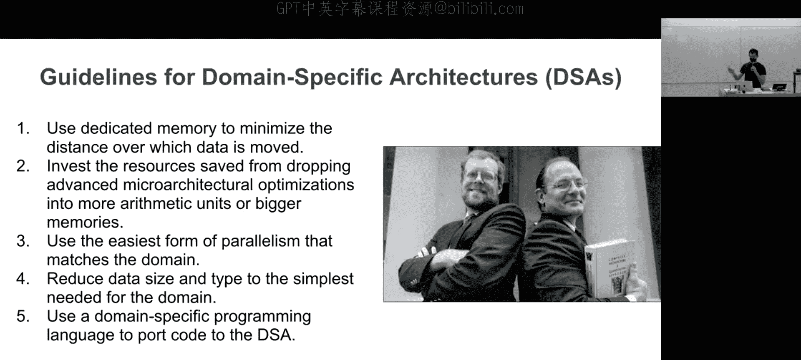
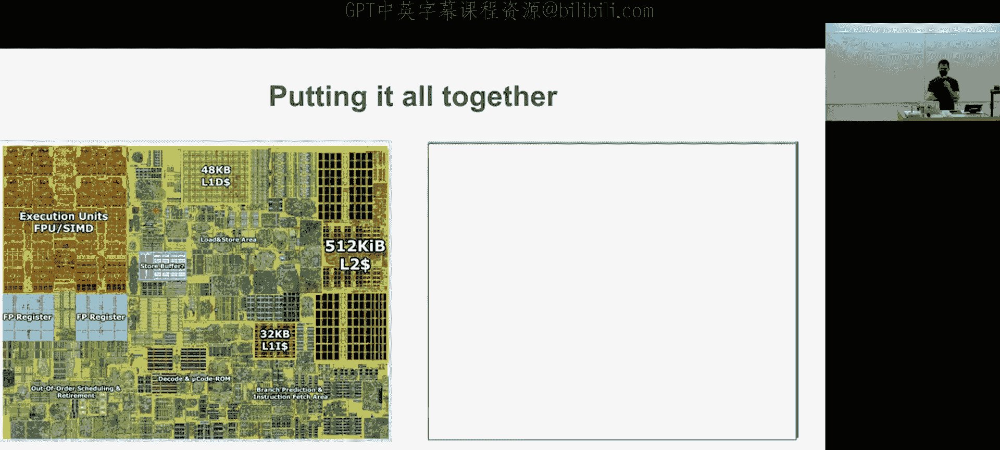
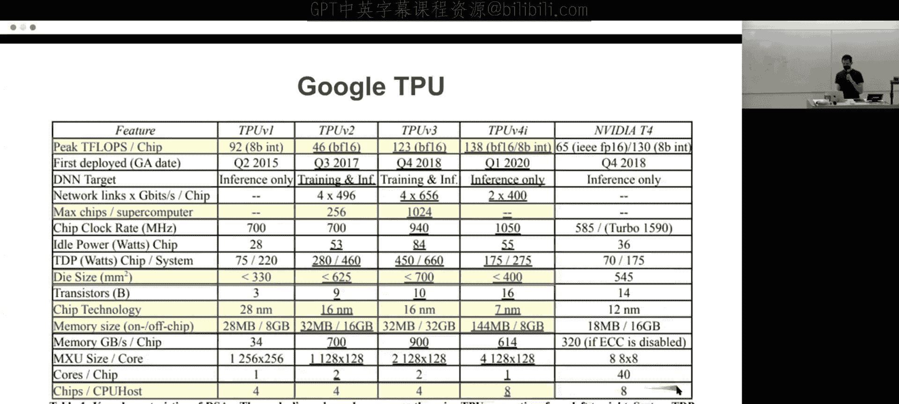
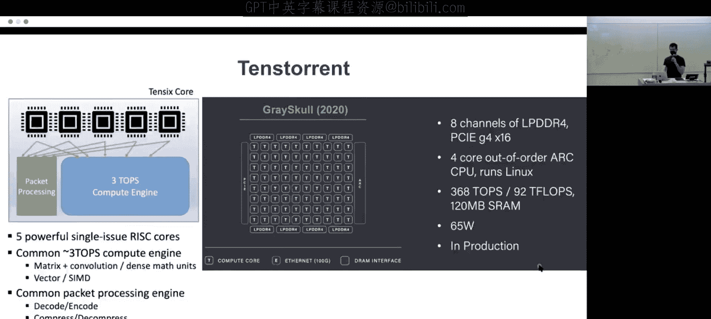
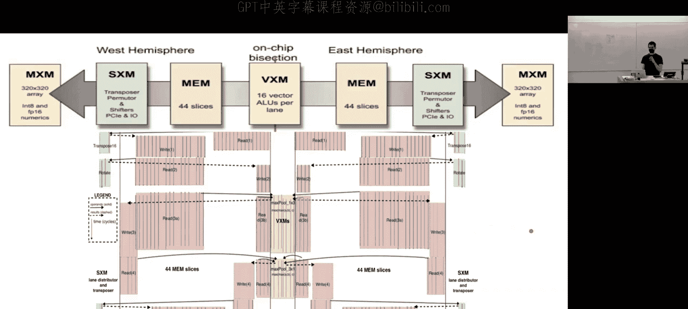
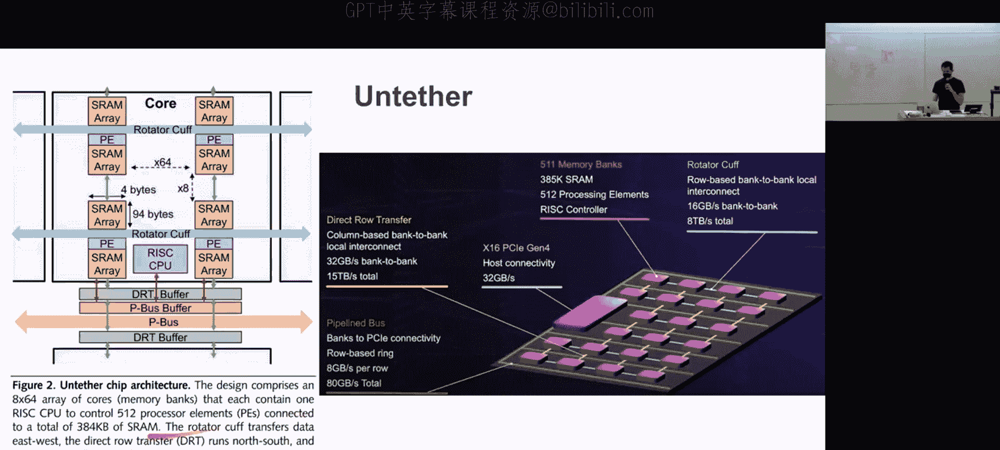
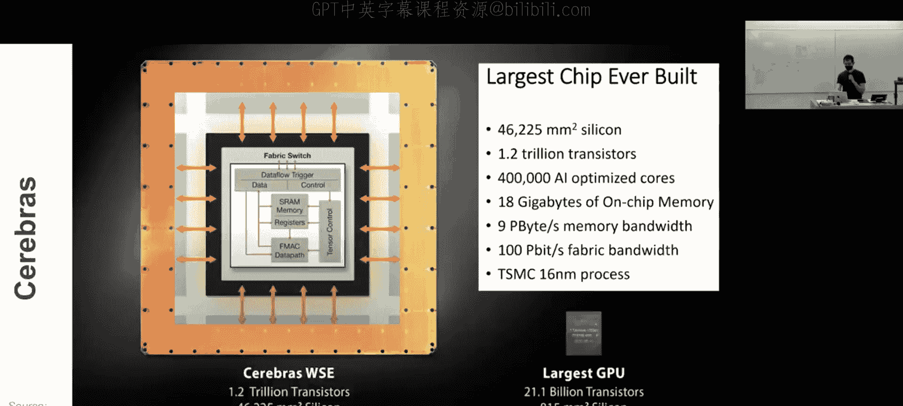
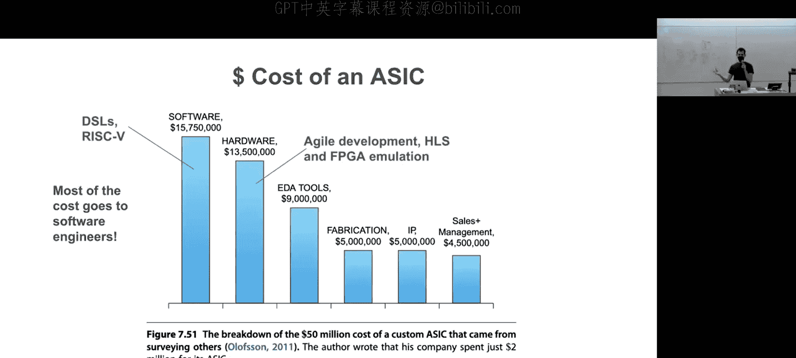
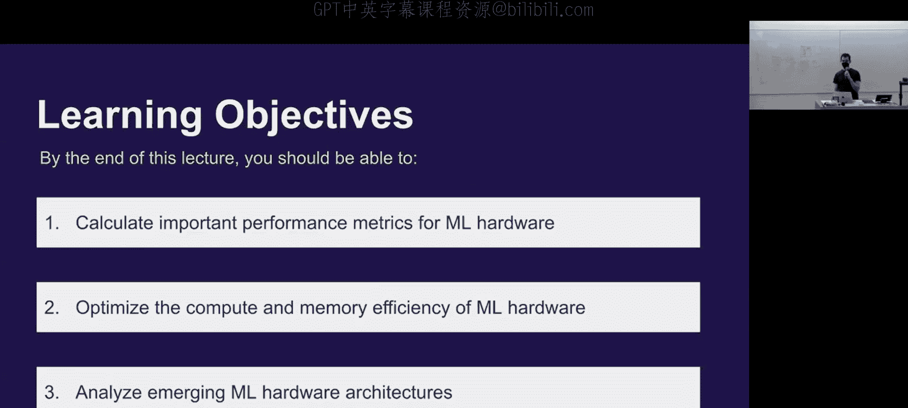
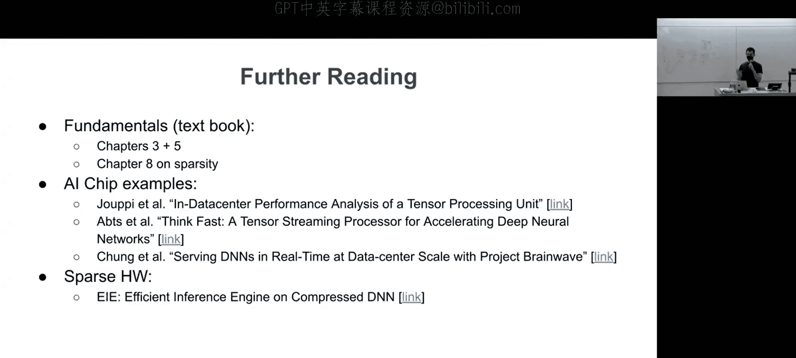

# 005：康奈尔大学《机器学习硬件和系统｜Cornell ECE 5545 Machine Learning Hardware and Systems》中英字幕 p05 -05-Lecture 4_ ML Hardware III (case studies).zh_en -BV1CCqPYSEP5_p5-

All right， I think we can get started， so I'm very happy everyone's here。

 so now we're in normal classroom again。The first normal classroom of the semester， I guess。

So so where are we， we are talking about machine learning hardware or hardware to accelerate deep neural networks specifically。

 first we talked about kind of metrics and roofofline and how we can analyze different hardware。

Then we talked about hardware efficiency and with hardware efficiency， we started with arithmetic。

 then we talked about memory optimizations and a bit about sparsity。😊。

So this should be the last part hopefully of lecture2 of ML hardware。

 and this is the most fun part because we will just go through a bunch of use cases from industry and startups and big companies what they're actually doing in these machine learning chips。

So that should be a lot of fun。So let me share the slides。

So I see there are still a couple of people online。

 so I should say you are required to come to class now and if you want to attend online you still can on Zoom and the lectures will still be recorded。

 but you need to tell me explicitly why you're not attending class and it needs to be a valid excuse right so you need to drop me an email or something either before or after class。

So some admin get it out of the way， so a0 is due。It was supposed to be due this morning。

 but I set it to 8 pm accidentally so you have until tonight， if you didn't submit it。

 it is free marks， so you should just do it， it doesn't take time and it is preparation for the next few assignments as well。

😊，A1 will be released right after this class， so I'll go upstairs and do a few things and release it。

It will be about analyzing different machine learning hardware using the roofline things that we talked about and also benchmarking deep neural network models。

 so you will kind of have handson experience with evaluating these different chips and running stuff on them basically。

A final note， so assigned readings are important。So please go through them and try to submit the weekly paragraph as well these are also kind of remarks I mean I do skim them but it's mainly for you to go through the readings and to make sure you understand it sometimes when you engage more than one of your senses so you read it you write it you engage your you know your touch your vision different parts of your kind of different things that are attached to your brain you understand things better so I found that it's always useful to summarize something after I read it so that's why you are also doing this and I hope it's useful。

Okay， so where are we like I said， we're talking about hardware efficiency right now。

 so we went through arithmetic， we talked about the specialized instructions and amortizing overhead。

 we talked about lower precision of course， which we'll get back to again in later lectures when we talk about quantization。

😊，We talked about memory optimizations， how we can leverage locality and reuse to make sure。

 you know data is always closer to my compute。And finally， we talked a bit about sparssity。

So there is one more thing I added to the spars T section that I wanted to chat about and that's a specific kind of representation for sparse matrices that's often used when computing you sparse matrix multiplication。

So， that's called。Compressed sparse column format。So with the show of hands have anyone heard of this before。

 do you know what it is？A couple of people okay so not many so basically when when I have a vector that's full of zeros I don't need to represent it represent all of the zeros right I can skip some of those zeros and some of the common ways to do that something called run length encoding so instead of writing out 10 zeros after each other I can write zero times 10 for example I still understand that they're you know 10 zeros and everyone kind of understands what's going on so this is basically what's happening here。

So this vector。I can represent it as you know， a bunch of dense。

 like a dense numerical representation of the numbers in my vector and some indices telling me how many zeros come before each number。

So this first number has two zeros before it so I say I have a one and they have two zeros before it。

 and then the second one has no zeros before it， so I have a two and they have no zeroes before it zeros。

And then I have 15 zeros before。A number comes and in this case， that number is zero。

 So the reason here。In this specific example that we are actually representing a zero in our compressed format is because our indices only go from zero to 15。

Can someone guess why our indices would go from zero to 15 only？走。Yeah， you were saying。

So I think you're very close four bit， so basically in this specific case which I copied from a paper written down here。

 they're using just four bits to represent these indices to further compress that you know that representation and so four bits you can represent from zero to 15 so you can go further so that's why they were forced to kind of actually put as zero in their compressed format as well。

Right。And so so kind of to get everyone waking up in the morning。

 here's another example from the same paper and why don't you guys try to decode it like I'll give you like three minutes on a piece of paper and here it's a bit more complex because now we also have these column pointers。

😊，So so these are the same as before， so that's my compressed kind of dense numbers in my matrix in this case。

 I have those relative row indices which tells me how many zeros before I move on to the next row。

And then I have these column pointers， which tells me。

How many elements before I switch to the next column， okay？

So let me maybe let me do the first kind of set of entries with you and then I'll let you kind of continue。

So my first column pointer is zero， so I start right away in the first column。

And my first entry is a， and it has zero zeros before it。So I just put an A。And then。

I have three elements before I move on to the next column。So ABC will be in the first column。

And then there's a B with10 before it。So I put10。And then a B。

And then there is a C with zero zeros before it。So I put a C and then now I have three elements。

 I move on to my next column because my column pointer says three。

So maybe if you have a piece of paper and if you don't have a piece of paper， I have a pile here。

If anyoneone wants。So if you can just kind of continue decoding this。嗯。

And I should say the column pointer is absolute， so it's not relative。

So four means total of four elements before I move on to the next column。Right。

 it's not plus 4 every time。4，6，6， so on。行。嗯。Okay。It looks like most people should have at least have their matrix。

So。So it looks something like this。So basically this compressed parse column format takes this matrix of eight by four elements and compresses it into this representation。

 right？So like I said。This relative row index tells me how many rows to skip before entering the next element。

 so first I skip zero elements， I put the a， and I skip one element， I put the B。

 I skip zero elements and then I put the C。And then the column pointer tells me how many elements before I move on to my next column。

Right so here are three elements before I move on to column two， so I already enter three elements。

 so I move on to the next column。I put D after skipping with 10 and so on。

 then total of four elements before I skip onto my next column。

 which means you know ABCD are already done， I put my E next， and I skip zero zeros to put it。

And so on， so if you keep doing this， you will find that you got eight columns in this case。

So what are the benefits of this compressed sparse column format， so one of them is quite obvious。

 right？We're usually saving space when we have a lot of zeros。

The other benefit is that when I'm computing using。

 if I have this compressed format stored and I'm doing my computation。

 this is actually not that friendly to a lot of kinds of computation because it's kind of a weird representation of my matrix。

 right？But for dot products they're very tolerant because for dot products are usually one to take a whole row or a whole column and multiply it by a vector right and so it doesn't really matter you know it doesn't really matter exactly where the element is or something like that likes I know that I need to take all of the elements before this column pointer so I need to take the first three elements and I need to multiply them to activations in this case so this is a compressed format for the weights I need to multiply them by activations。

So it's actually relatively simple to construct a circuit to do this。

 and maybe we'll talk about that more in the next lecture。

And it's also in one of the optional readings that's cited below here。嗯。So yeah。

 so I just wanted to go over this before we move on to the hardware case studies and in the paper if you do read it。

 you'll find that the matrix looks a bit like this and they have this extra thing on top of doing that compression called interleaving。

 which means they actually distribute the workload from the matrix to different PEs。

 instead of computing the whole matrix spectrum multiplication1 PE。

 so that's why it's kind of color coded here， but I just wanted to show the full matrix so that you don't kind of you can map what you learned here to that big matrix in the paper once you go through it。

But we will also talk more about interlaving in the circuits class。Okay。

 so that kind of concludes the efficiency part， are there any questions at this point or things that are unclear with this part？

Or any thoughts？No。Okay。All right， so so if you follow a textbook to kind of create your machine learning chip and these guidelines do come from that textbook that I mentioned before。

 this is what you'll do you'll do these arithmetic optimizations the memory optimizations and these two guys help us kind of summarize them into five points so the first one is to you know use dedicated memory。

So that's you know， our on chip memory to increase。Looccalality and reuse。

 which also minimizes the distance over which data is moved or how often data is moved。

The second point is to invest your resources into more arithmetic units or bigger memories right so basically you remove all of the complex stuff that's currently in things like CPUs like prefetching whatever it is。

 look ahead buffers， instruction caches even and you replace that with stuff that you'll actually use and will actually give you flops per second。

And then third thing is to use the easiest form of parallelism that matches your domain。

 so here we talked about weight stationary， input stationery and output stationery。

 we also talked about CM versus data flow， so basically look at your application and let that drive what your architecture looks like。

Okay。The fourth point is to reduce your data size， so reduce precision， quantization， and so on。

And finally， use domain specific programming language。

 which is something we'll talk more about when we touch upon mapping and compilers and so on。

And so these guys didn't just write the book on it。

 they actually also went and created or helped build a TPU chip at Google。

 and it's a very kind of textbook application of what you would do as a computer or architect if you want to build something to accelerate neural networks。

And so I'm putting here kind of the chipD photo of the Intel CPU core and if you remember we have all of this stuff right like load store area。

 decode unit out of order scheduling， branch prediction。

 we have instruction caches and data caches and so on。

 and then we have this orange execute unit which have elements for multiplication addition。

 but also other stuff， I think they even have an exponential unit and other stuff in there as well。

And maybe also some CD instructions， and I think they have dot product now in TCPUs。

But if I was now creating this chip for deep neural networks。

 I wouldn't do all of that right instead if I follow the guidelines that I showed before。

 I should be using most of the chip for arithmetic and for gettinging kind of flapps per second for my application。

And so output。AMultiply accumulate array。For example。

 where I'm using the best kind of parallelism for my application。

 I'm using these complex instructions that amortize the overhead of my control and I'm putting a lot of them。

 right？We also have here these layer specific arithmetic units for things like activation functions or batch normalization or things that I do very commonly in neural networks。

Then I'll put a huge on chip memory and again that's for our second kind of hardware efficiency tenant。

 which is to improve locality and reuse of my data。

 put it as close to my computer as possible on the chip itself。

And finally you know we need other stuff like we need to connect to external memory。

 we need to connect to other chips， we need some control logic to decode our simple instructions onto this chip and so on and if you do that you get kind of the floor plan for the TPU V1 in this case so have a very big matrix multiply unit we have accumulators here activation pipeline that takes up about half the chip so just for compute elements。

And then you have a huge buffer as well， in this case， 24 megabytes。

And that takes about 30% of the chip and then the rest is kind of for connecting to other chips and very small part for control because if you remember our instruction now is you know do matrix multiplication。

 so multiplying 256 elements by 256 elements， you don't need many of those instructions。

 you can have another instructions like do addition or perform activation in this round and so on。

 but your instructions are very few and very coar grained。嗯。So yeah。

 so this is kind of our first hardware case study that we have basically been following throughout this lecture so far by kind of performing these optimizations one by one and applying them kind of in a textbook way。

 but now let's take a look at more hardware case studies that。That are similar。

 but also more interesting and more diverse。So I'm sorry I'm actually losing my breath。

 this is a very good mask。That's。And my first time talking through a mask。

So so first let's look at GPUs so GPUs are without a doubt kind of a very important chip for machine learning。

 they I would say they started this modern deep learning revolution and they're also kind of as a company a huge believer in deep learning right so they are changing their chips to look more like accelerators for deep neural networks than graphics cards and so let's see how they did that or what they're doing to achieve that。

By the way， I should say this is coming from a lecture by Bill Daally。

 so Bill Daley has a huge name in our field， Stanford Prof and now works for NVDdia as well。

Ba building their new micro architectitectural enhancements for GPUs， especially for deep learning。

So if we look at GPU performance in terms of int eightterraflps per second or TerraOs per second。

 we will see this exponential trend from 2012 up to now and so in total in eight years this 317 x improvement。

And so what happened in those10 years or less than 10 years。

 eight years in this plot that enabled these enhancements？So。So the company had a good CEO， I think。

 who believes in deep learning。And the press actually called this exponential improvement Huang's law。

 I don't know if Jenssen Huang himself had something to do with this or just kind of the press talking。

 but you'll find it tenant's own Wikipedia page and stuff now so you can go read about this。I mean。

 it's I think the useful thing that we can extract from this is a quote by Jensen Huang when he was asked about it。

 he claims that you know synergy between hardware， software and AI makes the new law possible。

 so Huang said the innovation isn't just about chips， it's about the entire stack。

And that's really kind of one of the main reasons we have this course。

 so this course we'll talk about hardware for this lecture and maybe next week， but that's it。

 we will then talk about compilers， software and optimizations to the machine learning models themselves and the neural networks themselves。

 right。And so so that's how you can achieve that you know or continue that exponential improvement at least for a bit it's no longer like Moore's law where it was just about the transistor speed it's about so many other things now to achieve this kind of improvement so that that's one thing I like about Huang's law but the rest of it I think is just kind of。

People talking and inflating things but。So let's kind of go through that plot one by one and see what the GPUs look like。

嗯。And by the way， stop me at any point， if you have questions。

 also gives me a chance to take my breath。So in 2012 the Kepler GPU looked like this right。

 so it just supported FP32 single precision and also double precision， so FP64。

 which is another IEE standard for presenting numbers。

It had external memory bandwidth of 250 gigabytes per second。

And it was in 28 nanometer process technology right， the chip。

 the board is about 300 watts and we will see across kind of that graph that 300 watts is stain constant。

 that's basically constrained usually by the cooling and the form factor of the board more than anything else。

So。So 28 nanometers is the process technology node。

 so that means basically the size of the transistor， so transistors look like this。

 at least MosFt transistors。So I remember them correctly。 So we have kind of。N and P and a gate。嗯。

Something like this。And you kind of apply voltage here。

 it connects those two parts together and you remove voltage。

 it disconnects them and this is the size that really matters because this affects how fast you can turn on and off your transistor。

 so that's the most important number when it comes to process technology。

And so here it was 28 nanometers。And then it keeps shrinking。

 so Moore's law is basically we can keep shrinking this。

By 2 x every three years or something like that or whatever every 18 months， I think it was。

But obviously once you get down to seven nanometer and five nanometers which is where we are now。

 you're hitting some fundamental limits， basically you can't stack that few number of atoms here before you get all sorts of quantum effects and tunneling effects and other things and so that's why Moore's law stopping right but it's roughly an indication of transistor speed。

Okay。So a few years later， the Pascal architecture was released。And in this case。

 we're seeing one of the things that we kind of talked about in this lecture already being performed。

 so that's in 2016。Actually we're seeing two things happening so the first one is that lower precision is being supported。

 so lower precision is traditionally not that useful for normal graphics applications。

 but now it's useful for deep learning so they support FP16 in addition to FP32。😊。

And what we found when I was at Intel was that FP16 loses almost no precision and loses almost no accuracy when it comes to deep neural network inference at least。

 so you can train a neural network in FP32， deploy it an FP16 and lose nothing in terms of accuracy very easily。

嗯。At least for many vision and speech models that we tried。

And so that's kind of a safe choice to do and they can do it usually by fracturing or breaking up the FP32 multipliers into two FP16 multipliers by adding some control logic so that's roughly what you see here as well。

 you know you have 10。6 terafflps for FP32 but almost double that for FP16。

Another thing they did was they amortized the overhead。

Of they're controlled by adding these complex instructions， in this case， FDP4。

 which is floating buoyant dot product for so four elements doing a dot product using a single instruction。

So that's one other thing that we learned about and they applied it， they're following the textbook。

Finally， they increased their external memory bandwidth almost twofold。

 so that's another thing that can quickly get data to feed those extra multipliers that they have right？

Okay， so one year later， and I think the Volta architecture was really kind of created for or the first chip created really for deep learning。

 we have much of the same really where we' you know increasing the number of flops available in lower precision and here you see that you know it's way more than double the number of flops you have available in FP32 because now they're going all in they're creating dedicated FP16 multipliers they're also creating these tensor cores which can do 16 times 16 matrix multiplication in one instruction and they're all in 16 bit precision right？

So that's another thing they're supporting these more complex instructions or more core gradeed instructions。

 I should say， have precision， matrix matrix multiplication。

 and they're also increasing their off memory bandwidth。

So that's becoming more and more kind of a chip that's geared towards deep learning than it is a graphics card。

 in my opinion。There is also these enveings， do people know what they are？Yeah。Yeah。好。Yeah。

 that's exactly right so so basically before。When the CPU is still kind of the main chip in any computer architecture。

 right， you have a PCIE link that connects it to a GPU。

And that's typically how you kind of transfer data， instructions and stuff to your accelerator card。

 in this case， a GPU。But what if you have another GPU sitting somewhere， how do they communicate？

So like you said， what's your name？James， like James just said， previously you had to go， you know。

 all the way around。Through the CPU。嗯。Like this。To send data from GPU1 to GPU2。

Now they have these andv links， so。You can connect two GPUs together directly。

 bypassing the host completely， and that's also a trend that we're seeing not just with GPUs but with other deep learning chips as we'll see as well。

And the reason for that is basically training and some inference tasks are very big that you need multiple chips to be able to support them efficiently。

 and so that's the best way to do it by having a dedicated high bandwidth link between those chips。

Okay and finally in 2020 we have the Am GPU and now that's yeah。

 if anything its it's a programmable deep learning chip or a co a programmable deep learning chip so they added support for sparsity we talked about this two out of four fine grain sparsity that they added in their GPUs。

They now have。Very customized non standard precisions like Bf。I think it's called Brain floatinglo。

 16， it's like a Google proprietary not proprietary。

 but it's a Google invented floating point format which has I think more exponent than Manisa。

 I think it maintains the same number of exponent bits as FP32。

 but then has five or six bits of Manisa， and they found that that works well for lots of training tasks。

 they also FTF32 which is again， probably a Google invented thing as well。

 actually don't know exactly what it is。Then the number of flops increased again。

 especially for lower precisions and the added integer support。

 which is super important for inference， especially that it kind of doubles yourterops as you can see here。

 so we talked about how much smaller these multipliers and adders for integer math R。

 and so they're really leveraging that here。嗯。Yeah。

 so so I would say the kind of the GPU progression over the past few years is following the textbook fairly well。

 aortizing overhead。Using reduced precision， increasing the memory bandwidth。

Adding those dedicated chip to chip interconnects。m tryinging to support sparsity。

 although kind of by admission of Bill Dali himself in that lecture when I watched it， was that。

 you know they haven't really figured out sparssity yet。

They think they're trying to do it and like I said they got this 20% improvement in performance by supporting 50% fine grains parsity。

 so they're not quite there yet， it's still an open problem。And finally， using integer math and。

Yeah and and doing all of that curiously also the the chip power increased to 400 watts。

 not sure what to make of that， but yeah， it's one thing we can look into or try to comment on。O。

So any questions or comments about GPUs？是啊。嗯，Yeah。But not for training。

 so there is research into using reduced precision for training。

Typically it's just very hard empirically it doesn't work that well because I mean during inference your numbers are kind of fixed so you can you know scale them and shift them how you like but during training they're still being trained so you want to give them as much freedom to kind of be influenced by gradients in the right direction as much as possible and so usually people haven't really been successful at training below 16 bit precision that much。

 there is an IBM paper that does it at eight bits there's a lot of research into mixed precision training so reducing the precision where it's not needed and increasing it where it's needed and so on but it's definitely an active area of research and everyone wants it to happen。

Good question。O。All right， so so let's talk about the TPU again because in those like 40 years or something Google actually released four TPUs。

 so we've been talking about the first TPU so far。But when we move to V2 we find kind of one fundamental change that has happened。

 which is they went back on one of their optimizations， so they said well aortized overhead。

 we'll have a 256 by 256 unit that's you know as much bank for our buck that we can get but they went back on that and they actually fractured their matrix vector unit into two units。

So they now have two of them on the chip， and each one is 128 by 128 matrix multiply。

So can people guess why they would do that？Like， what would be the benefit？It's an easy one。

I'm sorry。嗯。I see so if an application is memory bound you're saying then by fracturing our arithmetic then we can kind of do two separate things or two separate batches for example separate thing I can see that I can see that being a reason's I would say that that's valid there's also another very simple reason which is not everything divides into 256 by 256 right so you had a lot of waste at the end of those instructions where you know you were tiling your computation into these huge chunks and in the end you had a small chunk which was I don't know three by five and it would just waste the whole thing so you had only one option for the instruction and it wasn't that useful。

嗯。So this is what a TPU pod looks like so this has 64 TPUs and that's again where things are going so part of the reason we have these enV links and these chip to chip interconnects that are coming up is because you usually especially for training and large workloads or data center workloads you want to connect many of those chips together。

To do one task， not to do multiple tasks。And so this has a total of 11。5 petafflps。

So if you think of giga is 10 to the power of nine， terra， 10 to the power of 12。

 perta is 10 to the power of 15， so that's a big number， it has four terabytes of HBM memory。

And for Google， what this means for them is that they can speed up their search by 14 times when comparing 16 TUs to 275 CPUUs。

So that' you're using fewer machines， way less power。

 and you're improving your overall performance by 15 x。嗯。Image model training， so training。

 you know for image tasks， you're improving it by about 10 times。

They didn't say what they're comparing to， probably a GPU based setup， but again。

 it's a major improvement because you're moving towards the specialization。

 you're specializing your hardware for the task and so you're getting this improvement。And again。

 for their waveveNe model， so WaveNet is the one that synthesizes speech。

 so that's when you talk to your phone that's what talks back to you。

 so they're able to generate speech 20 times faster than real time so they're able to。

 I don't know serve 20 users in the time they would have served one or something。

But like I said we actually went past TPU V1 and V2 very quickly and Google has been very good at kind of pumping out those chips really quickly and I wanted to highlight so there is actually kind of almost a white paper about comparing the different TPU generations。

 I didn't link to it yet but maybe I'll add it， it's quite interesting。

So I wanted to highlight some of the things that they did here。So of course。

 the Terra operations per second keep increasing right the number the precisions that they're supporting are more kind of geared towards inference and training。

Yeah， there are specialized basics， so that's that's a given because this is an inference trip。

 this is not a general purpose trip。The maximum number of chips per supercomputer so that's an interesting one so at some point they said we can limit those maximum number of chips and we'll be fine but they went back on that decision as well in their latest chip even though the latest one is destined just for inference。

 so I think scalability is something you will see a lot in data centers when it comes to deep learning just because of the scale of these applications。

The die size， so this is also an interesting one， so die size is just the size of the chip， right？So。

 you know， I have a chip that is。Length times width， that's the die size。

So they started by quite a small chip， 330， I think this is millimeter squared y。

And then they increase the size of the chip a bit and then they decreased it again。

 so can someone guess what's the benefit of a smaller chip， a smaller size chip？

So James said cheaper。I'm sorry。Power usage is less， that's also true。

And then they come into it more。Oh， someone's on the phone。 Oh， I'm sorry。 So， so。

 so that they can put more in one pot。I can't hear。

I say they make it smaller to put more in one potd。I see， so I mean， these are all valid answers。

 so make them smaller to put more of them in one pod that that would make sense and it could kind of also speak to breaking down your applications into finer grain pieces。

But the main reason was， like James said， I think， was basically the chip is cheaper and it's much faster to。

To tape out to send to a fabrication facility and get it back and the reason it's cheaper is because of something called yield do people know what that is。

嗯。对。Yeah， so the number of usable chips per wafer， so usually you know you have a wafer。啊。

None of these work。You have a wafer， you break it down into chips。And you sometimes， you know。

 have a floating dust that comes on one of them， piece of dust。

 And so that breaks the chip that no longer works。And so my yield is now， you know， well， wait。

 I have more dust。So my yield is now for example， 50%， 50% of those work， 50% don't work。

 but I'm paying a fixed cost per wafer because that's the main cost production。Yeah， James。Yeah。

 you do that a lot so and that's something we'll discuss in one of the other case studies。

But you can't always do it and sometimes you have enough defects that you can't harvest enough chips。

So yield is a very well kept secret for most fabs， so I don't know because I haven't worked for a Fab and even if I knew I couldn't tell you。

 but people hold that really close because that's the main economic factor in terms of chip cost。

I would say yield is usually not that low， so my guess would be above 80%。

 especially for kind of the third run or the second run of a process node。

 so if you're well into like eight nanometers or something or seven nanometers。

 then it would be quite good， the first run of a new process node would be quite low usually。Okay。

So I think they're creating smaller chips for money reasons， basically。Chip technology。

 so they're still writing Moore's law， so that's why they're trying to pump out new chips very quickly so now they're on the seven nanometer node of TSMC I think。

The memory size on chip and off chip and let's focus on on chip it keeps increasing so they actually started with a fairly small on chip buffer when I said it was 24 maybe here they say it's 28 megabytes but there went all the way up to 144 megabytes。

 which I think is way more sensible and aligns a lot better with the other chips that we're going to look at。

And finally the chips per CPU host， I thought that was quite interesting as well。

 so in this drawing I have one CPU connected to one accelerator or one deep neural network accelerator that's not usually the case now actually the CPU is becoming way less important that I can add so many accelerators controlled by the same CPU and this could keep up because all the CPU needs to do is just send the program to those accelerators and also marshahal the data usually but that can all be streamlined basically。

So now we have the ratio of accelerators to CPUs is just eight to one now。

 instead of four to one in the first generation and before that。

 if we go back to GPUs or something it used to be one to one。

Okay now let's talk about a few startups， so Ttorent is a Canadian startup that's working on a machine learning accelerator as well。

 so when I was working at Intel I left in 2019。And I think。

I think three months after I left my whole team left and went to Tentorent so I was happy I left early。

 so then I'm not in a situation where I'm kind of alone at Intel I think they made the right decision because we were working on an FPGA based accelerator which will never be as efficient as an ASI accelerator and this made a lot of sense。

 so what they did at1torent they don't have many details out but I think it was fairly standard and focused on the software tag。

😊，So you need efficient hardware but you need very efficient and flexible software as well and a very programmable chip and a scalable chip as well。

 I think that's what they try to achieve with their you know a very efficient three tops per second compute engine connected to five risk cores so they could control that compute engine in many different ways using those cores and they had a packet processing engine as well to be able to marshal data to different you know of those they call 106 core on the chip。

As well。And so so yeah， so that's kind of。All I have about it here。

 their compute engine supports both matrix and convolution instructions natively。

 it has CD based parallelism。And they can also yeah。

 a key thing is that they can also move data easily between different parts of their chip or different cores using this packet processing engine。

 which also can compress data on the fly。So I think what they built attend10 store is quite good。

 they have a very famous guy now working with them called Jim Keller。

 I don't know if you've heard of him。But basically。

 I think they're doing a great job of just you know applying like getting as much compute as possible out of their chip。

 but maintaining the software programmability of it。

 so they still program it essentially like a CPU with some additional instructions。

 but that is very kind of multi corere CPU with CMD extensions and they're able to connect many of those chips together quite easily。

We'll see that they also have you know lots of on chip memory and they're trying to push power to be very low so by comparison we saw the GPU has like 300 or 400 watts of power per chip here it's more below 100 watts for sure。

And they have 120 megabytes of SRM， which is what the TPU V4 got to。

 they were starting with that number large amount of memory。嗯。Yeah， so that's1 torrent。

嗯。Another interesting one， and by the way， the rest of my team at Intel left and went to work for Gc。

 so this is actually a true story， including my manager and my ex manager anyways。

And so Gock is super interesting because they're actually not following the textbook that much。😊。

They're trying a new thing， so instead of。I mean， we talked about data flow and we talked about Cindy to get parallelism。

 right？So what they're doing instead is。TheyThey're trying to unroll。

The compute core spatially on their chip， so what does that mean that means instead of having a single unit。

U you know， with with some math， multiply， accumulate some memory like registers or something。

um what else some， you know， a router or something like a packet processing。

And then having many of those on your chip。Instead， they unroll this thing into what you see here。

 so you have a matrix times matrix unit。You have this is， I think， scalar times matrix。

They also call it transpoer and permuter， so to move elements around in your data and shuffle elements and reorder and stuff。

Then they have memory， so that's your on chipt buffer。So they have a piece of memory。

 and then they have vector times matrix unit， so 16 vector AluUs per lane， another memory unit。

Scaalar times matrix and permute and transpoposedse， and then finally matrix times matrix。

So what does this mean， so this means I want to spatially lay out my instruction over the chip。

Which is quite interesting， they also have no external memory。嗯。

And that means they're limited to their 200 megabytes on chip SM。

 so anything they built has to fit within those 200 megabytes。

The alternative is to use those things up here， so chip to chip interconnect so to basically to scale。

 they said you know you don't want to add external memory that's slow， that's for Neumman bottleneck。

 I don't want that， you'll just add another one of our chips and it will work basically。

They are supporting FP16 and into8 precision， meaning they are destined for inference。

 at least this first iteration。And yeah， the philosophy is to unroll this multi core architecture。

 so so G was founded by。People from Google， I think a few of them were involved in the TPU and they wanted to try something different and more risky。

 so they did this cr startup。and here is an example of what an instruction looks like， like I said。

 they have these unrolled kind of cores throughout their chip。😊。

And they have a bunch of them stacked on top of each other， so they call them super lanes。

And so here is an example of what an instruction would look like。

So this instruction from their paper is just doing max pooling。

So we pool three by three operation and it shows you kind of what happens when you lay this thing spatially。

 you have some you know memory operation here right and then you transpose your data you kind of shuffle it around and then you go and read some more data then you go and do you know vector times matrix operation and so on so you keep kind of while the data is moving throughout your chip。

 you're doing operations on it to work for your program。Can you？

Can you guess what's what's the hardest part of using this chip。James。

Yeah so I think thats that's actually correct so basically compiling a program onto this and making sure you get the best utilization out of it is somewhat challenging I think at the beginning they would just hand code many of the applications to work on this or someone would go in and say oh if I do this here I can reuse that part but then they had now have a major effort into just building solid compiler for figuring out how to go from Resnet to chip basically。

Any questions about this or or ten to and or。

O。Another， I think， Canadian startup as well is ontether。And their big tagline is at memory compute。

 so it's not in memory compute， it's at memory compute。

 so I think what they basically mean is that they have a lot of memory foundship。U。Again。

 it's a very solid team， very good group of people。

 and their numbers are actually very impressive so far。😊。

So the way it works is you know they have a lot of memory， a lot of SRAM blocks。

 and I think if we compare them to tense toent or some other data flow architecture。

 I think the main difference is in the routing between blocks。

 and just the amount of memory in each core， they have a bit more of memory。嗯。What else is here？Yeah。

 I think that's basically it， but I maybe I also need to kind of revise their architecture as well。

嗯。Yeah， O。All right， another chip startup， so cerebras， so how many people have heard of this one？

So this a few people，5 or 6。 Okay， so， so this is quite impressive because now。We talked about。

 you know， a wafer cutting it up and getting chips and how if you make smaller chips。

 it's better because you have higher yield and so on， these guys said screw it。

 we won't cut up the wafer， we'll just use the whole thing。So they took the wafer。

 they trimmed it into kind of a square。And they took this thing and put it in a server rack。

And so if you compare it to in size to the largest GPU available ever。It's that big， right。

 it's about， I don't know，50 or 60 times bigger。And so so this is very impressive for many reasons。

 just you know creating this huge chip in terms of you know semiconductor fabrication and processing stuff is quite challenging and I think that a lot of the value of that company is in those patents to create those kind of chips。

I believe they tried it before in the past， maybe the same people。

 maybe different people and it kind of blew over or didn't really succeed just because there weren't enough applications to justify this size of compute so HPC applications in the past are kind of a niche thing you use it for things like weather forecasting some scientific simulations and things like that。

 but there isn't enough dollar value demand for it。

 whereas for machine learning there definitely is and so I think that's a good kind of application of this technology into a domain where it's needed。

And so what's happening here， actually can people guesss what's the biggest issue with this chip。

 obviously， other than James， someone else。嗯。Power powerow is a huge problem。

 obviously theres another problem as well。Yeah， so that's that's a good point。

 And so these are the two main things's。は。By。嗯。Yeah。Yeah， yeah。 So yield is a huge issue， obviously。

 and he as well。Sorry， memory what？Different part， so is that good or bad in this case？他就楚。Yeah。

 so latency and moving data from one corner of the chip to another that that's also valid。

 although you can get around that。 and like you said。

 it's usually higher than moving off chip to a PCB or something yeah。

CosCos is also another thing so I mean these are all great answers because they're all true and and the main one I wanted to hit on was yield which also factors into costs and all of these other things power is a huge thing as well I think it's water cooled which gets power under control but then reliability is an issue does does the extra heat kind of mess up the chip over time or not I think these are all problems they're trying to solve。

So how does this chip work， so if this is my chip。嗯。We have。

 I think it's also a data flow architecture with kind of routers and different packet switching engines to move data from one part of the chip to the other。

 so you have a bunch of small cores。On the whole chip， like width timess height， how many are they。

 they are 400 k cores， right so you have。400，000 cores on the chip。嗯。

So that's about 2000 a or something。You have 18 gigabytes of on chip memory。So I mean。

 most models fit on one chip， right， so you never need to actually go off chip to any kind of external memory and they don't have any memory attached to it outside。

 right？The on chip memory bandwidth is nine petabytes per second， huge number again。

Fabric bandwidth process node yeah so so what happens if I have so so first actually the first question is how do I map an application onto it。

 what is the compiler problem here right？So I need to again map things spatially。

and completely unrolled in many cases you can also fold some of your computation。

 but usually they're very unrolled so you would have you know a convolution here and then a linear layer here and the max pool here and they're all connected to each other and they can be weird shapes right they can look like this where these cores are responsible for you know attention for example or something and they're all connected to each other so what happens if I have you know a dead core here for example。

so so usually so I mean in the worst case I can just throw away that wafer doesn't work right。

 but that would be huge waste because one of those costs I don't know how much it costs。

 but it's a big very big number right we can we can try to find it out。

So what they do instead is that they shut off the whole row and column。

So they would basically say I'm not going to use that whole row。

 I'm not going to use that whole column and then to my software this is transparent this is now just a chip that has。

390 K cores instead of 400 K courses。 And if they have many faults， they would keep doing that。

 And yes， that wastes a lot of my cores， but。deal with a turned off row and column and software is way easier than actually going in and making exceptions for a specific course。

 and so it's much easier to do it that way。So I think they're definitely a startup to watch and have quite an interesting kind of angle to this whole thing。

嗯。This is what a core looks like again not much as interesting here it's basically a data flow core that has you know a floating pointfuse multiply accumulate some on chip memory。

 some control logic and just a switch to move data onto the next core in any direction。

I believe they use something called virtual channels and moving data around。

 do people know what that is？Basically。Maybe we cover that in the next structure and when we talk a bit about networks on ship or moving data around。

 yes。I really can't hear。Okay yeah that's a good question I was trying to explain it here。

 but basically my CAD problem or my compiler problem is to take a model like CrsNe for example。

 and lay it out spatially here so if I have a broken core。

I can make an exception in my compiler and say， don't use that core。

But it will always be like it it needs to change the whole flow the laid out thing will look different than if that core was operational and so on。

 so the easiest thing to possibly do is to turn off the whole row one column and say I have minus one column and minus one row like they're not even there。

But my chip is still 100% functional。RightSo in that case they need to change nothing in their software。

 they don't need to account for broken cores， they just say we have a total of 200 cores along that edge and。

199 chords along that edge and lay out the thing。It will look the same from one chip to another。

 They can rely on their algorithms to， you know， leverage a square architecture。

 They don't need to kind of skip anything or do anything crazy there。

 So so it basically just makes their software way easier。 And that's part of。You know。

 this whole idea that we need to not just think of the hardware。

 but also the software in other parts。

Okay， I think we're almost out of time so I'll try to run through this one。So Microsoft Brawave。

 this is a very interesting one because they're using FPGAs and I'm a big fan of FPGAs。And so here。

 the server Act used to have two CPUs。You know， connected through a network interface card。

 so data would come in， it would go through this NIC network interface card to the CPU it would do processing。

They put this FPGA in between so they call this bump in the wire architecture。

 so as data is coming in in my data center you know from my data center switch。

 it goes through an FPG and then goes back out and goes to the CPU or it comes to my FPJ does some processing and leaves back out without even going to the CPU at all。

So what does this mean， this means you know I have my CPUs。And I have。

 you know my router is up here connecting the CPUs together。

But I also have this extra hardware programmable layer of FPGAs in every server node。

 and actually Microsoft is rolling this out to every server node they have in the world。

And so the idea is that I can have these hardware， distributed hardware applications in the data center without even going through software at all。

Because of this bump in the wire architecture， basically data comes in。

 it goes to the FPJ does some processing and goes out。Right。

So it is quite interesting and their first use case for this wasn't actually deep learning。

 they accelerated Bing search， Does anyone here use Bing search？No， kind of okay， okay。

I was just curious， so they accelerated B search and made it much faster through this。

 but then they also used it for deep neural networks and they called it brainwave。

And so this is kind of another view of it， if you think of this as you know this is your neural network and you want to deploy it on this brainwa architecture。

 so you break up your neural network into different parts。

 you put each one of them on an FPGA and they're connected together through the data center network itself。

So that's usually that's currently a 40 gigabbit per second network。

 and I think the next generation will be 100 megabit megabits per second。

And so it's a very fast network and it's also already there in your data center so we talked about you know GPUs having these dedicated NV linkss over there you don't have to change anything。

 you just add this seemingly kind of transparent bump in the wire and you already have this hardware acceleration plane in your data center and I think that's one of the main reasons they did it that way。

 this is the least intrusive thing to deploy if you're going to deploy something to all of your data centers worldwide as a company like Microsoft。

We saw how you know the TPU pod is a special machine put in some special room has 64 of them and so on in this case no it's all over。

 you can use it at any point you can scale it up or scale it out very。😊，Quickly and easily。

So what does their core or their FPGA node look like fairly standard it's a dot product engine with some on chip memory and so on FPGAs are typically if you want a rule of thumb。

 they're typically 10 times less power efficient than an ASI， sometimes a bit better。

 sometimes a bit worse， but that's kind of your rule of thumb between 10 and 15 times。

lesss efficient just because it's hardware programmable and so they pay for that obviously。

 but at the same time it's just a very non intrusive thing to add to your data center。

So so I mean you heard about a lot of these chips， so if you if you want to hear a guest lecture from one of those guys who would it be。

 so who's interested in Gck？One， two， three，4。5， okay， some ten torrent one。2。Its cerebras。Hey。

 everyone。Onte。Brainwave。Couple of people okay， I'll try to get someone from Creris and maybe Brawave and maybe Gock as well。

 well one of those I'll try to get someone but there are no promises right so I know people in many of those teams but they're obviously very busy people and I'll try to get one but no promises。

This is the final slide I know we're running a bit over。😊。

But someone went and figured out why is an ASI prohibitive， why is it expensive？

RightAnd they found that fabrication itself to tape out an AsI is not that much。

 it's about $5 million， which is money， but I mean I don't have it， but many people have it， right。

But a lot of the other stuff costs a lot， so hardware development。

 so this is what you pay the engineers to build your hardware circuit。

 the EDA tools so the actual software costs a lot of money when it comes to chip fabrication IP so that's kind of someone you know designed a core already and you want to reuse it that costs a lot of money。

 sales management boring stuff boring to me at least that costs some money as well。

But by far the biggest cost is actually the software development going into figuring out how to compile stuff and put it on that chip。

 so most of the money actually goes to software developers when you're creating a chip。嗯。有有。

And so people are trying to improve these things and we will talk about a few techniques to make these bars a lot smaller。

 something like domain specific languages， and open source instruction set architectures are reducing the cost of software development。

Different more process development techniques like agile development is moving from software to hardware to make the hardware cost a lot cheaper as well。

 bigger FPJs are allowing emulation or basically trying something out on an FPJ before rolling it out to an ASI and so these costs are actually coming down so people are predicting that we're going to build more and more specialized Ass more and more specialized languages to program those Ass。

Okay， so that brings us to the end of the hardware lecture or the lecture I call hardware which I should probably rename at some point by now we should be able to calculate these important metrics for machine learning hardware。

 you should be able to easily optimize the compute and memory efficiency of existing machine learning hardware and finally analyze and comment on emerging ML hardware architectures。

This is the further reading it's all very interesting stuff i'm trying to make this list as short as possible。

 but please try to go through it and let me know if you have any questions yeah and that's all I had thank you。

😊。

