# 机器学习硬件和系统：005：机器学习硬件 III（案例研究）📊

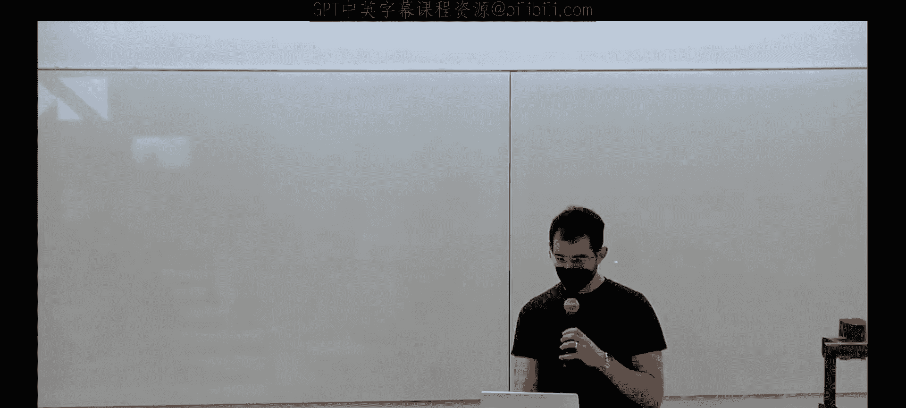

在本节课中，我们将学习如何将之前讨论的硬件效率原则应用于实际案例。我们将分析来自行业和初创公司的多种机器学习加速器芯片，了解它们的设计选择、优化策略以及面临的挑战。

上一节我们介绍了算术优化、内存优化和稀疏性等硬件效率概念。本节中，我们来看看这些概念在真实芯片设计中的具体应用。

## 压缩稀疏列格式

在深入案例研究之前，我们先补充一个关于稀疏矩阵表示的细节。这是一种常用于稀疏矩阵乘法的特定格式。

以下是其工作原理：
*   **压缩稀疏列格式** 的核心思想是避免存储矩阵中的所有零值。
*   它通过存储非零值、相对行索引（指示下一个非零元素前有多少个零）和列指针（指示每列开始前有多少个元素）来实现压缩。

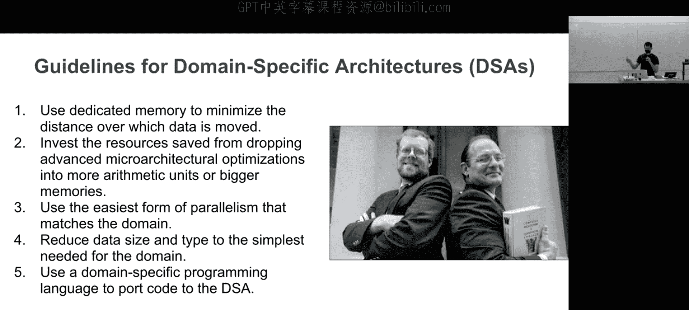

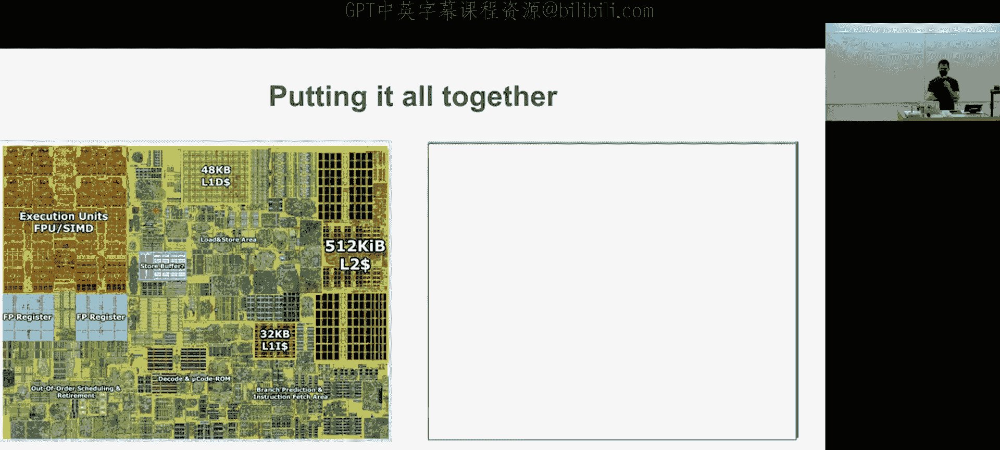

例如，对于一个矩阵，我们可以将其表示为：
*   **数值数组**: `[A, B, C, D, E, F, G, H]`
*   **相对行索引**: `[0, 1, 0, 10, 0, 1, 0, 1]`
*   **列指针**: `[0, 3, 4, 6, 6]`

这种格式的好处包括：
*   **节省存储空间**：当矩阵中有大量零时尤其有效。
*   **便于点积运算**：对于需要整行或整列与向量相乘的点积运算，这种格式相对友好，易于构建专用电路来处理。

## 硬件设计原则总结

遵循教科书指南来设计机器学习芯片，可以总结为以下五点原则：
1.  **使用专用内存**：利用片上内存提高数据的局部性和重用率，最小化数据移动的距离和频率。
2.  **投资算术单元和内存**：移除CPU中复杂的控制逻辑（如预取、指令缓存），将芯片资源用于提供实际计算能力的算术单元和内存。
3.  **使用匹配领域的并行策略**：根据应用特性（如权重固定、输入固定、输出固定）和数据流模式来选择并行架构。
4.  **减小数据尺寸**：通过降低精度、量化等技术来减少数据位宽。
5.  **使用领域特定编程语言**：这有助于更高效地将算法映射到硬件上。

## 行业案例研究

现在，让我们应用这些原则，分析几个具体的硬件案例。

### 谷歌张量处理单元

TPU是教科书式应用上述原则的典范。与包含复杂控制单元、缓存等结构的通用CPU核心不同，TPU的设计极度专注于神经网络计算。

其核心设计包括：
*   **巨大的矩阵乘法单元**：占据了芯片约一半的面积，用于执行大规模乘累加运算。
*   **大型片上缓冲区**：约24MB，占芯片面积的30%，用于存储权重和激活值，减少访存。
*   **极简的控制逻辑**：指令非常粗粒度（如“执行256x256矩阵乘法”），因此控制部分占比很小。

这种设计移除了不必要的通用功能，将绝大部分芯片面积用于直接提升神经网络性能的算术和内存单元。

### 英伟达GPU的演进

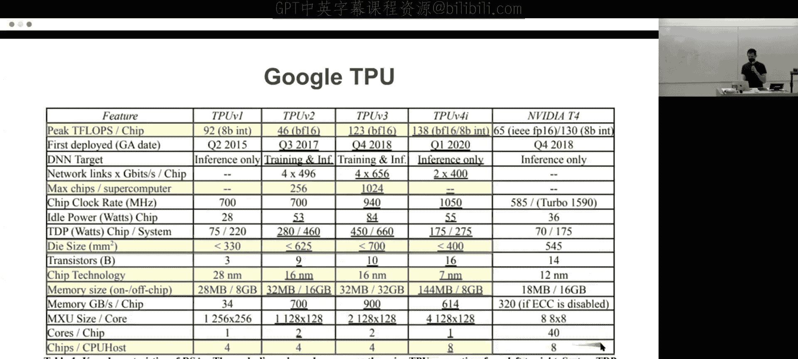

GPU是推动现代深度学习革命的关键硬件。近年来，其设计越来越倾向于深度学习加速。

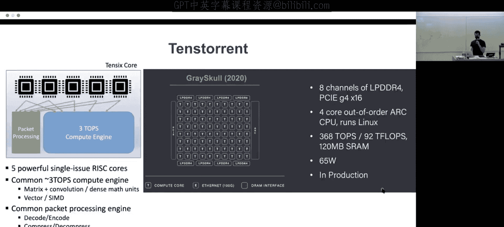

其演进趋势主要体现在：
*   **支持更低精度**：从仅支持FP32/FP64，到增加对FP16、INT8、BF16等格式的支持，显著提升单位面积算力。
*   **引入复杂指令**：如`FDP4`（4元素浮点点积）指令和**张量核心**（专用于小矩阵乘法），以分摊控制开销。
*   **提升内存带宽**：不断增加片外内存带宽，以喂饱更多的计算单元。
*   **增强芯片间互联**：引入NVLink等高速直连技术，避免通过CPU进行多GPU通信。
*   **探索稀疏性支持**：例如支持2:4的细粒度稀疏模式，但仍是待完善的开放问题。

这种软硬件协同优化，使得GPU能持续获得显著的性能提升。

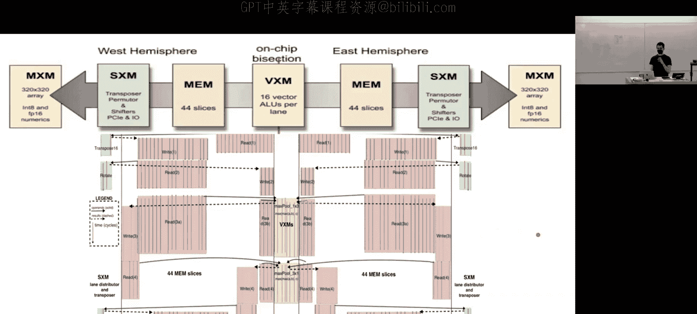

### 其他初创公司案例

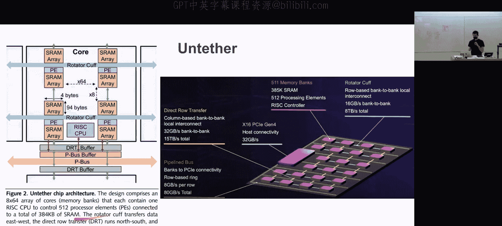

除了行业巨头，许多初创公司也提出了有趣的设计。

*   **Tenstorrent**：注重软件灵活性和可编程性。其芯片结合了高效的计算引擎与多个RISC-V核心，通过数据包处理引擎在芯片内灵活移动和压缩数据。
*   **Groq**：采用了一种**空间展开架构**。它不是将多个相同核心放在芯片上，而是将整个计算数据流图在物理上展开布局到芯片的不同区域。它没有片外内存，完全依赖大型片上SRAM（200MB）和多芯片互联来扩展。
*   **Untether**：强调**近内存计算**。其设计包含大量片上内存块，专注于最大化内存带宽和降低数据访问能耗。
*   **Cerebras**：以其**晶圆级引擎**而闻名。他们直接使用几乎整个硅晶圆作为单个芯片，尺寸远超传统GPU。这带来了巨大的片上内存（18GB）和计算核心数量（约40万个），但同时也面临良率、功耗和散热等严峻挑战。他们通过禁用整行/整列有缺陷的核心来简化软件映射。
*   **微软Brainwave**：采用了一种独特的**“线中 bump”架构**。他们在数据中心服务器的网络接口卡和CPU之间插入FPGA。数据流经网络时，可被FPGA实时处理后再转发，从而在数据中心内形成一个可编程的硬件加速平面，部署侵入性小。

## 专用集成电路的成本考量

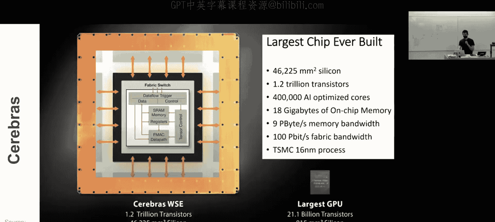

开发一款专用集成电路成本高昂。研究发现：
*   **制造成本**（约500万美元）并非最主要部分。
*   **最大的成本来自于软件开发**，即如何为芯片编写编译器和工具链。
*   硬件设计、EDA工具、IP授权等也占相当比例。

降低这些成本的技术正在发展，例如采用领域特定语言、开源指令集架构、硬件敏捷开发方法以及利用大型FPGA进行原型验证等。

## 总结

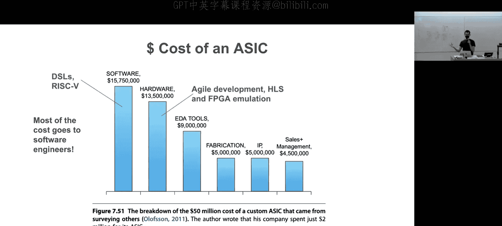

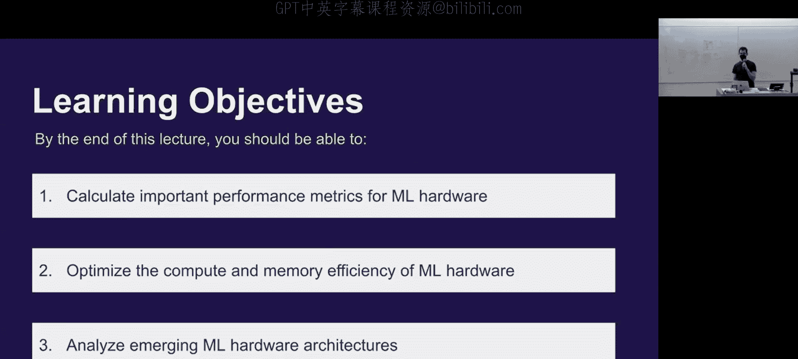

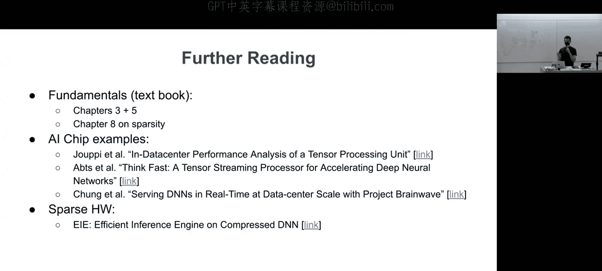

本节课中，我们一起学习了多种机器学习硬件加速器的实际案例。我们从TPU的教科书式设计出发，探讨了GPU为适应深度学习而做的持续演进，并分析了几家初创公司具有创新性的架构选择，如空间展开、近内存计算和晶圆级集成。最后，我们了解了ASIC开发的主要成本构成。通过这些案例，我们应能更好地分析、评论乃至优化未来的机器学习硬件架构。