# 006：康奈尔大学《机器学习硬件和系统｜Cornell ECE 5545 Machine Learning Hardware and Systems》中英字幕 p06 -06-Lecture 5_ Microarchitecture.zh_en -BV1CCqPYSEP5_p6-

We started by kind of going over machine learning computations。

Trying to look at them in a computational way， meaning what are the number of operations that I perform。

 what is the memory footprint of an operation and the bandwidth requirements。

 so the memory versus compute trade off。We then went and started to talk about hardware where we talked about metrics。

 roofline analysis。And all of that stuff， then we talk a lot about hardware efficiency。

 how to get efficiency out of arithmetic by using lower precision amortizing overhead。

Memory system， how you can increase reuse and locality。

 and finally we looked at a bunch of case studies。So last time I asked you who you want to hear from in terms of those chip startups。

So I sent an email to Crebras and they replied in like five minutes and they said they're happy to do it。

 so we'll get a talk from them sometime this term。嗯。

Yeah， I， I think when， when you're kind of a。Cornell Prof。

 it makes like a difference when you send an email to someone。

I'm now trying now trying to kind of understand how to use that power。So because I'm new in this so。

So today we'll be kind of diving one level deeper previously we talked about kind of hardware architectural concepts now we're going to talk about micro architecture and so previously I had this lecture called circuits but I decided that I don't think we're going to go as low as circuits just because。

It requires a lot of background knowledge and the details we can get lost in the details quite easily。

 So we'll talk a bit higher than circuits。 we'll kind of talk a bit about circuits， but not so much。

 we'll mostly talk about micro architectureure。嗯。So yeah， so we're getting that guest lecture。

 so the person to deliver it will be kind of their chief hardware architect and one of the co founds。

 so he's their main kind of frontman so that's good。嗯。A1 is released， please get started on it。

It is the easiest of the four assignments so so well I don't know why I'm saying that but just it's proportional to the number of marks assigned to it this is 10 out of 58 marks and then there are three more assignments it's mostly research so you would kind of go online figure out what the flops and the memory bandwidth of all of these chips are be comfortable with kind of perusing through papers and data sheets and extracting those numbers and then the other part of it is just benchmarking models and figuring out how to run them how to accurately measure their runtime and translate that into throughput and project it onto a roofline plot so that's kind of the main thing of the assignment。

Hopefully you'll find it useful， but ask questions early， it's due in less than two weeks now。

 a week and a half。Good question， does anyone not have their GitHub ID linked by now？Oh good， okay。

For a0， we got like 80 something% 83% participation or something。

 which is five less people than I wanted to submit assignments。

 so if you haven't submitted a0 please talk to me I mean if you want to but I think I think I was hoping that everyone would submit it。

 so it was a very kind of just getting warmed up assignment。Okay。

 so yeah so as I was saying in the previous lecture。

 we went over how to design this chip essentially， we went through the textbook kind of analysis and optimization steps that we would take as a computer architect to design a chip for the application called you know deep neural networks。

 and that's what we would come up with。And so far， we have decided on what the architecture will look like。

So we talked a bit about the instructions， how they have to be course grained and so on so these are architectural concepts。

 we talked about macro decisions like the data flow or the type of parallelism that we want to leverage we talked about the flops versus memory bandwidth tradeoff that we can have by kind of trading of chip area on chip memory versus a multipliers and adders or core。

And finally high level design decisions like supporting sparsity or having different kinds of precision。

 so these all kind of fall under the architecture of that chip right so as I said today we will talk more about the micro architecture of the chip。

And here it really comes down to the implementation details of what。

Of how we actually do the computation。So typically the distinction would be。

 you know you define the ISA or the instruction set architecture when you're defining the architecture of your chip。

 but implementing that ISA like the cycle accurate description of how it's implemented on your chip that is decided by the microarchitecture of your chip。

 so that's what we will mostly be talking about today。

Things like the arithmetic unit design and the memory organization。And as I said。

 a step below that is circuits。How do you actually organize the transistors to do that computation or even logicgates which is one step above transistors。

 so we'll touch a bit on that when we talk about processing in memory and when we talk about how to build multipliers from Gs。

 but we won't go into too much depth， I think it will be too much for the scope of this course。

If you go， okay。So the outline for today will be kind of these three parts。

 we will start by building a PE， so a PE is a processing element in my unit， in my accelerator。

 it's also you can refer to it as a core， but it's a very simple core。

And so we'll talk about the micro architecture of building that key。Second。

 we will go and talk about on chip memory， so some basics of how to connect memory to your compute on chip。

 so we're not talking about external memory here。And finally。

 we will kind of move on to more exotic or emerging compute paradigms that I think are very kind of promising。

 but still didn't prove that they can be put in production。Okay。

 so let's build our first processing element， so what does the processing element need to do whether it's a convolution or a matrix multiplication。

 what is the fundamental operation。dot product dot product yes so that's correct so that's the thing written down below here so you have two vectors and you want to compute a dot product between them that means you're multiplying two elements adding them to the other two elements which are multiplied and so on。

So as it's written down there。So the first thing I need is a multiplier to multiply those two elements。

And so in this case， I can enter two elements， it's kind of the first activation and the first weight into my multiplier and get the first partial sum of this dot product。

Then the second thing I need， as you might expect， is an accumulator。

 so what's different between an accumulator and an adder？Some。Can。Can anyone kind of guess？收。

Aumulator need to hold a number all the time。So let's start。So basically what's your name。

 Jeremy Jeremy， so what Jeremy said accumulator needs to hold the number whereas the Azure does not。

 and that's exactly correct because so this whole thing is an accumulator where it adds something and keeps it in kind of a register or some storage。

attachedta to it， whereas an adder is just half of this accumulator。

 it's just this addition part without holding any state。

So now to compute this dot product on my very simple PE。

 what I do is that I can sequentially stream in my inputs so now I have x121 and I keep adding them to the previous。

Previous values right so x1 w1 is now added to x 0 w0 and comes with the output and then I'm adding that my next partial product or partial sum other and so on so。

So obviously this is a very simple PE and it's very slow because it will take n cycles if my dot product is multiplying vectors of n size。

 so it's really slow。So how can I make it faster。Yeah。嗯。I mean。

 I already kind of switched to the slide so I can make it faster by paralyzing my computation right。

 so instead of having just one multiplier I can put four of them and so my computation should be four times faster。

😊，But now how do I connect those four multipliers to this one accumulator。

 what do I need to put there to make this work？And still compute dot product basically。Okay， come on。

Addder， okay， how many add in this case。嗯。2。Three others， okay。So some people said two。

 some people said three in general we need log n adder plus one or something to add those partial sums。

 so in this case now I have you know my multipliers I can paralyze them as much as I want and then I can add an adder tree and because my computation is still folded I still need an accumulator to add all of those partial sums together。

And so now what it would look like if I'm trying to compute this dot product is you I' would have x0 to x3 all in registers here and W0 to W3。

 they're all multiplied by each other at the same time。

 and then I would get this kind of big partial sum here。And in the next cycle。

 I would stream in x4 to x7， add them all up after a multiplication。

 and finally in two cycles they can have know the dot product between eight elements。

Right and that's actually basically it， that's what the compute in a PE looks like for like a neural network accelerator。

 so that's what it looks like in the TPU， that's what it looks like in those tensor cores。

 that's the essential building block and that's how you parallellyze it and make it faster。

So that's the first thing that we need to know how to do really well， parallelization。

 or sometimes people call it vectorization because it operates on vector rather than a scalar at any given time。

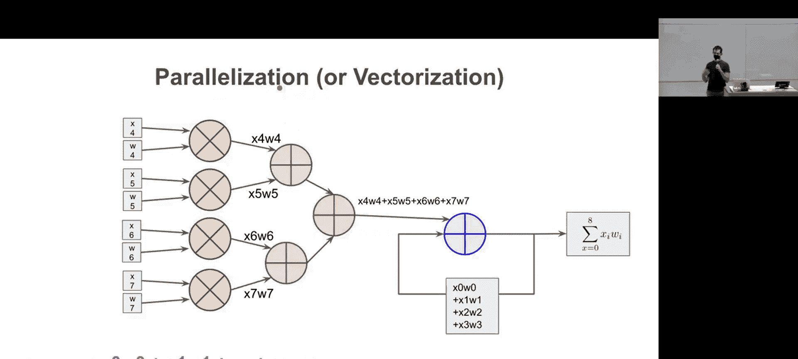

Okay， so so one interesting thing now is now that I have this PE。

 if someone tells you I'm doing inference in int8 precision。

What does this actually mean in terms of the precision supported by different parts of the circuit？

So。Is it kind of just the multipliers or an in8 or just the accumulators or just the adders or all of them。

 so who thinks so look at it for a second and then raise your hand if you think it's the first choice so basically everything is an in8。

Yeah。你看。No one thinks it's number one， okay。So are the multipliers only in intake。

 so raise your hand if you think it's number two？Okay， half the people。嗯。Number three。

 multipliers and adders are in eight。So a half hand， two， two and a half hands， okay。

And then accumulator only is in eight。是啊。😔，A hand plus shake of the head， okay。So。So I mean。

 at first I thought it was number one， right， like everything is an innate precision if you're telling me you're doing inference in in8 then everything is an in8。

 but that's not true。Basically when you're multiplying two numbers you can do with the small range because you know if you're multiplying it's just two numbers。

 you only need to take into account the range of those two numbers but when you're accumulating numbers from kind of vectors that are size I don't know 256 then you will get a lot of values in different ranges so you need to have a much wider range in the accumulator definitely and maybe also in the adject tree so I've seen both things。

But whenever like the Tensor cores and NviIDdia GPUs， the stuff they do in Brawave， all of these PEs。

 they have wide accumulators， they never use narrow range accumulators because you're adding so many numbers。

 you need that wider range。So。So your savings kind of when you're going to lower precision are actually not as big as you might think。

 they're only limited to the multipliers and sometimes the add and I've seen people customize the exact precision of those add to get the accuracy they want an important workloads so theyll say I'll have eight bits of precision here。

 I'll have nine bits here and you know 12 bits here if I'm using integer precision throughout or something like that and many people still use floating point accumulators just because that's what they have and that's what provides the largest range。

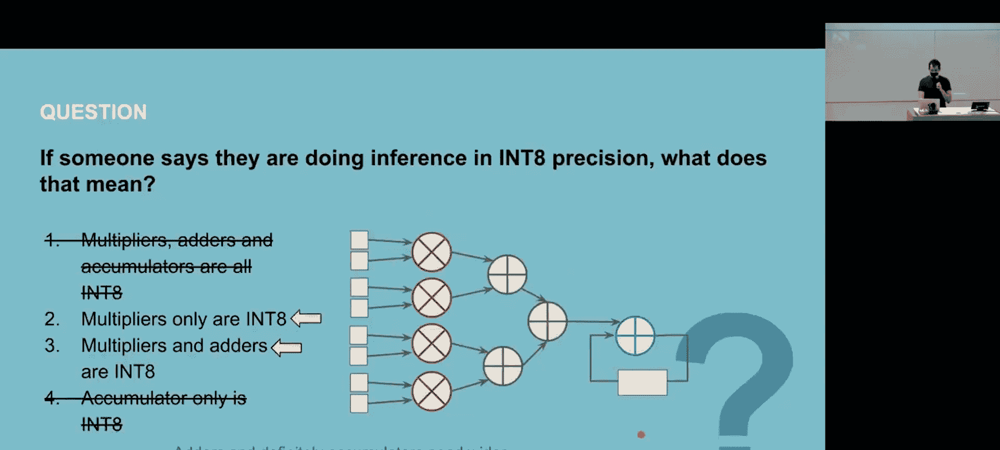

Okay， so now we have this PE that's paralyzed or vectorized if we want to yeah question。Yeah。

 both the inputs and the outputs would be and8。Yeah。

 so you would have to handle overflow and most people would handle that by saturating。

 so it would just stick at 255。And that's why you kind of lose some accuracy on your task when you go to in date。

 but people also do normalization and stuff while doing quantization。

 which is something we'll talk about next week or something to make sure that doesn't happen too often。

嗯。And yeah， so in the case where we do have a floating point accumulator。

 we usually have a circuit here to convert that to an integer number before you kind of feed it into your next layer of the neural network or even before you store it in a buffer just to save space。

 but you want to compute it first in that wide range to make sure you're not losing that。Okay。

 so so parallellyization is the first important concept pipelining is the second very important concept。

 so how many people know what pipelining is。没有白。Okay， I was。

 I was expecting more hands because I think there are more ECE people here， but。

But that's that's fine we'll talk about it so so we'll talk about pipelining and I'll define this term as well initiation interval。

 which is actually borrowed from compiler and software communities。

 it tells you how often you can start a loop。😊，So if you think about this PE here as performing the computation of a loop。

 there is a for loop。What isism think。So there's a for loop。And for blah。

 and then you are multiplying。AI times B I。C I plus equals， right， so it's something like this。

And these can be vectors or something a pseudocode。

 so basically this is what I'm showing in terms of the hardware here。

 but I need to repeat that again and again until I finished my computation。

And so the initiation interval is telling me how often I can start a new iteration of that loop。

Or how often I can feed new data into my processing element and that's tightly coupled to pipelining actually because that determines how often I can send in new data。

So let's see an example， so zooming in on just the multiplier。

 if the multiplier kind of operates in one cycle。Then I can do my computation very quickly in one cycle I'll have kind of AB computed CD。

 EF and NGH so in this case， what is my throughput in terms of operations per cycle。I'm sorry。

So it's four operations in four cycles。So it's one operation per cycle right so I'm able to to compute one product every cycle that I'm running this multiplier。

 so can I do better than that for this multiplier。Not really right like it's you know the multiplier multiplies two numbers and is's doing each one of them in one cycle。

 the cycle is my smallest element of computation on the chip so I can't really do better。

So what happens if my latency is five cycles， so what would my throughput be now？是。嗯。Aman。

1 fifth so one if one operation finishes in five cycle， so one divided by 50。

2 kind of operations per cycle so that's correct and what if so。

So so most circuits take more than one cycle right so how do I fix that how do I make sure that I still get high throughput because one fifth of an operation per cycle is not acceptable in fact none of these circuits you will find in an actual design that's used in industry where the throughput is less than one operation per cycle no one will kind of say that that's a good end of design。

And so what do I do if I want to start a new operation every cycle， the answer is called pipelining。

 so what is pipelining？So basically if this is my multiplier。And， you know。

 I have a big cloud of logic where I send in to。Numbers， and I get the product out。

And this takes five cycles， right？What pipelining is is that you break down the computation into finer grain parts。

And put some registers in between。Right。Five times。Does anyone know what registers are？

So so just to make sure registers are just， you know， a store of value。

So here I've computed kind of a function of A andB。Which is not the product。

 but it's something it's part its it's going it's getting me along the way of computing that product I'm computing that intermediate computation and storing it somewhere because if I do that then I can start a new computation here and you know start。

A1， a 2。Send in the next set of elements to multiply。So if my latency is high。

 that's usually not an issue as long as I can fully pipeline my circuit。

So is is this quite clear now now how many people now know what pipelining is？So。Okay。

 so so yeah so latency is usually not an issue as long as I can pipeline my design and start a new operation every cycle and so how does this relate to the initiation interval。

 what would be the initiation interval if it's fully pipelined？How often can I start a new loop。

 a new iteration of the loop？In this case。嗯。So every cycle， so which means an II equals to one。

 so initiation interval is often kind of abbreviated II and you know in this case the II equals to one。

In the non pipeline case， it would be equals to five because I can start a new iteration of that loop every five cycles is when I finish the whole thing right？

So that's good， so pipelining works we're all happy， but that's a feed forward circuit。

 so that means I don't use my results in the input of that circuit again。

 there are no feedback loops so that's the easiest circuit to build because you can add as many kind of pipeline stages as you want and it won't affect your throughput。

嗯。Instead， what happens when I have this feedback loop。

 so now I'm looking at an accumulator where amm using the output I'm sending it back in to my adder to compute the next value。

So what happens if I pipeline this design？And it takes two cycles。

Again in kind of the software community they would call this a data dependency and basically I'll have to wait for the two cycles whether my address is pipeline or not right so in the first cycle I can send in this a value to add to my zero here。

Well this is the case of latency equal one cycle right so this is fine I can just keep adding a new element every cycle。

 what is my throughput it's one operation per cycle what is my II in this case or initiation interval is equal to one I can start a new operation every cycle。

 but what happens when my latency is equal to two cycles here。So first I'll send in my a opera。

 but it will take two cycles in the adder， whether it's pipeline or not right and so in this case。

In cycle1， I would get a stall， I would need to stop the next input from coming in until I compute the first sum of adding a to zero。

 right？Because I need at this point here， I need to have the a value come in because that's what I want to add to and it's taking two cycles to produce that value。

 so I need to stop and it's irrespective of whether this is fully pipeline or not。Right。

And so this is quite an interesting problem and it's actually not that straightforward to solve。嗯。

So yeah， not only in the second cycle， can I now send in my B opera to be added to my a opera。

 which is now in my register。So can people think about how to solve this problem？是。By the way。

 what's your name？Alex。Add a second register where。对可以。嗯哼。😊，Yeah， so that's that's actually correct。

 So that's that's exactly what we'll do。 And it's it's something called interleaving where we want to add two completely independent kind of things together。

Yeah， so。Let me， let me go through it。So basically。

 what Alex said is that we can add a second register holding the state of the accumulator。

And what I'm doing there is not just you know pipelining this feedback loop because that wouldn't really help me。

 I'm also interleaving my opera end， I want to add a to B to C。

 but I also separately want to add X to Y to Z。So there are two completely different additions that I want to perform using the same accumulator and I can interleave those additions on the accumulator if it has a latency of more than one。

And so I would duplicate the registers at the output and in my feedback loop and then would I would alternate sending in the first operation and the second operation。

 so it will look something like this， so I'll send in the a。

Then the a will come into my interlaving or the extra register。

 and then in the very next cycle I'll send in the X。So now after two cycles。

 my a partial sum is ready。So now I can add it to the B。So a plus B comes into this register。

 I shift the x now I can。Add the x to the Y。And so on。So in the same operation。

 I'm adding two sets of numbers to each other by leveraging this extra interleaving register and by interleaving the opera in the input here。

And so this accumulator still has a latency of two， but now what is my throughput？是。1议。😔，Yeah。

 so it becomes one operation per cycle。So is interleaving clear to everyone？😊，Does it make sense？

Okay， I'm seeing lots of nods so the main challenge with interleaving actually is figuring out how to send in those opera in this pattern。

 so basically how can you lay out your opera in memory so that they are interleaved because that makes your memory accessing a lot more complicated your addressing logic becomes a bit more complicated as well but adding that extra register to the accumulator usually is not that expensive。

嗯。Okay， so now let's look at this PE。So we talked about vectorization， so to increase throughput。

 we added a bunch of multipliers and then add their tree instead of just having one of them and doing everything sequentially。

 we then talked about pipelining because we want to start the operations in that PE every cycle and have the throughput of one operation per cycle or in this case four depending on your parallelization or vectorization and finally we talked about interleaving for anything that has a feedback loop。

It can either only be allowed to take one cycle， which is usually hard to do if you want to run at a very high clock frequency。

 so instead you can also do interleaving where you're interleaving computations is from two different。

Yeah， two different computations essentially on the same accumulator。Okay。

So any questions about our toEP before moving on？And don't be shy， you can ask any questions。

 it's fine。 This is actually a classroom。Where you're meant to ask questions。 So， yeah。Yeah。

Yeah exactly， so actually in the design that we were building at Intel we had a latency of four on the accumulator。

 so we interleaved four different computations and had four registers to hold that intermediate state in our accumulator。

H。It's tied to the number of cycles of latency， it's not tied to the clock cycle period or the kind of the absolute number of it's just a number of clocks yeah。

那你。Anyone else know， Sure， okay。So our toy PE is actually not a very bad model。

 I took a screenshot of two PEs from good papers that I've been following or two good pieces of work that I've been following so that's kind of what you would see you see a PE in the wild。

So here that kind of looks like the one that we created。

 you know you have multipliers and adder tree and here they're breaking down this into two different parts and that's an artifact of how FPGs work and how multipliers and adders are organized on an FPGA。

 you have an accumulator which holds state and kind of feeds data back into the accumulator。

 you have some control logic and some memory here。And usually because of interleaving specifically。

 you have all of these mues to choose which piece of memory to read from and that's controlled by the control logic of your PE。

So that's one example in this example not shown is that this actually operates on a sparse format。

 so the only clue here is those inputs which tells you you know run length indices and weights。

 so run length means how many zeros before I hit my first element and then my second element and so on。

嗯。So this is one example， this is another example and this is from the brainwave architecture。

 the one I created by Microsoft and it looks a bit different so what they have here they call DPE dot product engine so that already contains the multipliers and the adders and I don't think they hold any state they literally have an other tree to reduce all of the multiplications in each one of those dot product engines。

 but they also have this part here so。They have their input splitting into two parts。

 going into this exponent branch and this， I guess Menisa branch。So MRf Mantia register file， maybe。

And so what's happening here， this is a floating point。

This is a floating point PE instead of being a fixed point or an integer PE。

 so you have now your exponents and your menties。But if you look really closely， the number of。

 so when you're doing a floating point multiplication。

 you're adding the exponents and you're multiplying the anticesis， right？

And so that's what they're doing here， there's a multiplication going on here。

 and here they're adding the exponents。But how many exponents do we have， we have four exponents。

And we have， like。Eight or nine， eight， eight kind of arrows for Menisa。

 and each one of those arrows is actually a vector as well because it goes into a dot product engine。

So how can we have fewer exponents than menticses？So for that we need to kind of review our numerical formats and precisions。

 so you know we have floating point， we have integer and we have something called block floating point。

 which I don't think we talked about yet。So in floating point numbers， you have sign exponent Menisa。

But in block floating point numbers， you store one exponent for each block of elements。

So basically this is block floating point 16 with block sizes8， so for every eight elements。

 I will align them all to the same exponent and I will just store one exponent instead。

And so one example of that is， you know， if I have。These numbers 3。2 times 10 to the power of five。4。

5。Time stand the power of3。3 point。7even times 10 to the power of four， right？

So what do I do in this case？I see what my biggest exponent is because you know my biggest number will dominate most of my computations anyways。

 and then I shift all of those things to make sure they are at the same。Exponent， so for this number。

 I would convert it to。You know，1，2。So，0。045。😔，Times 10 of power of 5 and this one。0。

37 times1 the power of five。So now the exponent for those three numbers is five。

 so I store just one exponent and then I store three montices， so 3。2。0。045 and 0。37。

and that's what I'm showing here， so you have all of these eight mentices aligned to a single exponent。

And so usually this alignment to the same exponent is done by a bunch of mues or multiplexors and it can be done offline for things like weights so you can pre computeute all of the。

blocks and yourmantices and exponents offline and store them in that format in your memories and then read them and do the computation using a PE like this one where you have a different data path for the menticesis。

 a different one for the exponents， and they don't have to be the same size。

And that's actually also what we did at Intel。 we collaborated a lot with that team。Okay。

 any questions so far？So we talked about you fixed point integer and floating point。

 but there are also other numbering systems。And I think this will be actually。

A huge area for improving the efficiency of machine learning accelerators。

I know that NviIDdia are actually looking into log numbering systems right now。

 so they have a patent about computing multiplications and additions using log arithmetic quickly and the main problem there is usually the conversion to and from log numbers and they find an approximate but very fast way of doing that and I think in the last or before last assignment maybe you guys will also look at that patent and implement the algorithm for that as well。

There's also something called deposit numbering system。

 which is less used but could also be useful for deep learning。

 and they're both combined into this interesting blog post from Facebook/lash Meta where they're thinking about those new numerical precisions and so on。

So I recommend reading that and also just keep an eye on NviIDdia because I think their next generation of GPUs will have some support for log numbers。

嗯。Another PE from the wild， so this one is one that supports parsity and you will find that you know when you start supporting doing things like fine grains parsity your actual arithmetic becomes a very small part of the PE and most of your most of the stuff you have to think about is just how to read the data efficiently and feed those multipliers and adder every cycle properly without having any bubbles or cells so this is from one of the readings for this week efficient inference engine。

So yeah， so you should be able to comment on it once you read the paper。

And before moving on to the next bit， I just wanted to very quickly kind of show what is inside that multiplier。

 so I said we won't go to circuits， but this is kind of our very quick take on circuits of multiplication。

 so this is from an MIT lecture so if you're interested in kind of knowing more about it click on the link the bottom of the page。

 but basically this is how I multiply two numbers in binary。

I'm taking kind of essentially an end gate between all of the pairs of inputs and then adding them all together。

So most of the area of a multiplier is actually in all of those add is because I'm adding a lot of numbers together。

 doing the end gate is not that expensive。So you know you have your inputs lined up here。

 a0 to A3 and your other inputs B0 to B3 here， you end them all together and then you just keep adding those partial sums until you get your result。

The latency is usually proportional to the size of the input。

 but the hardware size of this simple multiplier is usually squared with the number of inputs there are n log n multipliers and again if you're interested in the circuitry you can search with these keywords so there are different kinds of circuits that you can use for multiplication that you probably learned about if you're in ECE like in your third year or something so booth multipliers。

 Wallace tree array multipliers and so on so if you're interested in that yeah feel free to search with those keywords and this could be a good topic for paper term paper for example。

Okay so we've built a PE， we looked at some examples of PEs and now we know kind of how to do the arithmetic what we need to do to make sure the throughput and the II are always equal to one and we're always feeding our computation units now let's talk about memory for a bit because on the other end of that PE。

 we have some storage where we're storing those filters slash parameter slash weights and we're also storing intermediate activations and our inputs。

So what is an on chip memory it's basically a table so a table with two columns one of them is an address and the other one is the data right in a very in the very simple form it has a single write port and a single readport so on the right port if I want to add something to that table I would give it the address I'll give it the data and it would write it and overwrite whatever is in there and the readport I give it an address and it gives me the data at that address right。

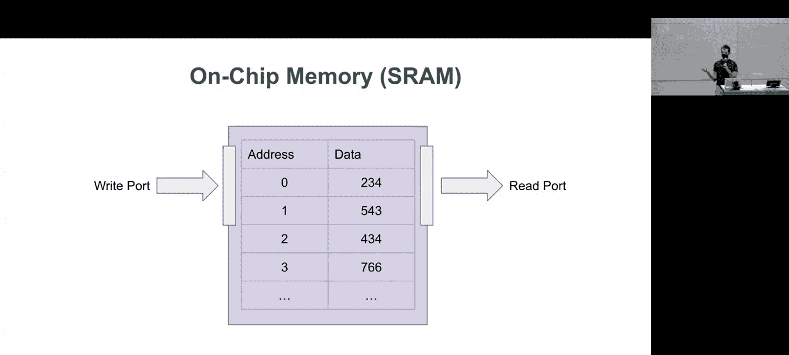

So a question about that memory unit that I saw in the previous slide。

 so what decides the Bi width of these addressesdes？So all of these numbers。

 I need to use a specific bit width for it right， number of bits to represent these numbers。

 the same is true for data， so I'm asking about the address， what decides how wide each address is。

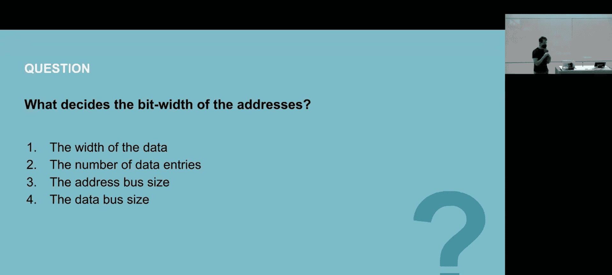

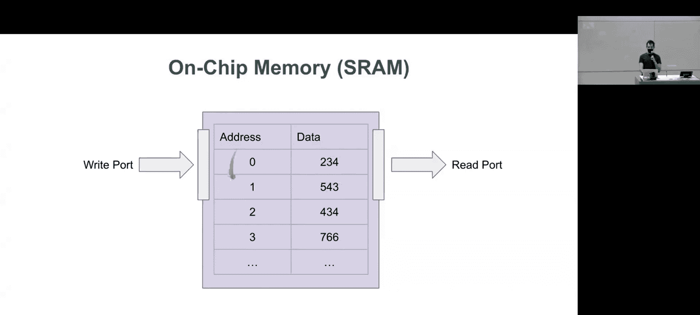

So who thinks it's number one width of the data？那忘了。Number two。Number of data entries。Okay。

 most people， that's good。Because that's the correct answer。And so yeah。

 this is basically the number of addresses。Depend on the number of data entries and so if I have like n data。

 if I have n bits to represent my address， then I have two to the power of n possible addresseses that I can put in there and that's the number of locations in my memory。

 right？

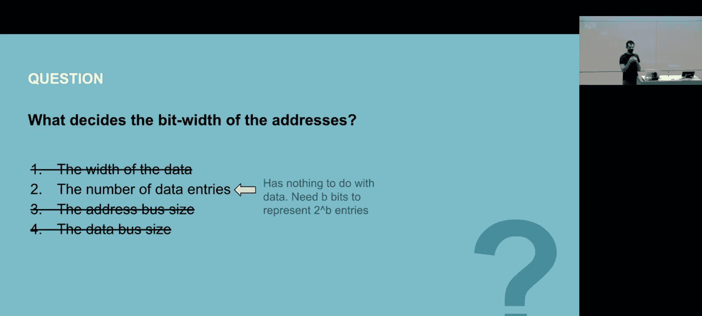

And so this should be an easy one。Okay， back to this diagram again。

So I said in the simplest case we have the single readport and single writeport but you should know that you know building memories is its own field like some people are actually just memory IP developers that's what they do and there are many different variations of what you can do there and we'll talk about a couple of them but just for now also just know those two terms simple dual port is what I'm drawing here each port can either be a write or a readport and you can read and write from them in each cycle but you can also have a true dual port tram where each port can serve as either a write or a read so you can do two reads。

 two write one read and one write at the same cycle right and that's usually controlled by an extra bit that goes in and it says whether you're reading or writing。

嗯。So back to our beautiful PE here， how do we connect this RAm now to the PE？

Right so so look at this picture and think about it for a bit。

 remember our key design objective in this whole lecture and in our whole lives as DNAN accelerator designers is to have one operation per cycle。

So I can read one operation per cycle from the Ram。

But how do I connect it to this vectorized multiplier PE and the vectorized multipliers in the input？

So。What do people think， What do I do？Soorrry。Using a mug， where would I put the mugs。So not quite。

 So am has multiple inputs and gives and selects one of those inputs and give and you know sends it to the output。

 So in this case， I actually have the opposite problem。 I have a single input。

Which is the report of that tram， and need to connect and they need to somehow read eight elements out of it。

That's the issue I'm trying to solve， right？So what what can I do， What is the simplest thing to do。

 maybe。对。Add eight small Rams， so that's that's a great answer because that's you know the simplest thing to do and that's something I can do。

 I can just add eight Rams。What I'm going to do is very similar to that so first you know I'm going to use two different Ram blocks one for memory holding my parameters and the other one for activations。

 that's the first thing because usually there are two different data paths if I'm doing inference I care more about the activation one because that's the one where I need to keep writing to and reading from intermediate results whereas the one holding the parameters or the weights is kind of static already pretrained and they're held there。

The second thing I'll do is I'll increase the number of ports to read from right so why do I have just one arrow sticking out of that box I can have four。

And then now I can connect all of those reports to all of my PE inputs and can compute one I can have a throughput of one operation per cycle or in this case four multiplications per cycle。

 and everyone is happy， right question。So so an activation function is like a reo or 10h or something。

 but when I say activations， I actually just mean intermediate numbers flowing through the networks。

 usually they're called activations because they have been activated using an activation function before they move on to the next layer。

 but you can just think of them as the intermediate results。😊，Yeah。Okay。

 so so this picture looks great can anyone think of any problem with this picture actually？😊。

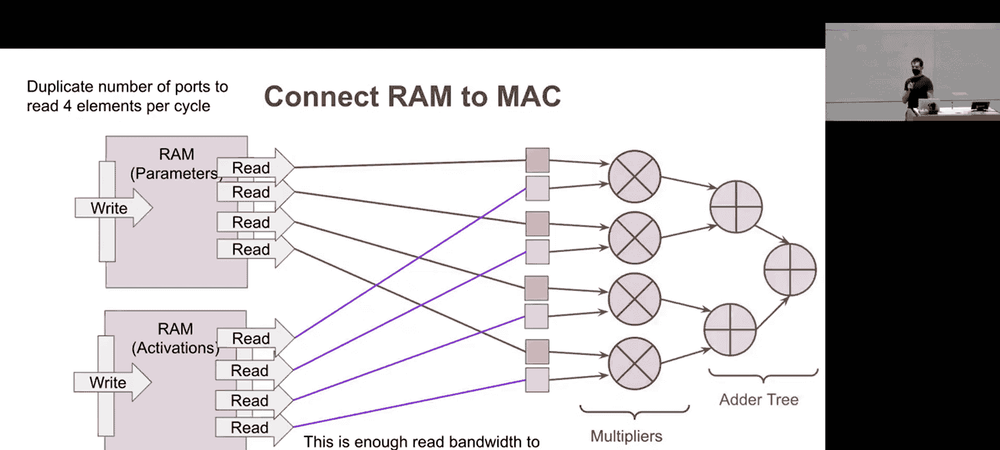

Yeah， so what is wrong with adding many reports to an SRM？嗯。So who thinks it's number four。

 nothing is wrong。Okay， who thinks is number  three。Would be power hungry。Okay， couple of people。

Ner two， it will be large。Good， number one， it will be very slow。Okay， so。

 so something to keep in mind， whenever we're talking about circuits。

 large and power hungryungary are almost anonymous。 So if something is big。

 it will consume a lot of power。 And so it's basically directly proportional。

So the problem with adding read port to a RA is that it makes it very large。

 very slow and very power hungryung and and we're talking just about read ports here。

 what about write ports， if I want to add write ports to the same RA。

 what happens when two write ports are writing to the same address？

It can easily corrupt or mess up my data， so I need kind of complex logic to make sure that doesn't happen。

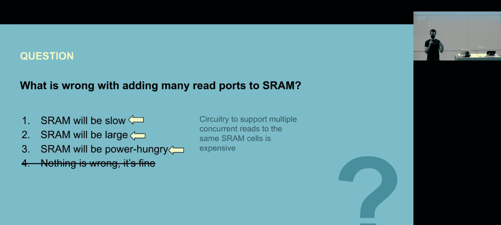

嗯。So what we do， so a note about multiported memories， basically in AsIs。

 adding more ports increases the area and power， so if you're building that RAM from scratch or using some kind of memory compiler to create that RamM。

 it will just be a slower， larger ra to make sure that you're able to like the electrically properly read the values stored in that RamM。

 you just need to make the cells a lot larger。On FPGAs。

 it's a bit different because you actually have these predefined blocks。

 these predefined Rams built into your FPGA， so when I needed to create a multiported RA。

 I actually needed to duplicate that Ram。So I would have the right port connected to two Rams and then I could read from any one of them now obviously this is wasteful because this doubles the area of my RAM。

嗯。喂。So yeah， we talked a bit about how right ports are even more complicated。

And so the rule of thumb here， and if you are interested more about memory you can go and look at that lecture。

 but basically the rule of thumb is to use small， which also means fast memories together to provide the illusion of a large fast memory。

And one thing about hardware design is that you learn the official rules in the textbook and all of that。

 but rules of thumb actually play a huge role in what your design looks like in the end。

 so whenever you talk to hardware designers they'll have these lots of rules of thumb that they just inferred out of experience。

So that's what we will try to do now instead of just naively adding read reports or write reports for that matter。

 we will try to do that by constructing our out of。Smaller pieces of memory。

 And that's what's called banking right has nothing to do with money。

's it just has something to do with separating your memory into smaller pieces of memory。

So in this case， this is a banked memory。So I divide this huge memory table that I have or the large memory table into smaller ones。

 so I'm calling this bank zero and bank one。And then I need to add this extra logic here and extra switching crossbar basically to route my right requests to the proper bank and get my read request from the proper bank as well。

 right？And so what that would look like， it would check the address at which is writing if it's you from zero to seven。

 it will write in bank zero， if it's from 7 to 15 or 8 to 15， it will write to bank one and so on。

And more and more what we are actually doing in practice is that we are explicitly managing those banks ourselves。

 so we're not instantiating an IP block that contains banked memory and some arbitration logic or some arbitration algorithm inside of it。

 or instead we're actually just instantiating this banked memory or even just smaller memories like James said。

 and then we are controlling how to write and read from them separately by ourselves。

So this is what is known as memory banking， instead of using one large memory。

 we're using multiple small memories， and that gives us the advantage of multiple read and write ports which can keep up with the throughput that I need to feed my pes。

And it also makes my memory faster compared to a larger memory that has multiple read and write boards。

So does memory banking make sense to everyone， this is kind of the number one most important memory on chip memory technique to be able to kind of feed your PEs a high throughput。

And by the way。For external memories， we also have banks right so on those DDR chips。

 you actually see multiple chips and each one of them is a bank。And basically for the same reason。

 you want to be able to read concurrently from multiple pieces of smaller memories to be able to keep up with the throughput of sending that data on chip。

It's。So that's a good question so you're asking about you know why this one is more common。

 it's basically more common because in this case you would get that crossbar and that arbitration logic from memory compiler that wants to do this generally for any read and write pattern。

But for machine learning， the reads and write patterns are usually actually simpler than you know the general case。

 so you can build more efficient arbitration logic out here。Or not build it at all。

 maybe you have a case where you actually have disjoint pieces of memory that you want to use。

And so basically， if you do it yourself and tailor it to the application。

 it becomes more efficient than you know。😊，Yeah， then then using kind of the pre。Pree compiled one。

 right or the general one。O。So we talked about PE micro architectureitecture。

 we talked about onship memory， we now have a complete PE。

 it operates really quickly and it's able to keep up with that throughput of one operation per cycle。

So for the rest of this， I will pause for questions， but in the rest of this lecture， we'll just。

Point to some interesting emerging computing paradigms that are intersecting a lot with deep learning and might have kind of a place in the coming future。

 So at this point， do people have any questions or comments or things they want to discuss。Silence。

 okay。Alright。Okay， let's start with processing in sensor。

 So I really like this because it's cool and also。😊。

CMoOSs imaging sensors or even CCD imaging sensors are built on silicon chips and using the same or very similar processed to normal chips。

 so that's an awesome opportunity because now I can actually integrate computation on the same chip with my image sensors。

So that's what they're doing here， so they have this chip。

 which is a camera essentially like a camera chip， but they're using only this yellow piece to capture light and capture the kind of incoming photons and create an image and the rest of it they're using to perform some operations so they have this arithmetic logic unit。

 they have some registers and they have some logic and so on。To do some computations。

So the number of processors they have on this chip is 64K and this is actually just like a test chip from the University of Manchester。

 which is an example of doing this， but there are many examples of doing processing in sensor。So。

Can can someone think why I would want to do that， Like， why is this advantageous。

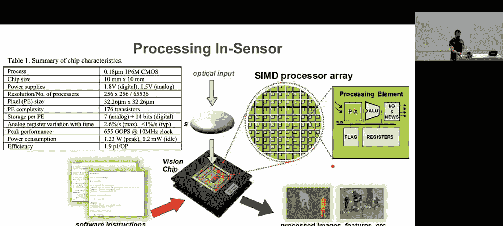

I mean， the right reason is somewhere in there， but can people also just think of。

Why I would want to compute in the sensor instead of just capturing the image in the sensor。

 sending it down to my processor for processing。嗯。Okay， all right to Amman。It's faster。 Yeah。

 that makes sense because as soon as I get the pixels， I can quickly kind of do that operation on it。

 Yeah， I， I think that's correct。对。So， a。Yeah， that's that's interesting so re is saying option four to avoid kind of having a processor that's possible usually in your computing system you will need a processor anyways。

 but。嗯。Yeah， it would be interesting to see a case or construct a case even where we don't need a microcontroller or a processor at all。

 and a sensor with just embedded compute could be enough， but I think we're not there yet。

 basically like from the examples I've seen at least。So。I mean。

 the main reason is actually to avoid moving the image to the processor。

So an image captured through any of your cameras or phones， it gets captured by the sensor。

 it goes through something called an ISP， an image signal processor。

 which does a bunch of pre processing on it white balance color correction， HDR and things like that。

 and roughly again the rule of thumb is that half the energy is spent in capturing the image and half the energy is spent in that ISP for processing that image。

And then the image still goes downstream， gets stored into your processor main memory。

 and then it gets read from that main memory onto your CPU or whatever else is on that SOC and then the processing happens and so that's kind of a long pipeline and there's a lot of energy being spent there like we said reading and writing from memory is a huge source of energy consumption for example。

And so if for example， I have a sensor where I'm doing image classification on that sensor。

I have this huge image， maybe it's I don't know， eight megapixels， for example。

And all I want in the output is just a class label。So that's metadata that could be stored in。

Like8 bits or something if I have 256 classes so instead of transferring8 megapixels I can transfer8 bits down to my main memory and do and perform a decision based on that so if i'm building a robot and I just need to kind of see the world and make decisions based on what I see processing in sensor could be a really cool way of doing that right and there are some products now there's one from Sony where they are doing exactly that it's called。

Something vision sensor， I can look it up， but that's basically their main argument。

 why transfer that whole image if you're not going to look at it right if you just want the kind of analysis or the result of that image。

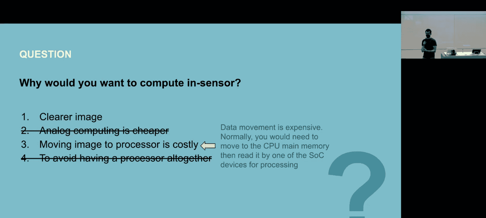

Okay。So quickly on the second paradigm that's emerging and that's being used a lot。

 they call it processing near memory， so not quite in memory and what they're doing there。

 a lot of the work is just 3D stacking a bunch of DRA chips or SRAM chips。

 basically memory and compute。So in this example， it's called neuro cubebe where they have。

This accelerator chip and a bunch of DM chips stacked on top of it and this kind of stuff has been enabled by the 3D stacking technology where you're able to stack multiple dies on top of each other and some people also stack multiple chips in a planar way on something called an interposer。

So this is still silicon。But it's called an interposer。

And you can connect a lot of wires here as if it's a single chip。Whereas the and many chips here。

 right？Whereas the traditional way of doing it is that you have packaging， it's put on a PCB。

And then you only have very few wires that you can connect to， you know， your DM， for example。

So that's actually what Apple is also doing with their M1 chips right。

 so they have it all in a single package and they think they're using an interposer。

 but maybe I should double check that。And so this is really useful for machine learning applications where you have a memory bound application and you want a lot of memory bandwidth close to you。

 essentially。Okay， and I think this is the final one processing in memory。

And that's a bit more involved because。Now we're not doing digital processing anymore。

 we're doing now analog processing。And this could also be an interesting topic for a term paper。

 I think， but basically in this example， what they're doing is that they're encoding the activations or your inputs as a set of voltages。

And by controlling kind of your word lines and the bit lines in your memory。

 you're able to do a multiplication between those voltages and the weight values which are stored in your memory itself。

And so the main thing here is that you when you're sending your activations in。

 you need this block called the digital to analog converter。And when you're reading out the result。

 you need this block called analog to Digital converter。

And that's actually where most of the area and power is spent。

 just in that conversion between the two domains。嗯。

And that's why this kind of type of processing is still in progress it's also a bit finicky to get this thing to work and you can read this paper and they will talk about you know cutoff voltages and threshold voltages and how everything has to be exactly in the right range and how much range and precision that gives you in your analog voltages and so on。

 but if you're interested I would recommend kind of going and reading more about it。All right。

 so do people have any questions about this last bit about those emerging computing paradigms？James。

Yeah so so cooling is usually somewhat of an issue for 3D stacking but people have found ways of dissipating that heat。

 I think part of it is they sometimes use just metal traces。

 not connected to anything that kind of distribute the heat across the cube or the chip and send it to the edges or something but they figured out a way of making it work basically。

O。Alright， so so that's all I had for today。 Here are some further readings and。

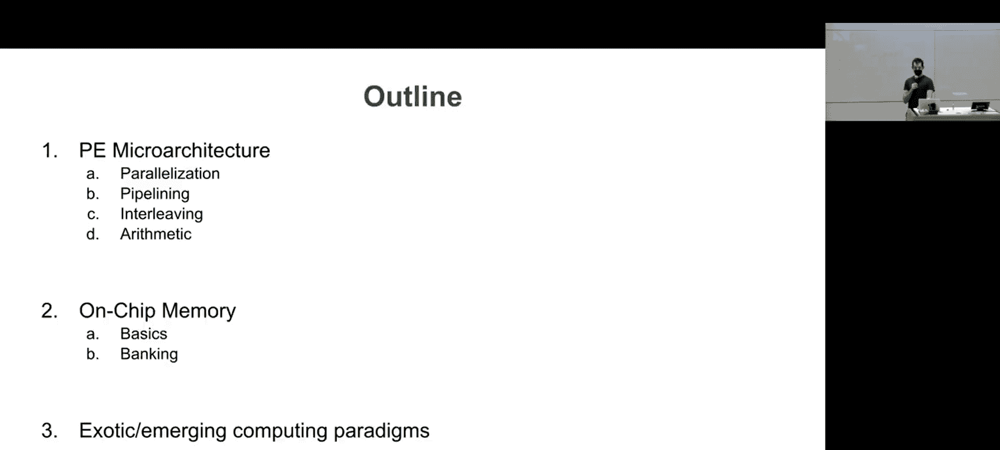