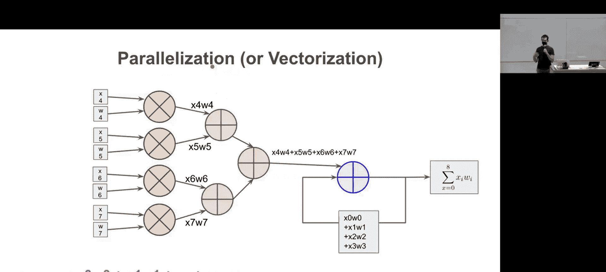
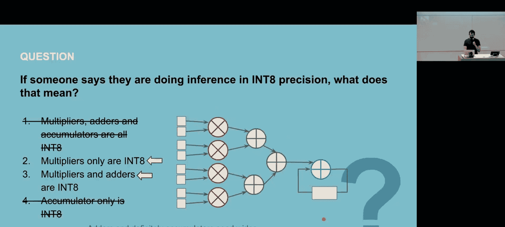
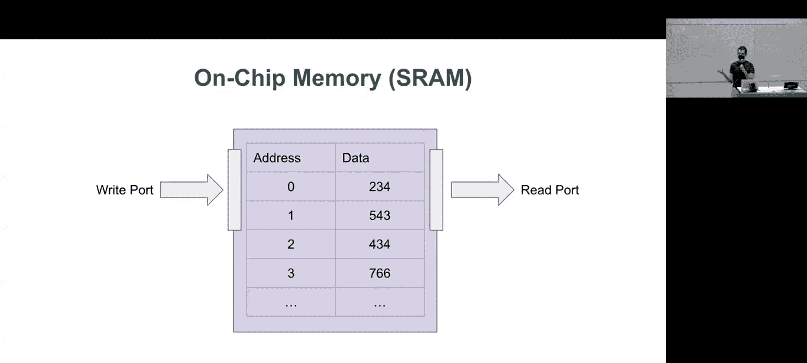
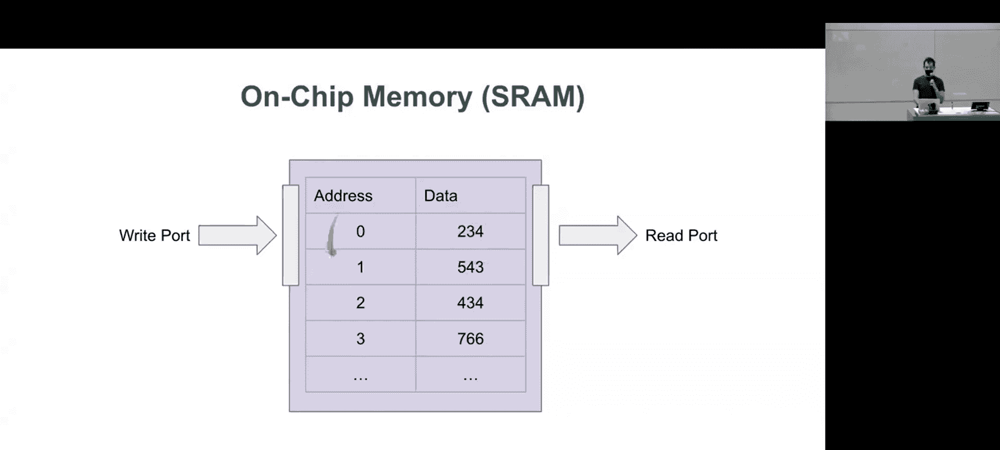
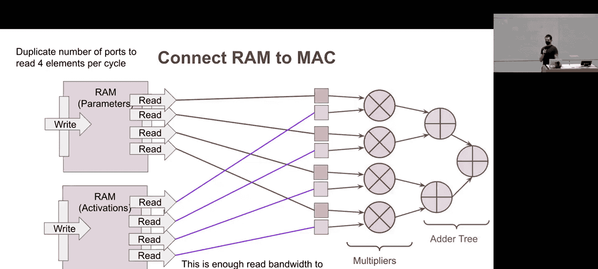
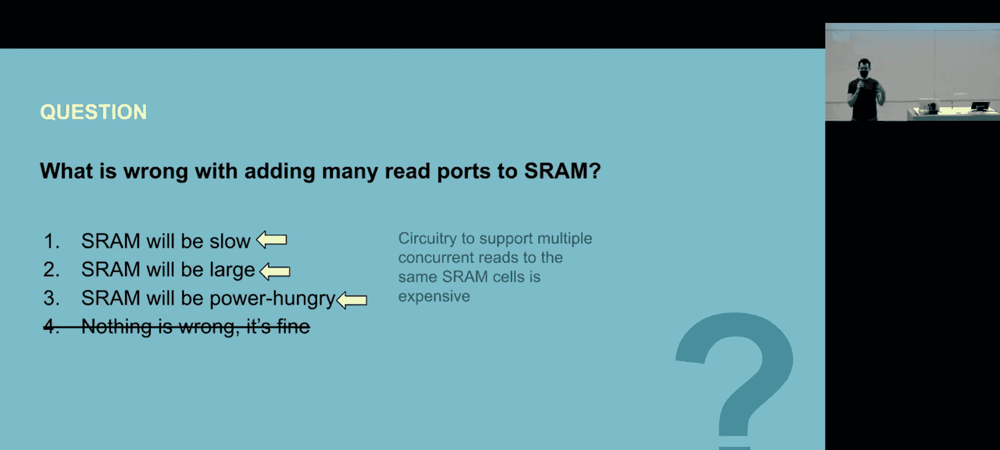
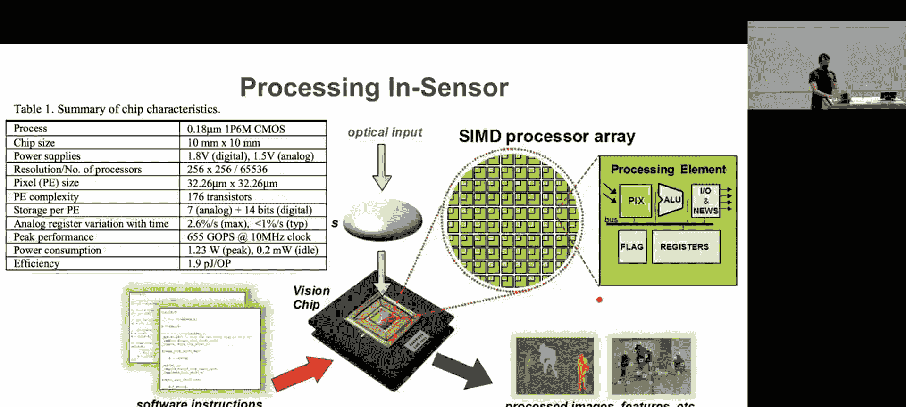
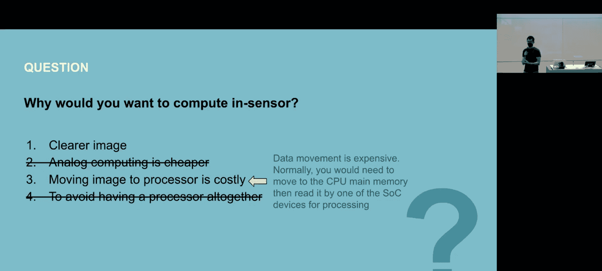
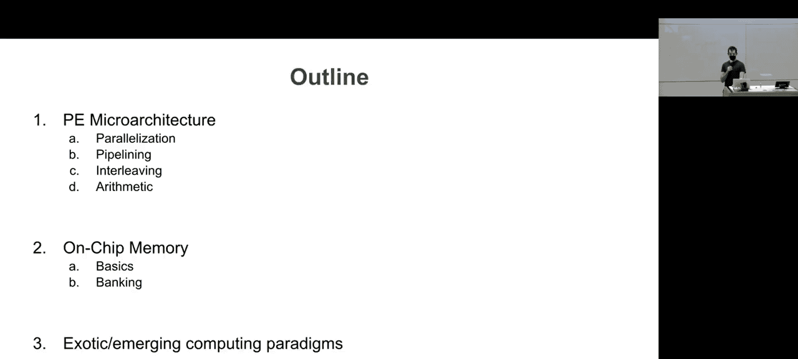

# 机器学习硬件和系统：006：微架构设计 🧠

在本节课中，我们将深入探讨机器学习加速器的微架构设计。我们将从构建一个基本的处理单元（PE）开始，然后讨论片上内存的组织方式，最后简要介绍一些新兴的计算范式。通过本节课，你将理解如何设计高效的硬件单元来执行机器学习计算。

---

## 构建处理单元（PE）

上一节我们介绍了硬件架构的高层概念，本节中我们来看看如何构建一个具体的处理单元（PE）。PE是执行核心计算（如点积）的基本单元。

点积是卷积和矩阵乘法的基础操作，其公式为：
\[
\text{dot\_product} = \sum_{i=0}^{n-1} A_i \times B_i
\]

一个最简单的PE包含一个乘法器和一个累加器。乘法器用于计算两个元素的乘积，累加器则用于累加这些乘积以得到最终结果。

为了提升性能，我们可以对计算进行并行化（也称为向量化）。以下是构建高效PE的关键步骤：

1.  **向量化**：通过增加乘法器的数量来并行计算多个乘积。例如，使用4个乘法器可以同时计算4对元素的乘积。
2.  **加法树**：为了将多个并行乘法器的输出累加起来，我们需要一个加法树。一个包含 `n` 个输入的加法树大约需要 `log₂(n)` 个加法器。
3.  **累加器**：加法树的输出会送入一个累加器，该累加器持有中间状态，并将新的部分和累加到之前的结果上。

一个支持8位整数（int8）推理的PE，其不同部分的精度可能不同：
*   **乘法器**：通常为int8精度。
*   **加法树**：可能使用比int8更宽的精度（如int16或int32）。
*   **累加器**：几乎总是使用更宽的精度（如int32或浮点数），以防止在累加多个数值时发生溢出。

---

## 提升PE吞吐量：流水线与交错

仅仅并行化还不够，我们还需要确保PE能够每个时钟周期都启动新的操作，以实现高吞吐量。这涉及到两个关键概念：流水线和交错。

**流水线** 通过将长延迟操作分解为多个阶段，并在阶段间插入寄存器，使得尽管单个操作完成需要多个周期，但每个周期都可以开始一个新的操作。对于一个完全流水线化的电路，其启动间隔（II）为1。

然而，对于包含反馈循环的电路（如累加器），简单的流水线可能不够。如果累加操作本身的延迟大于1个周期，那么在下一次加法开始前，必须等待当前加法的结果，这会导致停顿。

**交错** 是解决此问题的方法。通过复制累加器的状态寄存器，我们可以让累加器同时处理多个独立的累加序列。例如，如果累加器延迟为2个周期，我们可以添加一个额外的寄存器，从而交错处理两个不同的点积计算。这样，吞吐量仍可达到每个周期一次操作。

---

## 片上内存组织

我们的PE需要快速访问数据（如权重和激活值）。为了匹配PE的高吞吐量，内存系统必须能够每个周期提供足够的数据。

最简单的内存单元是单端口SRAM（一个读端口和一个写端口）。为了同时向多个并行乘法器提供数据，一个直观的想法是增加内存的读端口数量。但这种方法会导致内存面积增大、速度变慢且功耗增加。

更实用的方法是使用 **内存分块**。我们将一个大内存划分为多个更小、更快的独立内存块（称为“存储体”）。通过一个交叉开关逻辑，我们可以将读写请求路由到正确的存储体。这样，多个存储体可以同时被访问，从而在整体上提供了类似多端口内存的高带宽，同时避免了单一多端口大内存的缺点。

在机器学习加速器中，由于数据访问模式通常较有规律，我们可以显式地管理这些存储体，设计更高效的仲裁逻辑，而不是依赖通用的内存编译器。

---

## 新兴计算范式简介

在讨论了传统数字计算架构后，我们简要展望几种与深度学习相关的新兴计算范式。

**感内计算**：将计算单元直接集成在图像传感器芯片上。这样可以在数据产生的地点立即进行处理，避免了将大量原始图像数据（如数百万像素）传输到处理器所消耗的巨额能量和带宽。这对于只需要图像分析结果（如分类标签）的应用（如机器人视觉）特别有吸引力。

**近内存计算**：通过3D堆叠或硅中介层等先进封装技术，将计算芯片（如加速器）与多个DRAM芯片紧密集成在一起。这极大地增加了处理器可用的内存带宽，非常适合内存受限的机器学习应用。苹果的M1芯片就采用了类似的封装技术。

**存内计算**：这是一种更激进的方法，直接在内存阵列中进行模拟计算。例如，将激活值编码为电压，利用内存单元（如SRAM或RRAM）的物理特性执行乘加运算。这种方法可以极大减少数据移动，但面临数字-模拟转换开销大、精度控制复杂等挑战，目前仍处于研究阶段。

---

## 总结

本节课中我们一起学习了机器学习加速器的微架构设计。我们从构建一个基本的向量化处理单元（PE）开始，探讨了如何通过流水线和交错技术来最大化其吞吐量。接着，我们了解了如何通过内存分块技术来组织高效的片上内存系统，以满足PE对数据带宽的高需求。最后，我们简要介绍了感内计算、近内存计算和存内计算等新兴范式，它们为未来机器学习硬件的能效提升提供了新的可能性。掌握这些微架构概念，是设计和优化高效机器学习硬件的基础。