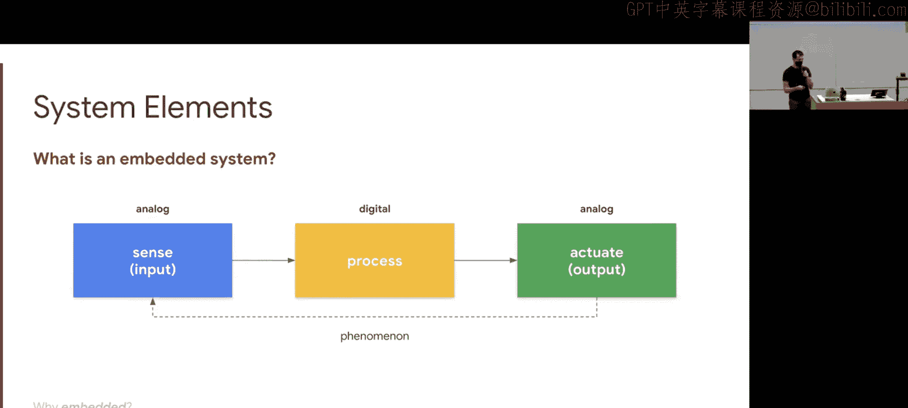
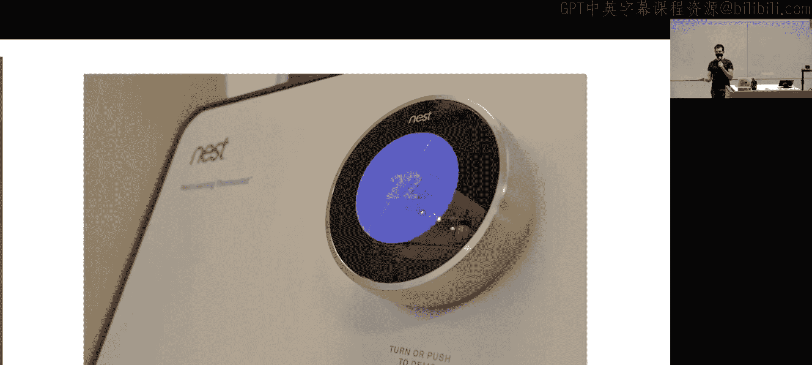
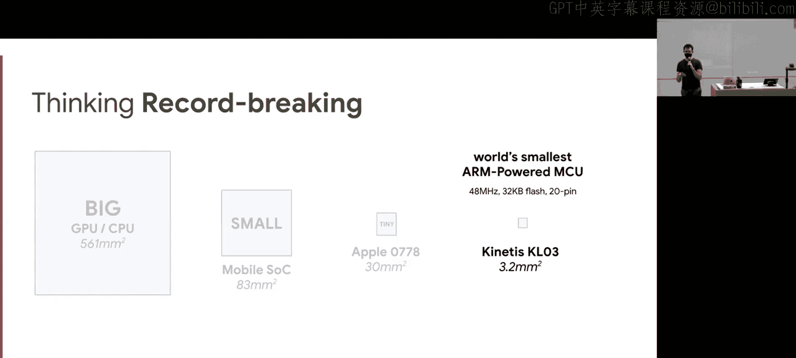
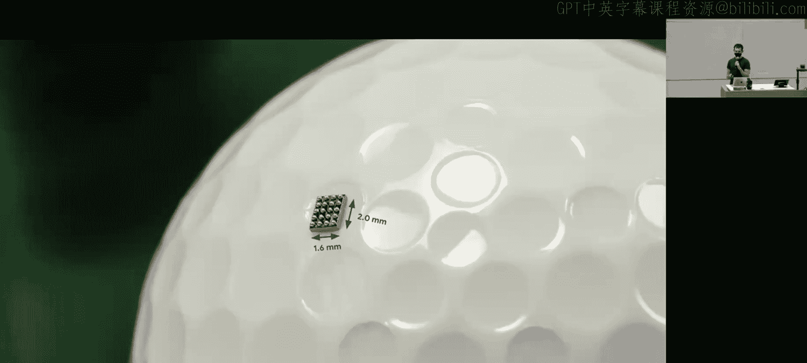
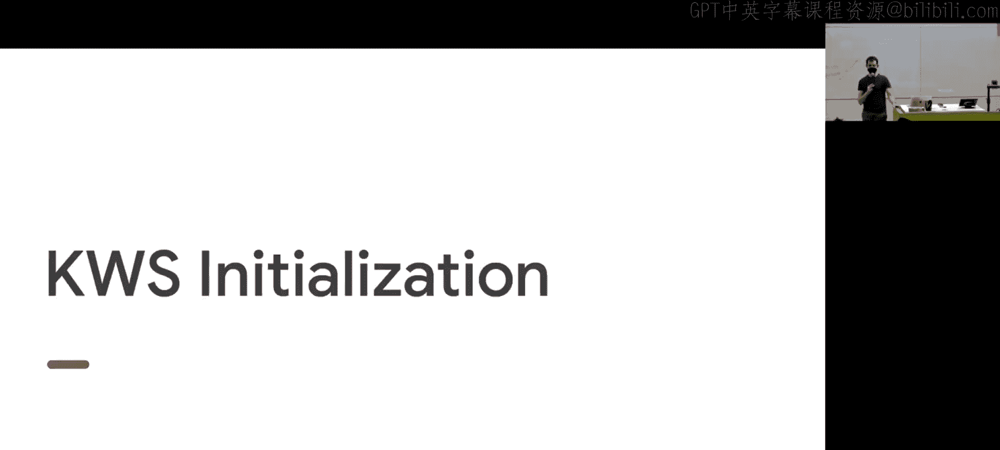

# 机器学习硬件和系统：第6讲：TinyML 🧠

在本节课中，我们将要学习一个与之前截然不同的主题：TinyML。我们将探讨如何在最轻量级的计算硬件上运行机器学习，了解其独特的挑战、应用场景以及相关的软硬件栈。

## 概述

到目前为止，我们的课程重点一直放在数据中心和用于处理大型工作负载的重型硬件上。然而，今天的课程将转向另一个极端：我们将讨论最轻量级的计算机硬件，以及如何在其上运行机器学习。这项挑战如此之大，以至于人们为它起了一个专门的名字——TinyML。

## 什么是嵌入式系统？🔌

在深入了解TinyML之前，我们需要先理解什么是嵌入式系统。

嵌入式系统是一种以处理器为核心，但输入来自实际传感器，输出则控制执行器的系统。这与常规计算机不同，常规计算机通常通过以太网、鼠标或键盘等设备进行交互。嵌入式系统被设计成可以与周围环境互动。

以下是嵌入式系统的几个例子：
*   **智能手表**：其传感器包括加速度计、GPS和心率监测器。它有一个微小的处理器，输出则显示在LCD屏幕上。
*   **智能恒温器**：输入来自旋转调节、温度和湿度传感器。输出是控制温度的控制信号。
*   **日常设备**：如电视遥控器、洗衣机、微波炉等，内部都包含微控制器。

## 什么是TinyML？🤖

TinyML是嵌入式系统与机器学习的结合。人们认为机器学习非常重要，它将成为我们编写软件的新方式，也是理解环境中各种传感器输入的新方法。将机器学习部署到嵌入式系统上，就是所谓的TinyML。

上一节我们介绍了嵌入式系统，本节中我们来看看TinyML与传统机器学习在输入感知上的区别。

### 感知输入

传统机器学习主要关注两个领域的传感器：麦克风（语音）和摄像头（图像）。此外还有一些其他数据输入，如文本。

对于嵌入式设备，我们拥有更广泛的传感器阵列：
*   我们仍然有**语音**和**图像**传感器。
*   我们还拥有**惯性测量单元**。IMU通常包含加速度计、陀螺仪和磁力计，用于许多应用，如运动检测、计步，甚至可以替代传统传感器（例如，某些耳机在外部环境嘈杂时，会切换到内部的IMU来检测耳内振动以传输声音）。
*   IMU等传感器的功耗比小型摄像头低一个数量级，更适合低功耗嵌入式系统。

然而，处理这些嵌入式传感器数据也面临挑战：
*   **可解释性**：图像和语音数据人类可以直接理解，但IMU等传感器的数据有时更难解读。
*   **传感器漂移**：随着时间的推移，测量振动、磁性或方向等的传感器可能会性能下降，需要重新校准。

## TinyML的处理核心与约束 ⚙️

我们讨论了输入感知，现在让我们谈谈处理部分，这也是在TinyML系统上实现机器学习的主要约束所在。

以下是不同处理设备的尺寸和功耗对比：
*   **高端GPU**：芯片面积约为数百平方毫米，功耗约为300瓦。
*   **手机处理器**：芯片面积约为83平方毫米，功耗约为10瓦。
*   **智能手表处理器**：芯片面积约为30平方毫米。
*   **微型微控制器**：例如，一款运行在48MHz、具有32KB闪存和20个引脚的ARM MCU，尺寸仅为3.2毫米 x 3.2毫米。与大型GPU相比，它小了约100倍。

这些MCU虽然微小，但数量庞大，无处不在。其使用趋势正在上升，价格低廉（有些低于1美元），预计未来需求会更大。功耗方面，可以从GPU的数百瓦降至MCU的数百微瓦，这使得它们能够使用纽扣电池运行长达一年。

## TinyML开发套件介绍 🧰

你们面前都有一套开发套件，我们将用它来完成第二次作业。以下是套件中包含的主要组件：

*   **开发板**：基于ARM Cortex-M4处理器，具有1MB闪存和256KB RAM。
*   **多种传感器**：包括颜色、光线、接近、温度、湿度传感器和麦克风。
*   **蓝牙模块**。
*   **摄像头模块**：0.3兆像素，可用于形状检测和分类等。
*   **扩展板**：用于连接MCU板、电源、USB模块、额外按钮、LED和其他外设。

在作业中，我们将主要使用**麦克风**来实现一个简单的**关键词检测**应用。该应用将检测几个单词（如“开”、“关”、“音量增”、“音量减”），并根据检测结果点亮不同的LED。

## TinyML软件栈 🖥️

了解了硬件之后，本节我们来看看TinyML的软件部分，它也与常规软件有很大不同。

在嵌入式系统上，软件栈通常包括：
*   **操作系统**：不是Windows、Linux或Android，而是非常简单的专用操作系统，甚至是“裸机”运行（无操作系统）。
*   **应用程序与库**：例如Arduino软件库。

一个关键的考虑因素是**内存使用**。在关键词检测应用中，大部分内存用于音频输入缓冲，模型本身也占用一部分，因此需要通过量化、压缩和剪枝等技术使模型尽可能小。此外，还需要为应用程序、库和框架代码预留内存。

我们将使用**TensorFlow Lite Micro**框架来部署模型。其关键优势包括：
*   与TensorFlow兼容（我们将通过ONNX从PyTorch转换而来）。
*   无需操作系统，可在裸机上运行。
*   设计为可移植到多种平台。

TFLite Micro的工作流程如下：
1.  定义模型中实际使用的操作（层），以节省内存。
2.  将模型加载到TFLite Micro解释器中。
3.  将模型输入（如缓冲的语音数据）复制到输入张量。
4.  调用`Invoke`函数运行模型。
5.  获取模型输出并根据其执行相应操作（如点亮LED）。

模型以**FlatBuffer**格式（一个字节数组）存储，包含了所有权重、层类型和连接信息。部署步骤是：在PyTorch/TensorFlow中训练模型 -> 转换为FlatBuffer -> 由嵌入式系统上的TFLite Micro解释器加载运行。

## 内存管理与优化 🧠

我们反复提到要关注内存，这主要是因为MCU具有非常受限的内存限制，并且需要长时间持续运行。

一个关键问题是**内存碎片化**。在长时间运行且动态分配/释放内存的程序中，即使总空闲内存足够，也可能无法分配一块大的连续内存，导致程序无法运行。

在TFLite Micro中，通过使用**张量竞技场**来解决这个问题。开发者预分配一个固定大小的缓冲区（竞技场）交给框架，框架在初始化时分配好所有内存，并保证之后不会动态分配，从而避免碎片化并确保内存使用有明确的预算。

如何确定张量竞技场的大小？这取决于模型大小、解释器状态等因素。通常的工程方法是：先分配一个较大的空间，运行程序并分析其实际使用量，然后根据分析结果调整到合适的大小。

## 模型部署与优化工作流 🔄

最后，我们来概述一下将机器学习模型部署到MCU的完整工作流，这也会在你们的作业中体现。

整个工作流包括以下步骤：
1.  **数据收集与预处理**：收集数据并进行预处理（如对于语音，转换为MFCC谱图）。
2.  **模型设计与训练**：设计神经网络架构并在PyTorch中训练。
3.  **模型评估与优化**：使用剪枝、量化等技术优化模型。
4.  **模型转换**：通过提供的脚本将PyTorch模型转换为TFLite Micro可用的FlatBuffer格式。
5.  **部署与推理**：将模型部署到MCU，并在实际硬件上进行推理。

在关键词检测应用的主循环中，流程如下：
*   **麦克风输入**：持续从麦克风捕获音频。
*   **特征提取**：将音频波形转换为MFCC谱图。
*   **模型推理**：将谱图输入神经网络模型进行分类。
*   **输出处理**：根据分类结果（如“是”、“否”、“上”、“下”）执行相应动作（如点亮红色或绿色LED）。

## 总结

本节课中我们一起学习了TinyML的核心概念。我们了解了什么是嵌入式系统和TinyML，探讨了其独特的传感器、微小的处理核心以及严苛的功耗和内存约束。我们介绍了用于实践TinyML的开发套件及其组件，深入研究了TinyML的软件栈，特别是TensorFlow Lite Micro框架的工作原理和内存管理策略。最后，我们概述了从模型训练到部署在MCU上的完整工作流程。TinyML使得在无处不在的微型设备上实现智能成为可能，开辟了机器学习应用的新前沿。