# 008：康奈尔大学《机器学习硬件和系统｜Cornell ECE 5545 Machine Learning Hardware and Systems》中英字幕 p08 -08-Lecture 7_ Quantization.zh_en -BV1CCqPYSEP5_p8-

If it helps。嗯。So today we're actually done with the hardware part of this course。

 or the first module called hardware， and we'll move on to now some kind of general efficiency techniques。

 which are very relevant to hardware but。

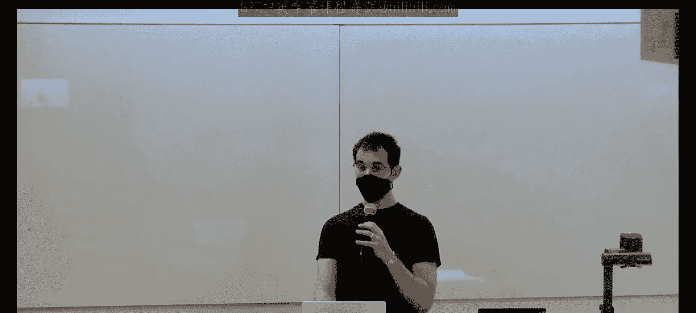

Do not necessarily speak to the design of hardware itself， rather the efficiency of neural networks。

So the first thing we'll talk about is quantization。Yes， James。

It's always posted right after the class。 Do you， do you like to follow kind of while the lecture is going that。

对。Okay， the， the thing is， there are these questions that I ask throughout the lecture。

 and then the answer is right afterwards。 So that's one reason to post it after the。

After the lecture。嗯。嗯。Okay， so if you haven't already taken one of those tiny ML kits。

 come to my office to get one， my office is 257， so you need that for next week when assignment2 is released。

Yeah， I already asked， how is a going if you do have any questions just drop by my office or send me an email。

 I'm usually in my office， huddle， I mean。And then I'm going to prepare a few slides about the term paper and the presentation next week as well because I've gotten a few questions about that。

 but yeah， so you'll know more about it next week。So this is kind of the overview of our courts。

 so so far we started with this first module and we talked about hardware。嗯。

So there we talked about how to design a hardware accelerator for neural networks。

 how to evaluate different accelerators and compare them to each other。

 a few efficiency techniques like parrssity and low precision and how that affects the power consumption and the area utilization even of a machine learning accelerator。

 and then we went a bit into microarchitect where we looked at the design of a processing element and what that looks like。

So so looking at kind of that first module， is there anything else you wanted to get out of the hardware module of this course。

 is there something you feel is like missing I don't know about that I wanted to know about it。

Or or is it kind of done。 Youre experts in hardware now， you're ready to move on， so。

You're all experts。No， yeah， so it's some people are saying no， some people are saying yes。So， yeah。

 so， yeah。 So I mean this。You know you know more than most people about hardware at this point。

 machine learning hardware， but obviously you only become an expert when you start designing one yourself or you kind of work with a piece of hardware and you compare it to other things in some kind of setting so we didn't really get much of that and unfortunately it's hard to fit into this course just because of kind of how many design tools we need for designing hardware and the。

Kin of the background knowledge as well。 But but if you do if you do have lingering questions or if you want to work in any kind of hardware project。

 feel free to follow up with me and I can lead you in the right direction as well。 But by now。

 you know more than most people about hardware。 So that's good。嗯。

So the next module is this neural networks module and these are general techniques to make neural networks more efficient。

 so oftentimes we apply those techniques because we want to get a specific throughput or a specific latency out of a constrained hardware platform。

But more and more I'm seeing that， you know， you need to apply those techniques anyways because deep learning workloads are becoming so heavy that even kind of the big data center hardware can't support that sustainably anymore。

 and you need to kind of apply these efficiency techniques regardless of whether you're doing it on a mobile phone or on a Tesla A100 GPU。

Right。Someone contacted me from a startup doing kind of these automated。

What do they call them like phone support people like they want to replace those phone support by just an automated system that speaks back to you like an AI system and I told them like why are you talking to me I build hardware and I do efficient kind of machine learning is like we need that anyways even if we're implementing our solution to the cloud it's all kind of a dollar cost to us we need to rent all of those AWS servers and it costs a lot of money so making our models more efficient is kind of our number one priority and we need to start team doing that and so yeah so these techniques are relevant if you're deploying a model to a mobile phone because without them you can't deploy it to a mobile phone but they're also super relevant if you're deploying your model to a data center because otherwise it costs money electricity and sometimes it just becomes infeasible as well。

So we will talk about quantization and the main motivation for that。

 you know going back to this slide here from the hardware lecture is that we save a lot of energy if we operate in lower numerical precision。

So you see here how you know， going from FP32 to N32 addition。

 we save about 9 x in energy consumption。The same is true in multiplication where we can save almost 18 times the energy between int8 and FP 32。

嗯。And finally， you know we also kind of scale the memory axis energy linearly with the number of bits。

 so if we're using four less bits， then you know it's four times more energy efficient when you're accessing memory by the way。

 when I say FP32 and int8， does everyone know what I mean by now？Yes， okay。 that's good。

So more benefits of quantization， I kind of touched upon this second point here。

 the power consumption or the energy consumption， but as I said。

 you know you also save a lot on memory and not just the energy to bring data from memory onto your chip but also just the memory storage。

 so we looked at these MCUs and how they have very small flash by kind of quantizing your numbers to8 bit precision from FP32 for example。

 you need a quarter of that storage and so for constrained systems where you don't have enough memory。

 this is also really useful。Latency， obviously when you。When you have a more efficient circuit， A。

 you can stamp out more of it on the chip and therefore do things faster and B。

 you know you access the memory less often because your data words are now much smaller。

 so this also speeds up your application if it's memory bound。And finally， Silicon area。

 which is again， it's always。Directly proportional to your power savings， so your saving area。

 so you're also saving power， so you can build more of this thing。

 more of these PEs on the chip or you can just have a smaller chip and save power。

 so it's always a trade off that way。Okay so what is quantization so I copy this from Wikipedia so basically quantization。

 it's the process of mapping input values from a large set to a small set that large set is often continuous so something like real numbers so real numbers are continuous have infinite precision and then you were mapping it to accountable smaller set so like into eight numbers which has exactly 256 values that it can assume and so how do you do that mapping that's called quantization。

And so quantization is not a new thing， so if you took any communication course or yeah like in classical engineering courses related to communication。

 they talk a lot about quantization because in communication you're sending waves and waves have continuous values and then you need to sample them and you need to quantize them send them through an analog digital converter and deal them in the digital domain using bits and so quantization has been around for a long time。

 it's just been adapted to kind of this field of neural networks and it's starting to mean essentially going from floating point precision to integer precision or a large number of bits to a small number of bits sometimes this floating point to floating point or integer to integer or fixed point to fixed point and so so that's kind of the new definition almost for us as people optimizing deep neural networks。

So whenever we talk about quantization you'll often see one of those two kind of figures。

 the first one is just a number line， so this is a number， here is zero。

 here are positive numbers and here are negative numbers and this is the domain that you're mapping from usually we denoted by R standing for real numbers and then to a quantized domain Q which has you know a specific number of bits in this case it's eight bits and goes from minus 127 to 127 and so that mapping process from the real value numbers to the quantized numbers that's called quantization。

And you often see it also plotted that way where your y axis is the quantization function。

 which maps values from the x axis onto this what looks like a step function。

So all of the values kind of in this range will map to the same quantized value。

 even though they have different real values， so that's usually what a quantization function looks like on a 2D plot。

Okay， yes， so as I said， kind of that term quantization has been there for a long time and it is being redefined for deep neural networks and you know when you see quantization written out there it's just it usually means at the moment going from FP32 to in8 that's not the only quantization possible but that's what it usually means nowadays and that's what we'll focus on here but like I said there are many kinds of quantization which do not mean that。

So so what are we mapping right like how many how many distinct numbers are we mapping from and how many distinct numbers are we mapping to unlike kind of the formal definition of quantization that you're going from real values we're actually interested in going from these floating point values right and in FP32 you can map about you have about 4 billion distinct numbers that you can represent right you have a 32 bits I think eight of them are for the exponent and some of them are for the Anisa 23 I think and one bit is for the sign if you kind of work that out using pen and paper you'll find that you have about 4 billion numbers that are representable in FP32。

We want to go to int8， which has exactly 256 numbers that you can represent。

 So you're definitely kind of reducing your。Representational capacity of this numbering system。

 by a lot。Like， I don't know。 What is this。Like 10 orders of magnitude。

 something like that or seven orders of magnitude， so you're reducing this representational capacity by like a very large amount so have to be careful there。

You're also reducing your range by a lot， so the largest number you can represent in FP32 is really huge。

 it's 10 to the power of 38， whereas the largest number you can represent an into8 is 255 if you're using unsigned numbers。

And so how is this possible， how does it work if you go from FP 32 to in8 and you can still run a neural network and get meaningful results at the output。

And the answer lies in， okay neural networks are very tolerant to reduce precision。

 they have a lot of redundancy and all of these things。

 but it's also the way we train neural networks， the way we normalize numbers within them。

 you usually end up with a distribution of numbers that looks a lot like a normal distribution or Gaussian distribution doesn't always look like that and it really depends on how you train it and what optimizers you use but typically it looks something like that usually your numerical range is quite small and minus5 to5 is just an example。

 I've seen it from minus 0。5 to 0。5 as well。嗯。But but yeah。

 so so basically your trained parameters usually fall within that。You know， that kind of nice。

 simple distribution with a relatively small range。

So what about my inputs so I'm talking now about parameters or trained parameters for inputs it's a similar story as well you'll often hear this term you know in domain inputs or out of domain inputs usually the domain that you're operating on has some reasonable values so you know images they're already actually usually represented in eight bit numbers you know you have three channels RGB each channel has an eight bit number representing the intensity of that color you also have you know larger bit images and smaller bit images as well but usually your domain of natural occurring data like images or speech is quite limited in its numerical ranges and so for those three reasons you know quantization often works even though you're mapping from that very large range to this very small range。

Okay so so so that's kind of just an intro to what quantization is。

 but you know we really want to dive deep into what does quantization mean for neural networks so you know we have a neural network here and we want to quantize it what should we care about。

So I mean the first question that comes to my mind is should we care about weights or activations。

 so parameters or inputs so which one of those are we going to quantize。

 so that's an important question to answer。Do we use linear or nonlinear quantization right。

 and if you don't know what that means you will by the end of this lecture。

Do we use symmetric or asymmetric quantization， These are two different types of linear quantization as well。

What do we do during training， can we somehow regularize training to improve the results of a quantized model。

 so that's something called quantization aware training。And where do we apply quantization。

 do we apply it for training to make training more efficient。

 or do we apply it to inference to make inference more efficient？

Usually you'll find that it's applied to inference。

 but there are cases where it's applied to training as well。

And you know quantization involves mathematical simple mathematical operations like crowding and clipping and truncation so what about those what do those induce error。

 what kind of error do they induce what is the trade off there and finally what is the granularity of my quantization do I do it per network do I quantize the whole network using the same range or do I quantize each tensor in my network using a specific range or do I quantize each channel in my network using。

A specific range as well。 So what is the granularity。

 So these are all questions that we'll try to answer in this lecture。 And by the end。

 you should know all about these things。 S 3。ChanSo so I'm using here kind of terminology from mainly the image domain where you know an image has typically an image has three channels。

 red， green and blue， it refers to kind of the different colors but as you move through the neural network you're also adding more channels they're called them feature channels so you know your inputottensor is three channels。

 but then usually it turns into 16 and then goes all the way up to 2 k channels。

 2000 channels and then kind of you do your classification that way。嗯。

So it's basically the third dimension of a tensor。Okay。

 so let's start with the basics and back to our number line。

 so here I have a number line with some example numbers， real numbers represented here。

 and then I want to map it to a quantized domain and so that is called quantization。

And so what is happening here， what is the function that I'm applying to my numbers？

So I have a quantized number。Equal something。A function and the input is a real number。

So what kind of function is this， what does it look like？嗯。嗯。😊，That's right。

 so it looks like that step function that we looked at at the beginning。If I want to write it out。

 what would it look like？Some of step functions。Right。Oh， I see。 I think that could work actually。

 but there's still a simpler there's an even simpler method to write it out。😊，嗯。And I mean。

 it looks something like this。So basically I take my real number。I divide it by some number。

 which I'll call a scale。And then I added to a number that I call a zero point。

And then I clip the whole thing based on my range， so my range in this case is from zero to2 to the power of B minus1。

So if I haven't already， I don't think I've mentioned it。

 but B here is the number of bits that I am using in my quantized number and so usually if you know if you have b bits then you can go from zero to to two the bar of b minus1 numbers right so if I have four bits I can represent numbers from zero to two this is wrong。

To2 to the power of 4 minus1， so 0 to 15。 so that you know stands for0，0，00 all the way to 11，1，1。

Right。And so that's my quantized range。So I need to clip if I go over that range and then for all of the numbers。

 these real values， I'm dividing them by a scale factor and adding them to a zero point and that's general quantization from real values to quantized values。

So the next question becomes how do I find my scale and zero point。

 it seems that those are essential for doing this quantization process。

 so can someone think of how to calculate that scale？嗯。我。O。

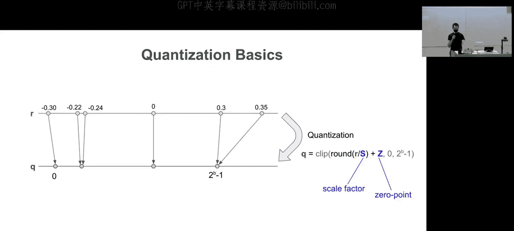

Actually I skipped this slide so we'll go back to the scale。

 but before we even talk about the scale in this zero point。

 do you think this is linear or nonlinear quantization and do you think it is symmetric or asymmetric so who thinks it's linear and symmetric quantization？

Who thinks based one person。2 and a half3 and a half。 Okay。

 Who thinks it's linear and asymmetric quantization。More people， okay。

 who thinks it's non nonlinear quantization。Okay good so so it is kind of a trick question because this function is a nonlinear function because of this clip that I have right but this is the function for linear quantization and so everything inside of that clip is a linear function I mean it still has around but but this is basically what's called linear quantization I can map from my real values to my quantized values using a function a simple function that I can write out and compute and and it's kind of linear let's call it that way whether it's symmetric or asymmetric depends on my zero point it doesn't really depend on this function So if the zero point is zero that's what we call symmetric if it's a value then it is asymmetric。

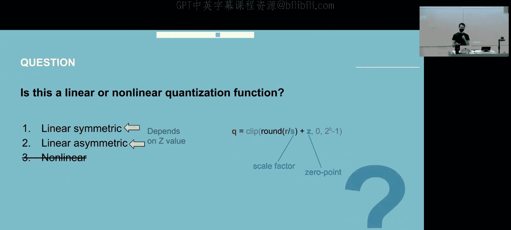

And so coming back to that scale factor， hopefully you had a bit of time to think about it now， yes。

 Rami。Yeah， yeah， we'll get to it here， but it's a good question because I haven't really said so。嗯。

So coming back to our scale factor， so how I compute that is you know I pick a maximum and minimum value that I want to represent from my continuous real values。

 so as I said you can represent up to like 4 billion numbers and10 to the power of 38。

 what is the maximum value I want to represent in my quantized numbers and usually you look at your numerical distribution。

So， you know， it looks something like this， so you pick， you know， an arm in and an Rax somehow。

There are different ways of choosing that， sometimes you choose just the smallest and largest number you have。

 sometimes you choose you know the smallest and largest number。

 you take like at your like 90th quartile or something like that so you just ignore those numbers and you clip them sometimes you do other algorithms and sometimes you actually learn those values using an optimization algorithm as well。

But basically now I've decided you know this is the largest number that I want to represent。

 this is the smallest number I want to represent and so to answer Rashmi's question。

 what I'm going to clip is any number greater than R max basically it's going to map onto the same value as my largest number right so that's the clipping function。

And then my scale factor is simply you R maxax minus R min divided by the number of bits。Right。

 so what am I doing here。I'm doing， you 0。3， that's the largest number。Minus negative 0。

3 divided by the number of bits。 let's always use8 bits as our example， so you know it has 256 bits。

I think this is supposed to be 255 but it doesn't really matter， so that's equal 0。

6 divided by 255 and so that's my scale factor。Right。

And so now what this will do is that it will map at least if I plug this scale factor into the equation。

 now if I have the value 0。3，I will divide it by， you know my scale factor。So 0。3 divided by 0。

6 times 255。Which is equal to。1，27。05， but then I have a rounding function。

And so what this is doing is that it's changing the range of my numbers from whatever range they have。

 which is R min to R max， to my new range， which is 0 to2 to the power of b minus1。

So that's my new range and this is my old range I'm just creating a mapping one to one you know I used to have an open3 I want to represent it using eight bits now I'm represent because this is the maximum value I'm presenting it by that maximum value。

嗯。Right and then to make it even more general， I add the zero point so what is the zero point。

 the zero point is very simply what is the value that I'm going to map my zero to so can someone guess what the zero point here is？

I actually have a zero on the on the Q line。So。So it's not zero， but usually in a lot of cases。

 it is zero， but in this case， it isn't。嗯。I'm sorry， who's stopping。Yeah， that's right。

 So in this case that's what I chose。 I mean you you you can't infer it 100% from this diagram。

 but that's actually what I chose it to be。 So now I've taken this number。

You know it was it looked like this， I'm rounding it down， so it's 127。

 and I'm adding to a zero point， which is another 127。So my result is 255 so now the 0。

3 according to the scale factor computed by this and the 0 point chosen as you know the value 127。

 I can map this 0。3 down to 255 here if this is a bit quantization。Yeah， yeah。

 that's a great question。 And it does matter。 And so I have one slide about that。

 but you will find like many papers on on rounding。嗯。O。So is this now kind of 100% clear？Yes。

 Russian。Yeah， that's right。So basically， it all depends on your choice of where the zero point is。

In this simple example， I just mapped to an unsigned number。

 but you can also map to assigned signed number and choose your 0。2 be0， for example。

 so that's also possible。And I mentioned clipping quickly in the middle。

 but basically clipping is what happens you know to any number that is larger than your 2 to the power of b minus1。

 so if we apply the same equation and 0。35 here because it's outside of our range is' bigger than R max。

 then this clip function will clip it down to 2 to the power of b minus1 which is 255 so you'll see that those two numbers are mapping to this one here。

Right。Okay， any。该可以。有。Yeah， exactly yeah。All right。Okay， so that's the quantization process。

 so what about decoquantitization， how do I go back from my quantized domain into real valued numbers？

And so the equation here looks even simpler， so it is kind of the inverse of this one。

So the real number is equal to the scale times the quant number minus z。

And so if you rearrange this equation and get rid of some of those nonlinearities。

 then you'll come up with this， and I think that's why it's called linear quantization because this mapping is obviously a linear one。

嗯。And so what happened here like the output numbers have now lost some information right so I did this mapping some numbers aliaed onto the same number like here and here some numbers were clipped。

 some number were outside of my range， some numbers were rounded and so。So I'm getting some error。

So the quantization error is basically the main reason quantization doesn't work perfectly and that's why you know。

That's what we're trying to minimize as people doing quantization or we're trying to make our neural network more resilient to those quantization errors so what are they there are two sources of errors from this kind of quantization first one is called clipping error。

 so any number that I clip。Introduces an error obviously because it's no longer mapped to my quantized range it's outside of the range and I have to clip it down to the maximum value。

 it saturates。So that's kind of denoted here， you see this 0。35， I mapped it to a number。

 when I mapped it back， it was a much smaller number， so this is a clipping error。And then。

There is also rounding error so here I see that number minus 0。

22 it's mapped to that number when I map it back there is a difference between the original number and what the deco quantantized equivalent looks like so that's called the rounding error and it is bound by your scale factor basically I also want you to think of the scale factor as your step。

So so this scale factor is the size of your step。 So if anything in your real valued numbers up here。

 this is。If you get any number and add this to it， then it would correspond to a plus one in your quantized range if that makes sense。

 so this is your step in the real value domain that corresponds to one step in the quantized domain。

And so the rounding error is usually from minus half of that step to half of that scale factor。

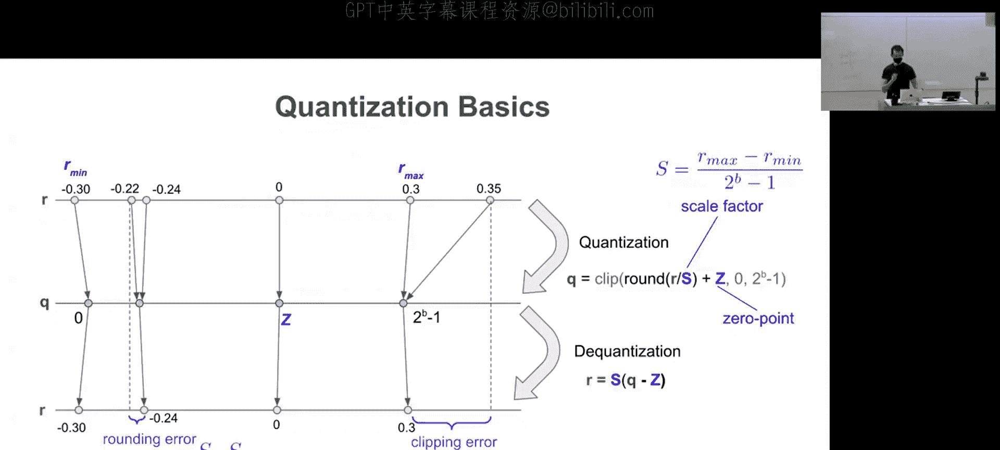

Okay， so now you know I'm designing this quantization system。

 so how do I make this rounding error smaller？嗯。What do you think so here's the equation again for the rounding error。

Do I increase RmX？So I get to choose the range that I'm quantizing and so how can I change that range to make the rounding error smaller？

嗯。嗯， yeah。Right， yeah， so Sam Sam right Sam said increase R min and decrease r max to have a smaller range。

 So a smaller range means a smaller step size and the equation just says。

 you know if the step size or your scale factor is smaller then your error is smaller because you can represent numbers at a finer granularity。

 your step becomes much smaller and so you get less rounding error that's correct。

 So so that's what you do to decrease your round error。

 but what is kind of the bad side effect of this， if I decrease if I decrease my range。

 then all of a sudden now you know I'm pushing this R max in this direction I'm pushing this R min to this direction and so that increases my clipping error。

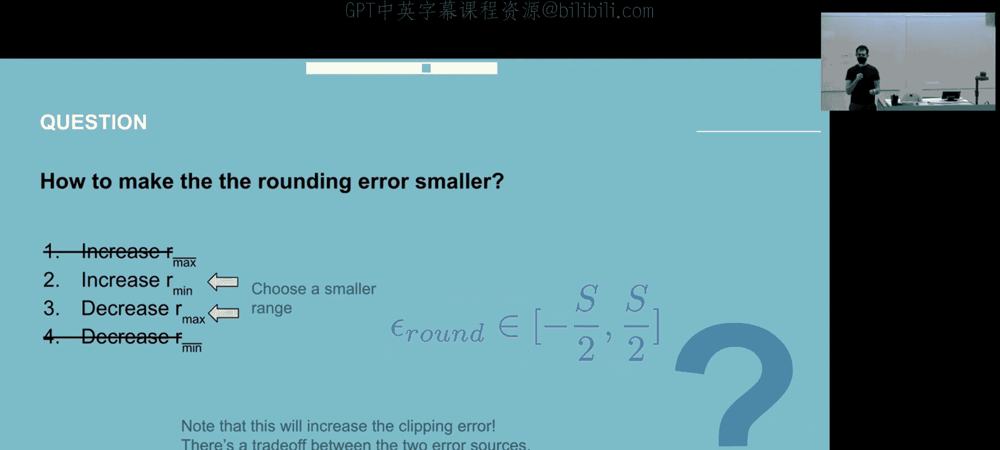

So usually there is a tradeoff between rounding error and clipping error。

 and you have to be careful when you're choosing that。OK。

Okay so Harish haish right so Harish asked about rounding and so actually when we were working on our accelerator back at Intel we used to just clip the number so basically we used to always round down because that's the cheapest thing to do in hardware you don't look at your kind of remainder you don't do anything with it you just you know get rid of it and that works really bad so we found that we dropped a lot of accuracy and you'll see in this table here which is from a paper kind of investigating different rounding schemes。

Your accuracy drops to 0。1 basically your model becomes broken， something。

 but it really affects your accuracy basically， and so this is from a paper where they do quantization down to four bits。

 so a very small number and when they use the floor function for rounding。

 you know you lost all of your accuracy。When you use the ceiling function for rounding you lost all of your accuracy as well Basically what these functions do is that they introduce a bias and when your numerical range is0 to 16。

 this introduces a very large bias in your network and it breaks everything a very good rounding function and a safe bet is around to nearest which is typically how you would drown the number just you' round it up if you know closer to that up numberumb you' round it down if it's closer to that down number so that you know gives you an accuracy of 52% but then the people in that paper found that you know if you're around randomly。

Up or down， you also get close to that round to nearest number， so every time you need to round。

 you just randomly either round up or round down。嗯。So that's called stochastic grounding。

And but obviously， it has a large kind of standard deviation because it's random。

 like sometimes you get it right， sometimes you get it wrong。

But the best the best result from this stochastic rounding is actually way better than round to nearest the rest of this paper and if you're interested it's down there in the source goes through a way of doing adaptive routing and rounduting and learning kind of the rounding scheme as you're doing training and so that's a really cool paper。

And by the way， I'm talking about this surrounding function， right？有。Yeah good question。

 I don't remember exactly what they did there， but it has some overhead obviously。

 so going to that paper will give you the answer。Okay。

Okay so so far kind of we covered some of those points， we talked about you know linear quantization。

 how to go and quantize， how to de quantize， we talked about both symmetric and asymmetric and that it depends on basically the zero point and finally we talked about rounding and clipping error and also different kinds of rounding。

Yeah， so logarithmic grounding is definitely very useful and some people use it man。

 I should add the slide on it， but I don't have one it will be in the book though。

 So if you go through your readings， you'll read more about logarithmic grounding as well。嗯，So。

So logarithmic grounding is basically that function has a log in it and it's nice because。

You know if you look at the distribution， you actually have a lot of numbers here。

 so linear rounding or not rounding， linear quantization basically assign numbers equally along that number line so you know you have a value here。

 a value here， a value here， a value here and so on so even though you have so many numbers here and you probably want better resolution here。

 you still have the same kind of scale factor so it's a single scale factor throughout。

Loarithmic quantization changes that scale factor based on where you are so usually it works well for something that looks like this where you need a lot of resolution here and then not so much here。

 so it gets kind of more spaced out and then there's something called nonlinear rounding which we'll also talk about which is a general way of doing this as well。

Okay， let's move on so linear quantization so that's what we've been discussing so far now let's apply this linear quantization on a matrix multiplication。

So we have weight matrix W， activation matrix X， and we want a result y out from multiplying those two matrices。

So so if I want to do that matrix multiplication now in the quantized domain y becomes approximately equal to this function and so how did I get this function I basically plugged in that quantization equation I have in the corner into W and x so now I have a scale factor for w I have the quantized version of w so it's all quantized to let's say8 bit and I have a zero point for w right the same is true for the activation so I computed you know a scale factor and the zero point and I quantized my x。

My extensor。Does that make sense， so now that's quantized matrix multiplication。Make sense， yes。ok。嗯。

And so if my linear quantization scheme is symmetric， then all of my zero points are zero。

And so it simply becomes， you know I have the two scale factors multiplied by each other and then the normal matrix multiplication。

 but now it's with quantized numbers， so now I get to do kind of quantized arithmetic here so this is eight bit arithmetic and then I just have the scale factors that I multiply with。

And so James to your earlier question where when you ask kind of what happens to the numbers where are they and so the y value doesn't change here right。

 because I am multiplying by those scale factors， but just the product of W and x now has a much has a different range。

 it goes from， for example to0 to 255。But I still have those scale factors here so y is approximately the same y in my floating point multiplication right it just you know if I multiply out the scale factor you get approximately the same result obviously it's not exactly the same result because I have a quantization error。

 but I need to maintain the same arithmetic throughout my network and so I still have those numbers here that I need to multiply with。

And so what happens in the asymmetric case so here in the symmetric case the overhead is quite small because I have this just one constant scalar value that I need to multiply with all the numbers after they come out of the quant multiplication。

 so this scale factors here， but for asymmetric I basically need to multiply out this equation because my zero values are no longer zero。

So it took something like this， right， so it's no longer just matrix multiplication。

 it's matrix multiplication plus something plus something else and plus something else。

And the colors are confusing so I color it in a different way to show what numbers are actually constant scalarrs versus what numbers are matrices and change and so you'll find that you know the first term is the same。

As my symmetric quantization so it's just a scaled matrix multiplication basically can still do it in the quantized domain and then there are two numbers which are basically all constants and what I do with those typically is that I fold these into my bias addition so usually you know in a linear layer something you have matrix multiplication plus bias or in convolution layer the same thing you have a convolution plus bias and so these values are just a constant scalar value that you're adding to all of your numbers so I just fold it into the bias yeah。

WQ oh， that's a great question Har so W so Har is saying you know WQ is a matrix。

 it's not a constant value and that's true。So it's not a scalar so I said scalar and that was wrong Harrisish corrected me that's a good point but it is constant during inference so that's kind of one implicit thing I've been that's one implicit assumption I've been making so far as well is that we're doing this during inference after we trained our model and our weights are a constant thing that don't change at all and so all of these numbers become constant now which like I said I can fold into the bisedition。

Whereas I have this extra term which I cannot fold because I don't know the X value beforehand so I need to do this extra computation and this is called you know quantization overhead so you don't just get to do your math in lower precision arithmetic you also have this overhead if you want to support asymmetric quantization that you need to compute online and it's roughly equal to the overhead of adding one channel to your tensor so if you have many channels then it becomes a small overhead if you have very few channels it's a large chunk of your computation。

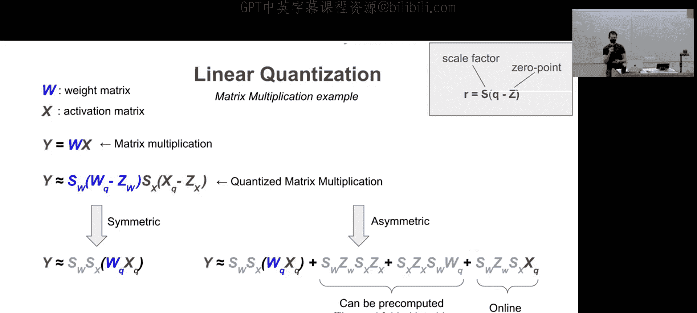

嗯。So how do I get rid of this online overhead of asymmetric quantization。

 what is one simple way of just forgetting about it， not having that extra overhead。是。

What do you think。So。So yeah， one thing I can do is。I can make that zero point equal to zero。

So so usually actually what people do is that they use asymmetric quantization for the activations and your inputs。

But they use symmetric quantization for weights， so setting that Zw to0 means that you know my activations can still have asymmetric quantization that works well for activations actually。

 especially with kind of skewed nonlinear functions like Relu which really skews your activations to be on one side of the number line whereas weights are usually centered around zero or we try to do that during training so usually symmetric quantization works well for weights and it also simplifies my equation here and so so I don't have any real overhead from quantization in this case。

Does that make sense？

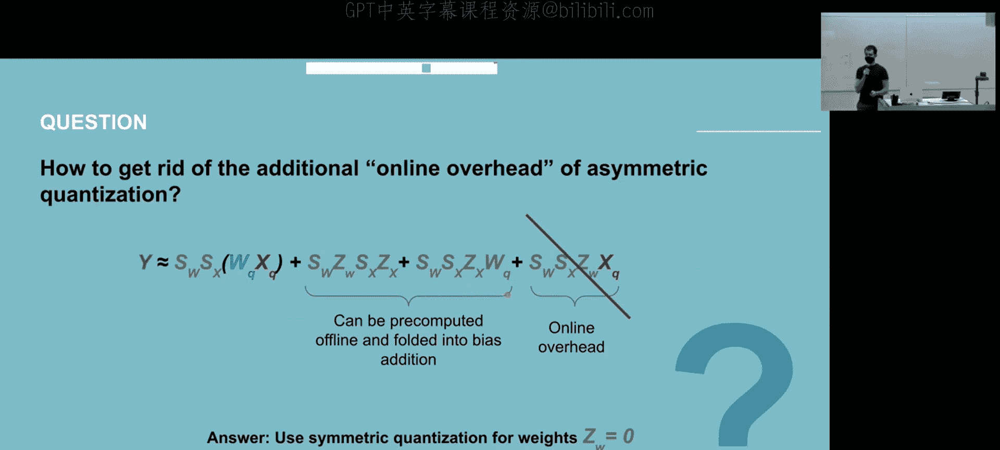

O。And so so I mentioned you know the scale value， the zero point。

 what is that granularity of choosing you know the scale value and the zero point。

 you know you can choose one scale value for your entire network that's possible but usually that's not a good choice because you know you have a very different numbers and yeah so you know you end up clipping your clipping error ends up being too large in some places and your rounding error ends up being too large in other places and so the different granularities you can do this at is you know per network per tensor so per weight tensor or per channel in that weight tensor so you break down that weight tensor into different pieces and you choose a range and zero point for each one of those pieces and in this case I'm just showing channels so here you know the three channels RGB each one of them I'm going to compute Rmax and R min and I'm going to select a zero point based on the numbers in that。

volumeolume。You can also go to different smaller granularities， but these are the most common ones。

 in current hardware you'll find that most of it that supports quantization will support per tensor quantization because it's kind of simpler and easier to think about but increasingly people are moving towards per channel because it has kind of the smallest effect on overall accuracy typically yeah。

Okay， so so we covered a bit more from that list， so we talked about weights and activations and went through that matrix multiplication example where we do quantization。

And we talked a bit more about symmetric and asymmetric quantization in that context as well。Oops。Oh。

 there's a question in this chat。Kim is asking when is asymmetric quantization useful so I gave one example of that。

So it's useful when you have a skewed numerical distribution like the one that comes out of Relo。

 which is all positive numbers basically so asymmetric quantization is useful there yeah and it really just depends on your numbers and asymmetric quantization is more general and more adaptable to your kind of numerical distribution and so usually it gives you the most flexibility whereas you take some of that flexibility away when you go to symmetric quantization。

Okay， and now let's。Try to cover。Some more of those things that we care about related to quantization。

嗯。O。So yes， implicitly， so far we have been talking about posttrain quantization。

 so I've trained my model， I want to deploy it on a phone， for example。

 and so to do that and to have it runly， I take that trained model。

 I try to change all of those weights to be into eight numbers instead of floating 。32。

And that's after training and then also the activations as they're coming in。

I'm changing them from FP 32 to in8 as well， and so you know I do the neural network training and then I move on to this post training quantization。

So so weights you know the weights are frozen and precomputed but what about activations right so I mean I have a training set which I've seen before。

 but what about you know my test set if I deploy this model to the wild like what what happens to how do I find the quantization range of my activations or my inputs for that matter right？

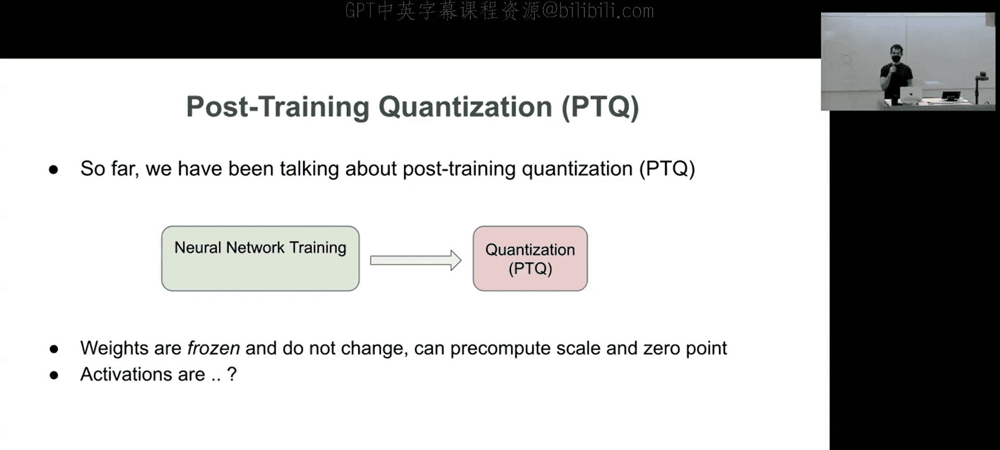

So how do I compute that？So for the waits it's easy， right。

 I have all the numbers that are already pre traineded， they're already there， but what about inputs？

But what's an approximate way of kind of finding the ranges？Of the inputs。

 how do I choose the scale in zero point？嗯。So when he said based on the task because each domain has kind of a specific range and that makes perfect sense to me。

 but what about let's say I'm looking only at black and white images in one application and the other one I'm looking at color images so or or I'm looking at images of cats and they all have a specific range of colors for example so yeah James。

So the mean of what and standard deviation of what。被告。Based on your training set。 Okay， so。

 so James said， let's just do it based on the training set。 and that's usually what people do。

 So they they either do it based on the training set or based on a representative test or validation set。

It doesn't have to be the training set， usually actually we do it on a validation set that wasn't used for training。

 but we just take a representative mini batch， we run it through the network。

 we store all of the intermediate activations we compute RX and R in， we compute the scale factor。

 we compute the zero point and so we basically we do it experimentally based on that single mini batch and hope that it extrapolates well to other inputs that we see when this application is running。

So you can take as many mini batches as you want， but usually a mini batch。

 like you should take a representative mini batch， let me put it that way or a representative batch of data。

Doing it on the entire training set maybe a bit too much， so you get diminishing returns basically。

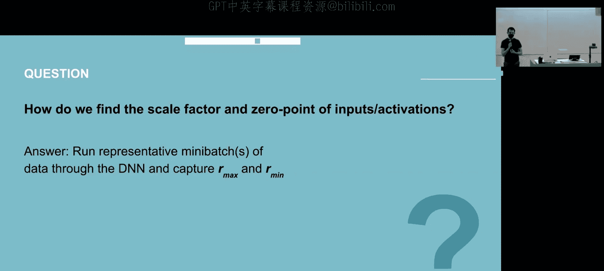

Okay， okay so that's posttrain quantization so you know the weights we have them。

 we compute the RmX and R min and like I said there are different ways of doing that and it should have had a slide about it but I don't but basically we usually usually take like 90th quantiles or something so we basically exclude outliers and then choose our Rax and R min to cover most of our numbers so 90% of our numbers or 95% or something like that。

So that's post training quantization， there is also something called quantization aware training。

 and so that's what we will talk about next。just。So。So as you know， post training quantization。

 you already trained your network without any awareness of the fact that you're going to quantize it afterwards。

 but in quantization aware training。During training， we add something called simulated quantization。

And why do we do that， we do that basically to make the neural network more robust to quantization。

 basically you're adding you're essentially adding your quantization error through the network to your loss。

 and so through back propagation you should nudge your weights in the right direction to compensate for that quantization error if that makes sense。

And so here is a simple graph of you know training。

 a convolutional layer followed by a bias addition， and then a relu relu6 activation function。

 and so to simulate quantization during training， we do something that's actually really simple。

We don't want to change our GPUs to support integer math， although they do now。

 but we don't want to support like change our training in any way。

 so we add these quant nodes here and what they're usually called is fake quantization nodes。

And what that means is that we basically take the numbers。

 we quantize them and then we dequantize them， and then we do the operation as normal before。

 so that's kind of the minimal change in my training graph to be able to simulate the effects of quantization。

So everything here is still FP32， all of the operations and everything I didn't change them at all。

 but all I did is you know my input here is float。And my output here is float as well。

 but what I did is that I quantized and then I de quantized。 So what what effect does that have， So。

 for example， you know， if I had this number 0。35。In my previous example， I quantize it。

 it goes to 255， and then I de quantantize it， it goes to 0。3。Exactly， so basically。

 I've introduced that quantization error between those two number。喂。嗯。A框。

And so now I'm simulating the effects of quantization without having to change my intermediate computations in any way。

 so I'm quantizing the numbers， the output is still float。

 it still looks a lot like the input number I don't change the math I don't have to add these extra biases or compute this running sum that I showed in the overhead of linear quantization but all I do is I quantize a de quantize and then that gives me。

Gives me most of what quantization actually does to your numbers。

The other benefit of this is that all of my numbers are still floating points。

 and so in the backward past I can add very small numbers to it。

 meaning that I can train effectively as well。嗯。So basically in the forward pass。

 I apply this quantization function to all of my inputs。

 but in the backward pass we actually use something called a straight through estimator and the straight through estimator is it's nothing。

 it basically says the gradient of this function is one。

Because you know I can't really compute the gradient of this it's zero here and undefined here zero here and undefined here zero here and undefined here so it's not meaningful so instead I just say a okay my gradient is one everywhere and this will work and then we try it and it works and we're all happy but that's basically what straight through estimator means we use it for a lot of quantization work so forward path we do the actual thing backward path we just propagate the gradients to make sure the training works。

Okay， so now we covered quantization and aware training as well。嗯。Yeah。Yeah。

 so that's a good question so in what context do we want to do simulated quantization during training basically what it's in the case where I want to perform post training quantization and I'm losing too much accuracy。

So I say， okay， instead of you know training my neural network without any awareness of the fact that it will be quantized later。

 I'm going to tell it， you're going to be quantized later and what does that have effect concretely on the training。

 it basically adds that quantization loss， you know aggregated from all of these errors of doing quantization。

 it gets added to my final loss of the network because it changes my final number in some wrong direction and then through back propagation。

 that error should nudge the weights in my network to compensate for that quantization loss as well。

If that makes sense， so basically if you're doing something during training。

 it helps it allows the training process to compensate for that thing that you're doing during training。

 which in this case is quantization so three。Yeah。关完这个。that。您能听到。很说。

Yeah yeah that's a great point so basically you want to simulate whatever quantization you'll do post training during training。

 so it's the same numerical precision and numerical format。Yeah， it。Yeah， there are no drawbacks。

 Usually it's only as effective as kind of adding half for 1% to your accuracy。 It doesn't kind of。

No， it's it's not the difference between 0 and 50% like we saw before with rounding it it gives you a marginal improvement with a marginal increase in GPU run time or whatever training chip runtime as well。

 So there is no reason not to do it It's just a bit of extra work， a bit of extra runtime so。Okay。

Now we're missing， you know we've been talking about linear quantization all that time。

 talked about how to do it， how to quantize de quantantize， you know do it during training。

 simulated during training， do it on a matrix multiplication and what the overhead is and all of that。

 but we haven't really talked about nonlinear quantization at all except due to Harrisish's question about logarithmic quantization。

 and so what is nonlinear quantization。And so so I think it's summarized well in this picture where you have a weird numerical distribution and you can see this during training I've seen it in some cases where you have kind of a two peak distribution。

😊，And what linear quantization will give you are those x's here。

You will choose kind of a discrete set of values that are equallyd spaced by the value of your scale factor。

 if you remember。And you know they cover a specific range that you define right so in this case this is the range that I chose because maybe some numbers are in that range here and so so even though most of my numbers live here and here。

This linear quantization， what it gives me is a numbering format in which numbers are equally spaced and do not really take into account your input distribution anyway。

What non nonlinear quantization gives you is a numbering system that exactly or approximately matches your input distribution。

So in this case， if I were to kind of draw by hand where I want to represent numbers。

 maybe I'll put these red dots here right okay I will want to have you know a number here to distinguish between this one and this one and then most of my numbers I will cluster them somewhere here close to that peak and somewhere here close to that peak because that's where most of my numbers live and so these are the numbers that I actually care about right so that's not nonlinear quantization。

And what the technique that people use for you know nonlinear quantization is usually a clustering algorithm。

 so until now people use something like K means clustering to do that。

 who knows what Ka means clustering is。a few people。 So yeah， I mean。

 it's an algorithm where when you have a few some numbers， you're basically trying to。

You know divide those numbers up into different clusters so you know we start by saying okay I want to have three clusters。

 those three colors here， all the numbers are in the blue cluster but then as my algorithm kind of operates we're changing what which cluster each set of numbers belong to and we end up with you know RGB clusters here so three clusters。

 three numbers associated with each cluster。And so what does this mean。

 so if I have a set of weights like this one？😊，I'm choosing。

I'm choosing a specific number to represent each group of numbers in that weight here in that weight matrix。

 it's represented by the color。So what I actually need to store now is not the actual number。

 so you know 2。09 and 1。92 1。872。12 I only store the index here so these blue numbers are all stored with index okay this is belongs to my cluster 1。

1111 right？And so what number represents that cluster。

 it's usually kind of the average of all of these numbers。And in Ka means terminology。

 it's the centroid of this cluster， so usually the average of the numbers that belong to that cluster。

嗯。So you know， if I have k clusters in this case， I need binary logarithm of k bits to represent those centroids so basically you know let's say I have。

8 clusters。 then I' would need。Lock to8 so three bits， three bits。 yeah。

 three bits to represent these cluster indice。 So the number of bits to represent my weights now goes down from。

 you know it what used to be FP 32。All the way down to three bits。

 so usually you can get really good compression with nonlinear quantization。

And so what do these three bits represent， they represent an index， so for example， you know 101。

 so that represents， you know this number corresponds to cluster 5 and it will be all represented using some kind of average or centroid for mymian cluster。

 so 3。189 for example。So any arbitraryies so still the number is FP 32。Still。The index。

Is a very small bit width number so three bits。This number is high accuracy though like it's high precision has a lot of decimal points And so yeah。

 so that's that's what it would look like for a 2D matrix so we will just you know need to store the cluster index in this case it's a two bit cluster index。

😊。

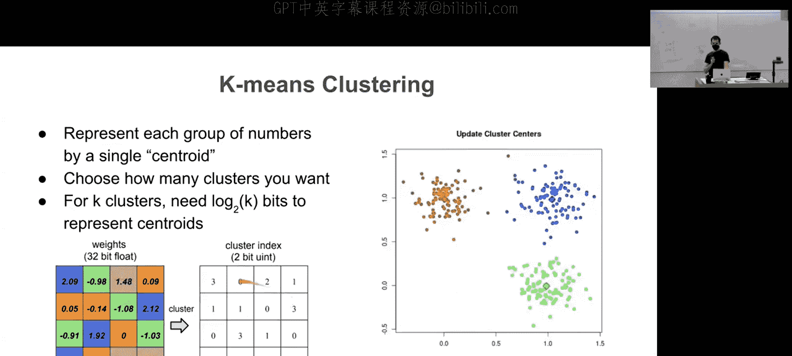

So。Okay， so I mean we talked about quantization and decoquitization functions before。

 so my quantization function here this K means clustering algorithm。

 so it's it's definitely a nonlinear function。 it performs this algorithm and it finds this this table of indices to。

You know， sorting point numbers。 But what is my decoquantitization function。So。Yeah。

 that's right so that's what we do but still what is the function to do the equal quantization so each each number now is represented by an index。

Right so how do I get the number？So。好吧。It's basically it's a lookup table right so I have each number is represented by an index like we saw here。

 so 301 and so on and so before I do the computation I just look up that index in something that's usually called a codebook if you read any paper it will be called a quantization codebook and so it will have a specific value corresponding to the centroid of that cluster that's representing my number。

😊。

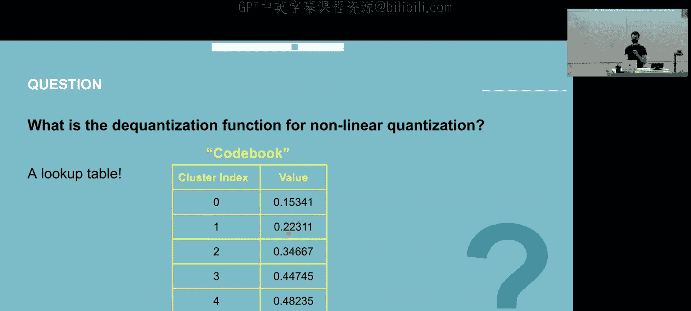

And so now if I have an FP32 operation like this one， this is matrix multiplication， for example。

 or convolution， I have FP32 inputs and FP32 weights and FP32 outputs in nonlinear quantization。

 all I do is that I encode my weights using this codebook and then before I do the computation。

 I look it up in the codebook and I do the computation。😊，So this doesn't actually affect my runtime。

 in fact it might slow down my runtime a little bit。

 but what it really benefits where it really benefits me is I have a much smaller model size。

 so my parameters become very small and usually at a very small accuracy loss as well。

So that's why we focused on linear quantization whenever we're talking about hardware we really care about linear quantization because you can do this reducedtic reduced precision arithmetic like8 bit matrix multi and so on in this case we're not doing that we just care about the storage。

 the memory footprint of my model and and that's the real benefit of nonlinear quantization so it could be the difference of you know using a DM chip to store your model or storing that whole thing in on chip memory and you can typically store the codebook in on chip as well on chip memory because it's usually very small。

And so it really benefits you definitely in memory bound applications or in a chip that doesn't have。

External memory or a large memory where you don't really care about runtime because you still have to do your computations in high precision。

Okay， so we covered most of that now for training part， I don't have a slide。

 go read the IBM paper on it， it's one of the recommended readings this week。

 but basically you can also just do training in lower precision to save energy and speed up training itself。

 so we've talked about inference so far， but you can also do it in training to make that faster or more power efficient。

And so someone at this point is thinking oh quantization is boring。

 you know you just use smaller numbers save energy so what right and so I just have this one example which is my last slide actually about something called product quantization which is a really interesting way of thinking about quantization as well。

 so if you think quantization is boring so far check this one out。

So basically here we're not quantizing each number。

 instead we're quantizing each group of numbers into something called a prototype。So again。

 if you're interested， read the paper， but I'll try to give you a quick rundown of what's happening here。

Let's say we have a vector A。And a vector B that we want to multiply。

What I do is that through a clustering algorithm again， like came meansian clustering。

I choose a shape that's closest to my piece of vector a。

 So in this case you know vector a it looks like a you know pyramid here or a triangle I look at a bunch of prototypes that I've already learned offline and I say oh。

 this looks a lot like this one so I'm going to approximate this group of numbers so this here is like let's say 16 numbers you know it starts with0。

125，8，11 and so on。 so the group of numbers have this pattern that's increasing and then decreasing so I'll represent this group of numbers using this shape that I learned offline which also looks very similar And so what I'm doing here is that I'm doing quantization not on the single number granularity but on a vector granularity so I'm replacing this group of numbers by this prototype。

And then this other part looks like this like a semicircle， so oh， it looks a bit like this one。

 so this is what I'll represent it with。And so on， and so now I encode this whole data vector。

 let's say it has， I don't know， each prototype has 16 numbers， so the whole thing has 48 numbers。

 I'm representing it now by these three numbers and exactly six bits which correspond to the index of my prototype。

And then I want to multiply it by this query vector B， or what's called the query vector B here。

And do a do product basically and so what I do is again， I match those with my prototypes here。

And I can store all of the multiplications， the pairwise multiplications of those prototypes offline in a table。

 so I say you know if I have this prototype， this red one multiplied by this double permitting or double you know ridge thing here。

 then the number that I get out is three。And then I look up that number， I put it here。

 and then here if I multiply this prototype with this prototype， the number should be one and so on。

 and so to compute that whole dot product，I've now approximated my vectors using these prototypes。

 I've already precomputed all of the values of doing a dot product between those prototypes offline。

 put it in a huge table， and then all I need to do is just add those pre computeuted numbers and I get a result。

So this is from an interesting paper published last year called multiplying matrices Without multiplying。

 and so this is an example of where people are taking quantization。

 not just to a single number scale but on a vector or tensor scale as well。

 I thought it was quite interesting。So， so yeah， and hopefully now you think quantization is also a bit cooler than just。

 you know， using fewer bits for your number。Further reading。

 it's also in the schedule and that is all I have， thank you。

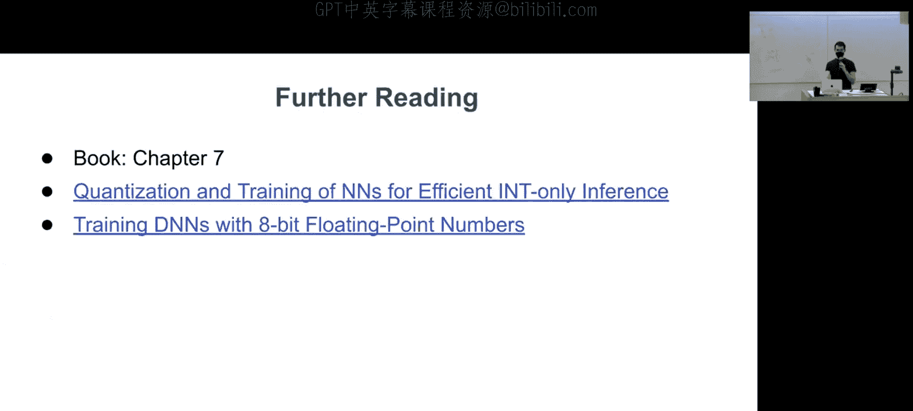