# 机器学习硬件和系统：008：量化技术详解


在本节课中，我们将要学习神经网络量化技术。量化是一种通过降低数值精度（例如，从32位浮点数到8位整数）来提升模型在硬件上运行效率的核心方法。我们将从基本概念入手，逐步探讨其原理、不同类型、实施细节及其对神经网络的影响。

## 课程概述与过渡

至此，我们已经完成了本课程硬件模块的学习，探讨了如何为神经网络设计硬件加速器、评估方法以及如稀疏性和低精度等效率技术。从本节开始，我们将转向一系列通用的效率提升技术，这些技术与硬件高度相关，但更侧重于优化神经网络本身的效率，而非硬件设计。首先，我们将深入探讨**量化**。

## 什么是量化？🤔

量化是将输入值从一个大的集合（通常是连续的，如实数）映射到一个小的、可数的集合的过程。在深度学习的语境下，这通常意味着从高精度数值格式（如FP32）转换到低精度格式（如INT8）。

**核心公式**：
对于一个实数 `r`，其量化值 `q` 的计算通常遵循以下公式（线性量化）：
`q = clip(round(r / s) + z, 0, 2^b - 1)`
其中：
*   `s` 是缩放因子（scale）。
*   `z` 是零点（zero point）。
*   `b` 是量化后的比特数。
*   `clip` 是截断函数，确保结果在量化范围内（例如，0到255）。
*   `round` 是取整函数。

反量化（从量化值恢复近似实数值）的公式为：
`r' = s * (q - z)`

量化并非新概念，在通信等领域已有长期应用。在深度学习中，它主要被重新定义为**降低数值精度以提升计算和存储效率**的技术。

## 为什么量化可行？🔍

从FP32（约40亿个可表示数）映射到INT8（仅256个可表示数），表示能力和数值范围都大幅缩减。量化之所以仍然有效，主要基于以下原因：
1.  **神经网络容忍性**：神经网络本身对噪声和精度降低具有一定的鲁棒性。
2.  **参数分布集中**：训练后的网络权重和激活值通常服从一个范围相对有限的分布（例如，类似高斯分布），而非布满整个FP32的理论范围。
3.  **输入数据范围有限**：自然数据（如图像、语音）本身的数值范围就是有界的。

## 量化中的关键问题 ❓

将量化应用于神经网络时，我们需要考虑一系列设计选择：

1.  **量化对象**：权重（参数）还是激活值（输入/中间结果）？还是两者都量化？
2.  **量化类型**：采用**线性量化**还是**非线性量化**？
3.  **对称性**：在**线性量化**中，使用**对称量化**（零点 `z=0`）还是**不对称量化**（`z≠0`）？
4.  **训练阶段**：是否使用**量化感知训练**来让模型在训练时就适应量化误差？
5.  **应用场景**：量化主要用于**推理阶段**以提升效率，但也可用于**训练阶段**以加速训练过程。
6.  **误差来源**：量化会引入**舍入误差**和**截断误差**，如何权衡？
7.  **量化粒度**：是整个网络使用同一套量化参数（**每网络**），还是每个张量（**每张量**）或每个通道（**每通道**）使用不同的参数？

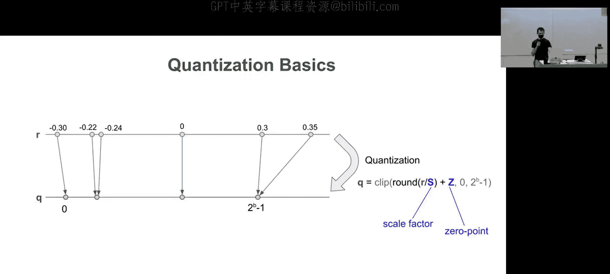

接下来，我们将逐一深入这些问题。

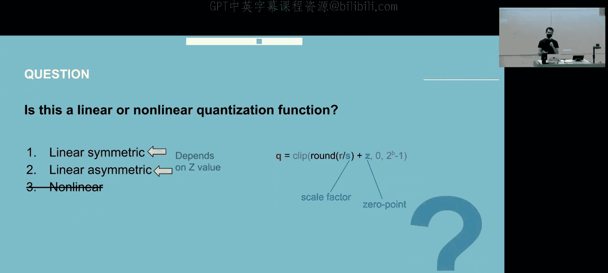

## 线性量化详解 📐

上一节我们介绍了量化的基本公式，本节我们来详细看看最常见的**线性量化**。

### 缩放因子与零点

缩放因子 `s` 和零点 `z` 是线性量化的关键。
*   **缩放因子 `s`**：决定了实数域中的“步长”。它通过选择的实数范围 `[r_min, r_max]` 计算得出：
    `s = (r_max - r_min) / (2^b - 1)`
    选择 `r_min` 和 `r_max` 的方法有多种，例如直接使用最小/最大值，或使用百分位数（如去除离群值后的最小/最大值）。
*   **零点 `z`**：表示实数0在量化域中对应的值。其计算公式为：
    `z = round(-r_min / s)`
    若 `z = 0`，则为**对称量化**；否则为**不对称量化**。

### 量化误差

量化过程会引入两种误差：
1.  **舍入误差**：由于 `round()` 操作引起，误差范围在 `[-s/2, s/2]` 之间。
2.  **截断误差**：由于 `clip()` 操作引起，所有超出 `[r_min, r_max]` 范围的实数都会被映射到量化范围的边界值上。

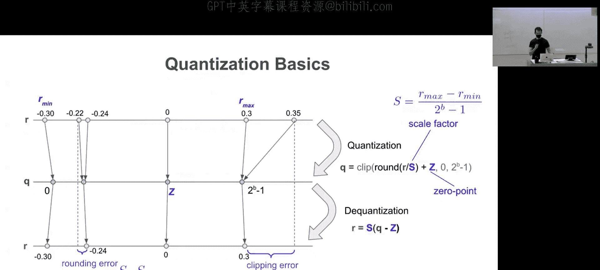

**误差权衡**：减小量化范围 `[r_min, r_max]` 可以减小步长 `s`，从而降低**舍入误差**，但会增加被截断的数值数量，从而增大**截断误差**。设计时需要在这两者间取得平衡。

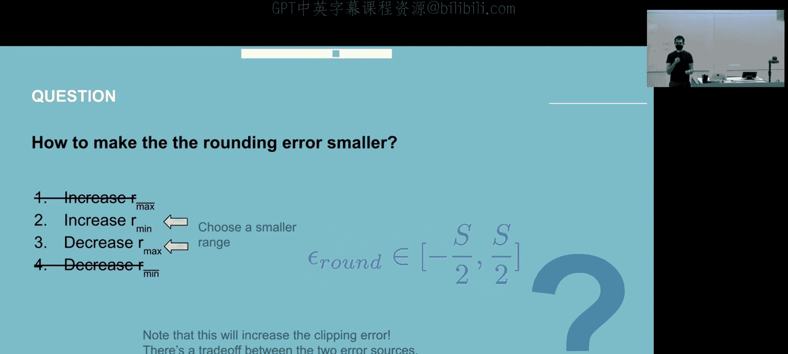

### 矩阵乘法的量化

了解了基础原理后，我们来看看量化如何应用于神经网络的核心运算——矩阵乘法。

假设我们有权重矩阵 `W` 和激活矩阵 `X`，进行浮点运算 `Y = W * X`。
对 `W` 和 `X` 分别进行量化后，我们有：
`W_q = quantize(W, s_w, z_w)`
`X_q = quantize(X, s_x, z_x)`

那么，量化后的矩阵乘法近似为：
`Y ≈ s_w * s_x * (W_q * X_q) + s_w * z_w * (sum(X_q)) + s_x * z_x * (sum(W_q)) + s_w * s_x * z_w * z_x * n`

**情况分析**：
*   **对称量化（`z_w = 0, z_x = 0`）**：公式简化为 `Y ≈ s_w * s_x * (W_q * X_q)`。计算开销很小，只需在整数矩阵乘后乘上一个标量系数。
*   **不对称量化**：公式包含额外项。通常实践中，**对权重使用对称量化**，**对激活使用不对称量化**。这样，`z_w = 0`，可以消除公式中与 `W_q` 相关的额外项，剩余与 `X_q` 相关的项可以合并到网络的偏置（bias）中，从而减少在线计算开销。

### 量化粒度

量化参数（`s`, `z`）的选取可以在不同粒度上进行：
*   **每网络**：整个网络使用同一套参数。简单但灵活性差。
*   **每张量**：为网络中每个权重或激活张量单独计算参数。这是常见做法。
*   **每通道**：为张量的每个通道（例如，卷积层的每个输出通道）计算参数。这能更好地适应数据分布，通常能获得更好的精度，但计算稍复杂。

## 量化实施策略 🛠️

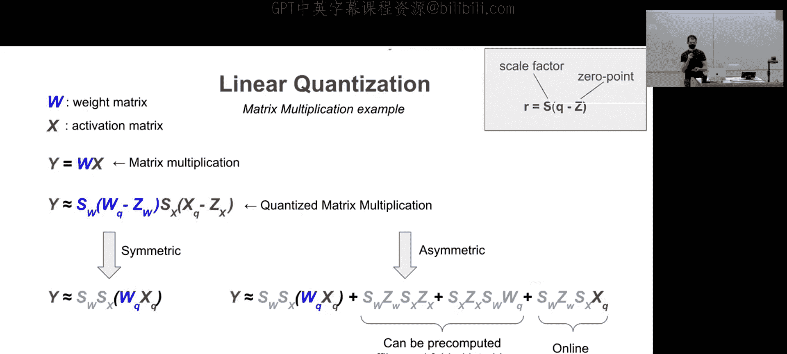

### 训练后量化

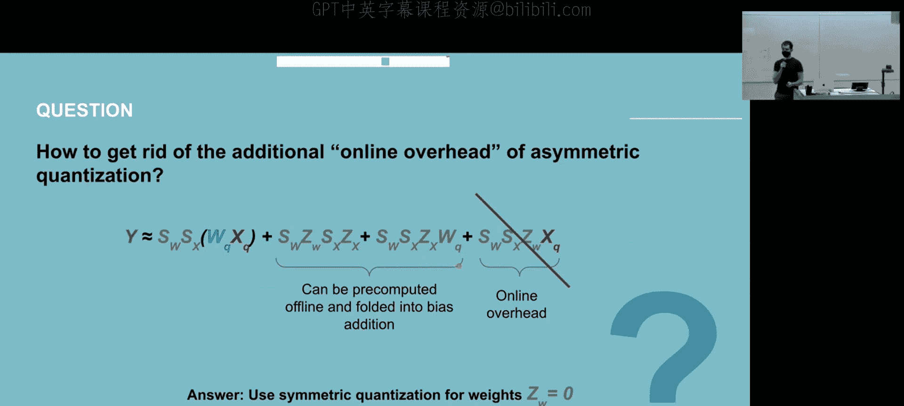

**训练后量化**是最直接的方法：先正常训练一个FP32模型，训练完成后，再确定各层的量化参数并将权重转换为低精度格式。
*   **权重**：直接根据训练好的权重值计算 `r_min`, `r_max`。
*   **激活**：需要一个**有代表性的数据集**（如验证集的一个批次），通过网络前向传播，收集各层激活值的分布，据此计算量化参数。

这种方法实现简单，但对于某些模型可能造成精度下降。

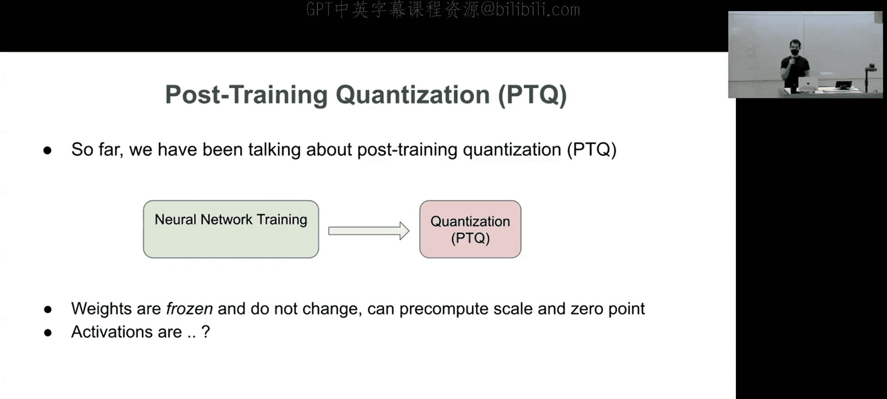

### 量化感知训练

为了缓解训练后量化的精度损失，可以采用**量化感知训练**。其核心思想是在**训练过程中模拟量化效应**，使模型能够适应量化误差。

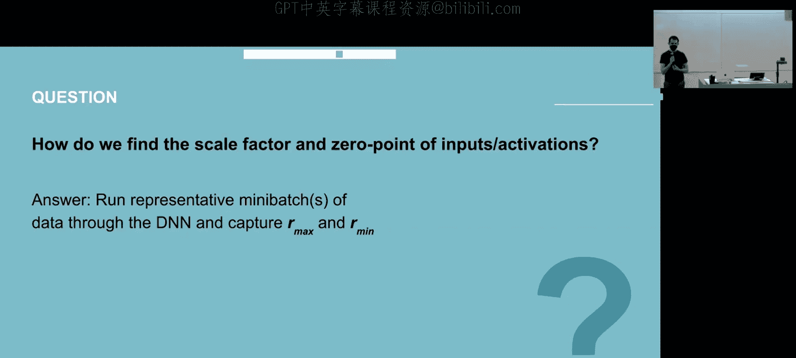

**实现方式**：在网络图中插入**伪量化节点**。在前向传播时，这些节点执行 `量化->反量化` 操作，将量化误差引入计算图；在反向传播时，使用**直通估计器**，假设该操作的梯度为1，让梯度正常回传。

**代码示意**（前向传播中的伪量化）：
```python
def fake_quantize(tensor, scale, zero_point):
    # 量化
    quantized = round(tensor / scale) + zero_point
    quantized = clip(quantized, 0, 2**bits - 1)
    # 反量化
    dequantized = scale * (quantized - zero_point)
    return dequantized
```
量化感知训练通常能显著提升量化模型后的精度，是生产中的常用技术。

## 非线性量化 🌀

之前我们讨论的都是线性量化，其量化步长是均匀的。但当数值分布极不均匀时（如双峰分布），线性量化效率不高。这时可以使用**非线性量化**。

**核心思想**：根据数值的分布密度来分配量化值，在数值密集的区域使用更精细的间隔，在稀疏区域使用更粗糙的间隔。

**常见方法**：**K均值聚类量化**。
1.  将权重值通过聚类算法（如K-means）分成 `k` 个簇。
2.  每个簇用一个**质心**（通常是簇内点的平均值，高精度存储）表示。
3.  原始的每个权重值不再存储其具体数值，而是存储其所属簇的**索引**（仅需 `log2(k)` 比特）。

**优势与局限**：
*   **优势**：能实现极高的压缩率（例如，用2-4比特索引代替32位浮点数），大幅减少**模型存储占用**。
*   **局限**：计算时仍需将索引查表转换为高精度质心进行计算，因此**不能加速计算**，主要适用于存储受限、计算能力足够的场景。

## 前沿思路：乘积量化 🚀

本节最后，我们看一个有趣的量化变体——**乘积量化**。它展示了量化思想可以如何拓展。

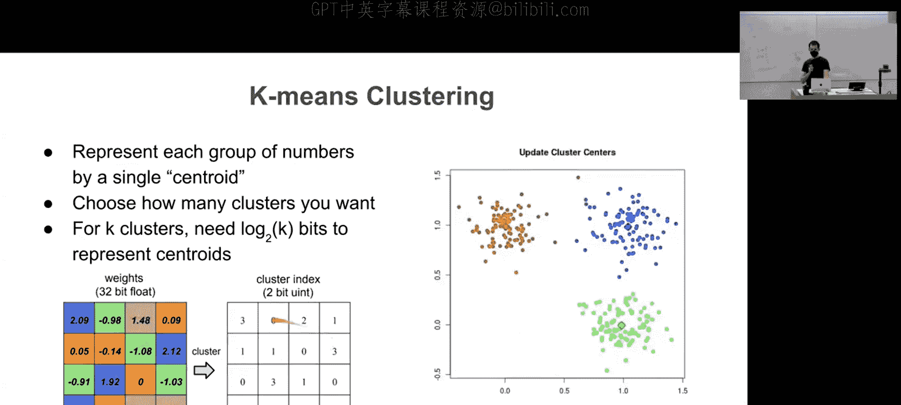

乘积量化不再对单个数值进行量化，而是对**向量块**进行量化。
1.  学习一组**原型向量**。
2.  将数据向量分割成块，每块用最相似的原型向量来近似表示（存储原型索引）。
3.  对于点积运算，可以预先计算所有原型向量之间的点积并存入查找表。
4.  实际计算时，只需查找和累加这些预计算的结果，从而“不乘而乘”。

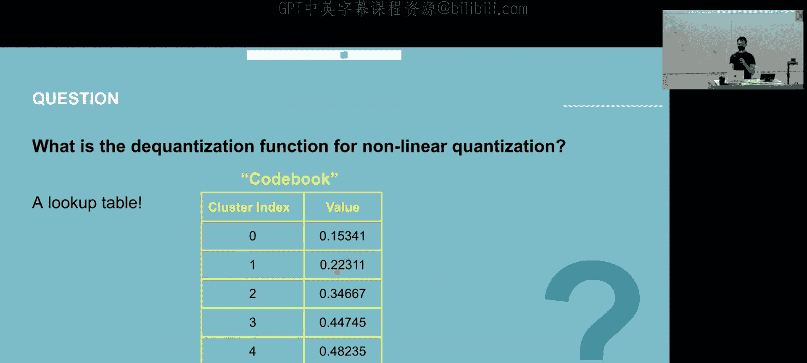

这是一种将计算开销转化为存储和查找开销的激进方法，在某些特定场景下非常高效。

## 课程总结 📚

本节课我们一起深入学习了神经网络量化技术。我们从量化的基本定义和动机出发，详细剖析了**线性量化**的原理，包括缩放因子、零点、量化误差以及其在矩阵乘法中的应用。我们比较了**对称与非对称量化**的优劣，并探讨了**量化粒度**的选择。

接着，我们学习了两种主要的量化实施策略：简单的**训练后量化**和更鲁棒的**量化感知训练**。此外，我们还了解了**非线性量化**（如K均值聚类）如何通过非均匀间隔实现更高的压缩比。最后，我们瞥见了**乘积量化**这一前沿思路，它展示了量化思想的更多可能性。

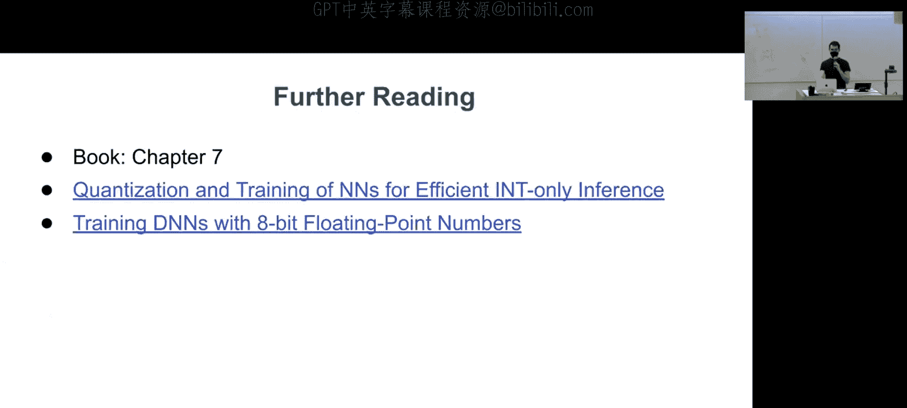

量化是连接高效算法与底层硬件的重要桥梁，是部署机器学习模型，特别是在边缘设备上不可或缺的技术。掌握量化，意味着你能让模型跑得更快、更省电，并能在资源有限的平台上解锁更强大的AI能力。