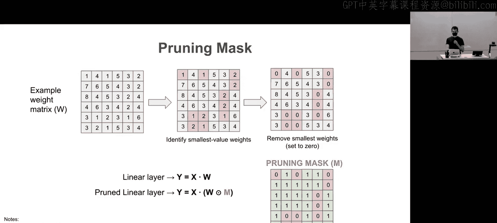
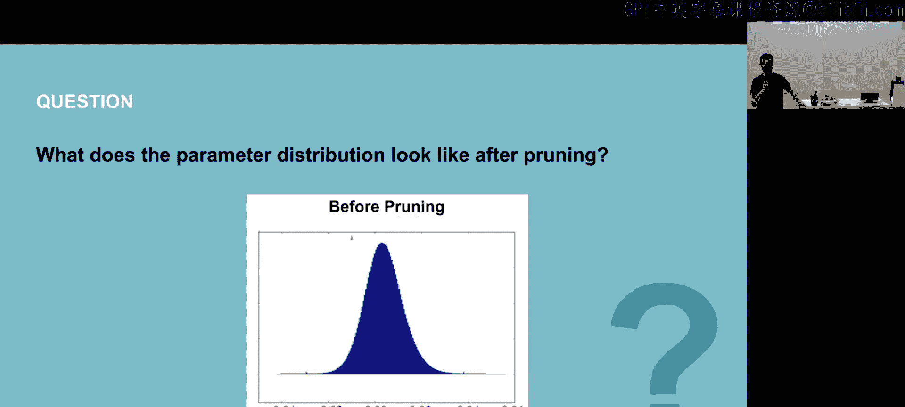
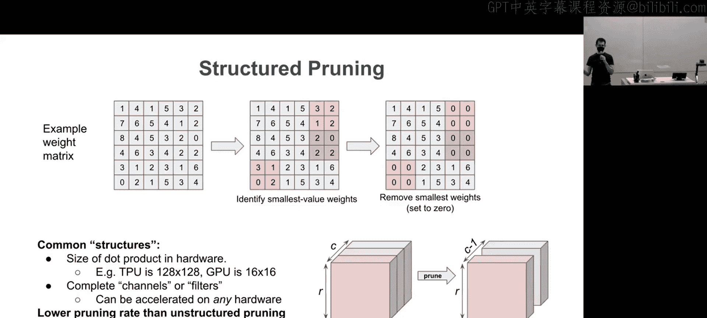
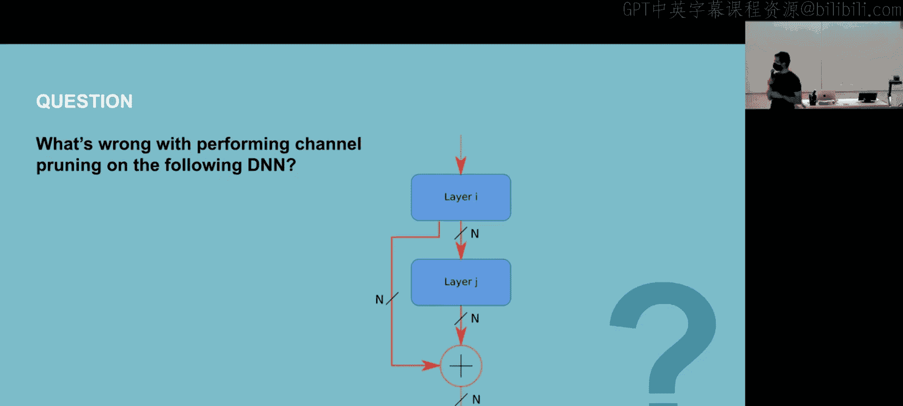

# 机器学习硬件和系统：009：剪枝


在本节课中，我们将学习另一种提高神经网络效率的技术——剪枝。我们将探讨其核心概念、不同类型、实施方法以及如何将其整合到训练流程中。

## 概述

剪枝是一种通过移除神经网络中不重要的参数（权重）来减少计算量和模型大小的通用技术。其核心思想是，许多参数对最终输出的贡献微乎其微，移除它们可以在保持模型精度的同时显著提升效率。

## 什么是剪枝？





上一节我们介绍了量化技术，它通过降低数值精度来提升效率。本节中，我们来看看另一种方法：剪枝。

剪枝的基本过程是：训练一个神经网络，分析其参数，然后移除其中一部分。最简单的标准是移除幅度最小的参数，因为它们在点积运算中的贡献最小。

在数学上，剪枝通过引入一个**剪枝掩码**来实现。假设我们有一个权重矩阵 **W** 和输入 **x**，正常的线性层计算是 **y = Wx**。剪枝后，计算变为：
```
y = (W ⊙ M) x
```
其中 **M** 是一个与 **W** 形状相同的二进制掩码（0 表示剪枝，1 表示保留），`⊙` 表示逐元素乘法。

在 PyTorch 中，实现方式就是创建一个剪枝掩码，并将其与权重矩阵进行逐元素相乘。

## 剪枝的类型与策略

了解了基本概念后，我们来看看剪枝的不同维度。主要涉及**剪什么**、**如何剪**、**何时剪**以及**剪枝频率**。

以下是几种关键的剪枝策略分类：

1.  **按剪枝结构分类**
    *   **非结构化剪枝**：移除单个权重，不遵循特定模式。理论上压缩率高，但硬件加速困难。
    *   **结构化剪枝**：移除整个结构单元，如权重矩阵中的整行、整列（通道）或整个滤波器。硬件友好，但可能对精度影响更大。

2.  **按剪枝范围分类**
    *   **局部剪枝**：独立地对每一层移除固定百分比（如 P%）的参数。
    *   **全局剪枝**：将所有层的参数放在一起排序，全局移除幅度最小的 P% 的参数。通常效果更好，但可能导致“层坍塌”（某一层的参数被全部移除）。

3.  **按剪枝时机分类**
    *   **训练后剪枝**：模型训练完成后，一次性剪枝。
    *   **迭代剪枝**：采用“剪枝-再训练”的循环，逐步移除参数并微调模型，通常能获得更好的精度-稀疏度权衡。
    *   **初始化剪枝**：在训练开始前，根据权重初始化状态进行剪枝。

## 迭代幅度剪枝



目前最成功且普遍的剪枝方法是**迭代幅度剪枝**。



它不是一个一次性操作，而是将剪枝过程放入循环：先训练网络，移除一小部分（如10%）最小幅度的权重，然后对剪枝后的网络进行再训练（微调），重复此过程直到达到目标稀疏度。

这种方法之所以有效，是因为它给了优化算法机会，在每次剪枝后重新调整剩余权重的重要性，从而找到更优的稀疏子网络。

## 促进稀疏性：正则化

为了让剪枝更有效，我们可以在训练时鼓励权重趋向于零。这通常通过向损失函数添加正则化项来实现。

损失函数通常为 `L_total = L_task + λ * R(W)`，其中 `L_task` 是原始任务损失（如交叉熵），`R(W)` 是正则化项。

常用的正则化项有：
*   **L1 正则化**：`R(W) = ||W||_1 = Σ|w_i|`。倾向于产生精确的零值。
*   **L2 正则化**：`R(W) = ||W||_2^2 = Σw_i^2`。使权重整体变小。

在训练中，优化器会尝试最小化总损失，从而同时推动权重幅度减小，为后续剪枝创造更有利的条件。

## 超越幅度：参数重要性准则

仅凭权重幅度来判断重要性是一个有效的代理，但并非终极标准。更根本的方法是衡量**移除某个参数对损失函数的影响**。

参数 `w_j` 的重要性（显著性）可以形式化定义为：
```
S_j = | ΔL(D; w_j) | = | L(D; W) - L(D; W | w_j=0) |
```
其中 `L(D; W)` 是使用所有权重时的损失，`L(D; W | w_j=0)` 是将 `w_j` 设为零后的损失。

然而，精确计算这个值需要为每个参数重新训练网络，计算成本无法承受。因此，研究提出了多种近似方法：
*   **最优脑损伤**：使用损失函数关于权重的二阶导数（海森矩阵的对角线）来近似重要性。`S_j ≈ w_j^2 / (2 * [H_{jj}])`，其中 `H` 是海森矩阵。
*   **基于梯度的准则**：利用一阶或二阶梯度信息来估计参数对损失的影响。
*   **基于信息的准则**：如互信息或费雪信息，衡量激活通道（而非权重）的重要性。

这些方法旨在找到比简单幅度更准确的参数重要性排序。

## 彩票假设与初始化剪枝

一个有趣的方向是**彩票假设**。它指出，一个随机初始化的密集网络中，包含一些“中奖彩票”子网络（稀疏网络），如果使用与密集网络**相同的初始化**来训练这个子网络，它能达到与原始密集网络相当的性能。

这启发了**初始化剪枝**的研究，旨在训练开始前就找到有效的稀疏结构，从而避免先训练庞大密集网络的开销。相关算法如 SNIP、GraSP、SynFlow 等，试图在初始化阶段就估计参数重要性并进行剪枝。

## 其他高级剪枝概念

除了上述主流方法，还有一些前沿方向：

*   **动态剪枝**：允许在迭代过程中被剪枝的权重重新恢复，从而更灵活地探索稀疏结构。
*   **运行时剪枝**：根据不同的输入样本，动态激活网络的不同部分。
*   **学习剪枝掩码**：将剪枝掩码或稀疏模式作为可学习参数，与网络权重一同优化。

## 总结


本节课我们一起学习了神经网络剪枝技术。我们从基本概念出发，了解了如何通过移除不重要权重来压缩模型。我们探讨了非结构化与结构化剪枝、局部与全局剪枝的区别，并深入介绍了最有效的**迭代幅度剪枝**方法。此外，我们还学习了如何通过**正则化**促进稀疏性，以及更复杂的**参数重要性准则**。最后，我们展望了**彩票假设**和**初始化剪枝**等前沿方向。剪枝与量化一样，是构建高效、轻量级机器学习模型的关键技术之一。