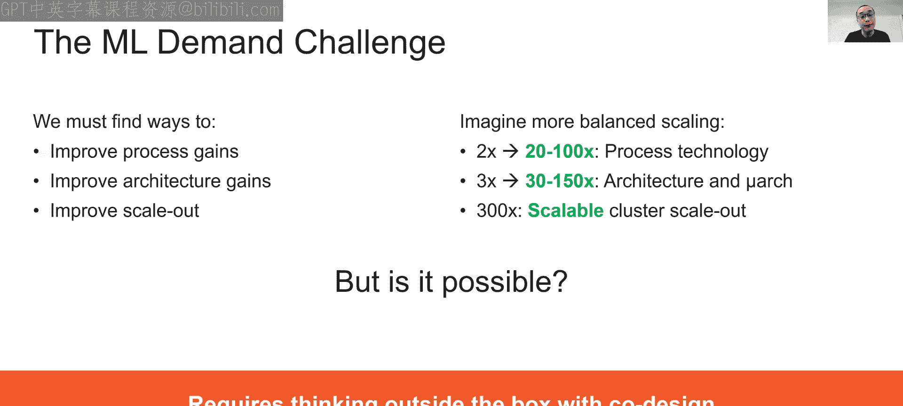
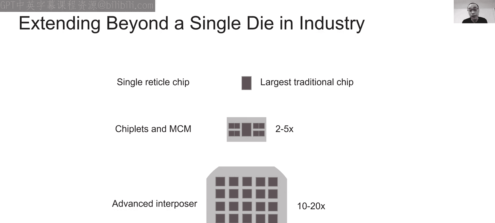
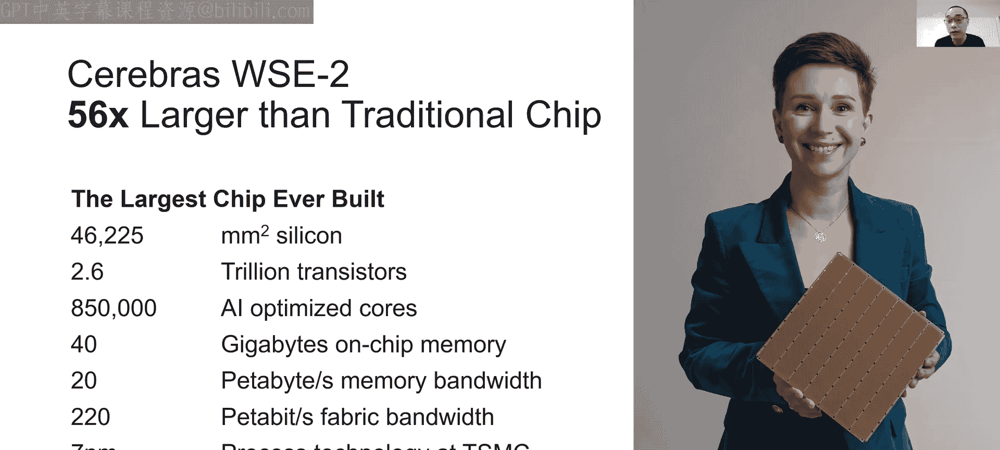
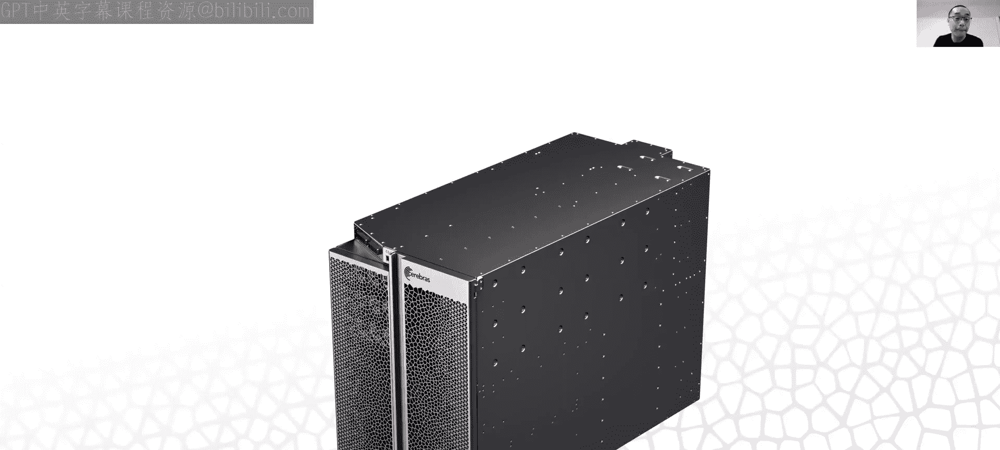
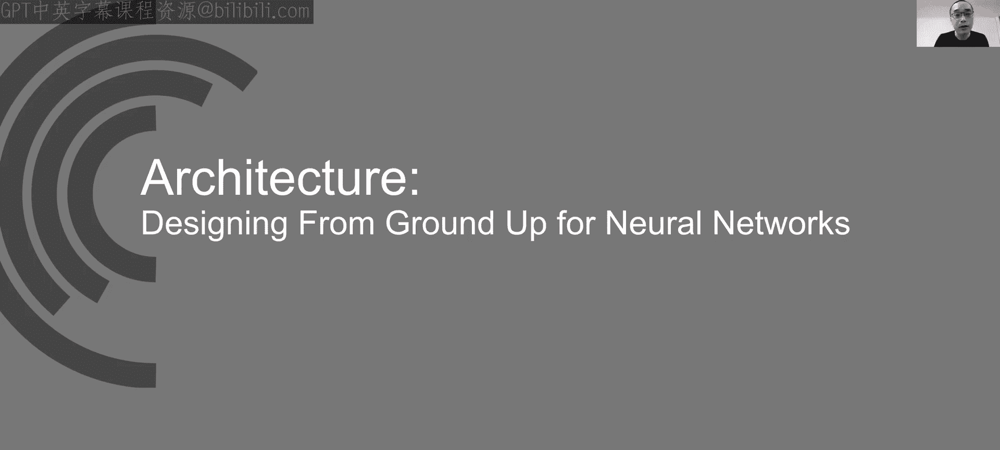
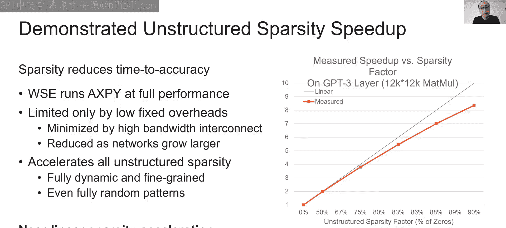
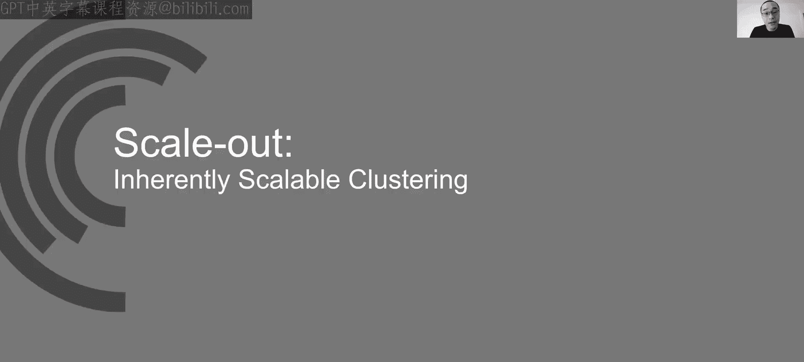
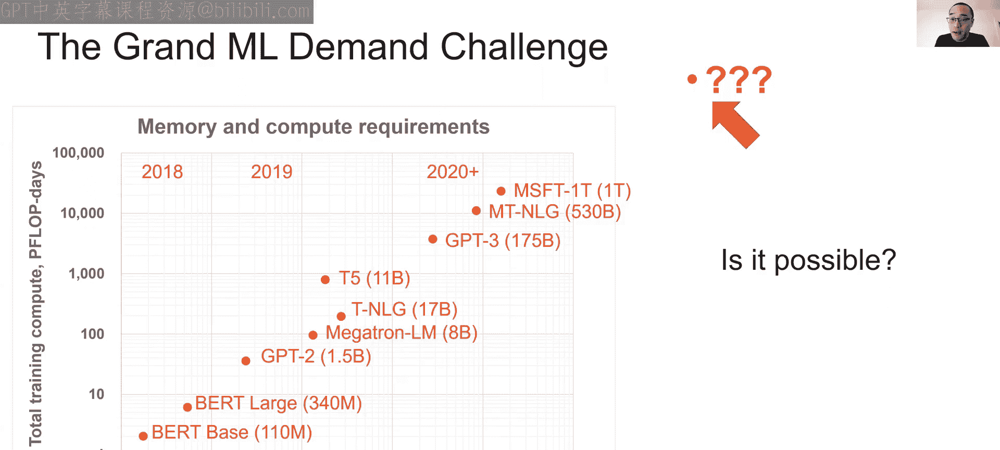

# 机器学习硬件和系统：010：特邀讲座 - Cerebras Sean Lie

在本节课中，我们将学习Cerebras Systems联合创始人兼首席硬件架构师Sean Lie带来的特邀讲座。他将探讨如何通过颠覆性的协同设计方法，应对未来机器学习对算力的巨大需求挑战。

---

## 演讲者介绍

Sean Lie是Cerebras Systems的首席硬件架构师和联合创始人。在此之前，他曾任职于SeaMicro公司，并担任其I/O虚拟化架构的硬件架构负责人。在SeaMicro被AMD收购后，他成为AMD院士和首席数据中心架构师。其职业生涯早期，他曾在AMD的先进架构团队工作五年。Sean拥有麻省理工学院的电气与计算机工程及计算机科学学士和硕士学位，并在计算机架构领域拥有16项专利。

## 讲座概述

我们非常荣幸能邀请到Sean。他今天将与我们分享Cerebras公司为应对AI计算挑战所做的一些“跳出框架”的思考。这些思考对于满足未来的机器学习需求至关重要。

---

## 面临的挑战：前所未有的算力需求

上一节我们介绍了演讲者，本节中我们来看看当前机器学习领域面临的巨大算力挑战。

机器学习，特别是深度学习，正以前所未有的速度发展。2018年，最先进的神经网络拥有1亿个参数。到了2019年，GPT-2和Megatron等模型的参数量达到了10亿到1000亿级别。2020年，GPT-3的参数量达到了1750亿。就在几个月前，微软宣布了其Megatron-Turing NLG模型，参数量高达5300亿。

**核心趋势**：模型规模在短短两年内增长了**1800倍**。这给计算机架构师和整个行业带来了既令人兴奋又令人生畏的挑战。

## 行业的应对：创新与局限

面对这种需求，行业做出了哪些努力？以下是近年来的一些关键创新：

*   **工艺技术**：从16纳米、12纳米到7纳米芯片的持续演进。
*   **先进封装**：实现更高带宽的内存。
*   **低精度格式**：如FP16和BFloat16。
*   **新数据通路设计**：如脉动阵列和张量核心，显著提高了计算密度和能效。

让我们深入分析这些创新。首先，工艺技术（摩尔定律）持续进步，晶体管密度在过去十年中稳步提升，并且这一趋势预计将持续数年。其次，在架构和微架构层面，我们使用“每晶体管峰值FLOPS”作为衡量标准。数据显示，架构性能的提升速度与摩尔定律持平甚至略有超越，这证明了架构设计的重要性。

然而，令人担忧的部分是：过去两年，工艺带来了约**2倍**的提升，架构带来了约**3倍**的提升，但ML需求却增长了**1800倍**。这中间存在**300倍**的缺口。这个缺口是如何填补的呢？答案是：**系统横向扩展**。例如，OpenAI训练GPT-3时使用了**1000个GPU**。因此，近年来的性能提升完全由系统横向扩展主导。

## 横向扩展的瓶颈

那么，我们是否可以简单地继续横向扩展来满足未来需求？让我们设想一下：假设未来两年，工艺再带来2倍提升，架构再带来3倍提升，那么要满足可能再增长1800倍的需求，我们仍然需要**300倍**的横向扩展。这意味着需要**数十万个芯片**组成的集群。这在技术上是可能的，但在成本、功耗和物理空间上几乎不可行。

横向扩展存在根本性限制，因为它并不容易部署，且本质上不具备良好的可扩展性。根本原因在于：巨型神经网络需要海量的内存、计算和通信。试图用成千上万个小型设备来解决这个问题，会将内存、计算和通信的扩展都变成相互依赖的分布式难题，导致分布式复杂性爆炸式增长。

因此，我们认为，使用现有的横向扩展技术，可能还能获得**10倍**左右的提升（对应约1万个芯片的集群规模），但很难再多了。微软训练MT-NLG模型使用了4000个GPU，似乎也印证了这一点。

## 总结挑战

综上所述，采用当前方法，行业在未来两年可能还有**60倍**（2倍工艺 x 3倍架构 x 10倍扩展）的提升路径。但我们需要的是**1800倍**的提升。这就是摆在我们面前的“宏大ML需求挑战”。

我们必须找到方法，在工艺、架构和横向扩展三个方面都实现数量级的实质性改进。我们需要一个更均衡的扩展路径：在工艺、架构和真正可扩展的集群技术上，各自再获得10到50倍的提升。这有可能吗？我们相信答案是肯定的，但前提是必须跳出传统思维框架，进行真正的端到端协同设计。

---

## 解决方案一：超越单芯片的工艺协同设计

上一节我们明确了挑战的规模，本节中我们来看看如何通过协同设计在工艺层面实现突破。

摩尔定律依然有效，但我们能否进一步放大其效果？历史上，晶体管密度的提升也伴随着芯片尺寸的逐步增大。然而，我们现在遇到了瓶颈：大芯片良率低、光刻技术存在根本性挑战、大芯片供电和散热困难。

行业已经通过先进封装和多芯片模块（MCM）技术进行创新，实现了比单芯片多2到5倍的硅面积。最近，特斯拉等公司提出的使用整个晶圆作为中介层的概念，甚至有望实现**20倍**的硅面积增长。

在Cerebras，我们采取了更极端的协同设计方法。2019年，我们推出了**晶圆级引擎**。它是一个从300毫米晶圆上切割出的最大正方形单芯片，面积超过46，000平方毫米，拥有2.6万亿个晶体管和85万个计算核心。它的面积是最大GPU的**56倍**。

实现这一点需要深度协同设计，以解决三个主要问题：**良率**、**光刻限制**和**功耗/散热**。

**1. 良率问题**：我们通过冗余设计来解决。将芯片架构设计为一个由二维网格连接的均匀小核阵列，并内置了冗余核心和冗余链路。当某个核心存在缺陷时，可以用冗余核心替代，并通过冗余链路重新连接网格，从而在逻辑上恢复完整的二维网格。

**2. 光刻限制**：我们不再追求更大的光刻视野，而是在标准独立芯片（die）的基础上，通过晶圆上的“划片槽”进行连接。我们在划片槽上添加导线，使用工艺的高层金属，将这些独立的芯片连接起来，从而在整个晶圆上形成一个完全同质的核心阵列。这些看似很短的导线至关重要，因为它们提供了芯片内部级别的带宽，却跨越了整个晶圆，其能效比传统I/O高出数个数量级。

**3. 功耗与散热**：这块芯片功耗高达20千瓦，传统的电路板横向供电和直接风冷无法满足要求。我们通过3D封装协同设计解决了这个问题：电流通过电路板**垂直**注入晶圆，热量则通过水冷板中的水流**垂直**导出，从而实现了对整个晶圆均匀的供电和散热。

最终，我们构建了一个从晶圆、引擎块到完整系统的、为晶圆级芯片从头设计的系统架构。通过芯片、封装、代工厂和芯片架构之间的这种深度协同设计，我们可以将芯片尺寸的边界推远至远超传统扩展的程度。我们相信，晶圆级芯片等新的协同设计方法，是解决宏大ML挑战的关键部分，它能在单芯片上实现高达两个数量级的工艺增益和集群级性能。

---

## 解决方案二：面向稀疏性的架构协同设计

解决了工艺扩展问题后，本节我们探讨如何通过架构创新，尤其是利用神经网络的稀疏性，来大幅提升性能。

神经网络通常被视为一系列矩阵乘法运算。传统架构不断演进，以越来越高的密度运行密集矩阵乘法，这是过去几年架构性能提升的主要来源之一。但这种方法能否带来下一个数量级的提升？很可能不行，因为物理和功耗限制意味着芯片上只能容纳有限数量的计算单元，且越大的数据通路在计算不规则工作负载时利用率可能越低。

我们需要改变规则。我们能否用更少的浮点运算得到相同的结果？答案是肯定的，因为**神经网络本质上是稀疏的**。将神经网络仅仅视为密集矩阵乘法，忽略了其基本特性。

稀疏性出现在计算中存在零值时。由于乘以或加上零不会改变结果，这些运算是浪费的。稀疏性可能来源于ReLU、Dropout等技术，甚至在前向传播密集的网络中，反向传播的非线性函数也会引入稀疏性。此外，即使是全连接网络也可以被稀疏化，因为神经网络本质上是过参数化的，训练过程在某种程度上就是在发现哪些参数重要，哪些不重要。

ML社区已经发明了许多利用稀疏性的算法，如下表所示，有些可以实现高达**10倍**甚至更多的浮点运算减少。

| 稀疏性算法示例 | 潜在收益 |
| :--- | :--- |
| 权重剪枝 | 高 |
| 激活稀疏化 | 中到高 |
| 动态稀疏训练 | 高 |

想象一下，如果架构能够利用这种潜力，并促使ML社区发明更稀疏的新模型。这种ML与硬件的协同设计水平，是现有矩阵乘法方法无法实现的。因为传统矩阵乘法架构与细粒度、非结构化、动态的稀疏计算从根本上是不匹配的，原因有二：

1.  **内存限制**：传统架构利用缓存和本地寄存器来利用数据复用，这对数据复用多的密集矩阵乘法很有效，但对数据复用少的稀疏操作则成为瓶颈。
2.  **结构限制**：数据通路为执行结构化矩阵乘法而硬连线，这使其设计紧凑高效，但无法有效处理非结构化的稀疏操作。

那么，如果我们能将稀疏性作为一等公民进行架构协同设计，解决这两个根本限制呢？这将为ML协同设计和稀疏性加速打开广阔的机会。

**Cerebras的解决方案**：
*   **解决内存限制**：我们通过**完全分布式内存**，将内存紧邻计算单元放置。利用晶圆级集成，我们能够以高容量、高性能和低功耗实现与计算操作数带宽相等的内存带宽。这使得我们能够以全性能运行从矩阵乘到向量-标量乘的所有级别的运算。一个稀疏矩阵乘法本质上就是一系列向量-标量乘的集合，因此这种能力使得加速任意非结构化、细粒度的稀疏矩阵乘法成为可能。
*   **解决动态非结构化问题**：我们采用**细粒度数据流调度**。在Cerebras核心中，计算由数据触发。数据流机制使得整个计算结构成为一个数据流引擎。通过简单地在源头过滤掉所有零值，接收端就不会触发计算，从而自然地支持稀疏性。这不仅节省了功耗，还通过跳过无用工作实现了加速。

这种架构需要与机器学习和编译器软件深度协同设计。在ML侧，它原生加速自然稀疏性，并支持新稀疏ML技术的协同设计。在软件侧，我们从零开始协同设计了具有数据流感知能力的软件。

以稀疏矩阵乘法内核为例：我们将整个晶圆视为一个巨大的稀疏矩阵乘法阵列。权重流经晶圆，触发与本地激活值的乘法（一次一个权重），跳过所有零权重，结果部分和通过高带宽互连在整个晶圆上累加。由于晶圆的巨大尺寸，我们无需对矩阵进行分块或分区。

我们的实验室测量结果显示，对于GPT-3规模的层，在高达90%的权重稀疏性（即零值是非零值的10倍）下，仍能实现接近线性的加速。唯一的限制是Amdahl定律，因为需要分摊一些固定开销，但随着模型增大，这些开销会减小。

通过这种级别的ML协同设计，我们实际上可以突破传统的浮点运算扩展限制。我们相信，稀疏性操作的机会随着模型规模的增长而增加。结合传统的架构改进，通过启用与ML社区协同设计的新一类稀疏ML技术，我们有路径实现另一个数量级的架构性能提升。

---

## 解决方案三：集群级的可扩展协同设计

我们已经讨论了工艺和架构，本节我们来看最后一个关键组成部分：如何实现真正可扩展的集群计算。

现有的集群解决方案为何难以扩展？让我们看看现有的横向扩展技术：

*   **数据并行**：模型在每个设备上复制，训练数据被分割。这种方法简单，但对于大模型不适用，因为整个模型需要能放入每个设备。
*   **模型并行（流水线并行）**：将模型的不同层放在不同设备上运行。这支持更大的模型，但通信开销大，且随着设备增多，需要保存的激活内存呈二次增长。
*   **模型并行（张量并行）**：将层分割到不同设备上。这也有通信开销，且如何分割层非常复杂。

因此，训练这些巨型模型通常需要**混合并行**策略（数据并行+模型并行），例如OpenAI训练GPT-3的方式。这使得问题极其复杂，许多大公司需要专门的工程团队来管理。

根本原因在于：传统的横向扩展中，**内存和计算是绑定在一起的**。试图在数千个设备上运行单个模型，使得内存和计算的扩展变成了相互依赖的分布式约束问题。随着模型增大，需要更多的分区、更细粒度的协调和同步。

在Cerebras，我们认为正确的解决方案不是创建软件来隐藏复杂性，而是在集群级别进行真正的协同设计，跳出传统设备的思维框架。我们相信可以设计出本质上简单且可扩展的解决方案。

我们的方法是**权重流执行模型**。我们将整个集群视为ML加速器，从根本上将内存与计算分离（解耦）。这样，我们可以在集群级别为模型所需的不同类型的内存和计算设计专用解决方案，从而解开复杂性，完全简化扩展问题。

**权重流架构包含三个核心组件**：
1.  **CS2系统**：包含晶圆级引擎的主要计算单元。单个大芯片使得所有大模型层都无需分区即可运行。
2.  **Memory-X**：外部存储设备，专门设计用于存储所有模型参数（权重），可扩展到支持数万亿参数。
3.  **Swarm-X**：互连网络，专门设计用于扩展神经网络训练，可将集群规模扩展到192个CS2系统。

在这个执行模型中，所有权重都集中存储在Memory-X中，并按需流式传输到CS2系统，以逐层计算神经网络。权重甚至不临时存储在系统上。前向传播产生的激活值保留在系统上供下一层使用。反向传播时，梯度流回Memory-X进行权重更新。

为了容忍将数据移远带来的延迟，我们利用了神经网络内存访问模式的特性：激活内存需要被下一层立即访问，对延迟敏感，因此我们将其保留在芯片上。而权重内存的访问和更新相对不频繁，没有这种背靠背的依赖关系。我们通过两种流水线技术来隐藏外部权重访问的延迟：
*   **粗粒度层间流水线**：调度整个训练作为层的流水线，无需等待前一层完成即可开始流式传输下一层的权重。
*   **细粒度权重更新流水线**：在更新权重的同时，重叠执行下一轮训练的前向传播。

通过这种集群级的流水线技术，权重流执行模型可以达到与权重本地存储相同的性能。

*   **存储容量**：通过将所有模型参数移至单个外部设备，我们可以使用DRAM和闪存存储来支持极大的模型规模。该设备内部还包含执行权重更新（优化器函数）的计算单元。
*   **计算扩展**：通过Swarm-X互连，我们可以完全独立于内存来扩展计算。Swarm-X在Memory-X和所有CS2计算单元之间，以树状拓扑广播所有权重并归约所有梯度。它是一个为数据并行训练量身定制的主动组件。扩展计算就像向Swarm-X拓扑添加更多节点和CS2系统一样简单。
*   **原生稀疏性支持**：由于底层架构原生支持稀疏性，整个集群也原生支持。稀疏性在Memory-X单元内的权重矩阵中诱导产生，然后以稀疏形式广播到CS2进行计算。

我们预计，从单个CS2系统扩展到192个系统，性能提升接近线性。对于从100亿到100万亿参数的各种自然语言模型，这种扩展可以转化为显著的训练加速。对于当今最大的语言模型（如GPT-3），我们预计在扩展到192个系统时仍能保持接近线性的扩展。

通过改变规则，从整体上思考集群级别的问题，我们可以解决当今横向扩展的根本挑战，并实现从单个设备到数百个设备完全相同的执行模型。这就是我们如何应对宏大挑战的最后一个组成部分——实现本质上可扩展的横向扩展。

---

## 总结与展望

本节课中，我们一起学习了Sean Lie关于应对未来机器学习算力挑战的深刻见解。

回顾过去几年，我们看到ML工作负载的需求增长了超过一千倍，且没有放缓的迹象。初看之下，这似乎令人生畏且难以实现。但我们今天看到，这实际上是可能的——但并非通过传统技术。只有改变规则，跳出传统边界，通过深度协同设计，才能实现这个未来。

我们探讨了三种关键的协同设计路径：
1.  **工艺层面**：通过晶圆级芯片等创新，超越单芯片限制，将工艺增益放大数个数量级。
2.  **架构层面**：将稀疏性作为一等公民，设计超越浮点运算限制的架构，为ML协同设计打开新的大门。
3.  **集群层面**：通过权重流等执行模型，在集群级别进行解耦和协同设计，实现本质上简单且可扩展的计算扩展。

这是一个令人兴奋的计算机架构时代。Sean分享的只是Cerebras为追求这一未来所采取的部分思路和方法，作为可能性的一个例证。我们期待看到社区接下来会提出什么创新的解决方案。

---
**本节课中我们一起学习了：**
*   机器学习模型规模爆炸式增长带来的算力挑战（1800倍/2年）。
*   传统工艺、架构和横向扩展方法的提升空间与局限。
*   通过“深度协同设计”应对挑战的必要性。
*   Cerebras在**工艺**（晶圆级引擎）、**架构**（稀疏性优先、数据流）和**集群**（权重流执行模型）三个层面的具体协同设计创新与实践。
*   这些创新如何共同为满足未来万亿参数模型的训练需求提供了可行的技术路径。