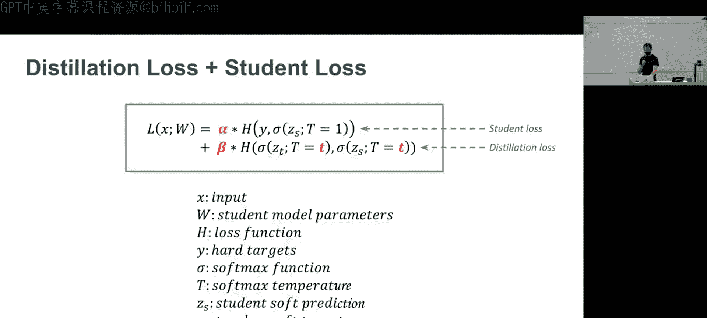
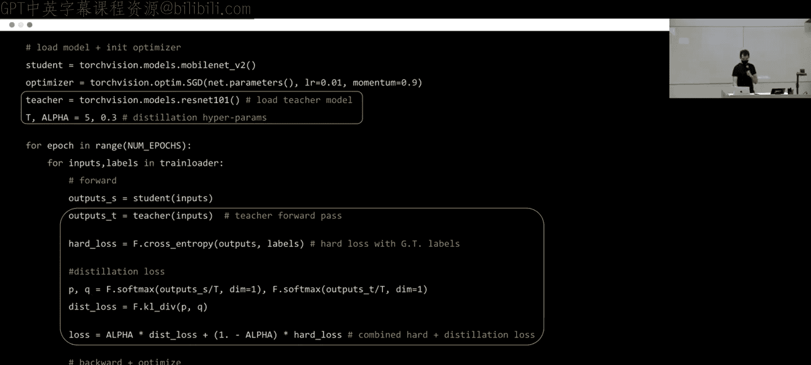
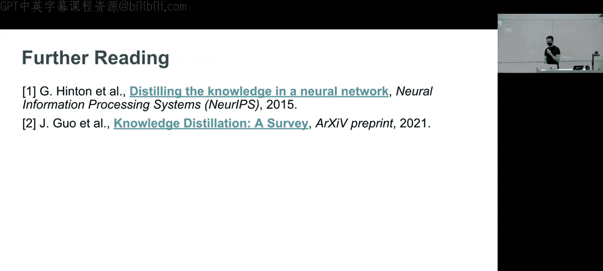

# 011：康奈尔大学《机器学习硬件和系统｜Cornell ECE 5545 Machine Learning Hardware and Systems》中英字幕 p11 -11-Lecture 9_ Knowledge Distillation.zh_en -BV1CCqPYSEP5_p11-

Okay， so so where are we now we are in the second module talking about neural networks and how we can optimize neural networks to make them more efficient。

 regardless of what hardware they're going to run on。

 so the first thing we talked about is quantization， how to use a smaller number of bits。

 a lower number of bits to represent numbers in a neural network and we saw that you know you can do that quite effectively without losing any accuracy。

The next thing we talked about was pruning， so we talked about how to remove superfluous parameters or channels or pieces of the weight tensor basically to reduce the number of computations that you actually need to do and remove anything that's going to be multiplied by a very small number or by zero。

 so that's what we call ineffectual operations。And so we're going to talk about another method that also shrinks neural networks called knowledge distillation today。

So this is actually quite a fun one because it's different from the other ones which looks for redundancy within a model。

 this one is a method to transfer kind of expert knowledge from a large neural network to a small neural network and the analogy I like to give there is that you know you're all students imagine if you came to the lecture and instead of me kind of standing here making slides and pointing to things。

 I just give you a bunch of books put them on your desk and ask you to learn。

So would that be effective so typically not unless you're really good at navigating books and so instead what we do we put this thing in the middle called the teacher and so the teacher absorbs all the knowledge in those books or all the data in those books and then transfers and distills that data down to something that let's call it knowledge and the teacher then attempts to transfer that knowledge onto the student and that's basically the concept of knowledge distillation by the way by a show of hands how many people already know what knowledge distillation is。

3， okay， good。U。And so we will also not kind of withhold that data and the raw material from the student。

 we will also give them the books to kind of augment their experience and that's why you guys have the weekly readings and all of those book chapters to go through by yourselfs so I'm doing lecture but also you have to go and read the actual material right？

Because as we will see， the knowledge coming from the teacher is sometimes noisy and sometimes even correct。

 whereas the knowledge from the books， we assume that it's 100% correct。

 and so that's something to keep in mind。😊，So what does this mean for a neural network so i'm talking about teachers and students and people for a neural network the teacher is typically a large neural network that has a very good accuracy right so in the field of you know vision and image classification this would be like distilling knowledge from a huge network like ReSNe 101 to a mobile net for example and this example is a bit dated but let's go with it。

And the key thing here is that larger neural networks are actually easier to train。

 whereas smaller neural networks are much harder to train， but easier to deploy。

 obviously as we know。And so we want to train a large neural network。

 but deploy a small neural network， and knowledge distillation is one way to convey that training information or training usefulness to the small neural network。

So it was proposed in 2006 in a very kind of simple formulation by Kauna Eal。

 and then it was generalized and kind of the term was coined in 2015 by Jeff Hinton。

 I think after he joined Google。嗯。I may be mistaken， but I actually think the Hinton paper was never。

 I think it was never accepted at a conference and he just put it on archive and now it's like cited 100 million times。

 but I think I may be mistaken there。So that's that's what we do is you see the diagram on the right here now change you know the knowledge is not books now it's this training data so we use the training data to train a large neural network and then we have this process。

Whereby we transfer the knowledge from that large neural network to the small neural network and what is that knowledge in one case as we will see is going to be the softm class probabilities so the output of the large neural network essentially in the case of image classification。

So in this lecture we'll try to cover these three items so we want to kind of understand what knowledge distillation is and we'll go into some detail of how it works and why it's needed。

 so hopefully for the three people who already know what this is this won't be too boring。

 then we'll do a short exercise where you write some Pythtorch codes to perform knowledge distillation。

And then finally， we'll look at some advanced knowledge distillation techniques and open problems in that area。

And so if we're all back to kind of your first lecture of your first class on neural networks。

 it looks something like this， you know you have an input again we're taking image classification as an example throughout this lecture。

 but this can be applicable to other domains and other problems as well。

So I have an image of the input。Let me do this。 So you have an image at the input here and then you have a neural network。

 which has the standard， you know， input layer， hidden layer and output layer。

 The output of a classification neural network is typically called logics。

And so we basically transform those logics into probabilities or class probabilities by putting them through a softm layer。

Then we have a loss function which takes on the other end these targets or the ground truth。

 so for example this image， we know it has a cat when you see it you say this is a cat and so we put on one where a cat is and we try to train this neural network through back propagation by showing it this ground truth and minimizing the error function between the ground truth and the output class probabilities there。

So the key observation here is that these hard targets。

 what we're calling hard targets or ground truth。They have only information about the correct answer right so it has a one here and a zero everywhere else right but we're not teaching the we're not conveying any information about the wrong classes so for example。

 if you were to mistake this for something else out of those classes，I mean。

 how many of you would mistake it for a boat， for example， like it's very unlikely， right？

But maybe someone could mistake it for a dog it's possible or if there were different kinds of cats like Kaap pua or lynx or something maybe you can mistake it for one of those so we want to provide something called soft targets which not only convey information about the correct class but also give you some information about the incorrect classes as well so I want to say this is definitely not a boat this is definitely not a bus maybe a dog if you're looking at it from a certain angle you know if you make that mistake you're fine because you've already identified many correct features like eyes。

 nose mouth， ears you know ferry texture， these things are common to cats and dogs so you already did have the job there。

RightBut you don't have these things on these other classes。

So where where do we get those soft targets from yeah so so an example of soft targets here would have kind of near zero probability everywhere except for cats and dogs。

 but where do we get them from right' that's the current question。So。What do people think？

Who thinks it's number one kind of from labeling some data and trying to cluster similar classes together and using kind of the distance。

Between those clusters or something like that， who thinks it's number one？Could be okay。

How about two using an equation very。Interesting， what what's the equation Yeah。

 that that's also my question Oh yeah， maybe maybe no one will choose number two。有有。Yeah。Yeah。

 that would be kind of a specific case of number one， but yeah it's。Yeah， I mean， you're。

 you're right。 So it could be， there could be an equation。 Who thinks it's number3 from。

 from a trained neural network。Okay， most people and who thinks it's number four。

Using kind of annotation and labeling。So， yeah。Yeah， I mean， it could come from expert annotation。

But。I mean， it wouldn't be too dissimilar from hard targets right because they're currently manually labeled as well。

 so it could come from expert annotation as well。I mean。

 for the purpose of knowledge installation and how people do it in practice today。

 it's like most of you guessed right， so we're using a trained neural network to the output of a trained neural network as the teacher。

 so we're using that as the way to get these soft targets。And so this is what it looks like。

 so we have the same image。😊，It goes through a small neural network and a large neural network。

And here we're only training the small neural network， right？We output the logics。

 we put it through a softmax function and the output of the large neural network。

 which we know has kind of good accuracy， we call these soft targets。Right。

And and in this case of a cat， it already kind of has this interesting information where， you know。

 well I'm not labeling the classes here， but this was dog and this was cat it already kind of has some it assigns some probability to similar classes。

 this is one of the characteristics of neural networks because it kind of goes hierarchically through different features that you have in the images。

Then then naturally， it would also kind of assign some probability to wrong classes which share many of the features of the correct class。

 right？And so we would put this into the last function， in the most simple case。

 the teacher network is already pre traineded。And we would do back propagation only to the small neural network。

 so basically the large neural network here is part of the loss function。

 it's a way to get the soft targets and then we do back propagation normally to train the small neural network。

喂。And so the images used in this kind of scheme are usually called a transfer set。

 typically it's a subset of the training data， it could be the whole training data and it could be done during training。

 but in a specific case it would be called the transfer set。嗯。And then the question now becomes。

What is the loss function that we're using here？So before even talking about the loss function。

 let's talk about the softm function。The standard softmax function。

 if you recall looks something like this， so the output is equal to exponent of the logic divided by the sum of the exponent of all the logics so's a softmax function which gives you probabilities from zero to1 out of these logics Z denoted by Z here and so what people usually do is that they add this softmax temperature and this is kind of a new hyperparameter that's especially useful for knowledge distillation。

So the example I'm showing here is a bunch of logics。

Z and a bunch of softm probabilities with different temperatures。So we will see， you know。

 if you look at the highest value logic 3。7 with the temperature equal to1。

 it would have probability of 0。8， with the temperature equal to 10， so the higher the temperature。

 the smoother kind of the probability distribution。So which will have kind of a probability of 0。

276 so the the ranking between the different classes here still stays the same this one is still the highest probability out of all of them and this one is still the lowest probability out of all of them。

But basically we are magnifying the values for the wrong probabilities and remember in knowledge distillation。

 we're trying to get more information about the wrong classes and so just numerically for this to be effective。

 this softm temperature turned out to be something actually quite important。So in Hton's paper。

 he calls it dark knowledge。嗯。So this additional hyperparameter， the higher your temperature。

 the more dark knowledge it exposes， but basically what that means is that it just magnifies the values for the wrong classes and and makes the distribution a bit smoother。

Okay， so back to this diagram now so we have a softm with some temperature and this is a hyperparameter so there is no real kind of correct value。

 but I've seen temperature in the range of five to 10 being used a lot。

And then and then there are I still have kind of many questions here why do we even use the softm can we just use the logics instead of the softmax class probabilities right and the answer is yes we can I think even the original paper did that they didn't do the output of the softmax function so you can use the logics they still convey kind of the same information iss just I think numerically less nice。

And then what is the loss function so so can someone tell me that so usually we use like cross entropy。

Los to train kind of a classification neural network。Here we， we don't have classes here。

 We don't have kind of ones and zeros， but we have。probabilityability distribution， right？

 So what would the loss function be。Yeah yeah that's correct so what James said is that we would still use kind of some something like KL dirgence and that's exactly right so we have two probability distributions。

 we want to quantify the difference between those two probability distributions and the easiest way to do that is to use some kind of divergs like KL dirgs function which can do that。

And then we already kind of talked about what temperature to use during training。

 but what temperature do we use during inference， so we trained this neural network using distillation with temperature equal to five to expose all of this dark knowledge。

 but what do we use during inference。So。So what do you think？Famous training， so。

So why would I use the same temperature as trainings， for example？So during training。

 I used it to expose kind of more information about the wrong classes。嗯。But during inference。

 do I need， Do I still need that。one here。D equals one， so。

Yeah so so so this is the correct answer so I mean any temperature other than zero would would give you the right answer right or would give you the same answer because that just moves the probability distribution or makes it kind of more pointy and more concentrated around the right answer。

But during inference you don't have the reason to change T anymore right like you you don't want to expose this dark knowledge。

 you don't need to use it during training and so what people usually do is that they just use the standard self max temperature during inference some people in some cases we also rely on the probability numbers to。

To kind of find confidence in kind of the output or quantify the confidence in the correct output versus the wrong outputs and so on and so some people do rely on the value coming out with a softmax temperature equal to one and so typically during inference there's no reason to change softmax temperature it's only a training hyperparameter basically。

Okay， so so far this is what it looks like right， we have a large neural network。

 we have the softmax with temperature， we have our soft targets coming out of that large neural network。

 we use a loss function like KL dirgence to compute thist what we'll call the distillation loss。

 but as I said at the beginning of the lecture， we still want to get the raw data and know these books to the student somehow。

So how do we do that？We can still train with the hard targets。

 right so with the actual ground truth predictions from the label data itself。

And so so usually what happens there is that we have another output with a standard soft max temperature。

 we train it with the hard labels so so now here we。

So we have kind of a one where the correct class is we don't have soft targets anymore this is standard training we have a loss function usually it's cross entropy loss。

 which is a specific case of aKL dirgence for for you know。For discrete labels。

And then we call this the student loss， so we do normal training with the student class and then we also add this distillation loss yeah。

合以。Do you tune and T the temperature I mean so it's like any other training hyperparameter so you kind of you know your binary search until you find a good value or you do hyperparameter optimization usually we don't an do anal the softmax temperature I don't think we we typically change the softm temperature during training but it's something you can do as well like learning rate or something can you can keep kind of adjusting how much of it how big the magnitude of it during training。

So so during neural network training you have you have many hyperparameters right so so learning rate for example。

 is one the number of epochs even to train the different data augmentations you use so all of these things are kind of empirically tuned to get the best result out of training and T is just one other parameter there so so people tried the standard softmax temperature they tried the higher softmax temperature and empirically they found that higher temperatures typically work a bit better and so so I'm hesitant to kind of give any。

Any specific answer as to why we should we should search for a good T value except that empirically it works well like I said in the original paper。

TheThe reasoning is called you know to expose more dark knowledge obviously。

 and to kind of magnify the values of those strong classes and so that's kind of just to get some intuition about it。

 but why does it actually work and what value is best it's all empirically driven， I would say。No。

 you combine them and you do one back propagation。 so basically I will show now how we combine them it's。

It's's quite straightforward we add a plus sign between them right so basically your loss function now becomes。

 you know it consists of two parts。And maybe we can take a closer look at that so the first part is the student loss and this is the standard cross entropy loss right so you have a loss function you have your heart targets y you have the output of the softm with the temperature equal to1 the logic ZS Z Z student and then plus another loss。

😊，Wwhich is the KL divergence in this case can be any kind of distance metric between two distributions and the two things it's comparing is the output of the teacher network with softmax temperature T and the output of the student network with the same softmax temperature T we call that distillation loss and we just scale each of them using alpha and beta basically so it's a scaled it's a weighted sum of the normal student loss trained with hard targets and the distillation loss trained with soft targets coming out of a teacher network if that makes sense。

分这る。Yep， that's correct， so we just introduced two more hyperparameter。

 usually beta equals one minus alpha。So it could be just one extra hyperparameter， but yes。

 in totality， there are three hyperparameters here at most。And again。

 it's it's empirical what works best best values to start with is usually kind of 0。

5 and then you kind of tune it and there is no magic value for。

For all neural networks where it works really well， there are some kind of rules of thumb。

 and then you go from there so。

Okay， so so this is code to。To train a neural network normally。So what do we have here？

We have a model， it mobileNev2， we have an optimizer。

 we have this training loop going over different epochs。

 and we have a training loop going over our training data。

And then you know the outputs equal to the outputs of the neural network， given those inputs。

 the loss is the cross entropy loss and we compare it with the labels。

 and then we do bad propagation。So if I want to change this code so that now instead of doing this classical training with label data。

 we want to use knowledge distillation。So so what do I do so first you know you load the teacher network。

 so in this case I loaded Renet 101 like I said in the very early example。

And I have those hyperparameters here I just have alpha。

 and I'm assuming that beta is equal to one minus alpha。So take a couple of minutes。

 try to write down the code that goes into that green box。Okay， let's。Let's go over the answer， so。

So， I mean， the， the standard one looked like this， right。

 Like we had just the output of the neural network。

 We have these labels coming from the annotated data。

 and we have one loss called cross entropy loss between the output of our model softmax and the labels。

So now we have this extra network， the teacher network， right and so。😊，And we have this extra loss。

 distillation loss。So the first thing is， you know， we do a forward pass with the teacher。

 so we get the output of the teacher outputs T。We still compute the hard loss。

 which is the cross entropy loss between the outputs and the ground truth labels coming from our training data。

 but we also compute this distillation loss。And so how do we do that first we compute the softm of our student and teacher output。

And we include this temperature， so we divide by T。

Which is our softmax temperature here right so now we have PNQ。

 which is the output of the student network with softmax temperature T and the output of the teacher network with softm temperature T。

 we compute our extra loss called distillation loss。And this is， like we said。

 we can use the KL diversions for that to compute the difference between two probability distributions。

 so P and Q in this case。And then our loss function simply becomes a weighted sum between the hard loss or the student loss and the distillation loss any questions about this code。

But I mean basically this is it， this is what distillation is。

 we add these three or four lines of code。To our training loop and usually it results in a bit of extra accuracy in your model tuning those hyperparameters is tricky is what I found in practice applying this different domains we tried it with speech models at some point is also tricky loss functions are a bit more complex there but this is essentially the core idea and the core way to apply it in code。

Any questions no？O。

All right， so I mean we just covered those first two learning objectives and now we can chat a bit about kind of more advanced knowledge distillation techniques and open problems in this area。

 and so like everything else in machine learning as soon as a new concept kind of comes out people go crazy with it and they do kind of very interesting things and so this is no exception。

So the first thing we'll talk about is this teacher network and so far I said it's a very accurate large neural network that is easily trainable。

 but it doesn't have to be just one neural network。

 so often what people do is that they actually train ensembles of neural networks。

 which means multiple neural networks， doing the same thing and then they average their output to use it as an input to this distillation loss。

😊，And so what does this do in general ensembles or groups of neural networks。

 they can bump up your accuracy a bit but then it becomes very hard to deploy them obviously because they are instead of having just one neural network of three or 10 in some cases and so how can you deploy that on a mobile device or even on a desktop GPU it's very hard but to get the benefit of this extra accuracy。

 we can average their output and input it into the distillation loss。

So this is one way to kind of do a fancy thing with the teacher network。So what are ensembles。

 they can be different neural networks， they can even be the same neural network with different initializations。

Yeah， and they can be completely different apologies as well。

The other thing that people have done here is to use something called specialists。

And this was actually described in Hinton's paper in 2015 as well。 And it was a way to。

A way to convey the knowledge in not just one neural network。

 but multiple neural networks doing different things。To a student network。

And so what's happening here， they have this huge data set， which is growing every day called JFT。

I think it has 15，000 classes the last time I checked。

 but this always grows and it has maybe 50 million。

Images or something and again 300 million 300 million images and again that numbers keeps growing you know you follow their papers and they say oh we trained using JFT which has 300 million images and then they say 340 and then so on so。

So they have a huge data set。So what they do is that they actually have these specialists。

 so they divide their classes into so they have 15，000 classes that say they divide into three。

 so they have each specialist kind of looking at just 5，000 of those classes。

 it's not being trained with the other classes not doing anything with those。And then。What。

 what they do is。They have this extra step where。They select a relevant output based on the correct class。

And they minimize the dirgence between。Again， the output of the small neural network and the output of the specialist neural network。

I think reading the paper will give you more details and especially this box here because we do again a fancy step there。

 but this is another way of having a very complex teacher network that is very difficult to deploy especially on a mobile device or something and then you can still use distillation to extract the knowledge from that。

Larger set of neural networks into your student neural network。Yeah。嗯。

Another thing is that so far we kind of talked about one distillation type。

So basically the one we talked about is offline， so the teacher network has been trained offline。

 it's already pre traineded and we just use its forward pass in getting some soft targets and then using that to train a student network。

 right？But I've seen some cases where you have online training of both the teacher network and the student network and people sometimes refer to that as collaborative or mutual learning and sometimes in that case you know your teacher network is no longer kind of a big network and the other one is a small network there' are just two similar networks being trained collaboratively and again people have found that that can improve the accuracy but。

And so people generally refer to this as online or collaborative learning。

And another interesting one which we actually which' actually used at Samsung when we were doing this stuff is self distillation。

 and this is also quite new and so in some cases you have a network that has multiple outputs and in our case the use case was quite simply we want to train one neural network。

 but we want to deploy that one neural network to all Samsung mobile devices。

And so you have your really good ones， I mean this is an old picture but you have your really good ones。

 you have your very kind of old and slow ones， but we don't want to maintain a model and you know deploy it differently for each device。

 we want to deploy the same software to all devices。

 so we train one neural network and we have this concept of early exits。

So for a very slow mobile device， we would just get the output of the first early exit and we wouldn't run the rest of the neural network for midrange。

 we would go to early exit2， and then for high end we would do the final neural network output and obviously your accuracy kind of improves as you run more of the neural network。

And so why is this relevant to distillation， we found that you can actually do self distillation from the final output to one of the intermediate outputs。

And so basically you minimize the distance between the outputs of this final output。

 which is running the whole neural network with the intermediate outputs as well。

 and we found that this improves the accuracy of the outputs， especially those early exits there。

And so this was quite interesting， I thought。There are also different knowledge types and so far I kind of just said。

 you know， let's use the soft targets， basically the softmax probabilities of a teacher network。

 but you can use other stuff。So typically what we covered so far is called response based。

 so it looks at the response of the neural network and based on that response or output。

 it tries to distill some uses that as knowledge and uses it in the distillation loss。

 but there is also feature based。So in that case， instead of using the final output and specifically the softm of the final output。

You can use the output of multiple layers and minimize the distance between multiple layers in the teacher network and the student network simultaneously。

Or you can even look at the weights themselves and minimize the distance between the weights in a teacher network and the student network。

嗯。More advanced versions of this is you you don't even just take the raw values of the weights。

In the teacher network and minimize the distance to the weights in the student network。

 you take kind of an attention map of the weights in the teacher network and minimize the distance to an attention map。

In a student network and you do that throughout the network to kind of make it look more like the teacher network and so what is this doing it's trying to basically inject information into student network throughout the network。

 not just the final output but you know in how the weights are structured how the activation maps behave and so on what so attention is a mechanism to focus on specific parts of the input or specific features。

 so basically telling the student network which parts to focus on and things like that。嗯。

And so so these are kind of more advanced loss functions and usually kind of the the loss function will start looking something like this。

 whereas here it was just kind of a distance function between the two outputs here it would be a distance function。

Of a function of some feature of the teacher network and some feature of the student network。

So it's still kind of a one liner in some cases， but you need to kind of do more pre processing and what goes in that one liner。

 it's still kind of just an extra loss that you add。嗯。Finally。

 there's something called relation based never have never played around with this。

 but basically instead of。Looking at just the output of a neural network or just the weights of the teacher and student neural network or even just the attention maps of the weights of the teacher and student neural network。

 I'm taking pairs of layers here so two layers from FT， which is the teacher and neural network。

And I'm computing some relationship between them。U。

One of those functions could is called the gramium between two features and so I'm saying。

These two feature maps or these two parameter tensors。

Should be related in some way that I don't know。I want that relationship to carry forward to the student network as well。

So instead of operating on just one layer in the teacher and student network now it's pairs of layers or even more。

And so these are all kind of more advanced ways to extract knowledge from a teacher to a student。

And you will find kind of lots of papers covering these specific cases。

 I will say this is still kind of the dominant thing at least that we did in practice and that has worked consistently across domains when the loss function becomes more complex like in speech and NLP domains sometimes people go to feature based or relation based。

Knledge， loss functions。Deteration loss functions。So。Okay， and then。There are also a bunch of。

Different distillation algorithms。So。So one of the readings for this week I put this survey paper about distillation。

 some survey papers are not good but this one is actually okay so it has a very thorough overview of all of the different variations of distillation and here are some examples of what's in there so we talked about multi teachereach a bit we talked about attention based or basically getting those attention maps between the weights in each layer a very interesting one is crossmodal knowledge distillation。

So why is this interesting？嗯。So basically， let's say I want to train a neural network using heat maps。

Right， so the images are heat maps。And then I have a neural network trained on normal images。

 right RGB。So。Usually we have way more RGB images than heat maps existing right so we have you know IageNe。

 for example， it's a data set with a million images。

 RGB images and you know we have classification of the outputs。

And so what people can do is that they take this teacher。Free trained on RGB images。

 which is a different modality or a different domain than heat maps。

 and then they take a small transfer set。Where they。You know， get the same images。

And we no longer need1 million images here， it could be 100000 or something or a small subset。

 we compute the heat maps for them， and then we find the distillation loss。Right。

So what I've done here different than you know the image that we saw before in the slides is that the input is no longer the same。

 this is a heat map and this is an RGB image and I'm transferring knowledge from a teacher trained on RGB images to a student trained on heat maps and so in this case I can use knowledge that's pretrained on something I have plenty of and this is called crossmodel basically distill and I thought that was quite neat as well。

嗯。Let's say unsupervised training of a neural network data free knowledge installationill just means。

 you know， you have a trained neural network。And the student network。

 And instead of inputting a real image， you just input noise。

Just you know input whatever random values and then use distillation to still transfer the output to the student and your hope is that even if you put you know garbage here then the output of the teacher will be meaningful in some way and you want the student to copy the output of that teacher so that's data freeee knowledge distillation people have used it successfully but again it's one of those niche kind of applications of distillation I would say。

嗯。Some people have also used distillation to train a quantized version of the same neural network or to improve the accuracy of a quantized version。

 yeah， and many other things in the paper that I recommend that you read。

Yeah and so here's the further reading please read it and that's all I have for today so if there are any questions i'll hang around here for a bits and can come up and ask。

