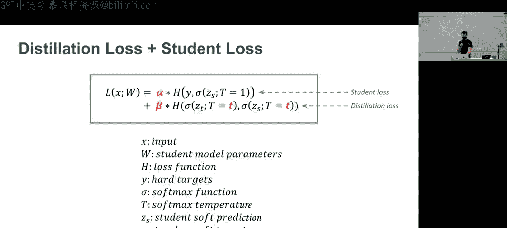
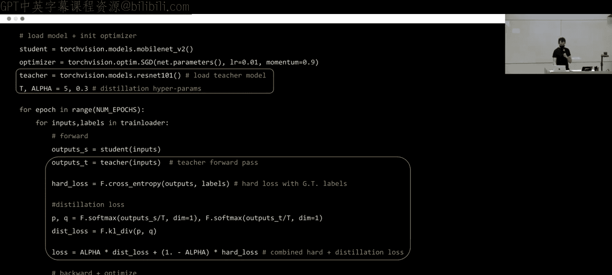
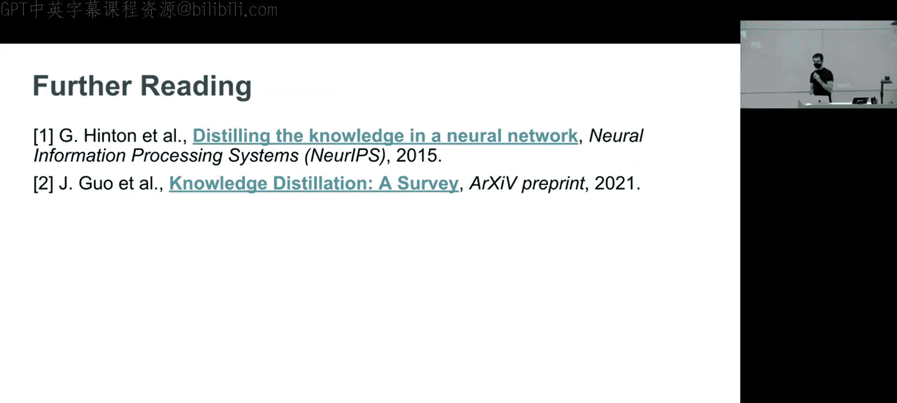

# 机器学习硬件和系统：011：知识蒸馏 🧠

在本节课中，我们将要学习一种名为“知识蒸馏”的神经网络优化方法。与之前讨论的量化、剪枝不同，知识蒸馏旨在将大型、高精度网络（教师网络）的“知识”迁移到小型、高效的网络（学生网络）中，从而在不显著损失精度的情况下实现模型压缩和加速。

## 概述

上一节我们介绍了通过剪枝来移除神经网络中的冗余参数。本节中，我们来看看另一种缩小神经网络规模的方法——知识蒸馏。其核心思想是，让一个已经训练好的、性能强大的大型网络（教师）去指导一个更小、更易部署的网络（学生）进行训练。

## 什么是知识蒸馏？🤔

在标准的神经网络分类任务训练中，我们使用“硬目标”（Hard Targets），即独热编码的标签（例如，对于一张猫的图片，猫的类别为1，其他所有类别为0）。这种方法只提供了正确类别的信息。

然而，一个训练良好的大型网络输出的“软目标”（Soft Targets），即经过Softmax函数处理后的类别概率分布，包含了更丰富的信息。例如，它可能给“猫”很高的概率，给“狗”一定的概率，而给“船”几乎为零的概率。这种分布揭示了类别之间的相似性关系，即所谓的“暗知识”（Dark Knowledge）。

知识蒸馏就是利用教师网络产生的软目标，结合原始的硬目标，共同指导学生网络的训练过程。

## 知识蒸馏如何工作？ ⚙️

以下是知识蒸馏的基本流程框架：

1.  **准备教师网络**：首先，训练（或获取）一个大型、高精度的神经网络作为教师。该网络已训练完毕，参数固定。
2.  **定义学生网络**：初始化一个结构更小、参数更少的学生网络。
3.  **前向传播**：对于一批训练数据，同时输入教师网络和学生网络。
4.  **计算损失**：损失函数由两部分组成：
    *   **学生损失（Student Loss）**：计算学生网络输出（使用温度T=1的Softmax）与真实硬标签之间的交叉熵损失。这确保了学生网络学习基本的正确分类。
    *   **蒸馏损失（Distillation Loss）**：计算学生网络输出（使用温度T>1的Softmax）与教师网络输出（使用相同温度T的Softmax）之间的差异。通常使用KL散度（Kullback-Leibler Divergence）来衡量两个概率分布的差异。这部分促使学生模仿教师的“思考方式”。
5.  **组合损失与反向传播**：将两部分损失加权求和，得到总损失，然后仅对学生网络的参数进行反向传播和优化。

### 核心概念：Softmax温度

温度参数 `T` 是知识蒸馏中的一个关键超参数。标准的Softmax函数为：

**公式**：`softmax(z_i) = exp(z_i) / Σ_j exp(z_j)`

引入温度T后，变为：

**公式**：`softmax(z_i, T) = exp(z_i / T) / Σ_j exp(z_j / T)`

*   当 `T = 1` 时，即为标准Softmax。
*   当 `T > 1` 时，概率分布会变得更“平滑”，错误类别的相对概率会被放大，从而暴露出更多暗知识，有利于蒸馏。
*   当 `T < 1` 时，分布会更“尖锐”，趋向于硬目标。

在训练时，我们使用较高的T（例如5或10）来计算蒸馏损失；在推理（部署）时，学生网络仍使用 `T = 1` 的标准Softmax来获得最终的分类结果。

### 总损失函数



总损失函数可表示为：

**公式**：`Loss_total = α * Loss_hard + β * Loss_distill`



其中：
*   `Loss_hard` 是学生网络与硬标签的交叉熵损失。
*   `Loss_distill` 是学生与教师软目标之间的KL散度损失。
*   `α` 和 `β` 是平衡两项损失的权重超参数，通常 `β = 1 - α`。

## 代码实践：实现知识蒸馏 💻

以下是如何在PyTorch训练循环中实现知识蒸馏的核心代码片段。假设我们已有一个预训练的教师模型 `teacher_model` 和待训练的学生模型 `student_model`。

```python
# 定义超参数
temperature = 5.0
alpha = 0.5
beta = 1.0 - alpha

# 训练循环内部
for inputs, labels in dataloader:
    # 前向传播：学生和教师网络
    student_logits = student_model(inputs)
    with torch.no_grad():  # 教师网络不更新梯度
        teacher_logits = teacher_model(inputs)

    # 计算硬目标损失（学生损失）
    loss_hard = F.cross_entropy(student_logits, labels)

    # 计算软目标损失（蒸馏损失）
    # 使用带温度的softmax
    soft_targets = F.softmax(teacher_logits / temperature, dim=1)
    soft_prob = F.log_softmax(student_logits / temperature, dim=1)
    # 使用KL散度，等价于交叉熵，因为targets是固定的
    loss_distill = F.kl_div(soft_prob, soft_targets, reduction='batchmean') * (temperature ** 2)

    # 组合总损失
    loss = alpha * loss_hard + beta * loss_distill

    # 反向传播与优化（仅更新学生网络）
    optimizer.zero_grad()
    loss.backward()
    optimizer.step()
```

## 进阶技术与开放问题 🚀

知识蒸馏领域发展迅速，出现了许多变体和进阶技术：

*   **教师网络的变体**：
    *   **集成蒸馏**：使用多个神经网络的输出平均值作为教师信号，可以提升知识质量。
    *   **专家网络**：针对大规模数据集（如数万类别），训练多个“专家”网络，每个负责一个子类别的集合，然后将它们的知识蒸馏到一个学生网络中。

*   **蒸馏模式**：
    *   **离线蒸馏**：教师网络预先训练好，固定不变。这是我们上面介绍的标准模式。
    *   **在线/协同蒸馏**：教师网络和学生网络同时训练，互相学习。
    *   **自蒸馏**：同一个网络内部，用深层特征或最终输出指导浅层或中间层的输出。这在具有“早期退出”机制的网络中特别有用。

*   **知识类型**：
    *   **基于响应**：使用最终输出层的软目标（本节主要内容）。
    *   **基于特征**：匹配教师和学生网络中间层特征图（如激活值）的分布。
    *   **基于关系**：匹配教师网络中不同层或样本之间的关系（如Gram矩阵），并将这种关系迁移给学生网络。

*   **特殊场景应用**：
    *   **跨模态蒸馏**：将从一个数据模态（如RGB图像）训练好的教师网络知识，迁移到另一个模态（如热力图）的学生网络。
    *   **无数据蒸馏**：在没有原始训练数据的情况下，仅利用教师网络生成合成数据或噪声数据进行蒸馏。
    *   **量化辅助**：使用知识蒸馏来提升量化后模型的精度。

## 总结



本节课中我们一起学习了知识蒸馏技术。我们从其核心动机讲起——如何将大型教师网络的丰富知识迁移到小型学生网络。我们详细剖析了其工作流程，包括软目标、Softmax温度、以及结合了学生损失和蒸馏损失的总损失函数。通过代码示例，我们看到了如何在实际训练中实现它。最后，我们概述了该领域的一些进阶技术与开放性问题，如集成蒸馏、特征蒸馏和跨模态蒸馏等。知识蒸馏是一种强大且灵活的模型压缩与性能提升工具，在资源受限的部署场景中具有重要价值。