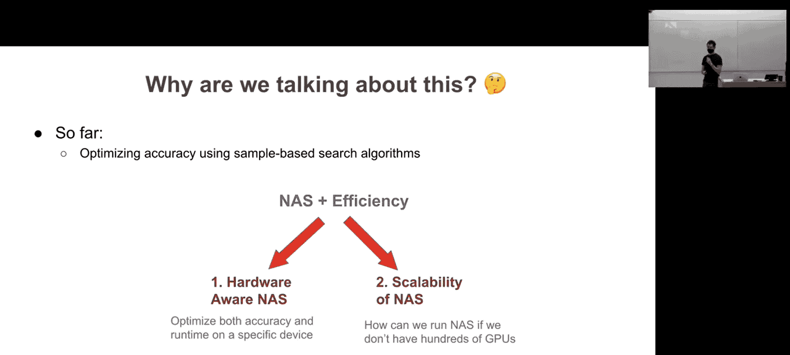
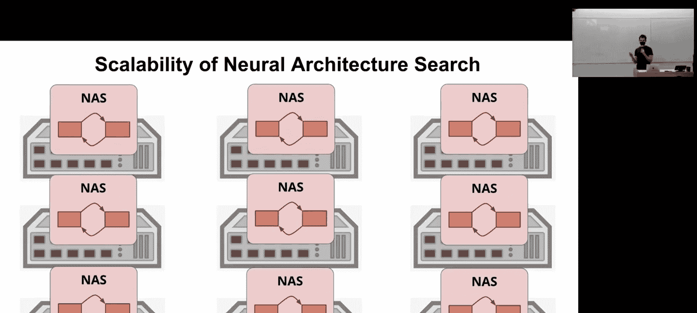
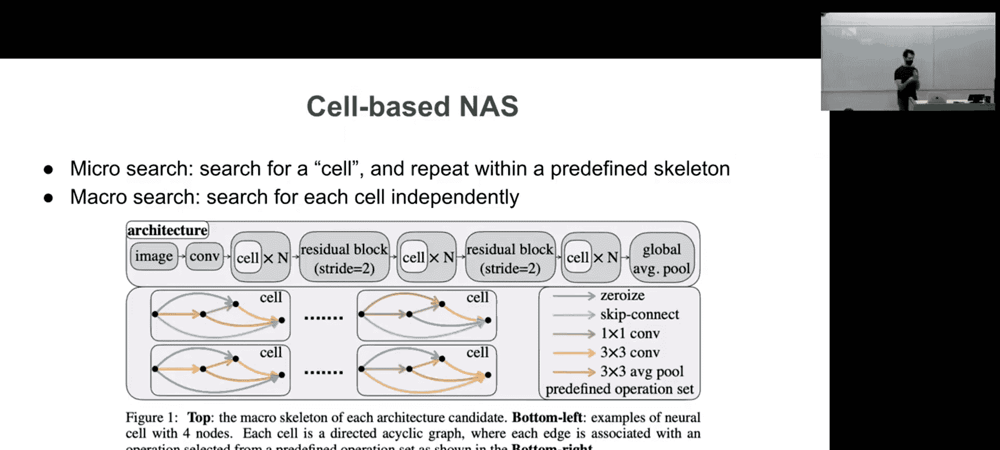
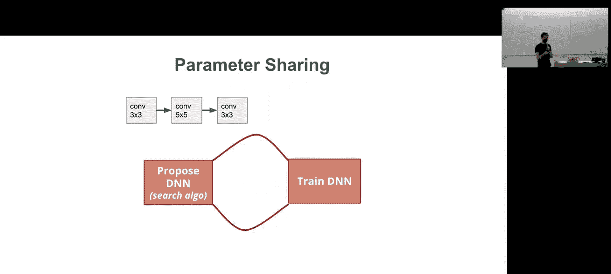
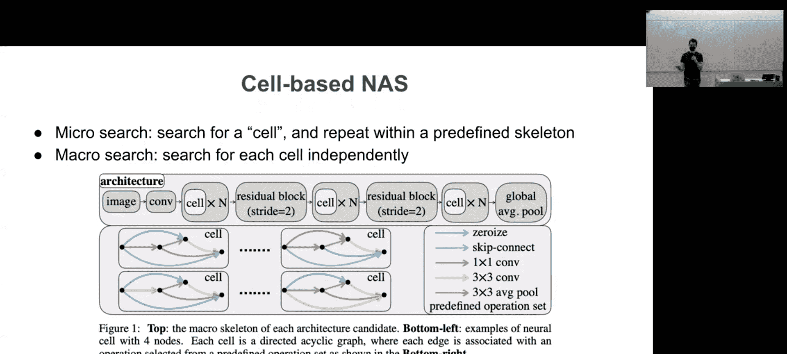
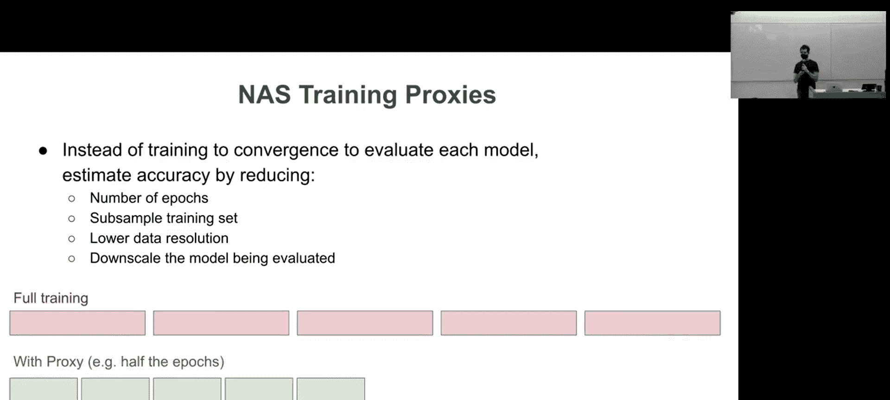
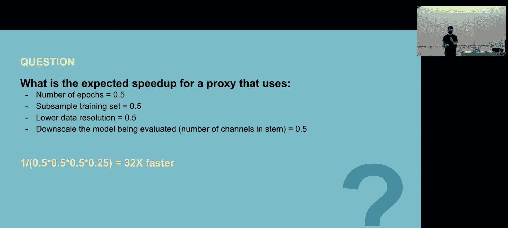
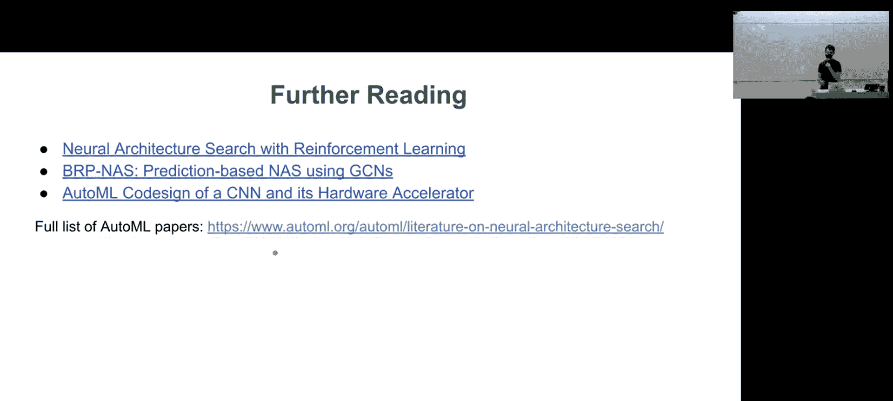

# 机器学习硬件和系统：012：神经架构搜索 (Neural Architecture Search)

在本节课中，我们将要学习一个非常有趣且高级的主题——神经架构搜索。这是一种神经网络优化方法，旨在让网络在硬件上实现更高效的运行。我们将探讨其基本概念、主要算法、如何提升搜索效率，以及如何与硬件特性结合进行优化。

## 概述

神经架构搜索旨在自动化神经网络结构的设计过程。传统上，神经网络结构（如AlexNet、VGG）依赖于研究者的直觉和大量试错。NAS通过算法自动探索和评估大量可能的网络结构，以找到在特定目标（如准确率、延迟）上表现最佳的模型。

## 动机：从手动设计到自动设计

上一节我们介绍了神经网络优化的背景，本节中我们来看看为什么需要自动化设计。

人们设计神经网络来完成特定任务。例如，AlexNet有特定的拓扑结构：5个卷积层和3个全连接层，这很大程度上基于传统图像识别工作的直觉。同样，VGG网络也是手动设计的，它基于“卷积层比全连接层更重要且计算成本更低”的直觉，因此增加了更多卷积层。

然而，这些设计中的具体参数（如层数384）往往是任意选择的。神经网络的一个强大之处在于，许多不同的拓扑结构都能通过训练算法（如SGD）学习到相同的功能。因此，问题就变成了：**我们如何设计出能获得最佳准确率的网络结构？** 这就是神经架构搜索要解决的问题。

手动设计基于直觉和大量试错，耗费大量人力时间。自动设计则转向了智能化的、自动化的试错，它虽然需要GPU时间，但正在朝着更快的方向发展。

## 什么是神经架构搜索？

上一节我们了解了自动设计的必要性，本节中我们来看看NAS最基本的形式。

在其最简单的形式中，神经架构搜索相当直接：
1.  一个算法提出一个深度神经网络（例如图中的绿色网络）。
2.  我们训练这个网络并获得其准确率（例如79%）。
3.  算法稍微修改网络结构（例如改变层数、滤波器大小），提出一个新的网络（例如黄色网络）。
4.  训练新网络并获得不同的准确率。
5.  重复此过程，最终在尝试过的众多网络中选择准确率最高的一个。

这种方法被称为**随机搜索**。它虽然简单，但效果不错，甚至可以超越人工设计的网络，因为它能自动化地尝试大量结构。

当然，除了随机搜索，还有许多更智能的算法。

## 基于样本的搜索算法

以下是几种主流的基于样本的NAS搜索算法，它们都需要实际训练候选网络来评估其性能。

### 1. 强化学习方法

NAS最初的研究始于强化学习。其核心思想是使用一个**控制器**（通常是一个循环神经网络）来生成网络结构。

*   **控制器 (Controller)**：一个参数化的函数（如RNN），在每一步预测网络的一个超参数（如滤波器数量、尺寸）。
*   **动作 (Action)**：选择一个具体的架构参数值。
*   **状态空间 (State Space)**：即**搜索空间**，是所有可能网络结构的集合。
*   **奖励 (Reward)**：训练生成的网络后得到的性能反馈（如准确率）。控制器根据奖励更新自身参数，以便下次提出更好的网络。

然而，早期的强化学习方法需要巨大的计算资源（例如，一篇开创性论文使用了800个GPU运行28天），这引发了人们对可扩展性的关注。

### 2. 遗传/进化算法

为了寻找更高效的搜索算法，人们转向了遗传或进化算法。这里介绍一个成功的变体：**衰老进化**。

以下是衰老进化算法的工作流程：
1.  **初始化进化池**：随机生成一组（例如8个）神经网络，并评估其准确率。
2.  **选择与变异**：从池中选择**准确率最高**的模型（“精英”），对其进行微小改动（“变异”）以产生一个子代模型。
3.  **淘汰与更新**：从池中**移除存在时间最长**的模型（“衰老”），无论其性能如何。然后将新的子代模型加入进化池。
4.  **重复**：不断重复步骤2和3。

移除最老的模型而非最差的模型，是为了在**探索**（尝试新区域）和**利用**（优化已知好区域）之间取得平衡。进化算法通常比强化学习更稳定、更高效，是目前最好的基于样本的搜索算法之一。

## 提升NAS的可扩展性

上一节我们介绍了搜索算法，但它们的计算成本可能很高。本节中我们来看看如何让NAS变得更高效、更易实施。

### 1. 缩小搜索空间：基于单元的NAS

搜索空间的大小随网络深度呈指数增长。为了应对这个问题，**基于单元的NAS** 成为一种主流方法。

其核心思想是：
*   固定一个网络的**骨架**（如整体的深度和阶段划分）。
*   不再搜索整个网络，而是搜索一个小的、可重复的**单元**的结构。
*   一旦找到最优单元，就将其重复堆叠到骨架的各个阶段中。

例如，假设一个单元内有5个操作，每个操作有8种选择。那么：
*   **微搜索**：所有单元相同，搜索空间大小为 `8^5 = 32,768`。
*   **宏搜索**：每个单元可以不同，如果有10个单元，搜索空间大小激增至 `(8^5)^10`，这是一个天文数字。

基于单元的方法大大缩小了搜索空间，同时借鉴了成功网络（如ResNet、MobileNet）由重复模块构成的经验，在实践中非常有效。

### 2. 参数共享

在传统NAS中，每个候选网络都从头开始训练，成本高昂。**参数共享** 技术允许不同的候选网络共享已经训练好的层参数。

例如，如果新提议的网络包含一个与之前训练过的网络相同的5x5卷积层，那么可以直接继承该层的参数，只需训练新增或不同的层。这可以显著减少训练时间，有论文报告其速度提升了1000倍。

### 3. 训练代理

完全训练每个候选网络直到收敛仍然很慢。我们可以使用**训练代理**来快速估计网络的潜力。

常见的代理方法包括：
*   训练更少的周期。
*   使用训练数据的子集。
*   使用更低分辨率的输入图像。
*   减少每层的通道数。

这些方法虽然不能给出精确的最终准确率，但能有效对网络性能进行排序，从而指导搜索方向。组合使用这些代理方法可以获得显著的加速（例如32倍）。

### 4. 高效的搜索算法：预测器

另一种思路是训练一个**元模型**来预测网络性能的相对排名，而不是每次都进行训练。

例如，可以训练一个**二元关系预测器**（一个神经网络），输入是两个网络的结构，输出是哪个网络更好的预测。首先用少量完全训练的网络数据对这个预测器进行监督学习，然后用它来快速筛选和排序搜索空间中的大量网络。这种方法能实现很高的样本效率，快速收敛到优秀模型。

## 可微架构搜索

上一节我们主要关注基于样本的方法，本节中我们来看一种不同的、基于梯度的范式：**可微架构搜索**。

其核心思想是构建一个包含所有可能操作的**超网**。在超网的每条边上，我们不是选择单一操作，而是将所有候选操作（如3x3卷积、5x5卷积、池化）的输出进行加权求和，权重为可学习的**架构参数** `α`。

**公式表示混合操作**：
`输出 = Σ_i ( softmax(α_i) * op_i(x) )`

在训练过程中，我们同时优化：
1.  网络权重 `w`：在训练集上，固定 `α`，优化 `w` 以减少训练损失。
2.  架构参数 `α`：在验证集上，固定 `w`，优化 `α` 以减少验证损失。

这形成了一个**双层优化问题**。实践中常采用交替优化的近似方法。训练结束后，选择每条边上 `α` 值最大的操作，即可得到最终的网络结构。

DARTS等方法使得NAS可以在几个GPU小时内完成，但这种方法在理论和实践上也面临一些挑战，是当前的研究热点。

## 硬件感知的神经架构搜索

到目前为止，我们主要优化的是准确率。但实际部署时，我们同样关心效率。本节中我们来看看如何让NAS同时优化准确率和硬件性能（如延迟、功耗）。

### 1. 多目标优化

在硬件感知NAS中，搜索循环增加了一个步骤：
1.  搜索算法提出一个网络。
2.  训练网络，获得准确率 `Acc`。
3.  **将网络部署到目标设备（如手机）或模拟器中，测量其延迟 `Latency`。**
4.  根据 `Acc` 和 `Latency` 计算一个**多目标奖励**，反馈给搜索算法。

奖励函数的设计通常有两种：
*   **硬约束**：延迟超过阈值的网络直接被丢弃。
*   **软约束**：使用加权和等形式，如 `奖励 = Acc - λ * Latency`。

### 2. 延迟预测

直接在设备上测量延迟虽然准确，但麻烦且难以扩展。因此，人们研究如何**预测**延迟。

*   **FLOPs/参数量**：简单的代理，但相关性往往不佳，因为它忽略了内存访问、硬件并行度等实际因素。
*   **逐层累加**：预先测量每种操作在目标设备上的延迟，然后将新网络的各层延迟相加。这比FLOPs更好，但仍未考虑层间的融合、数据依赖等整体效应。
*   **基于神经网络的预测器**：将网络结构（如图神经网络）作为输入，直接预测其端到端延迟。这种方法准确性高，且只需少量样本进行训练，是当前的研究方向。

### 3. 硬件与网络的协同设计

一个更前沿的方向是**协同设计**，即同时搜索最优的神经网络架构和为其定制的硬件架构参数（如缓冲器大小、并行度）。

这通常使用强化学习，控制器同时输出网络操作和硬件配置。虽然搜索空间更大、更复杂，但有可能在特定硬件（如FPGA）上实现精度和效率的双重提升。

## 总结

本节课中我们一起学习了神经架构搜索的各个方面：

1.  **动机与定义**：我们了解了自动化网络设计的需求，以及NAS通过算法自动搜索高效网络结构的基本流程。
2.  **核心算法**：我们介绍了基于样本的搜索方法，包括早期的**强化学习**和目前更有效的**遗传/进化算法**（如衰老进化）。
3.  **提升效率**：为了应对NAS的计算挑战，我们探讨了多种技术：**基于单元的NAS**缩小搜索空间；**参数共享**避免重复训练；**训练代理**加速评估；以及使用**预测器**等更智能的搜索算法。
4.  **可微搜索**：我们学习了**DARTS**等可微架构搜索方法，它们通过梯度优化架构参数，速度更快。
5.  **硬件感知**：我们深入探讨了如何将硬件指标（如延迟）纳入优化目标，比较了不同的**延迟预测方法**，并简要介绍了**硬件-网络协同设计**这一前沿方向。

神经架构搜索是自动化机器学习的关键组成部分，它正在改变我们设计神经网络的方式，使其不仅能达到更高的精度，也能满足实际部署中对速度、功耗和资源的严格约束。