# 013：康奈尔大学《机器学习硬件和系统｜Cornell ECE 5545 Machine Learning Hardware and Systems》中英字幕 p13 -13-Lecture 11_ Kernel Computation.zh_en -BV1CCqPYSEP5_p13-

So today we'll talk about something called kernel computation and this is kind of the first of our lectures on software。

 so we already talked about you know we started by talking about hardware。

 we talked about architecture efficiency comparing different chips。

 then we did a complete shift to neural networks and how we can optimize neural networks without necessarily knowing much about the hardware itself。

 we're just optimizing the number of operations and the size of those neural networks。

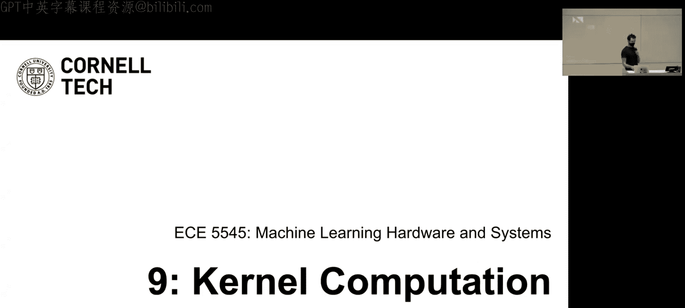

And now we want to move on to an next kind of critical component。

Of actually running these deep neural networks or deep learning workload。

 which is software and it's often kind of overlooked if you're using kind of you know Pytorch or you're thinking about a GPU you usually don't think about the stuff in the middle like you often take it for granted。

 but it's actually really hard to do and really important as well in kind of the performance of neural networks and I would say that's kind of one of the main reasons in videos on top right now because they have a really good software stack。

So I don't know if you guys follow this kind of news， but you know Graphcorre。

 it's a British company， which is creating an AI chip called the IPU。

Intelligent processing here I don't know， I don't remember what it stands for。

 but it's basically everyone thought you know once these guys will benchmark their numbers。

 then they will blow N video out of the water it will be much better there's no question about it。

And what happened was actually when they benchmarked their numbers。

 they were slightly worse than NviDdia in all of the metrics。

And so you read all the analysis articles on this kind of thing and it was saying basically their software isn't there yet and that is much harder to do than the actual hardware that's why they're behind and so so never underestimate software that's how companies kind of go under in the chip industry。

So so what will we talk about in software， we'll talk about mapping operations to hardware devices。

 we'll talk about compilation and we'll talk about different kernel implementations and so what that means is you know given simple piece of code like this vector vector multiplication or if if the if the A and Bs are vectorized here than matrix matrix small then how do we actually run this on hardware。

 what are the different algorithms for doing that， how do we map it to the processing elements and so on So the question we're trying to answer is how do we optimize these fundamental deep neural network primitives onto our。

You know， hardware。And this is a very simple view of the machine learning software stack。

 I think it's the most relevant view for a machine learning user or a deep neural network designer or someone who runs neural networks。

But it basically usually what you see is Pytorch or Tensorflow or something up there。

 and obviously that runs on top of Python。 So it's a Python library where you know you're calling。

Python functions。But then what does Python call， so depending on the hardware。

 it calls different things。And currently it calls a library called QUDNN if it's going to run on a GPU and QUDNN is written in KudDa。

 so QUDa is a programming C-based programming language which runs on GPUs if you are running this on a CPUU and Intel1。

 it usually calls a library called MKL so that's mathth kernel library and then it has this extension called DNN so it usually calls MKLDNN and that's written in C++ and everything below that I think we're not really interested in because it's standard it's the same across different kinds of programs but this part is quite interesting to us。

And so if you just Google the QDNN documentation or the QDNN API and you start looking through their functions to kind of see what granularity they have their implementation at。

 it's something like this， so they implement the whole convolution for example。

 so now when you think of Ptorch think of it as just a wrapper for QDNN if you're running on a GPU basically and so that's actually all it is。

嗯。Of course， it has some other stuff kind of in presenting a nice and usable API。

 but the performance it gets is usually by using the latest QDNN functions。嗯。So in this lecture。

 we want to look at different algorithms of implementing matrix multiplication。

 so matrix multiplication I can implement it using four loops very simply but。

How else can I implement it and there are many different ways usually called transformations or kernel implementations that we can do to the matrix operation to make it more efficient in some cases soll also we'll look at some of those and we'll look at the convolution as well for some of those。

Clonnal implementations。So we'll start with something called In call image two columns。

 we'll talk about stress transform minorgrad transform。

 fast Fourier transform unlock domain multiplication。

 so that these are kind of kernel implementations of matrix small and convolutions where you don't change the result or you don't change the final result by much you're not approximating the matrix multiplication。

 you're just performing it using different mathematical operations。

We'll also start looking a bit about approximations of matrix multiplications。

 so in that case we are actually not doing the exact operation anymore。

 similar to pruning where you know we're approximating an operation with a pruned operation here we will approximate an operation with something called the low rank approximation of that matrix and so we'll start talking about that and we'll give a very brief overview of tensor decomposition as well。

And throughout kind of the next few slides， you'll find me you know saying we saved one multiplication。

 but we're replacing that with 10 additions or something like that and so whenever I say that just keep in mind that you know multiplications are way more expensive than additions so in this case about four times more expensive。

嗯。And so keep that four to one ratio in mind when I say these kind of things。I think even at N8。

They're even more efficient。So， maybe yeah。4。032。 Yeah， So it's more than four times。

 So 4 to 10 times or something more efficient。Well not 10，4 to  eight times more efficient。Okay。

 let's start with the first transform。Any question about the motivation or kind of why we're looking at this so far？

No， O。So Inol， so Inco is a way to implement the convolutions on most kind of commodity hardware。

And what does that mean， so what the inter literally means is transferring an image from you know a 2D image to columns in a matrix。

Right and so for example， for this convolution here we have a filter and we have a feature map and we have the output so basically we need to sweep that filter across the feature map to get the output right so the first filter will be convolveed with this piece of the input and then you'll get this output but convolution is not kind of natively supported in most commodity hardware right you would have to transform it into additions and multiplications and so on and usually matrix multiplication is very well supported actually and most hardware is built so that matrix multiplication is implemented really efficiently on it。

And so how do we transform this convolution into a matrix multiplication？

And so what we can do is we can flatten the filter， so instead of being kind of a 2D shape。

 it can be a 1D vector。And then for each window of the feature map， we convert the image to a column。

 so the in call part is just this transformation here。

Where we will take that window and create a column in our matrix from it。

And so by doing matrix multiplication， in this case， the vector vector multiplication。

 we can get the same output as we got here。Then as we sweep the convolution window。

 we take the next window and then we put it as a new column of our new kind of transformed image and we keep doing that。

So the next window and the next window， and so what this gives us is kind of it transforms our convolution into a matrix multiplication。

And it's very simple， but it's basically how most convolutions are implemented on GPUs because you know GPUs again don't support natively convolutions so how would you implement it you need to transform it into a matrix multiplication which is really well supported and really well optimized Can someone tell me what would be an example of hardware that does support convolutions natively。

So can you think of anything？So hint， we we looked at that hardware。嗯。Soorrry。

An image processor may support that natively， but not that I know so I mean TPUs for example or or kind of these purpose built chips would actually support that natively and usually the way they do that is they have a weight stationary data flow right so they would get that filter they would store it。

In kind of these pes。And， Yuonzhou already replied as well on。嗯。On the chat。 But yeah。

 basically you would get the filter， you would store it in the Ps and you would leave it there and then that weight stationary data flow。

 you know， you would pass different inputs across that filter and you would get the results。

 So so why is that natively supporting。Convolutions as opposed to a GP or a CPU is because you know the hardware was built for this operation the same is true for NPUs in mobile phones。

 for example， where you also have kind of a specific cache to hold the filters in a convolution operation the same was true for the DLA that we designed back at Intel where the hardware is built for a convolution and we actually did the opposite when we had a fully connected layer we converted it to a convolution so this transform can go either way if you think about it。

So so yeah， but Inal is very relevant right now because you know。

 most hardware is more general purpose and。And it doesn't have native support。

 it doesn't have this you know assembly instruction or V IW instruction， which says do convolution。

Yeah。Yeah so that's a good question so turning the image into columns has no computational cost right because it's just reorganizing the memory but it has so that's kind of leading on to the next slide where not this slide but it does have a memory cost right so what would be the memory cost that's a good question。

没有。Yeah， exactly。 so so we so as one he pointed out we are replicating the data right so we have we're using got more memory bandwidth or more on chip buffer to to make sure that that data is replicated。

 And again， that's why we looked at all of these weight stationary activation stationary or whatever data flows to avoid these this kind of replication it also。

It seems that the access pattern for your data would also be a bit more complex。

 but usually people do that inter call kind of as an offline step almost。

 so they would reorganize the data before it goes into your convolution operation so that these aes actually fits really well in the cache and so on。

And this is actually something that you will optimize during your next assignment。

 so when when you're implementing。Or when you're optimizing different operations on GPUs and CPUs using TvM。

嗯。So Incal also can work on the filter， so it doesn't have to just be the image two columns。

 we can also do it on the filter， although this is much less common because it introduces all of those zeros。

 but basically we can flatten the image in this case or the activation map or the input feature map。

Into a vector。 And then we can replicate and pad the。

The filter in such a way that when you do vector matrix multiplication then you would get the same result of the output so in this case you know our first window is one。

 two，4，5 so if we multiply this you know one， two we multiply by one， two and then four。

 five will multiply by 3，4 so it would still work out。

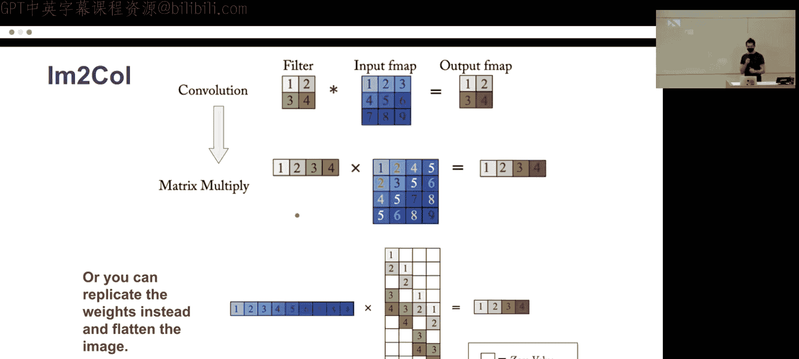

So so what is one problem with M to call， we already kind of covered that through Amman's question。

 but data replication the algorithmic level is expensive and may increase the demand for external or internal memory bandwidth or storage。

 basically。

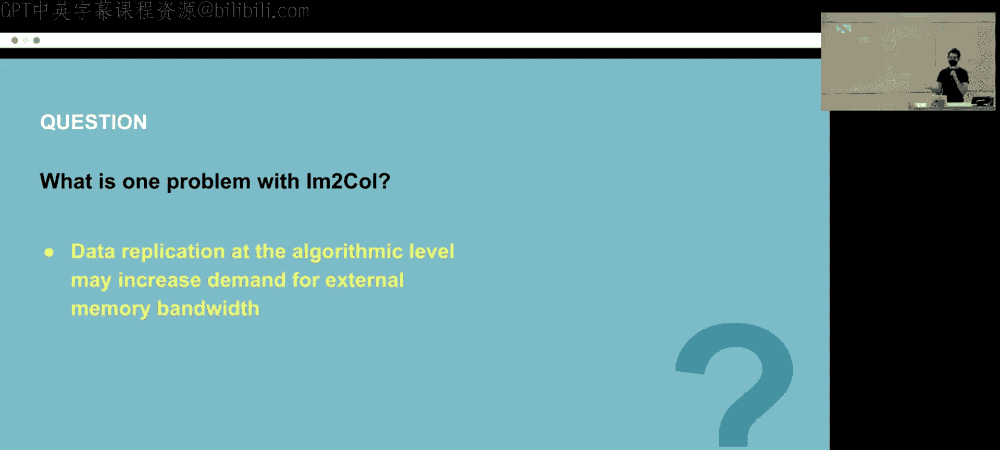

Okay， so so that's In， people kind of colloquially refer to Inco as you know convolution to matrix small conversion。

 but the inter algorithm itself， if you call it from nuumpy or something， it just that conversion。

 that memory reorganization， that's all it does。Now let's look at another transform and this is where we'll start you counting multiplications and additions and see how much we saved through each one。

And so on the left here， I'm showing just normal matrix multiplication。

 so you you you have this a matrix。Multiplied by the B matrix and what you do。

 you know you multiply the rows by the columns and you add the partial products and that's what you get AE plus BG。

 AF plus BH and so on So you get total eight multiplications and four editions。

So someone called stress and said I can do this in a better way。 I don't need eight multiplications。

 I just need seven multiplications。 and so that's what he came up with he said if we create these partial。

Partial results， K1 through K7， we can actually compute this in seven multiplications and 18 editions instead。

So he saved one multiplications and he gained 14 additions。

It's arguable whether that's better or not， as I said there is a big ratio between 4 to8 in the energy efficiency of multiplications versus addition。

 it varies by the precision as well so multipliers grow quadratically with the input size。

 at least integer multipliers whereas others grow linearly。

And so this on many hardware types would actually give you a lot of savings or some savings。

In deep learning and in deep neural networks， we also have an extra trick。

Because some of these multiplications or subtractions and additions。

Can actually be done offline because some of these correspond to our parameters。

 And so if we're doing this during inference， our parameters。

 let's assume that the B matrix here is our parameters or our weights。

 then we can compute those things offline so not during inference。

 I can compute it once deployed to a million devices and run it there with just 13 editions instead of 18。

And so so that's， you know， that's one example， a trick of kind of speeding up matrix multiplication。

So another one which is quite interesting， but now actually。

 are there any questions about Strins transform？Is it it kind of sink in， does it make sense？

We can go through kind of all of why this works and so on。

 but it's just you know it's just reorganizing operations literally， for example。

 if you know if you factorize this in a certain way。

 then you can transform one to the other very easily。

 by just changing where the additions and subtractions happen and so on。嗯。So。

Questions in real land or online。O。Okay， so another transform which is really interesting。

 we actually use that one a lot when designing our accelerator is Ygrad transform and now we're not talking about matrix multiplications anymore。

 but we're talking about convolutions。So let's take a look at an example of a one dimensional convolution。

We have a filter denoted by F0 to F2， and we have an input that's kind of very long。

 But let's take a tile of that input I 0 to I3。And so we need to sweep that filter across that activation map or that input。

And if we write that in matrix form， it looks like this， so first we multiply the filter by I0 i1 i2。

And then we sweep the filter one step and we multiply the filter by I1 I2 I3 right so that's the definition of convolution taking a filter。

 this is a one dimensional convolution， we're just sweeping the filter across the input and we're just writing that in matrix form here。

And so how many multiplications and additions does that take six multiplications and four additions？

So a person called Winograd came around and said I can do this better and it's in the same kind of spirit as stress and transform。

 but now he's also leveraging the fact that there are common pieces of data in that matrix so that matrix is not doesn't have all unique values or is not unrestricted it has each one of its rows is a shifted version of the row before it with one new value and the rest are old values in the case of Stride one for example。

And so he also reorganized the computations there and he proved that this is the minimal way。

 this is the minimal number of multiplications required for。For a convolution window。

to do the same exact operations and so again， he has these equations where he reorganizes you know the normal operations that you would have done here like I0 at0 plus i1 f1 plus I2 f2 into these intermediate values k and you know you computed using this equation。

So。So things to keep in mind with the Y grad transform well and actually we can do the same trick right so some of these results can be computed offline so we can even reduce those number of additions further So in this case we go from six multiplications for additions to four multiplications and just eight additions if we if we leverage the effect。

And yeah， so you， someone。Okay。SoSo that's a good question whether the transformation scale to larger inputs so we will talk about that for Winnograd。

 but for stressescence transform in general， I think the larger the input， the more savings you get。

If I'm not mistaken。So， so it does scale quite well。

 and I think people usually do stress and transform for very large matrices。

And that's why you don't actually see that much in deep learning because matrices aren't that huge。

 at least not offline filter matrices， which are usually what we target for these transforms。Yeah。

 so。Actually， we target both， we don't just target the parameters。

 but I think it works better for larger matrices。So a few comments about Winograd。So typically。

 the larger your convolution window is the more savings you can get。

So for a three by three convolution， I think this is the one we implemented in DLA was that you would get like 2。

25 x reduction in multiplications so the example I showed before for one D con it went from six to four multiplications in this case it would go from like you know9 to。

6ix or something or or9， no，9 to9 to 4， something like that。 So it。

 it really reduces the number of multiplications。However。

 one thing to keep in mind is especially if you're creating custom hardware for rhinograd。

Is that the transform is specific not just to the filter size。

But also to the size of the tile that you're operating on。

So what I showed in that previous thing is a tile size of four and a filter size of three。

So the numbers to transform into Win grad domain would be very specific。

 So these these computations would be very specific to that。To that size。

 if you're changing the the tile size。 So this matrix now has， you know。A bigger tile size。

 then it wouldn't be using the same computation here。

And people have generalized that computation by writing it in matrix form instead of writing it out using these equations。

 and we won't go through the matrices， but you can find them in the paper。

 but basically you transform your input and filters with these G and B matrices。

And then you can undo the transform through these a matrices at the output right so you sandwich your operation with these a matrices and a transpose and what these matrices are doing when they're multiplied by the filters and multiplied by the input。

 they just transform them， they basically to a generalized form of these equations。

But one thing to keep in mind is obviously these these G B and A are very unique to each of your filter and tile size。

 So if if I create custom hardware for this and I want to embed this transform in my hardware then。

I can do it for just one size of the convolution， if I do it for another one。

 then it needs to be configurable and that has its own overhead as well。

And the real savings from minor grarad transform actually come from the fact that once we transform our input and filters。

 it's not a convolution operation anymore， it becomes an element wise multiplication。

And so after kind of applying all of these transforms， then we don't need to do a convolution。

 we don't need to sweep the filter across our input many times we just do a multiplication instead。

Also one thing to keep in mind again is that these filters。

 they can be transformed offline so they don't need to be done online。

 but multiplication by these bes， so transforming the input needs to be done online while you're performing your inference and these A's as well to undo the transform need to be done online。

So one one note of caution and this is actually something we found empirically as well with these transforms is that when you're using lower precision。

 so let's say I'm using in eight precision for my numbers then。

The transform itself is usually much less robust to lower precision so multiplying by those Gs and those A's and those Bs are you would lose more accuracy if you do it in lower precision。

So usually what people do to overcome that is that they do the transformation in high precision。

 they would do this element wise multiplication in the lower precision。

So usually FP 16 and into8 or something like that。And this is not just true for rhinograd。 I mean。

 the empirical results I saw were on rhinograd， but it's also true for other transforms that we're talking about。

 so performing that initial。Transformation is typically done in higher precision for that reason。

Okay， any， any questions so far。日。So now you should know stress is transform and why to grad transform。

Does it all make sense it？O。Now， FFT transform。 So who here remembers what FFTs are。

I hope everyone know。So or FTs， just Fourier transforms， discrete Fourier transforms。So。Okay。

 so so I mean Fourier transformation is is one of the most important transformations on earth。

 it's basically going you must have taken it in kind of a digital signal processing course where you're going from。

A time series signal to have the frequency components of that signal right And so usually it's done。

 let's see。 usually it's done。 this is kind of the equation for discrete Fourier transform。

 But you multiply the input with this exponential of you know， yeah。

 with this exponent basically and you sum up over the size of the input。 And so so it's basically。

 you know， this transform and this inverse transform gets you from traditionally the time domain to the frequency domain and usually the。

You know， the common examples are， you know， you have a sine wave signal。

In the frequency domain so this is time， and then you have frequency。

I think the sine wave is like this。 I may be wrong。 And then the cosine。Is。You know。

 symmetric or something like that。And so。So， so that's kind of。Don through4 a。Transform。And in。

 in its。And this is for continuous function， what I'm showing on the board here。

So for continuous functions， there's an integral here。

 whereas for discrete functions we can use the summation and so what are we doing here。

 we're transforming the weights or our filter and the input through Fourier transform。And then again。

 the convolution theorem states that you know if you do convolution in the time domain。

 it's actually equivalent to multiplication in the frequency domain。

 so it's quite similar to Y grad transform in the sense that you you're replacing this computationally heavy operation of convolution with an elementwise multiplication。

But what are you paying as an overhead， you actually need to have same size you know tensors or same size matrices in this case to be able to do that elementwise multiplication so what we end up doing is actually padding this filter with all zeros to be the same size as the output feature map。

In order to perform this elementized multiplication。And so yeah。

 so if you're doing the convolution normally， you're sweeping a filter size。

 in this case a 2D filter of size r times s on an image。

with output dimensions P and Q and so the total number of operations will be something in the order of Rs times Pq so once you do the Fourier transform。

 this becomes a multiplication， but you're also increasing the size of your filter and so in this case it becomes p times q times binary logarithm of p times q。

So it goes from if P and Q and RNS were all the same numbers。

 it goes from n squared to n log n basically， so it scales much better。

 but obviously the condition here for S speed up in the actual operation is that r times s must be bigger than the logarithm of p times  Q。

So if your filter is way smaller。than the output size and it's still smaller than the log of the output size then you won't get a speed up actually in this case and you will have also paid for the transform overhead which is not trivial as well so yeah for all of these for this specific transform you don't always get a speed up it really depends on your dimensions it also depends on the transform overhead as well。

Okay， any questions？Feel like I'm going a bit quickly through these transforms。

Stop me if you have any questions。嗯。I think reading through them in the book chapter as well afterwards will kind of give you a bit more clarity。

 but you can also ask questions now。O。Allright， so I mean all of the transforms I talked about so far are ways to implement either convolution or fully connected layer and so if you think back to that you know QDNN library that we talked about in the beginning。

 you will find different function calls for those so you'll find Con forwardward 2D FFT Con forward  to the Ygrad and so on and so there will be implementations in the QDNN library for all of these kind of transforms。

This is another transform， which I think is not supported in QDNN now， but maybe soon。

 and so what is log domain multiplication， you have two numbers that you want to multiply a times B。

I can write those as2 to the power of x times2 to the power of y。

 if I can find a way to transform you know the A's to2 to the power of x and the B to the2 to the power of y。

 right？And then again， in that case， this is a multiplication， but in the logarithm domain。

To do that multiplication， I just need to add the exponents because now I have a common base for them。

 right。And so then you would get the result two to the power of Z。嗯。

And so this is basically log domain multiplication if I can find the conversion from a to2 to the power of x。

If I can find that x value， then I can do an addition instead of multiplication， right？

And so how can I find that x， if I have a number。嗯，诶。

And I want to transform it into2 to the power of x。 How can I find the x？嗯。Yeah， okay， good。

 People are awake。 So basically， you just take the logarithm with base2， right。😊。

And so that's what we do， so to transform into the log domain， we take our inputs。

 we take the binary logarithm of them， and then we get those x's and y's。

 and then now we don't need to do a multiplication anymore we can do in addition and get our Z's。

And then after we get the Z， we can do you know， two to the power of that number and we get the final result again。

And so this is really nice because。You know， if multiplication grows quadraically with the bit width and it's much more expensive。

 it's four to eight times more expensive than additions。

 then this can just be a simple way with a single operation to transform， you know my inputs。

And my outputs into to and from this binary domain and then or this log domain rather and then I can do addition instead of multiplication so instead of you know counting the number of multiplications and everything I actually got rid of all of the multiplications。

 this is great right。So one the main one of the issues here is you know， what about negative numbers。

 what do I do with those？哎不懂吧。好告人还。Yeah， so so that's that's a good question so you know the。

Converting， actually finding the log of numbers with high precision is not efficient。

So so that's one problem。 and even the exponent， so the exponent is also quite expensive。

 it's more expensive than a multiplication for sure。And so， so that's one of the issues。

 Another issue is， you know， what about negative numbers， What do I do with those？

 How can I take the log of negative numbers。What do you think。Come on。I'm sorry。Yeah。

 so that's a good point。 You don't actually need to take the log of a negative number right so you can just basically convert the magnitude of the number using this transformation then compute the sign offline so or not offline。

 but in a separate computation where it's usually just x or of the two signs of the inputs。

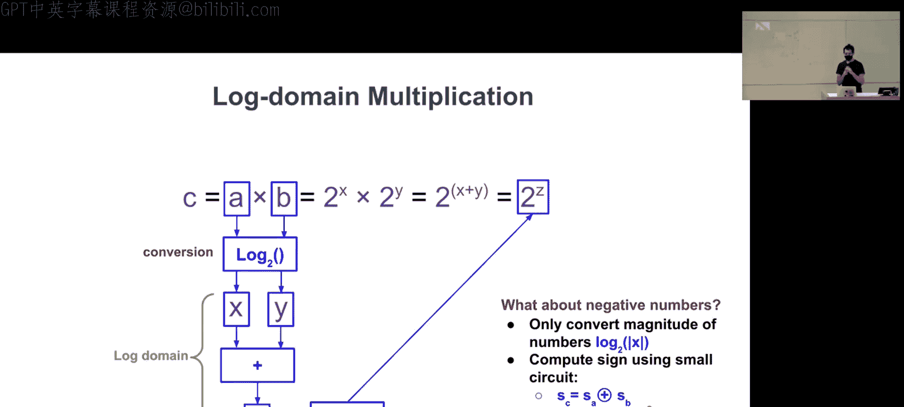

嗯。And so， so what is the current problem with log domain transformation。

 Am mine already touched on this。 you know， the transformation itself is expensive。

 but can you think of another problem， So James。Easy to overflow。 Can you give an example。好。Oh。

 I see。 so you can represent more numbers in the log domain because it compresses your numerical range and then when you convert back。

 you can easily saturate the output， right？嗯。It may be possible， although I will say。

 I mean the operation itself shouldn't change your numbers right it's just a way of executing a multiplication in an efficient way。

 you can think of it that way。 So if you were going to overflow through a log domain multiplication I think you would have overflown anyways with a normal multiplication so yeah。

So， one。啊就这我。好的。Yeah， so precision could be an issue as well because actually it's it's an issue for log domain and it's an issue for all of the other transformations just because you're remapping your numbers into a different kind of domain。

 especially with the log domain where you're shrinking that domain。

 then you might need higher precision for the initial numbers before the transform。

 so that's also truly。And I mean one of the issues is， you know。

 I'm never just doing multiplication right， I'm always doing multiply and add。

 so how can I add two numbers in the log domaining。嗯。I mean。

 there is no straightforward way so if I have。If I have those two to the power of x and two to the power of y。

I can， I can multiply them， but to add them， I need to kind of convert back。

And so that's one of the issues， you know conversion is costly and I can' reduce my numbers before doing the conversion back to the normal domain I need to do a conversion for all of these partial products before I do an addition and that has been the main reason people don't use log domain multiplication even though it's so attractive it is actually even if we need to use a bit higher precision even if there is a bit of accuracy last time we need to retrain for or something it's actually transforming all of my multiplications to ads I mean this is amazing right。

And so why haven't people actually done this it's because I can't add to log domain numbers not efficiently。

 there are so many approximations out there but they lose a lot of precision in some cases。

 they're expensive and they require specialized hardware in other cases so you can't implement it on GPUs or things like that and so that has been the main issue so far。

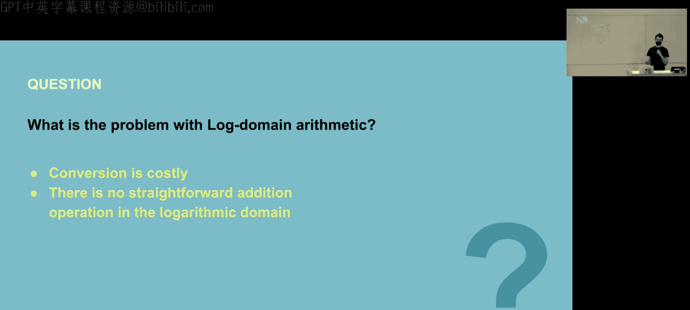

Good news， though， digging through kind of invidious patents， there seem to be working on it。 And so。

 so I found this patent， which。😊，I will look through it first。

 but I think I'll get you guys to implement it in assignment4 because it's quite interesting so they actually found a way to add log domain numbers quickly instead of converting back to the linear domain so they describe it in the abstract here very simply my decomposing exponents into separate quotient and remainder components。

 sorting the quotients based on the remainder summing the sorted quotient so it's a whole kind of。

It's a big math trick， basically， but they actually made it work。 it seems。

 at least from this patent。 There are no publications on it yet， but there is this patent。

 So I'm guessing in the next generation of GPUs， you will see some， you know。

 someone talking about log domain multip multiplyfuse multiply ad。Which would be really cool。嗯。

So so yeah， so this was one of the main issues people are really focusing on it。

 they're trying to solve it and hopefully you guys will implement it。

So how do we select which transform to use？So what do you think can。I'm sorry。And ask Nvidia Okay。

 so so I mean， that's that's a good approach because it's actually what happens on GPUus again。

 digging through the QDN library you'll find this function。😊。

Could D NN find convolution forward algorithm execution。Basically。

 this function attempts all algorithms available for con forward。

And it will provide kind of the the runtime for each one。

And so that's why whenever you're benchmarking a model。On a GPU。

 you kind of discard the first few runs because like through training， for example。

 you discard the first few mini batches or something。

 because at the beginning what NVIDdia is doing or the Cuyian N library is doing or Ptorrch maybe at this point as doing is it's trying all of the different transformations for each of your convolutions and each of your fully connected layers。

 it's seeing which one is fastest and then it will continue training with that one or continue inference with that one。

And so there isn't really a good heuristic and sometimes it's just too complicated to compute it by hand。

 even though you can count multiplications and additions for many of those。😊，But but yeah。

 so there are these benchmarking functions in the library itself to just find the execution time for each kind of implementation。

嗯。Okay， so we talked about a bunch of kernel implementations and this will actually be the topic of your assignment four。

 so the last assignment， the next assignment is assignment three will be on compilers。

 which we are preparing now and will be released hopefully on Monday。

 but in assignment four you will go and implement all of these transforms by hand。

 which I think will be a really cool exercise。Now let's talk very briefly about approximation of matrices instead of finding new ways of implementing the exact operation of matrices。

 let's touch upon you know low rank approximation of matrices really quickly and when I say low rank approximation。

 do people know what I mean or not really。No， O。When I say eigenvalues and eigenvectors。

 people remember， okay， good。And so basically， eigen decomposition is you know。

 finding the basis vectors of a matrix， for example。

 and what the scale of each of those basis vectors is。

Eigen decomposition I think works for very specific matrices。

 I think they have to be square matrices if I'm not mistaken and the generalization。

 you can think of this as a generalization of eigen decomposition for any size of matrix it's called singular value decomposition。

😊，And so what is happening here is you have a matrix m， the dimensions are m times n。

I can decompose it into a matrix U， a matrix sigma， and a matrix V。Transpose。

And so U and V here are if I click， maybe yeah。U and V here are called the orthoormal basis vectorctors of that subspace so similar to eigenvectors。

 these are now the analogous thing to that they're my basis vectorctors for the subspace and these singular values are the scalevalues so this is a diagonal matrix。

 everything else is zero and each one of them is similar to the eigenvalue it is the material it's called the singular value。

And so even if you don't remember what eigen decomposition is， then this is basically。

 you take a matrix and you transform it into three matrices。😊，So how does that help me？

I used to have one matrix and I thought that was too much computation。

 how does transforming it into three matrices helped me。是。Okay， I'll tell you。 so basically。

 what we can do next is。We can there is a very nice property for those singular values again the analogs thing to eigenvalues。

 they tell me the importance of each of my basis vectors。

 therere the scale value there is how much does this basis vector contribute in constructing my matrix right when I multiply those things together。

And so what I can do is that I can actually remove the small ones。So I can remove the smallest。

 you know。Singular value without affecting the reconstruction of M。So I removed one here。

 then I can remove another one and remove another one and basically I can start removing those smallest singular values。

Whilst minimizing my reconstruction error of that matrix M。

And so what's happening here is that I'm decreasing the they call it a lower rank approximation because I'm decreasing the rank of that matrix。

 I'm decreasing the number of basis vectors that I need to represent that matrix or reconstruct that matrix。

And so every time I remove one of those singular values。

 I can remove in corresponding row and column， and so now my matrix has become this much smaller computation of matrix。

 scalar matrix multiplication。So does that make sense？So， yeah， three。我之该。No。

 it's not linear so usually you can remove kind of the bottom， I don't know。

50 or 60% of the singular values and you would lose like I don't know。

2% in your reconstruction error of the matrix or something like that。

So it's not linear but it's it's not there is no hard rule here it really depends on your matrix people have said that you know the matrices in deep neural networks are fundamentally low rank they don't need that many that much representation power these networks are over parameterized already and that's why you can do low rank approximation quite effectively for many of them。

嗯。So yeah， so what are we doing， we are representing the matrix with fewer basis vectors。

And so now you know my computation becomes this instead of becoming you know multiplying something by a matrix M。

 I'm multiplying something by two matrices， so I'm just you know absorbing these singular values into the V matrix to create this V dash。

But basically， I used to have an M by N。You know， matrix multiplication。

 now I have two matrix multiplications n by K and K by n。And so so how do I get a speed up。

 It depends on K， which is also known as the rank of the matrix or how many basis vectors I need for it。

 And so when do I get a speed up So can someone。

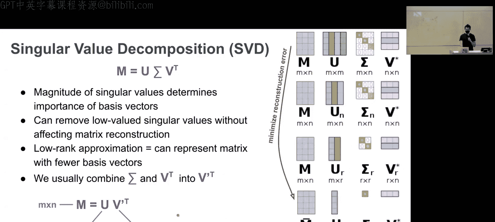

Kind of write an equation to。To reflect that speed up。What what do you think？It's a rainy day。

 people are sleepy。嗯。Take a guess。Time。有。Okay， that's fine。So basically。

 it corresponds to the number of parameters or the number of remaining values in the matrix。

So the ratio is m times n divided by。K times M and K times n。 So just adding those two numbers。

So the speed up is kind of proportional to that。嗯。So keep in mind。

 if I do that decomposition and I don't actually remove any singular values。

 youre actually you end up with a more expensive computation right so you need to remove a lot of those before you start getting speed up。

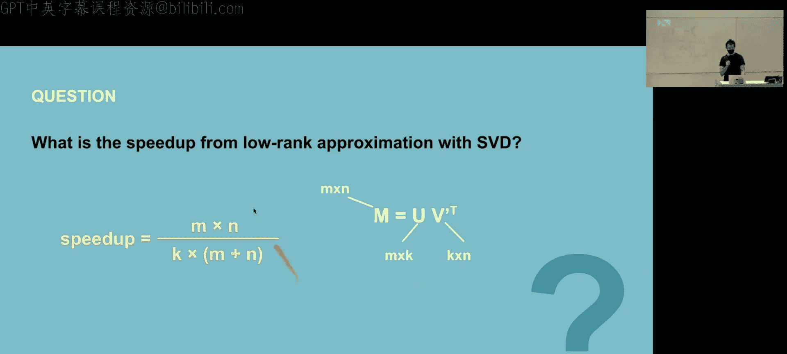

Okay， I think we're almost out of time， but I have a friend。Who works on something very cool。

 So instead of just doing and so he he loaned me some of these slides here。

 But instead of kind of doing just matrix decomposition， which is what we've been doing so far。

 he's going a step further and doing tensor decomposition。😊。

So instead of flatten so when I mentioned SVD， it operates on matrices and it's general for different sizes of matrices as opposed to eigen decomposition which is only for square matrices。

 but what do I do for tensors so I can flatten the tensors and run SVD on them that works but you lose some information through doing that and sometimes need to replicate values and so on so people now are looking to these tensor methods。

And I don't kind of expect you to know everything about this in the one minute that I'll present this in。

 but this is just to give you a preview of what people are looking at now。

 so John is at NVDdiaA now and he's writing a library called KU Tensor。

 so all of these tensor methods are now being written into the Quda library as a QudDa library and we're anticipating that they'll be very important for deep learning moving forward。

And so there is a way to decompose tensors directly and one of them is called Tucker decomposition。

 the other one is called CP decomposition and these are the two main ones and you can think of them as the analog to SVD but for higher dimensional tensors and I'm not just talking about three dimensional tensors talking about four dimensional。

 five dimensional eight dimensional and so on。And so what do I mean by four dimensional。

 So the filters of a convolutional neural network are four dimensional， for example。

 because they are three dimensional， but there are many of them depending on the number of output channels and so you know。

幼儿。Your dimensions are Rs。C， and then you have K of those right， so that's four dimensions。

And then you can have higher dimensions as well。

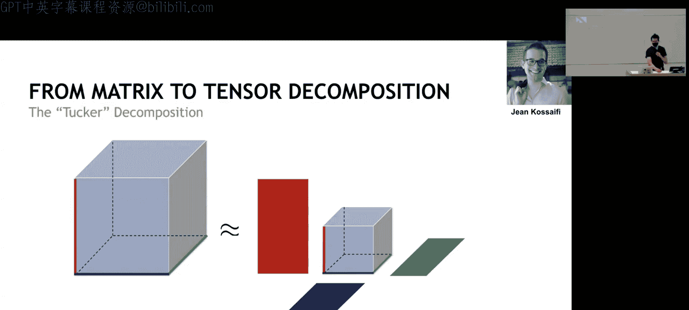

And so I'll run through these slides quickly， but this is kind of also a pointer to a really good paper topic。

 for example， if someone is interested in this kind of stuff。嗯。And yeah。

 so he's just highlighting here the difference between the traditional approach of flattening everything into a matrix and then doing S VD here。

 We don't flatten anything。 We just do the， you know。the decomposition on at tensor directly。

 and what does that give us， we can then compress it similar to SVD and we can do other things to it as well。

And so here' is an example of compression where we're saving about 60% without losing any accuracy and up to 80% with losing some accuracy of Resnet 101。

 so this is quite a good result。嗯。And so this is kind of a historical perspective when people were writing those library b is basically in your algebra library。

 so there's co Bla as well and there is MKL B so both for CPUs and GPUs。

Basically people started with， you know before that there were just scalrs right。

 so multiplying two numbers directly， then we had vector vector， matrix vector。

 matrix matrix and now we think everything will move on to tensor tensor operations and that's why we need those three dimensional transforms。

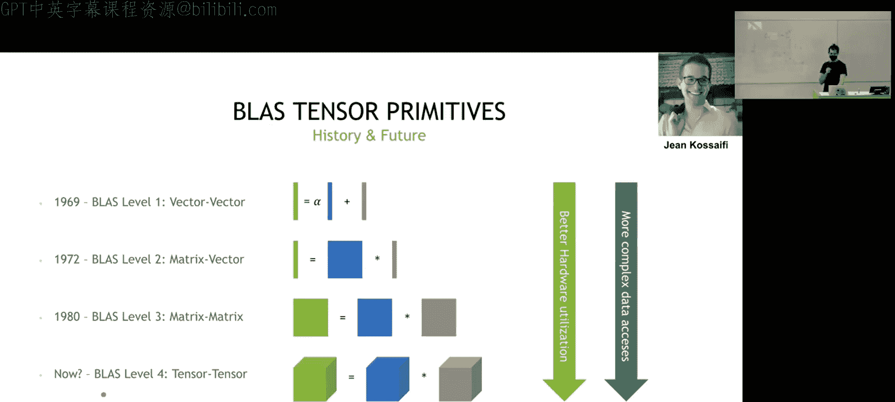

Another interesting paper he worked on was this T net and basically what he did there was instead of having you parameters。

 parameter tensors for each layer。He just had one big， very high dimensional。

 I think it was eight dimensional tensor here。And he used that to parameterize the whole neural network。

And so what does he gain from that， he gains that A he can compress that tensor in one go so you know it's compressed holistically。

 you can compress all the value or you can compare the importance of all the values together through something like Tucker decomposition or CB decomposition and remove the least useful ones and it treats the neural network as kind of one big parameterized function and here are the parameters in that huge tensor right？

The other benefit that he found is that it actually acts as a good dragizerizer and by controlling that one tensor to parameterize the whole network。

 he managed to get better results empirically。

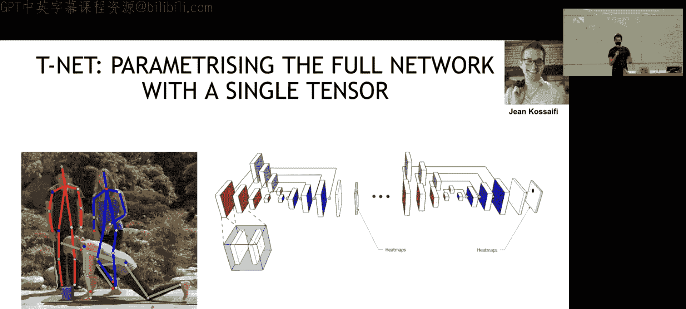

嗯。Yeah， and that's kind of just generalizing that idea again you can use a single tensor to train multiple models in multiple domains and then you can then think of that tensor as a way to encapsulate all of the parameters and all of that training data and a single data structure that you can manipulate yourself。

And so I'm a big fan of John's work and I mean he has a team as well now。

 but basically I think this is something to keep an eye on and it will only become more relevant moving forward。

Okay， so but back to now kind of our main topic， which is kernel implementation and approximation。

 so we saw different ways of implementing kernels mainly to save on multiplications。

 we you know talked about intocals， stresstons rhinograd。

 FFT and log domain and we also talked about singular value decomposition and approximating matrices and touched upon Tucker andP tensor decomposition。

Here are some examples of what you can read to know more about this。

 I also put one of John's papers as an optional reading if you're interested in that topic and yeah that's all I have today thanks for。

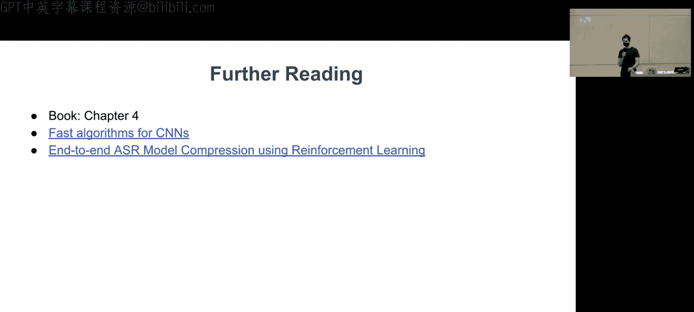