# 机器学习硬件和系统：013：核计算

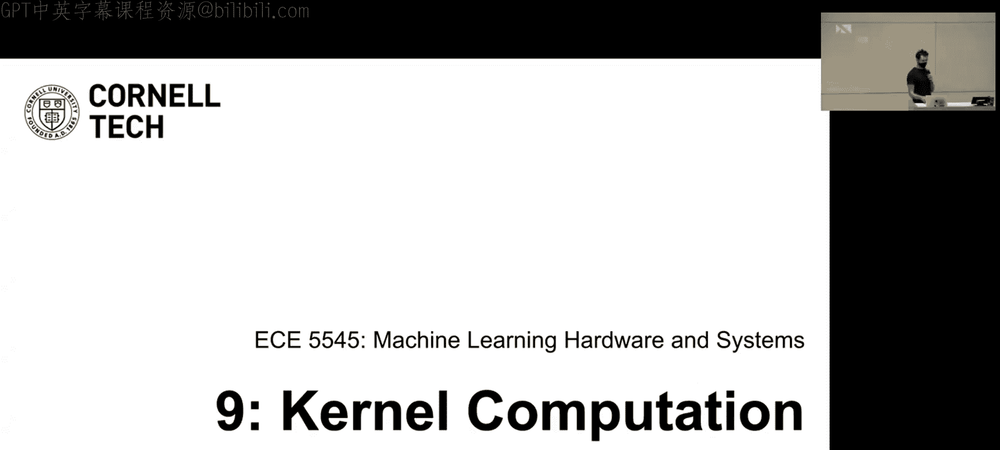

在本节课中，我们将要学习核计算。这是关于软件主题的第一讲。我们已经讨论了硬件架构效率，比较了不同芯片，并深入研究了如何在不深入了解硬件的情况下优化神经网络。现在，我们将转向运行这些深度神经网络或深度学习工作负载的另一个关键组成部分——软件。

软件常常被忽视，尤其是在使用PyTorch或考虑GPU时，人们通常不会关注中间层。然而，软件的实现实际上非常困难，并且对神经网络的性能至关重要。这也是像英伟达这样的公司目前领先的原因之一——他们拥有非常优秀的软件栈。

## 软件栈概览

上一节我们介绍了学习核计算的动机。本节中，我们来看看机器学习软件栈的一个简单视图。

对于机器学习用户、深度神经网络设计者或运行神经网络的人来说，最相关的视图通常是这样的：最上层是PyTorch或TensorFlow等框架，它们运行在Python之上。这些Python库会调用底层的硬件特定库。

*   如果运行在GPU上，通常会调用一个名为cuDNN的库，该库使用基于C的CUDA语言编写。
*   如果运行在CPU上（例如英特尔CPU），通常会调用名为MKL（数学核心库）的库及其扩展MKL-DNN，这些库使用C++编写。

cuDNN等库在非常高的粒度上实现操作，例如整个卷积运算。因此，PyTorch在GPU上运行时，很大程度上可以看作是cuDNN的一个封装器。

## 矩阵乘法的不同算法

我们将探讨实现矩阵乘法的不同算法。矩阵乘法可以用四层循环简单实现，但还有许多其他方法，通常称为变换或核实现，可以使运算在某些情况下更高效。

我们还将研究卷积的一些实现方法。我们将从图像到列（Im2col）变换开始，然后讨论Strassen变换、Winograd变换、快速傅里叶变换和对数域乘法。这些是矩阵乘法和卷积的核实现，它们不改变最终结果，只是使用不同的数学运算来执行。

我们还将简要了解矩阵乘法的近似方法，例如低秩近似，并概述张量分解。

在接下来的内容中，我们会提到“节省了一次乘法，但增加了十次加法”之类的比较。请记住，乘法运算比加法运算昂贵得多，其能耗比大约在4到8倍之间。

## Im2col：图像到列变换

首先，我们介绍Im2col变换。这是一种在大多数通用硬件上实现卷积的方法。

Im2col的字面意思是将二维图像转换为矩阵中的列。例如，对于一个卷积运算，我们有一个滤波器和特征图。通常，我们需要将滤波器在特征图上滑动以获得输出。然而，大多数通用硬件并不原生支持卷积操作，需要将其转换为加法和乘法。矩阵乘法在大多数硬件上得到了非常好的支持和高效实现。

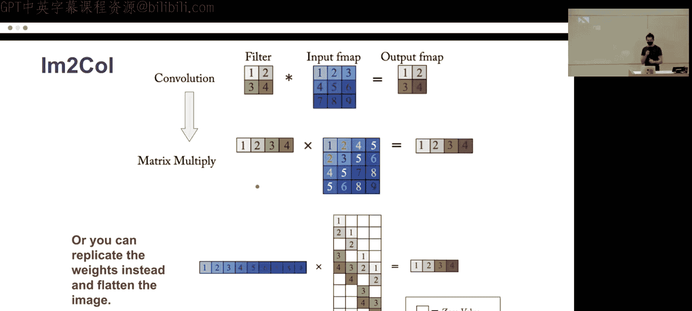

Im2col通过以下方式将卷积转换为矩阵乘法：
1.  将滤波器展平为一维向量。
2.  对于特征图中的每个滑动窗口，将该窗口内的数据转换为矩阵的一列。

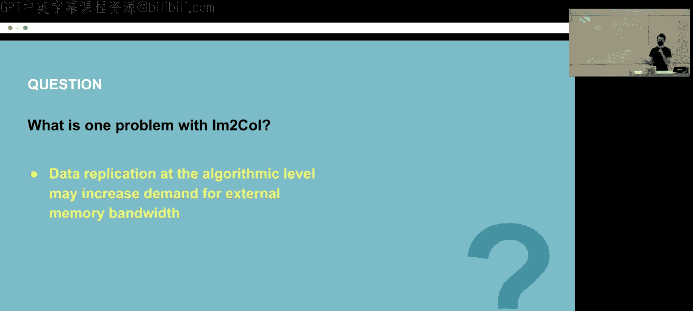

通过执行矩阵（或向量）乘法，我们可以得到与原始卷积相同的结果。随着卷积窗口滑动，每个新窗口成为转换后图像矩阵的新的一列。

这种方法非常简单，也是GPU上实现卷积的主要方式，因为GPU同样不原生支持卷积，需要将其转换为优化良好的矩阵乘法。

有人可能会问，是否有硬件原生支持卷积？答案是肯定的。例如，TPU或手机中的NPU等专用芯片就原生支持卷积。它们通常采用权重固定的数据流，将滤波器存储在处理单元中，然后让不同的输入流过该滤波器。这与GPU或CPU等通用硬件不同。

关于Im2col的一个关键问题是数据复制。将图像转换为列本身没有计算成本，只是内存重组，但它带来了内存成本。数据被复制，这增加了对内存带宽或片上缓冲区的需求。访问模式也可能变得更复杂，但人们通常在卷积操作之前离线完成这种重组，以便数据更好地适配缓存。

Im2col也可以应用于滤波器，尽管这不太常见，因为它会引入许多零值。基本思想是将输入特征图展平为向量，然后以特定方式复制和填充滤波器，使得进行向量-矩阵乘法时能得到相同的输出结果。

Im2col的主要问题是数据复制，这在算法层面是昂贵的，可能增加对外部或内部内存带宽或存储的需求。

## Strassen变换

接下来，我们看看Strassen变换。我们将开始计算乘法和加法的数量，看看每种方法节省了多少。

左侧展示的是普通的矩阵乘法。对于一个2x2矩阵乘以2x2矩阵，总共需要8次乘法和4次加法。

Strassen提出了一种更好的方法，只需要7次乘法和18次加法。他节省了1次乘法，但增加了14次加法。考虑到乘法比加法昂贵4到8倍，这在许多硬件上可能带来节省。

在深度神经网络中，我们还有一个额外的技巧。因为其中一些乘法、减法或加法可以离线完成，特别是当矩阵B代表我们的参数或权重时。在推理时，我们可以预先计算这些部分，从而在部署时只需13次加法，而不是18次。

Strassen变换本质上是通过重组操作来实现的，例如以特定方式分解运算，通过改变加法和减法的发生位置来转换。

## Winograd变换

另一个非常有趣的变换是Winograd变换，我们在设计加速器时经常使用它。现在我们讨论的是卷积，而不是矩阵乘法。

让我们看一个一维卷积的例子。我们有一个滤波器（F0到F2）和一个输入块（I0到I3）。我们需要将滤波器在输入上滑动。

如果写成矩阵形式，这需要6次乘法和4次加法。

Winograd提出了一种更好的方法，其精神与Strassen变换类似，但它还利用了矩阵中的数据有公共部分这一事实（例如，在步长为1时，每一行是前一行移位后的版本）。他重组了计算，并证明这是对卷积窗口执行相同精确操作所需的最少乘法数。

同样，我们可以利用参数可离线计算的技巧，进一步减少加法次数。在这个例子中，我们从6次乘法、4次加法减少到4次乘法、8次加法。

关于Winograd变换的一些要点：
*   通常，卷积窗口越大，能获得的节省越多。例如，对于3x3卷积，乘法次数可以减少约2.25倍。
*   变换不仅特定于滤波器大小，还特定于操作的图块大小。用于转换到Winograd域的数值计算对特定尺寸是唯一的。
*   人们通过矩阵形式泛化了这种计算，使用G、B、A矩阵来转换输入和滤波器，并在输出端用A矩阵及其转置来还原变换。
*   Winograd变换的真正节省来自于：一旦转换了输入和滤波器，卷积操作就变成了逐元素乘法。
*   滤波器可以离线转换，但输入转换（乘以B矩阵）和输出逆转换（乘以A矩阵）需要在推理时在线完成。
*   在使用低精度（如INT8）时，变换本身对低精度的鲁棒性通常较差。因此，人们通常在更高精度下执行变换，而在低精度下执行逐元素乘法。

## 快速傅里叶变换

现在，我们讨论FFT变换。傅里叶变换是将时域信号转换为其频率分量的重要变换。

离散傅里叶变换的方程涉及输入与一个指数项的乘积和求和。通常，我们将权重（滤波器）和输入通过傅里叶变换转换到频域。

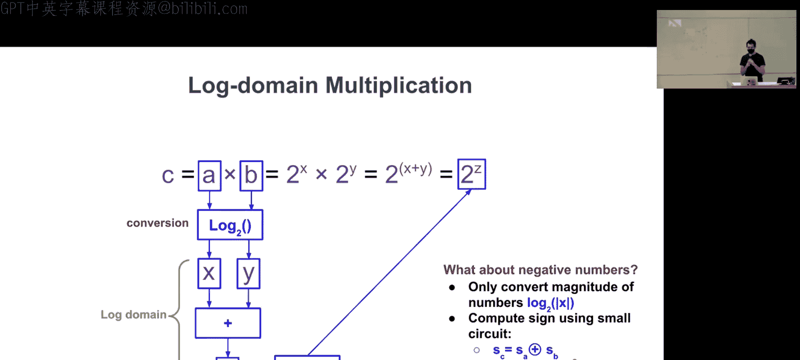

卷积定理指出，在时域进行卷积等价于在频域进行乘法。这与Winograd变换类似，都是用计算较轻的逐元素乘法替代计算较重的卷积操作。

但我们需要付出什么代价？为了进行逐元素乘法，我们需要相同大小的张量或矩阵。因此，我们通常用零填充滤波器，使其与输出特征图大小相同。

如果正常进行卷积，操作次数约为 `R*S*P*Q`（滤波器尺寸R x S，输出尺寸P x Q）。进行傅里叶变换后，操作变为乘法，但滤波器尺寸变大了，操作次数约为 `P*Q*log2(P*Q)`。

如果所有尺寸相同（设为N），则复杂度从 `N^2` 变为 `N log N`，缩放性更好。但实际获得加速的条件是：`R*S` 必须大于 `log2(P*Q)`。如果滤波器尺寸远小于输出尺寸，并且仍然小于输出尺寸的对数，那么可能无法获得加速，并且还需要承担不平凡的变换开销。

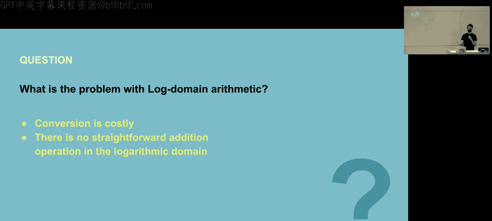

## 对数域乘法

这是另一种变换，可能尚未在cuDNN中支持。对数域乘法的思想是：将两个数A和B相乘，可以写成 `2^x * 2^y`。如果我们能找到将A转换为 `2^x`、将B转换为 `2^y` 的方法，那么乘法就变成了指数相加：`2^(x+y)`。

为了转换到对数域，我们对输入取以2为底的对数，得到x和y。然后，我们不再需要乘法，只需进行加法得到z。最后，我们计算 `2^z` 得到最终结果。

这非常巧妙，因为乘法比加法昂贵得多，这提供了一种用单个操作转换输入输出，然后用加法替代所有乘法的方法。

然而，存在一些问题：
1.  高精度计算对数和指数本身效率不高，甚至可能比乘法更昂贵。
2.  如何处理负数？不能直接对负数取对数。通常的解决方案是单独处理符号位，仅对数值部分进行变换。
3.  对数域变换本身可能容易导致溢出，因为它压缩了数值范围，转换回来时可能饱和。
4.  精度可能是个问题，尤其是在低精度下，因为数字被重新映射到不同的域。
5.  最主要的问题是：我们通常不只是做乘法，而是做乘加运算。如何在对数域中相加两个数？没有直接的方法。需要转换回线性域才能相加，而转换成本很高。尽管有许多近似方法，但它们通常会损失很多精度或需要专用硬件。

好消息是，英伟达似乎正在研究这个问题。有一项专利描述了一种通过将指数分解为商和余数分量、基于余数对商排序、然后对排序后的商求和来快速相加对数域数字的方法。这可能在未来的GPU中实现。

## 如何选择变换

那么，如何选择使用哪种变换呢？一个实用的方法是像英伟达那样：在cuDNN库中有一个函数 `cudnnFindConvolutionForwardAlgorithm`，它会尝试所有可用的卷积前向算法，并提供每个算法的运行时间。这就是为什么在GPU上对模型进行基准测试时，通常会丢弃前几次运行的结果——因为库正在尝试每种变换，找出最快的一种，然后继续使用它。

目前并没有完美的启发式方法，有时手动计算乘法和加法数量也太复杂。

## 低秩近似与张量分解

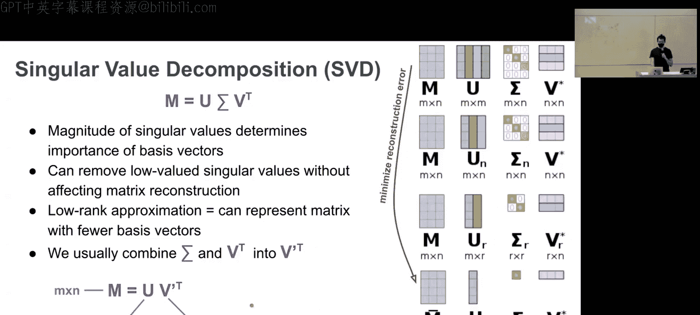

之前讨论的都是实现精确矩阵运算的新方法。现在，我们简要讨论矩阵的近似方法，特别是低秩近似。

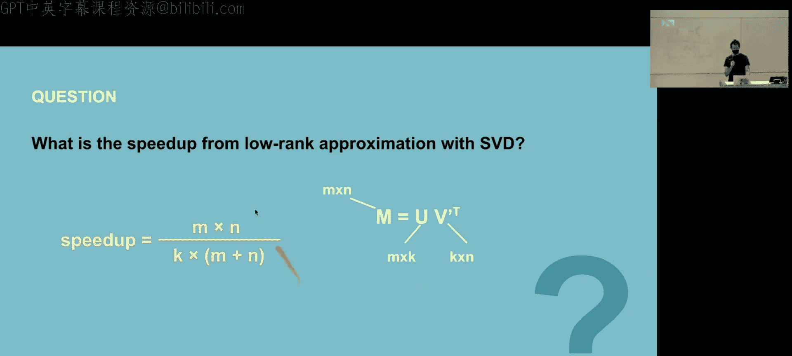

奇异值分解是特征值分解对任意尺寸矩阵的推广。它将一个 `M x N` 的矩阵分解为三个矩阵：`U`、`Σ`（对角矩阵，包含奇异值）和 `V^T`。`U` 和 `V` 是正交基向量，奇异值表示每个基向量在重构原矩阵时的重要性。

SVD如何帮助我们？我们可以移除最小的奇异值，同时最小化矩阵重构误差。每次移除一个奇异值，就可以移除 `U` 和 `V` 中对应的行和列，从而得到一个更小的矩阵运算。这被称为低秩近似，因为我们减少了表示矩阵所需的基向量数量（即矩阵的秩）。

深度神经网络中的矩阵本质上是低秩的，网络本身已经过参数化，因此低秩近似对许多网络非常有效。通过低秩近似，原来的 `M x N` 矩阵乘法变成了两个更小的矩阵乘法：`M x K` 和 `K x N`。加速比取决于 `K`（保留的秩）。只有当 `K` 足够小，使得 `M*K + K*N < M*N` 时，才会获得加速。

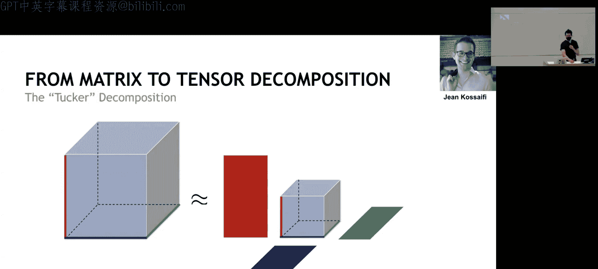

更进一步，除了矩阵分解，还有张量分解。SVD作用于矩阵，而张量分解直接作用于更高维的张量（例如，卷积神经网络的滤波器是四维的：高度、宽度、输入通道、输出通道）。两种主要的张量分解方法是Tucker分解和CP分解。与将张量展平为矩阵再进行SVD相比，直接进行张量分解可以保留更多信息，有时能实现更好的压缩。

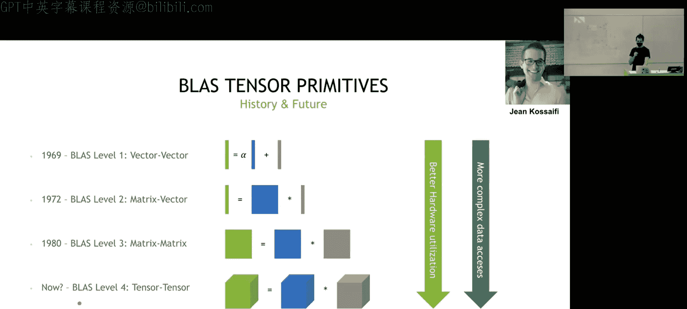

例如，有研究使用单个高维张量来参数化整个神经网络，然后通过张量分解对其进行整体压缩。这种方法不仅压缩效果好，还能作为正则化器，有时能获得更好的实证结果。这代表了从标量、向量、矩阵运算向张量-张量运算发展的趋势。

## 总结与延伸阅读

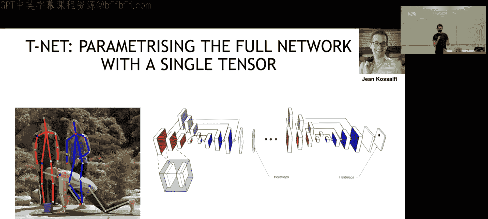

本节课中，我们一起学习了不同的核实现方法，主要是为了节省乘法运算。我们讨论了Im2col、Strassen、Winograd、FFT和对数域乘法。我们还讨论了奇异值分解和矩阵近似，并简要接触了Tucker和CP张量分解。

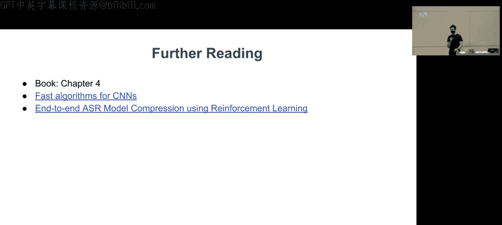

以下是一些延伸阅读资料，帮助你更深入地了解这些主题：
*   Im2col: Chellapilla et al., “High Performance Convolutional Neural Networks for Document Processing”, 2006.
*   Strassen变换: Strassen, “Gaussian Elimination is not Optimal”, 1969.
*   Winograd变换: Lavin & Gray, “Fast Algorithms for Convolutional Neural Networks”, CVPR 2016.
*   FFT变换: Mathieu et al., “Fast Training of Convolutional Networks through FFTs”, ICLR 2014.
*   对数域乘法: 英伟达相关专利。
*   低秩近似: Denton et al., “Exploiting Linear Structure Within Convolutional Networks for Efficient Evaluation”, NIPS 2014.
*   张量分解: Kossaifi et al., “Tensor Regression Networks”, JMLR 2020.