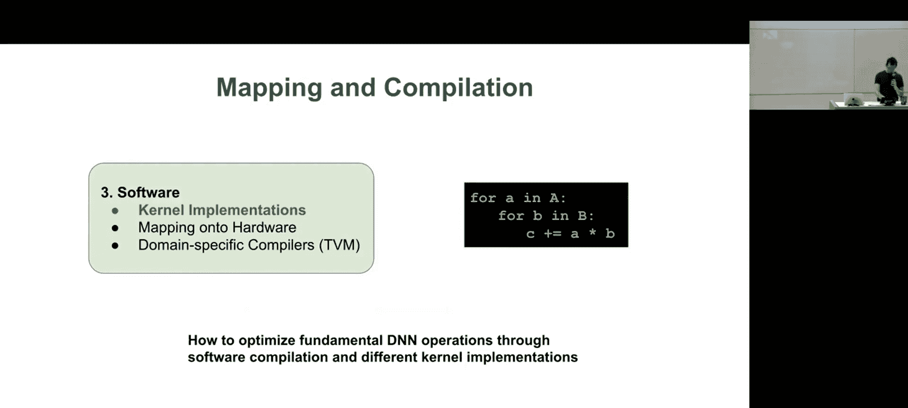
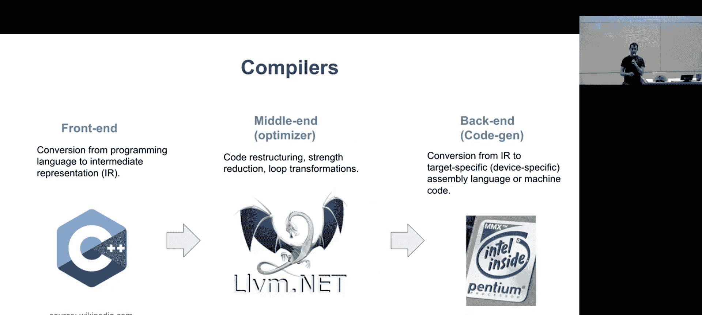
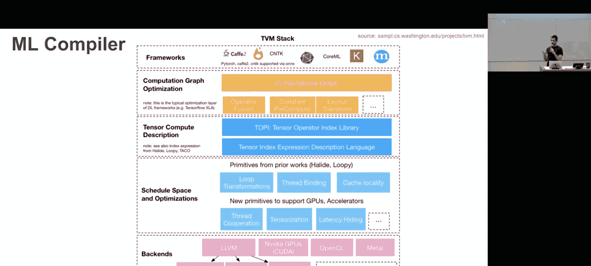
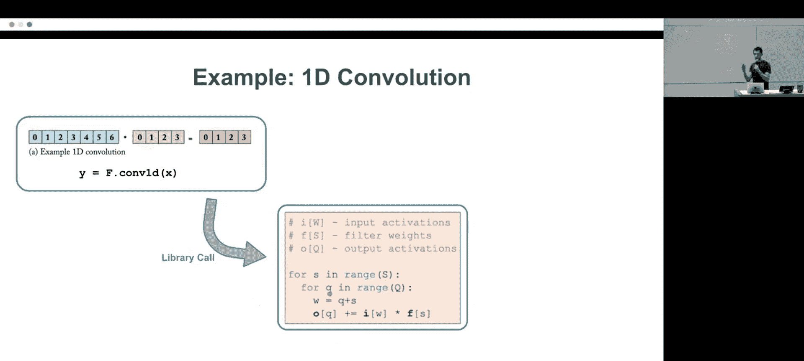
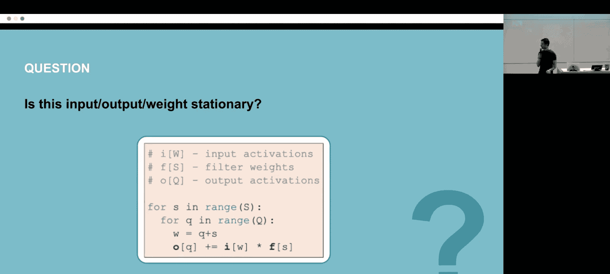
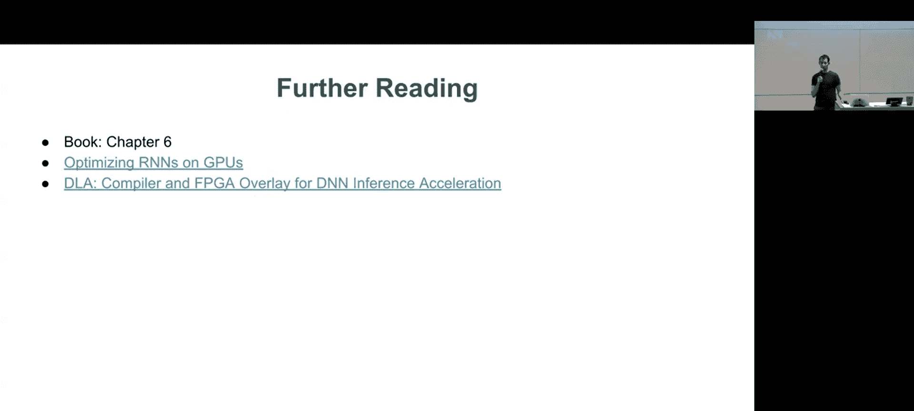

# 机器学习硬件和系统：014：映射



在本节课中，我们将要学习如何将高级代码映射到机器学习加速器或通用处理器上。我们将探讨为了在特定硬件上高效运行代码而进行的各种优化，这些优化对于提升性能至关重要。

## 编译器基础概述



上一节我们介绍了映射的概念，本节中我们来看看编译器是如何工作的。大多数编译器包含三个主要部分。

*   **前端**：将高级编程语言（如C++）转换为一种中间表示。这种中间表示比源代码更底层，但比汇编语言更抽象，便于进行优化。
*   **中端/优化器**：在中间表示上进行代码重构和优化。例如，可以重新排列循环、融合或拆分循环、改变数据索引方式以提高缓存命中率，所有这些操作都不改变程序的功能。
*   **后端/代码生成器**：将优化后的中间表示转换为针对特定目标硬件（如CPU、GPU或ARM处理器）的机器代码。LLVM项目就是为了创建统一的中间表示以支持多种后端而诞生的。



## 机器学习编译器

了解了传统编译器后，本节中我们来看看专注于机器学习的编译器有何不同。机器学习编译器通常处理领域特定语言，例如深度学习框架中的计算图。



以下是机器学习编译器的典型流程：



*   **计算图层**：接收由粗粒度操作（如卷积、矩阵乘法）构成的计算图，并在此层级进行优化。
*   **中间表示层**：将计算图转换为更细粒度的中间表示，并进行进一步的底层优化。
*   **后端**：最终生成能在GPU、CPU或专用加速器上运行的代码。此时，LLVM可能被视为一个后端选项。

## 映射的核心优化

现在，我们将深入探讨将深度神经网络映射到硬件时需要考虑的核心优化技术。

### 选择数据流

首先，我们需要决定计算的数据流模式。硬件可能支持不同的数据流，例如权重驻留、输入驻留或输出驻留。编译器可以通过重构代码循环来改变数据流，以适应硬件特性并提升性能。

以一个一维卷积的简单代码为例：
```c
for (int s = 0; s < S; s++) { // 遍历滤波器
    for (int q = 0; q < Q; q++) { // 遍历输入
        output[q] += input[q + s] * filter[s];
    }
}
```
在上述代码中，外层循环遍历滤波器权重，内层循环遍历输入。这意味着在每次内层循环迭代期间，`filter[s]`的值保持不变，因此这是一种**权重驻留**的数据流。

编译器可以将其转换为**输出驻留**的数据流，使输出地址在计算过程中保持稳定，这可能更适合某些硬件架构。

### 分块

分块是指选择每次计算所处理的数据块大小。这主要出于内存层次结构的考虑。

以下是将循环分块的示例：
```c
int Q0 = TILE_SIZE; // 分块大小
for (int q_outer = 0; q_outer < Q; q_outer += Q0) {
    for (int q_inner = 0; q_inner < Q0; q_inner++) {
        // 计算逻辑，使用 (q_outer + q_inner) 作为索引
    }
}
```
通过分块，我们可以控制数据在内存层次结构中的位置。通常，最内层循环处理的数据块（分块）会被放置在离处理单元最近的存储器中。

### 向量化/并行化

分块优化了数据局部性，而向量化则旨在利用所有可用的并行计算单元。

在分块的基础上，我们将最内层循环并行化：
```c
for (int q_outer = 0; q_outer < Q; q_outer += Q0) {
    #pragma parallel for
    for (int q_inner = 0; q_inner < Q0; q_inner++) {
        // 并行计算逻辑
    }
}
```
这样，多个处理单元可以同时处理同一个分块内的不同数据元素。分块大小通常设置为与处理单元数量相匹配。

### 计算单元绑定

在拥有多个处理核心的硬件上，我们需要明确指定哪个计算操作由哪个处理单元执行。

最简单的绑定方式是将循环迭代变量直接映射到线程或核心索引上。现代编程模型（如CUDA）通过“线程”抽象来管理这一点，允许创建比物理核心更多的线程，由系统调度执行。

## 计算图级优化

除了上述循环级优化，在计算图层级也有重要的优化手段。

以下是常见的计算图优化策略：

*   **算子融合**：将多个连续的操作合并为一个更大的操作，减少数据搬运开销并增加并行度。
*   **算子降级与强度削减**：将软件中丰富的算子集合映射到硬件实际支持的有限算子集上。例如，将反卷积或平均池化转换为标准卷积操作。
*   **内存分配与调度**：管理片上内存的使用，采用双缓冲等技术减少内存碎片，并通过调整操作执行顺序来最小化所需的内存容量。
*   **常量传播与形状推导**：在编译时计算常量表达式，简化运行时操作。

## 映射空间与指令集

映射的选择空间非常庞大，但其中许多选项在功能或性能上是等价的，另一些则是无效的。编译器通常使用启发式方法和硬件模型来导航这个空间，以找到较优解。

对于深度学习加速器，其指令集架构通常非常专用。编译器的工作可能简化为参数化这些粗粒度指令（如“执行卷积”并指定其超参数），然后直接发送给硬件执行。

## 总结



本节课中我们一起学习了代码映射的核心概念。我们从编译器的基础结构讲起，对比了通用编译器与机器学习编译器的差异。然后，我们深入探讨了关键的映射优化技术：**选择数据流**以适应硬件、**分块**以优化内存访问、**向量化**以利用并行计算能力，以及**计算单元绑定**。此外，我们还了解了在计算图层级进行的优化，如算子融合和内存调度。理解这些优化原理对于在机器学习加速器上实现高效计算至关重要。