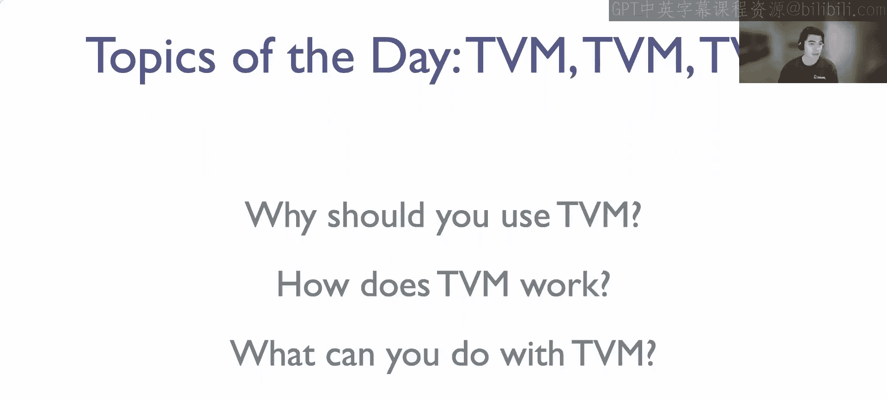
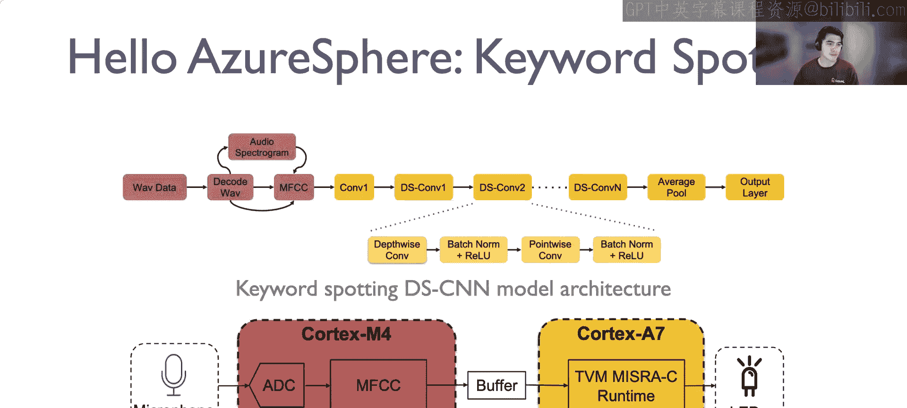
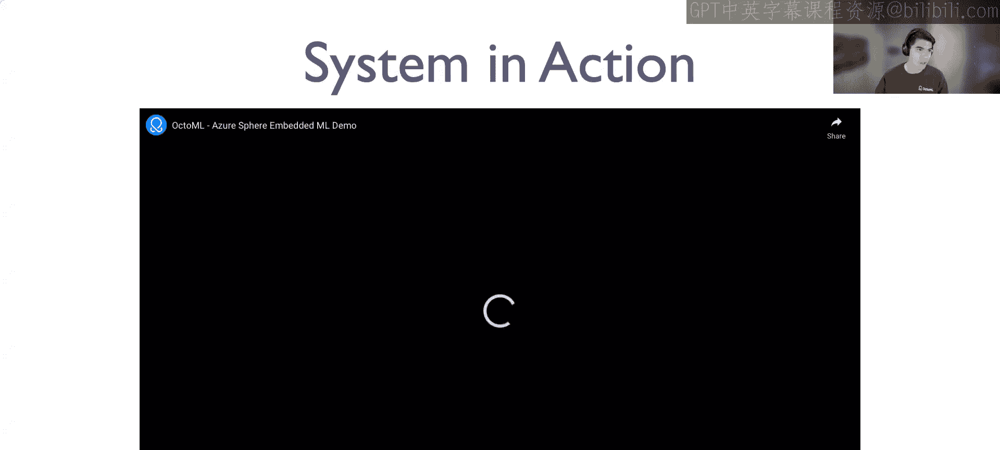
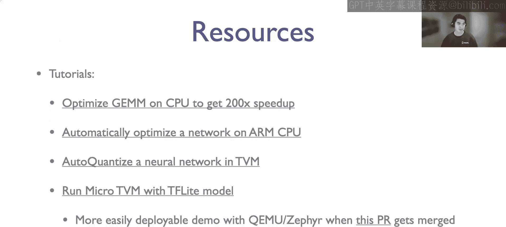

# 015：康奈尔大学《机器学习硬件和系统｜Cornell ECE 5545 Machine Learning Hardware and Systems》中英字幕 p15 -15-Guest Lecture_ TVM Thierry Moreau.zh_en -BV1CCqPYSEP5_p15-

So everyone please help me welcome Tiri， Tiri got his PhD from the University of Washington。

 where he was one of the first contributors to TM and now a widely used open source deep learning compiler。

His research aimed to facilitate hardwares after co designign with a complete open source deep learning stack so that's TVM+ VTA so that's the FBGA plugin today Tiri spends his time growing a 2。

5 year old Seattle based startup called OctoMl。So he's the VP of Technology Partners and a co foundunder there。

Where he's building a unified machine learning optimization and deployment platform。So so yeah。

 welcome to Iri， please go ahead。Yeah。嗯。Sorry I muted myself。

 thank you very much for the introduction and very excited to be here。So let's jump right in。

 I'm going to go ahead and share the slide deck and time budget was。When should I stop？

So we have just under an hour just under an hour okay and in terms of Q&A I'm happy to be interrupted at any time so please free to ask your questions along the way but if no questions pop up I'll make sure to leave some time for Q&A at the end so all right well thank you and it's a great pleasure as I said to be giving this this lecture here today and as part of the topics of the day all I'll talk about is TDM TDM TDM why should anyone use TM you know what is this。

Framwork really about how does it work underneath the hood you know what is the the secret sauce that makes it work so well across a wide collection of models and hardware targets and what are the exciting applications at Tbn that you can。

Get it today， you know if you were to try it out and especially given that this is。

Sure is in the context of a class think about the kind of projects that you could do with TBM deploying an nl on a lot of interesting kinds of devices。

 so I'll just motivate quickly by mentioning that AI is now pervasive。

AI inference is pervasive on a lot of edge systems smartwa here。Your smart speaker。

 perhaps your security camera at the entrance of your building。

We'll all use AI to some extent to do speech processing to do some form of NLP。

 and sometimes this has to be done on the edge under extreme constraints。

Due to the limitations of the hardware that are present on the edge and sometimes it's uploaded onto the cloud。

 so you end up having to serve AI either on really small energy constrained devices。

or in the cloud within a setting where you're really trying to maximize the efficiency per watt or the efficiency per dollar of all of these AI inference tasks and I assume that by now you've been to several lectures and you have a lot of familiarminity with inference versus training and really this talk will focus on inference。

And so when we're talking about AI inference， we're faced as。Ml engineers with this。

Deployment challenge where first of all you're working with a train model and it might be coming from different frameworks like Pytortensor flow it might be serialized in different ways it might use this onyx formats and now you're faced with this challenge of deciding what kind of system you're going to deploy your ML on is it a server processor or GPU are we talking about running on mobile。

On an Io device， what kind of I they are using is it risk5 is it Arc is it arm and you might also。

Have dealt or have read about a lot of the exciting work being done in the space of designing specialized hardware。

And so as you try to navigate all these options right this essentially creates a matrix of deployment options where you have to decide well where am I taking my model from。

 where has it been trained and where can it run on and so let's say you're trying to deploy on a small arm microcontroller if your model has been trained inside of TensorF you can use Tensor light Mi and there's a good infrastructure to get your models deployed there but perhaps the story might not be the same if you're using Pythtorch or if you're using another you know if you're using OnX for instance。

 so as a ML engineer you're faced with this growing challenge and these growing pains of having to use a lot of different tool and based on what kind of deployment you're looking into and a lot of these tools are built on different kinds of libraries and runtimes and so the complexity is very high。

嗯。And so to summarize the challenge， you have countless models out there。

 there's a lot of models zoos， repositories， new architectures are being proposed and presented every day。

 and the number of hardware targets and platforms is growing every day as well and we've seen there's a lot of companies that are also dedicating a lot of effort towards designing new exciting chips。

So one convention approach to solve this problem。has been to use handtoed highly optimized libraries and oftentimes these are provided by hardware vendors I provide several examples that were designed and optimized by different companies like AMD and VDdia or Intel that essentially build a custom library that can map certain kinds of neural network or deep learning operations onto your hardware very efficiently and generally the design of these libraries are informed by a wide range of ML a very popular ML computations。

But unfortunately these are difficult to scale and adapt to new workdess。

 so on top of this they're extremely labor intensive。

Due to the fact that they have to be written and engineered by a highly skilled group of engineers that understand how the hardware work very well and are able to sometimes write these kinds of machine learning kernels that have to be extremely efficient and that have to align custom assembly code that is specifically tailored for the hardware target so as you are introduced with new model architectures or as your hardware capabilities evolve over time right you're introducing new generations of chips every year you need to adapt the software stack to those new constraints and this takes a great deal of effort I've worked with a lot of companies that often face the same problem and as you know ML is a field that evolve very quickly。

So these libraries are。Essentially generic and they might not necessarily be tuned for a particular model or use case and oftentimes hardware vendors will inform the design of these libraries based on a popular set of workloads based on customer workloads but it's hard to predict the next step what will future workloads look like what is the next trend in ML double emerge and how can I get my libraries to be optimized for that future use case it's very hard to anticipate。

So to recap the challenge is that we'd like to be able to automatically generate the fastest implementations and I really want to emphasize and automatically here right。

 how can we remove the human out of the loop？To provide a solution for these countless models out there that are specified and trained by different frameworks and different formats。

And run them on this explosion， this Cambriran explosion of new hardware devices， right。

 which is a really great opportunity for folks who are working on compilers to seize because it's really a unique set of conditions that dictate innovation in our field。

So with that， I'd like to introduce TM， which is this open source optimization framework for machine learning that provides a solution to this problem that I just mentioned。

It can adjustest models from varied sources including PyTtor， TensorF on Xmic S， etc ce。

 and it can target a wide array of hardware backs and I will talk about what makes it special。

 what gives it an ability to target all of these different devices that we have XD stake server and HCPUs。

 arm， CPUUs and microcontrollers， we have NVIDA GPUs， AMV GPUs。

 different kinds of ISAs are supported and also we have accelerator support。

 which I'm excited to touch on very briefly in this talk。

And within different software environments and that's also important right there's the operating system that has an impact or you might not even have an operating system and have a real-time operating system or a complete baremet microcontroller system so all of these enforce different kinds of constraints for your machine learning deployment。

And TbM here provides a solution。So I'd like to mention that TM is actually under Apache Gs。

 it's an open source project that I was started。Some years ago。

 all the way back in 2017 and I was lucky enough to be one of the first contributors and collaborators on this project and it's grown a lot since then we graduated into a full Apache project in late 2020 and actually the number here it's not 430 but we're over 650 contributors now some of these slides might be slightly out of date。

But we are community owned， so it means not a single company owns TM。

 it follows Apache governance rules， so we have shared ownership among different companies。

We have a very active discussed forum， and also I'd like to mention that we have regular meetups and conferences。

And every year in December， although this year that might change a little bit。

 we have TM con and there's a lot of material I'm happy to point people to and a lot of great talks。

 some given by industry， some given by academia on the kind of and all the great things that you can do with TM today。

And so I'll try to motivate TM on top of the quick introduction I gave based on three different use cases that I'd like to make a point on。

The first one is portability， the second one is efficiency and the last one is providing software support for new hardware devices。

So on portability， I wanted to use the example of a colleague who was a UW researcher is today。

 my colleague at Ota Ma， essentially he was working on this interest in keyword spotting model architecture that he wanted to deploy on this Azure sphere device。

 which is Microsoft secure edge IoT device and at the time that he was looking into this problem。

 there was nothing that really allowed him to deploy the model on this kind of hardware system。

And on top of this to add to the difficulty， this azurepher is essentially you a microcontroller style device with very limited asRAM and very bare bones rtas and unique challenges like no C++ support。

 no dynamic linking， so it essentially limited a lot of options for deploying ML on these devices and a lot of designers here have to deal with essentially building this model from scratch on a device like this which is very tedious。

So for this ML engineer they're very happy with what TensorFlow or Pyarchch offer that when they have to take a model and deploy in a device that these frameworks do not support。

 you're faced with a huge challenge right and so TM provides this ability to deploy ML on a lot of exotic platforms where deployment would be if it had to be manual would be painly difficult otherwise。

Another example is TVM for efficiency， so I'm going to use the example of this Facebook AI systems engineer Andrew Tuick who gave a talk at TVM conference a couple of years ago and they're serving this model in the cloud。

 this wave R&N model。And。The default option here was to use Pythrch because Pytorch works on X6。

 right？The challenge that you're facing here is not that you cannot run the model on the hardware。

 you can already run it， but it's unfortunately too slow and some of the real time constraints。

 which was 24 kilohertz sampling， essentially doing realtime analysis of audio。

 requires a 40 microt second inference net runtime。But unfortunately。

 the Pythch model ran orders of magnitude above。So this engineer used TM as a playground for applying all sorts of optimizations which I've listed here。

 so they start with Pytor， the important of TVM then it applied sparse optimization blocks sparse optimizations right that's a recognition that there's a lot of zero valued weights that you can prune out。

And then they applied some data type optimizations like using。

Special data types that lead to higher throughputs on the hardware target and then applied another layer of polynommal approximations to some of the operators and at the end they were able to essentially meet the realtime constraint and get the overall model to get sped up by about 100 x in a week so this is a very talented engineer systems engineer that is able to take a model that runs in the cloud it's already supported by Pytorch but you need to go an extra step further in terms of meet the deployment constraints。

And so in this case， of the engineer， really， the key here is to achieve and unlock as much efficiency as possible out of your hardware。

😊，And so TvM on top of giving you that。Broad。Ability to target different hardware that also provides you with a lot of automated optimizations。

 which I will touch on that allow you to get the most efficiency out of your target hardware right once you've trained your model you're ready for deployment。

 how can you get the best throughput on that hardware target。And oftentimes。

 this makes a difference between a model that goes into production and one that doesn't。

 right as we are probably very well aware。And so the third motivation here is TBM for software support and for instance that Muhammad and I。

 we both have hardware backgrounds so we've worked on hardware acceleration in the past right and that might involve F PGAs or AsIs。

And I'm sure some of you have some hardware or electrical engineering background。

 there's a lot of companies out there that are trying to build chips and specialized hardware for AI。

 you know this is the next wave of deep learning revolution and we're seeing suffer companies。

 we're seeing IC vendors you startups all over the world IP companies design hardware accelerators。

And so for a lot of these companies， the challenge is not that I have my hardware， you know。

 I've taped it out， I'm ready to build a suck stack and man， this is really hard。

And a lot of hardware companies building their own accelerator realize how challenging it is because they're trying to plug your hardware accelerator into a whole ecosystem of software stacks。

 you're not trying to build a single one you're essentially trying to take advantage of interoperability that is exposed by different software stacks so what are solutions that you can use here to really lower the barrier of entry to allow programmers to access your hardware。

And you know， what do you invest in， what technology do you invest in。

 do you go all in on Tensorflow all in on Pytorch or all in on onxrontime or could you find a solution that checks all the above boxes right so I've talked to essentially about three different kinds of personas。

The ML engineer， the systems engineer， the hardware engineer。For which TvM solves real pains？

And just to convince you that TVVM has been solving these pains。

 I have some examples of TM's impact on industry， as I said we had this TVM conference with over 700 attendees last year and TVM has been shown to really allow for model deployments facilitate model deployments on the edge or in the cloud with these examples where you know Facebook was able to optimize models。

 AWS was able to use TVM to optimize Alexa Wup。To power Alex I wake up across a lot of devices and also we have examples of hardware manufacturers like Qualcom and Ar relying heavily on TVM to access the multitude of Harvard IPs you know CPUs GPUs and accelerators on their SCs so a lot of really great motivating examples to use TVM today。

And so my talk will touch on several points， the first one know really get when I want everyone to get out of today's classes。

 all right， what can you use TVM for but also how does TVM work right I've motivated it I've told you it's very broad is very applicable to a lot of hardware devices it can provide a lot of optimization potential what lies under the hood that enables all of this goodness right out of the TVM stack。

And so I'll touch on four different points， I'll start with operator level optimizations then I'll search gears and talk about how TVM automates the optimization process。

 I'll also talk about graph levell optimizations right so I'm going to talk about optimizations at two different levels of abstraction in your workload and finally I'm going to talk about microcontroller support and touch a little bit on hardware accelerate support so talk about talking about exotic device support that TVM enables which is I think something that's really exciting。

对。So just to dive into。What makes TDM special I'm going to use a very simple top down overview of how inference works and I'm going to use a simple example here of a simple classifier or essentially you have a neural network we often represent them as nodes that are interconnected and In and input for instance an image here right this is a vision workload。

 this was probably a convolutional neural network you want to classify this image as a cat so in comeses an image out comes a classification so what's inside and I assume that at this point you're already fairly familiar。

 but it helps to just recap what lies in within that model so typically we represent models as a compute graph right each node essentially is this what we refer to as a layer in machine learning compilers line we like to use the term operator right so 2D convolution incomes data like your input tensor these are your。

Acations right they change every time you look at new data and then you have your parameter tensor or your weights these remain consistent across all inputs that you feed through because they were obtained by essentially doing training or back propag on a label data set and out comes your app potentialtensive right And so essentially if you think of a compute graph or a neural network it's not so different from say。

A dag that you see in it。In saying in a compiler where operators or additions and multiplications simple scalar operations。

 whereas in deep learning compilers and operator can be thousands if not millions or billions of scalar operations in this comp2D taking two very large input and parameter of ten series and applying 2D convolution。

 so this is a way to have a global view on your model and represents the massive amounts of computations that are performed underneath the hood in a simple visual representation and so we're going to dive into what constitutes each operator each layer like this co2D and how one can make it run really fast target hardware because that's really what this compiler triess to cheap is what is the best implementation that I can get for this layer that constitutes this model on this given hardware and every hardware differs。

So I'm going to use it very simple。Nive approach to writing matrix multiplication just to keep the example fairly simple right matrix multiplication is used in transformers or fully connected layers inside of vision workloads and so you essentially take two matrices you meantply them with one another and that comes as a result matrix。

If you were to implement the program on the left， right。

 which is how we all learn how to write matrix multiplication in some of our first programming classes。

 you'd get a correct implementation， it would run correctly， it would put output the right results。

But it might actually be slow and in fact， it might be very slow on your hardware。

 even when you're programming the laptop that you use every day。In fact。

 when people want to optimize matrix multiplication on a given hardware target they will write code that looks like this where you have assembly in line you might explicitly do prefetch operations the code will instead of looking like this nice compact nested loop you'll have thousands of lines of code so why would people write code like this that's completely unreadable and hard to maintain well the key here is is that the code on the right is a whole lot faster and sometimes orders of magnitude faster than the code on the left。

If you don't believe me， you can look at real life examples by looking inside of open source repositories。

 for instance， if you dig into tensorflow we can look at how different operators are implemented so in this case you can look at defwise convolution apply to unsigned integers of8 bits。

4 a three by three filter and this file will have 13 lines of code and this is carefully an expertly crafted code and the reason why there are so many lines of code is because once again you're using a lot of assembly and inlining。

 there's a lot of different implementations for different quantization types as well。

 different access strides and rounding modes。And you might also want to include depending on your hardware capability right you might be dealing with different kinds of chips。

 different kinds of in this case it's for arm chips you might want to take advantage of vector intrinsics that they're available so this results in code that is very complex very large hard to maintain but works really fast。

And so there's a trade off here， which is。You either have compact code that is highly readable and easy to maintain。

Or you have expertly crafted code that runs really fast， but it's huge， it's bloated。

 you have to update it， it's expensive。And given the fact that there's a lot of operators and that list grows almost every day because people discover new ways of expressing ML workloads。

You have to deal with different input tensor shapes。

 you have to deal with different kinds of parameters to those operators like diations， strides。

 batting sizes for convolutions。And also your hardware will change right there will be new architectures being introduced if CPUs that might introduce new assembly capabilities to accelerate ML you might be exposed to different CPUUs or GPUs that have different cache hierarchies etctera。

 etctera， I mean essentially the challenge is huge here to just have this this ability to take these layers and run them fast on your hardware。

So TvM builds on top of。This notion of separation between functional definition and schedule definition。

 and this was an innovation that was introduced by the Haylight Per model aimed for vision applications。

And essentially the idea is that you provide a separation between these two concepts the functional definition essentially just defines what the function should do so this is almost similar to writing a mathematical equation right you're essentially saying that a convolution or goshian blur is essentially the result of applying this mathematical formula on neighboring pixels right of the input image and out the output image but you're not really implying any。

Information on。The way that the input data is stored in memory or the way that input data should be accessed right there's no implicit assumption on。

Ordering that you are making when you describe the algorithm the way you can actually concretize that information is by providing a schedule definition right and the schedule specifies how the function is implemented and when we write a matrix multiplication in an imperative language we essentially define those two concepts into one which was the matrix multiply example I showed earlier。

And so with this approach of functional definition and schedule definition separation。

TVM introduced this Tensor expression language。That essentially let you get the best at both worlds so let me explain to you through an example how with a very minimal amount of lines of code and code that is fairly understandable and readable one can achieve the levels of performance of the handwritten kernel that has thousands of lines of code so in this sensor expression DSL example。

 you essentially have a definition of your algorithm and a definition of your schedule and。

Here we have just a one line definition of schedule which is your vanilla schedule so you have your algorithm here。

 which is you know you have two matrices you define a reduction axis and then you define the computation。

 which is that matrix multiplication， which essentially you know defines how to compute each output of your output matrix based on you know。

Element wise multiplication and a reduction along the reduction axis。

And once you compile this program， you get this Tensor level IR or TIR program。

 which is an internal representation in TN， which essentially defines the low level implementation so this language is a language that is specific and internal to the compiler。

But essentially it materializes how this matrix multiplication gets implemented at the end of the date and because we are using a default schedule。

 this looks a lot like the matrix multiplication example that I showed you written in this imperative program which is a nestcent loop and essentially that traverses the different dimensions of your input matrices and perform a reduction on those element-wise multiplications and so this is how you would write a program this is the naive implementation there's actually an ordering of how you access memory that is applied and the performance of this would probably be pretty poor so how would you make this program run faster well you start to work on the schedule and you try to optimize the schedule so one simple optimization that you can apply to the schedule with these extra lines of code is to apply blocking or some other people would also refer to this as loop Tlin so essentially your computing。

Output matrix and chunks right and the goal here for anyone who's who's tried to accelerate programs on cs or GPs is that essentially you want to define a work size。

For this matrix multiplication that fits well within your caches of your processor or your GPU that way you get really good memory we use All right。

 so we're going to apply this loopop tiling。With these few lines of code and now you're going to end up with a program that gets generated once you compile it that has six levels of nest loop right so now you have a bit more of a complex slightly more complex implementation of this matrix multiplication is still doing the same thing right nothing has changed in terms of what you're producing。

 but what it has changed is the way you access the data and the way you assume that it's been stored in memory to get as much reuse as possible of data in your cache for instance。

You can also take advantage of hardware functionality for instance vectorization if it's available。

This applies essentially takes advantage of vector instructions on your GPU or your CPU。

And there's a lot of other you know， optimizations that I don't want to spend so much time on。

 but that we applied here in this short schedule implementation。

And the takeaway I wanted to show here is that by adding these handful of lines of code。

 we're talking maybe a dozen lines of code， you produce a program that has essentially that is much more difficult to parse。

 right much more complex in terms of the way it accesses data than your original naive implementation。

 which is equivalent to our simple matrix multiplication。But essentially we were able to keep。

The original specification of the schedule， very simple， easy to maintain and read through。

And essentially produce a program that is about 200 times faster than the original program with a few lines of code。

Here we're kind of getting the best of referrals in the sense that we're still having a compact specification of how we're going to implement matrix multiplication on the target hardware。

Well also getting the performance that you would get with a really big program that has you know probably in the order of 100 lines of code right and we've applied all these optimizations like tiling。

 changing the loop permutations， applying a rate packing， we can apply vectorization。

 thread levelve prioritization， ettera to use all the available cores and that with just you know a handful of lines of code which is really neat。

So I'm going to switch gears in so far I've showed you how one can manually tune a schedule to get really good performance。

But perhaps we can leave it to automation and why not use ML for ML。

 which is the next chapter I'm going to talk about here very briefly。And in the part example。

 just with these few lines of code， we could accelerate the original program by about 200x right and this is measured on an X86 CPU so because it's on X86 we're going to compare it to a really good handoon library called MKL。

Wch is very popular on Intel。On Intel CPU use and powers a lot of the you know runtime and frameworks that are。

That people use in machine learning。So by comparing what we did in the last few slides with the performance of NKL。

 we're still below that handoon performance， we're about 60%。

 which is pretty good you know now we're within within striking distance what can we do more to get to that level of performance and one way to get this level of performances while you sit down in a room and you try a lot of different schedule implementations and perations and loop tiling strategies and you know you stay in that room until you get to 100% that could take you a while unless you're really good at what you do you know the hardware architecture very well you've written high performance programs before and you kind of know how you need to get to this state of performance to beat MKL but perhaps another solution is to leave it to automation。

 leave it to machine learning to explore and in fact on some operators you often end up with a schedule space。

This is the space of all possible schedule implementations for the same program right but they're all different because you're using different ways of accessing memory。

 reusing memory， applying vectorization parallelization。

 etc and that space can be as big as you know billions of possible schedules for operators so if you're bad at this and you're sitting in the room you're not going to get out for a while right this might take some time so there was this work called autoTDM that was introduced at nears in 2018 that essentially applies automation to the problem and so you start with an expression which is the schedule template that defines the search space right the search space has billions of different configurations。

And use autoTVM， which essentially takes this expression and tries to fill in the holes that have been left open right it's a schedule template so you're leaving the permutations open for exploration。

 you're leaving the depth of the Tling open for exploration whether you apply vectorization or parallelization along which axis you lift all of those parameters out of your template for autoTVM to explore automatically and so autoTVM will essentially fill in the holes which is see this optimization configuration and you're going to generate real code that can run on hardware。

This code generates a program， you run that on the hardware， you measure the execution cost。

 and now you essentially have a problem where your objective function is to find essentially this optimization configuration that would minimize the overall execution cost on your hardware。

And so the approach to described here can be sold with essentially machine learning for optimizing machine learning。

 where essentially you build a statistical cost model of。

How your program runs on your target hardware informed by a lot of training data from doing trial and error on your hardware and so this work is described in the paper that attach here and the benefit here is that you can automatically adapt to different hardware types using the statistical cost model approach meaning that you don't have to look at the specs of your CPU you know how many different levels of cache does it have。

 do you have an L3 or do you just have an L2 what are the sizes。

 how many cores do you have what's the vectorization with et cetera， et cea。

 these are questions that are essentially automatically explored using this black box approach black box assumption that your hardware characteristics are not known ahead of time and that you're essentially learning those through this automated exploration process。

And this lets you essentially explore a really large solution space。😊，All the while， you know。

 informed by the statistical model。Applying the right changes to the schedules to get to a very good solution。

 And in this paper， for instance， we show that auto TVM approach on operators could beat the vendor specific baseline on。

The hardware target that we were testing and in this case were looking at an Nvidia GPU so here the king of the hill that we wanted to beat was coD andN and when we ran this study we essentially aim to get past this this dotted line here and as you can see we're 50% faster than this he。

handand tuned library implementation by the hardware vendor and of course you know at any point in time these can change because these libraries are constantly updated。

 but at least at the time it was pretty groundbreaking that we could get so much efficiency out of a single operator and then once you apply that to all the layers you get really good speedups。

So so far I've talked about optimization at a single layer level so what about combining this with graph levell optimizations right so we've talked about the operator right this is your layer or it can be a series offuse layers and can you combine this with other optimizations that you apply at the graph level so I'm going to talk about essentially popping a level up back to the whole network and what kind of optimization you can apply holistically there now that you have this ability is really nice ability to generate custom code for your hardware target。

So。TVM uses relay。Which is another。Intermediate representation inside of the TM stack so far I've talked about Tensor expression DSL I've talked about Tensor IR and reallylay is a high levell IR which is a functional and statically type IR to describe ML computation right and so you can actually use it as a programming language to describe ML computation and there's a lot of flexibility baked into relay to express all sorts of interesting workloads it implements common features in ML frameworks like quantization。

Shape inference as standard optimization passes so anyone who's worked on Gcc or LLVM might be familiar with the notion of compiler passes right it takes an intermediate presentation massages it applies changes and produces。

And output intermediate representation。They're functionally equivalent。

But the output runs better than the input because you've applied some compiler optimizations and the idea here is to do the same with machine learning right you look at machine learning as a program and you apply those compiler optimizations to that program。

And so actually in this talk we're just going to look at operator fusion。

 I will add the quantization examples in the final slides I'll share after this class。

 but for times sake， we're going to look at how operator fusion is applied in TM。

 thanks to relay and so one way that relay looks at your program is that you have these different operators like a Comp and Bash Manrelo and in the intermediate activations you have all of these tensors that essentially store these intermediateval values as your processing information throughout the compute graph。

But unfortunately， this approach to implementing or evaluating one layer at a time is fairly inefficient and if you're looking at optimizing the performance of your program as much as possible。

 you realize that you're introducing a lot of DM access bottlenecks in between those operators and this is really taxing in terms of performance。

So one approach to making this simple program run faster is to apply upper fusion so when applicable and there's rules to upper fusion you can take a COf2 D node and essentially fuse it with batch normalization and value so that you don't have to do as much data movements as you're performing this computation you don't have to have so many intermediate tensor that you have to move from from say your。

DRA in the case of a GPU you'd have to move it between your main memory and through PS Express to your GPU memory sorry you know actually in this example I'd like to correct myself。

 you'd be moving the data from GPU memory to your your shared memory or caches so that itself is expensive as you have to load data from DRAM to SRAM。

And so the key here is to apply fusion of these operators and compute the output tensor all at once through this fused implementation of those layers。

And。If you had to rely on a standard operator library right， which is our baseline。

 you have to manually specify all the different permutations or combinations of your CO2 D with those different。

Operators like bassh Nor and Relow that you could fuse with COf2D and in terms of codegloat that results in a lot of permutations that you have to account for So because TVvM is a code generator right you don't have to maintain a library or you maintain our templates and they can be combined to produce code that can essentially represent all these permutations that I've mentioned and so the beauty of relying on TVvM is a code generator is that now you can specify arbitrary combinations and get valid code as a result that you can also audit to so truly I think where TVvM shine is in its ability to combine graph level and operator optimizations。

And that minimizes DRAM access that you have to perform across the execution of this simple graph and in this case you can actually get fairly sizable performance improvements and in the paper we show this is really tech report that you can find online we show that we could essentially take the baseline which is no optimizations applied and apply all these different passes to your program as if you were applying L2 L3 levels of optimization。

 sorry0203 levels of optimizations in GCC or an L ofVM to get faster and faster programs as you apply more optimization passes。

Okay。And so here we're able to get really substantial speed ups on some of the workloads。

Thanks to these graph level optimizations， you know， going from。

Based on performance to have about 2x on mobileNe， which is quite substantial when you think that all we're doing here is just fusion and nothing else right we're not applying additional optimizations to optimize the operators themselves。

So to summarize this deep dive in TBM， I wanted to show you essentially the full diagram of what we went through at first we talked about how you can take models。

 essentially from all these different frameworks and the way you can do this is think this really IR that essentially provides a common abstraction to import all these models from those different frameworks and representations。

Into a common language that you can apply graph level optimizations on like operator fusion。

 and then diving into the layers that compose this really IR。

 we talked about each layer being an operator。These operators。

It can't be expressed in this tensor expression DSL that lets you separate the schedule from the algorithm definition。

And。Thanks to that separation， you can explore the space of all those different schedule implementations。

Which essentially translates into。Better performance， the better schedule。

 the better performance from your target hardware。 But we。

 we saw that the search base can be very big。 So by applying。

Automation to the exploration of that schedule and by informing it with a statistical cost model。

 you can converge to a good schedule within not too many trials and errors on。

The target hardware that you're measuring performance on。

And ultimately beating the performance of hand to libraries that are vendor specific that require a lot of effort to maintain and actually in some cases。

 beat their performance。And to convince you， I will show you these results that were the subject of a recent blog post on OcM website。

 which shows performance comparison between TVM， Tensor fi light and oxron time on Cortex A72。

 which is the processor that you find inside of a Raspberry Pi。Andly TV and the blue bar here。

 lower is better because we're measuring inference time in milliseconds does very well compared to the competing runtime。

And interpreters。And this performance is thanks to TvM's ability to perform all these custom optimizations right to generate code automatically for these different workloads on the target hardware in a very custom and bespoke way。

And remember the example that I showed you from TensorFlow。

 this is an operator that is being used for inference inside of Tensorflow light sorry inside of Tensorflowlow yes。

 inside of Tensorflow light。As I told you， the implementation was 13 lines of code， whereas in TM。

 it's about 700 lines long。And it covers a lot of different kernel sizes and data type implementations。

 so it's more compact， it's more general and it actually performs better overall as I showed with the results。

 so it's really a great solution for trying to tackle this problem of accelerating ML。

accross a lot of different hardware targets， across a lot of different models。

 and this is the technology that we're using to achieve this mission at the company I work at。

And so just to。Show you what kind of great applications you can have at a TM I'm just going to talk about microcontroller support which we call micro TVVM very briefly some of you might be interested in this idea of running ML on tiny IoT devices that are extremely constrained so how would one do that。

And unfortunately in microcontroller land， we're dealing with extremely constrained devices。

 typically they won't have an OS or fully fledged OS。

 so a lot of the conveniences of modern OSs don't exist there' very stringent memory constraints and those conveniences that you find in most of the computers we work with even raspberry eyess or smartphones。

 don't exist， you don't get virtual memory， you don't get advanced programming languages。

And you also have all sorts of restrictions， so it's really the most extreme deployments that one can get here at the end of the day for ML you know。

 this is the most extreme deployment example that one can face。

And so microcroTVM was introduced to solve these challenges because essentially foundationally TVM as a co generator。

 as a compiler for ML is a very powerful tool to have a very simple solution to produce essentially a very bare bones artifact。

to get your ML running on microcontrollers and it relies on our flexible cogen that can leverage GCC or LLVM or any vendor specific tool chain。

 we can target a lot of different ISs and also a lot of different Rta。

And to go back to the example of my colleague， Merdad Hassar。

 who's a UW researcher trying to run his model on the。Microsoft。Attterphere。

He had to face all these challenges and so he leveraged TVM to get his model running on this device within a short amount of time rather than having to build everything from the ground up and so he took this keyword spotting model and got it to run on the different hardware subsystems of the Azurepher。

And in this demo。He essentially shows。

You know， keyword spotting running in real time on the Azure sphere。

And so you have to believe me that these LEDs are indeed doing the right classification here。😊。

But this was pretty neat and this was put together in just a few weeks， which was very impressive。

And perhaps you might ask yourself well what about hardware accelerators right I provide a motivation it talked about well portability。

 it talked about efficiency and also I talked about software stats。

And so some of you might be very interested in Harvard outside of your typical microcontroller or CPUU or GPU right we want to deal with all these fancy accelerators out there that will give us really great efficiency gains at the end of the day。

And so the good news is that there are actual commercial grade accelerators and as Mohamd mentioned that。

 my PhD at work was on this VTA accelerator that was open source。

 which actually paved the way for a lot of hardware companies to build the compilers on top of TM。

 but I'm happy to report after you know， all this time that we were seeing commercial grade accelerators。

NPYPs being supported by TM， including arms ethos U55 micro NPU。

 you can see that they're essentially taking models from you know TFI on Xpitorch。

And through the TvM front end， really graph optimizations and a whole lot of really graph parting。

Transformations to your relay graph， you can essentially identify regions that you can off to your accelerator and do all the compilation down thanks to T and TR optimizations。

 which I mentioned right， which are your low level operator specifications of each operator。

You can essentially get something that will run on this macro NPU。

So this example and actually I put a tutorial link where you can actually try taking a model and through a simulator run the model on the Ehos U55 micrompU and keep in mind this is an MPU that it lives on this tiny little microcontroller so at leads to a lot of really exciting IoT applications。

So there's a lot of topics that I did not cover here。

 but there's you know it would take a whole lecture a whole semester to go over all of these I just wanted to talk briefly about what I do day to day I work at OA now and the idea is to take all of that goodness that TVM introduces。

All that automation that TM provides and optimization benefits and essentially help guide the ML engineers to answer those questions of what is the best platform I can run my model on。

 how do they compare intensive terms of performance and cost。

 how can I optimize my models for a given hardware target as much as I can and how can I get it into really simple package to deploy it on as many systems as I can as seamlessly as possible。

And so we' built this Oim that platform that combines a lot of different technologies to really simplify that story in at the core we really have TVM as a facilitator for this work。

 and so I just want to say that as a researcher really it's really fun and exciting to take the work that you did during your PhD and take it to production and use it to solve real real challenges and pains and TVM has been a great technology to explore those challenges with。

And I just wanted to say as a last note that we're hiring and we're growing OML started in July of 2019 which seems like yesterday and we've raised over $130 million in venture capital so we're growing very fast and the're about 120 people continuing to grow so I've put a link to our careers page but of course feel free to shoot me an email if you're interested and of course we're also looking for interns so lots of opportunities there。

And at the end of this spanage I've provided some links you can look at resources。

 papers or even tutorials， so I leave it at that and hopefully we have about 10 minutes for Q&A but I hope this was interesting and you learn something today and hopefully you'll be able to take a lot of this content I feel inspired to maybe apply TVM to some of your class projects。

