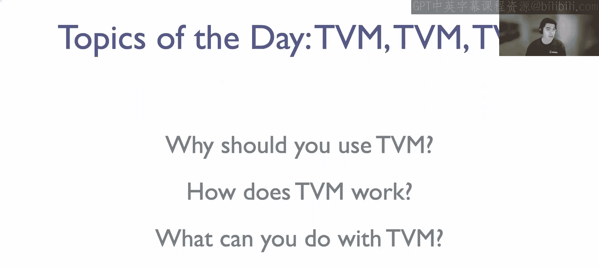
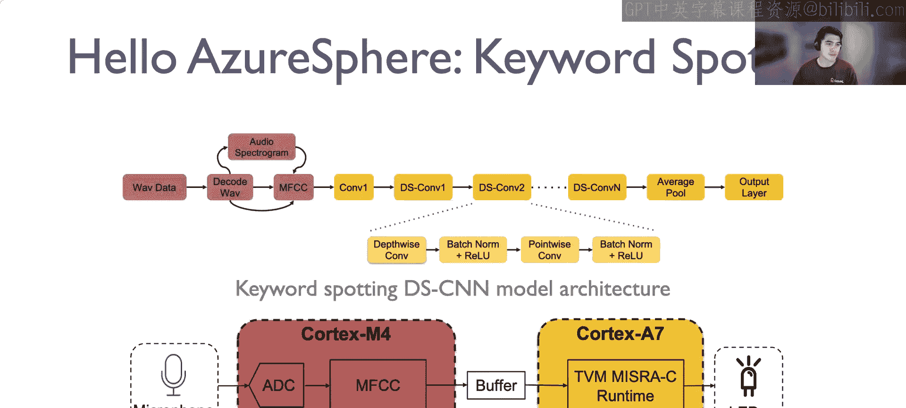
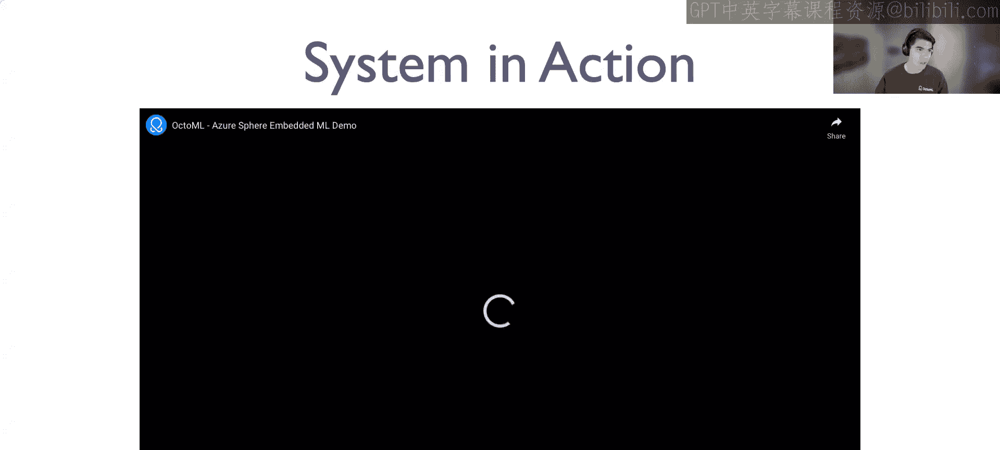
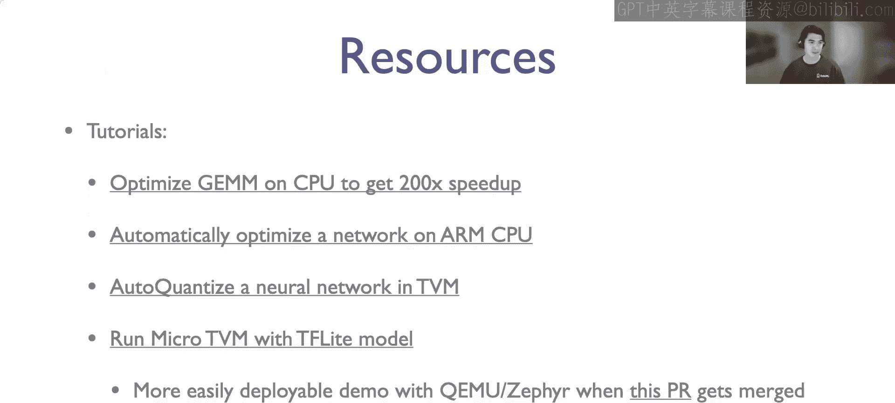

# 机器学习硬件和系统：015：TVM 框架概述与核心技术

在本节课中，我们将学习一个名为 TVM 的开源深度学习编译器框架。我们将了解它为何被创建，其核心工作原理，以及它如何解决机器学习模型在不同硬件平台上部署时面临的效率、可移植性和软件支持等关键挑战。

## 概述：机器学习部署的挑战

随着人工智能的普及，AI推理任务需要在各种设备上运行，从云端服务器到资源受限的边缘设备（如智能音箱、安防摄像头）。机器学习工程师面临一个复杂的部署矩阵：模型可能来自不同的训练框架（如 PyTorch、TensorFlow），而目标硬件平台（如 CPU、GPU、ARM 微控制器、专用加速器）也多种多样。传统上，依赖硬件厂商提供的手动优化库不仅难以扩展以适应新模型和新硬件，而且开发和维护成本极高。

TVM 应运而生，它是一个开源的机器学习优化框架，旨在自动生成针对特定硬件的最优代码，从而解决上述可移植性、效率和新硬件支持问题。

## TVM 的核心优势

以下是 TVM 旨在解决的三个核心痛点：

1.  **可移植性**：TVM 允许将模型部署到众多“异质”平台上。例如，研究人员曾成功将关键词识别模型部署到不支持标准机器学习框架的 Azure Sphere 物联网设备上。
2.  **效率**：TVM 提供自动化优化，能从硬件中榨取最大性能。例如，Facebook 的工程师使用 TVM 对 WaveRNN 模型应用稀疏化、数据类型优化等，在一周内实现了 100 倍的加速，满足了实时音频处理的严苛要求。
3.  **对新硬件的软件支持**：对于设计 AI 专用芯片（如 ASIC、FPGA）的硬件公司，TVM 提供了一个统一的软件栈入口，降低了让程序员使用其硬件的门槛，无需为每个框架单独适配。

TVM 已在工业界得到广泛应用，例如优化 Facebook 的模型、为亚马逊 Alexa 提供支持，并被高通、ARM 等芯片厂商用于其 SoC 上的异构计算。

## 深入 TVM 工作原理

上一节我们介绍了 TVM 解决的问题，本节中我们来看看 TVM 内部是如何工作的。我们将从算子优化、自动化优化、图级优化以及对微控制器的支持四个方面进行探讨。

### 算子级优化：从数学定义到高效实现

一个神经网络模型可以看作一个计算图，其中每个节点代表一个算子（如卷积、矩阵乘法）。让单个算子在特定硬件上高效运行是编译器的核心任务。

传统的高性能算子实现（如 Intel MKL、NVIDIA cuDNN 中的库）通常包含大量手写、难以维护的汇编或内联代码。TVM 借鉴了 Halide 语言的思想，引入了 **算法定义** 与 **调度** 的分离。

*   **算法定义**：描述算子要“计算什么”，即其数学功能。例如，矩阵乘法的算法定义是：
    `C[i, j] = sum(A[i, k] * B[k, j])`
*   **调度**：描述算法“如何计算”，即数据如何在内存中存取、循环如何组织、如何利用并行等。

通过这种分离，TVM 允许用户用简洁的 **张量表达式语言** 定义算法，然后通过编写简短的调度代码来应用各种优化（如循环分块、向量化、并行化），从而自动生成复杂但高效的低级代码。这使得在获得媲美手写库性能的同时，保持了代码的简洁性和可维护性。

### 自动化优化：用机器学习优化机器学习

手动为每个算子和硬件组合寻找最优调度非常耗时。TVM 的 **AutoTVM** 组件将这个过程自动化。

它首先定义一个**调度模板**，其中预留了一些可调参数（如分块大小、循环顺序）。然后，AutoTVM 将这些参数视为一个巨大的搜索空间，使用基于机器学习的成本模型来指导搜索。该系统通过在目标硬件上实际运行和测量不同调度配置的性能，学习硬件特性，并自动找到接近最优的配置。这种方法甚至能在某些情况下超越硬件厂商提供的手动优化库。

### 图级优化：超越单个算子

在优化了单个算子之后，我们还可以在整個计算图层面进行优化。TVM 使用名为 **Relay** 的高级中间表示来承载整个模型的计算图。

一个关键的图级优化是 **算子融合**。在典型的逐层执行中，每一层的输出张量都需要写回内存，然后作为下一层的输入再读出来，这造成了大量的内存带宽开销。算子融合将多个连续的算子（如 Conv2D + BatchNorm + ReLU）合并成一个复合算子，从而减少中间张量的内存读写，显著提升性能。TVM 的代码生成能力使得这种灵活的融合成为可能，无需为所有可能的算子组合预写实现。

### 支持微控制器与硬件加速器

TVM 的可移植性优势在资源极端受限的微控制器领域尤为突出。**MicroTVM** 允许 TVM 为没有操作系统、内存极小的微控制器生成精简的部署代码。它利用灵活的代码生成器，可以适配 GCC、LLVM 或供应商特定的工具链，从而支持多种指令集架构和实时操作系统。

此外，TVM 也为新兴的硬件加速器提供了软件支持。例如，ARM 的 Ethos-U55 微 NPU 就可以通过 TVM 进行编程。模型经过 Relay 图优化和分区后，部分计算可以被卸载到加速器上执行，并由 TVM 完成底层代码生成，使得开发者能够便捷地利用专用硬件的性能优势。

## 总结与展望

本节课中我们一起学习了 TVM 深度学习编译器框架。我们了解到 TVM 通过分离算法与调度、利用 AutoTVM 进行自动化搜索、在 Relay 层进行图优化，以及支持微控制器和硬件加速器，有效地解决了机器学习模型跨平台部署的挑战。它平衡了代码的简洁性、可维护性与高性能，成为连接多样化的模型与爆炸式增长的硬件生态的关键桥梁。

TVM 不仅是一个强大的研究工具，也已在工业界落地，并催生了像 OctoML 这样的商业化平台，致力于进一步简化机器学习模型的优化与部署流程。对于学习者而言，TVM 为在各类设备上部署和优化模型提供了强大的可能性和实践项目基础。

---
**资源链接**:
*   TVM 官方文档与教程: [https://tvm.apache.org/](https://tvm.apache.org/)
*   AutoTVM 论文: 《Learning to Optimize Tensor Programs》
*   MicroTVM 与 Azure Sphere 案例
*   OctoML 平台: [https://octoml.ai/](https://octoml.ai/)