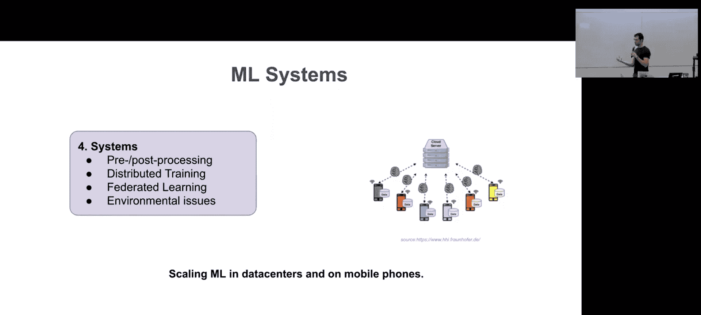
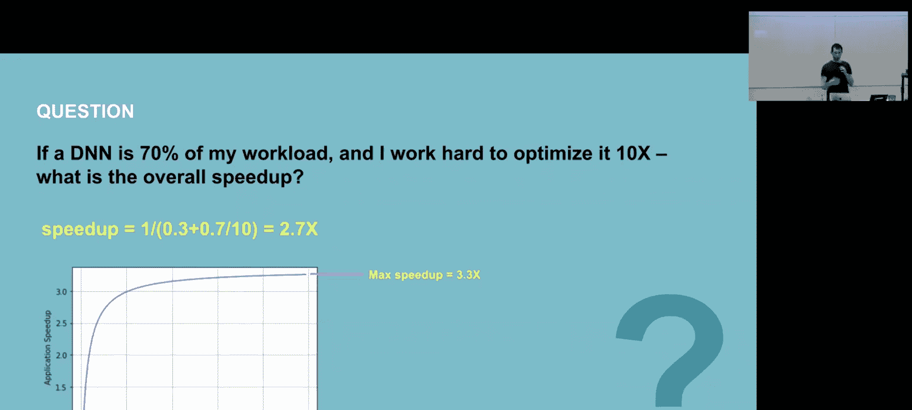
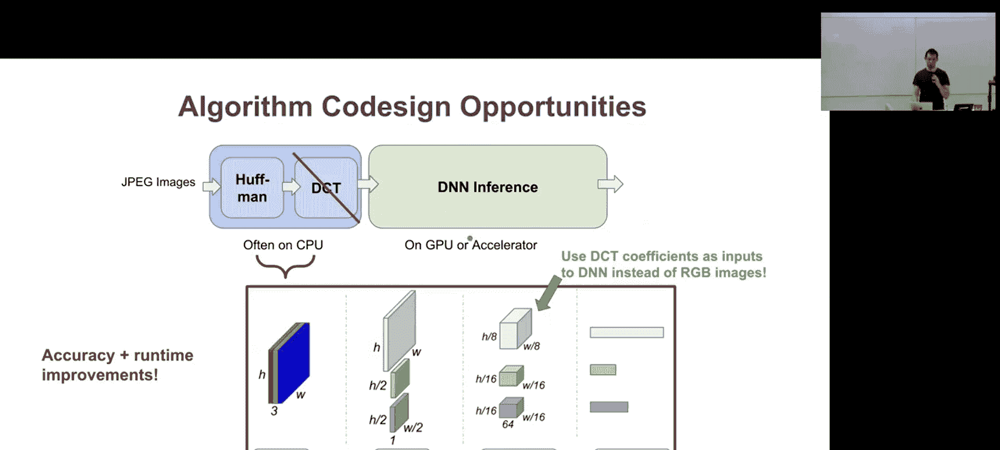
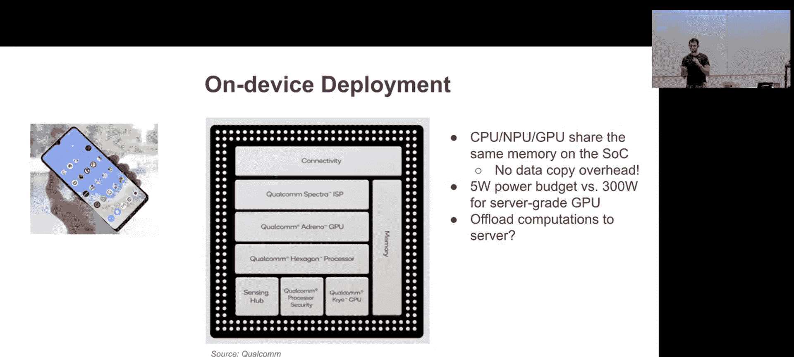
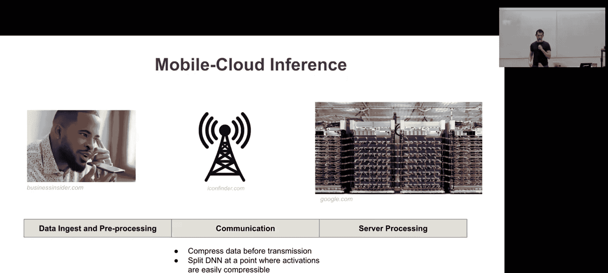
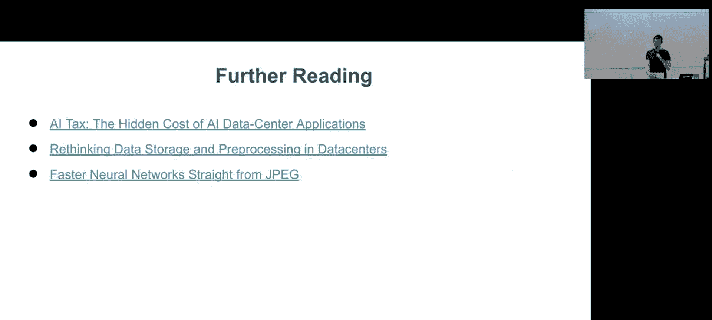

# 机器学习硬件和系统：016：ML系统中的预处理与后处理

在本节课中，我们将要学习在运行深度神经网络时，除了核心计算之外的其他系统开销。我们将探讨在部署机器学习模型时，预处理、后处理以及系统架构如何影响整体性能，并介绍一些应对这些挑战的新兴思路。

---

## 阿姆达尔定律与系统性能瓶颈

上一节我们介绍了课程的整体框架，本节中我们来看看一个决定系统整体性能的关键定律。

当我们优化一个系统时，通常只关注其最耗时的部分。然而，阿姆达尔定律指出，整体性能的提升受限于被优化部分在总运行时间中所占的比例。

假设一个工作负载中，深度神经网络部分占70%。如果我们将其优化了10倍（即速度提升10倍），那么整体系统的加速比是多少？

根据阿姆达尔定律，整体加速比的计算公式为：
`整体加速比 = 1 / ((1 - P) + (P / S))`
其中：
*   `P` 是可优化部分（此处为DNN）所占的时间比例（0.7）。
*   `S` 是该部分的加速比（10）。

代入计算：
`整体加速比 = 1 / ((1 - 0.7) + (0.7 / 10)) = 1 / (0.3 + 0.07) ≈ 2.7x`

因此，即使核心的DNN部分获得了10倍的巨大提升，整体系统性能仅提升了约2.7倍。剩余的30%开销（如数据预处理、传输、系统调度等）成为了新的瓶颈。

阿姆达尔定律的核心思想是：**通过优化系统某一部分所获得的整体性能提升，受限于该部分被实际使用的时间比例。** 在机器学习系统部署中，这意味着我们不能只关注模型本身的效率，还必须考虑其运行环境中的所有其他环节。

---

## 系统栈中的开销层级

理解了性能瓶颈的基本原理后，我们来看看这些开销具体出现在系统栈的哪些层面。从高层的部署到底层的硬件，每一层都可能引入显著的开销。

以下是系统栈中可能产生开销的几个主要层级：

1.  **部署层**：例如使用Docker容器和Kubernetes进行大规模部署时，容器间的通信和管理（如通过消息代理Apache Kafka）会引入延迟。在一个实际的人脸检测系统案例中，仅代理通信就占据了约36%的延迟。
2.  **应用层**：在具体的机器学习应用流水线中，并非所有步骤都涉及深度神经网络。例如，从视频流中提取帧、调整图像大小、裁剪检测到的人脸区域、记录日志等操作，都可能占用大量时间。在某些系统中，这些非DNN操作的总开销甚至可能超过DNN计算本身。
3.  **硬件层**：在典型的加速器架构（如CPU+GPU）中，数据需要在主机内存和加速器内存之间通过PCIe总线传输。这个传输过程会产生延迟，并且可能让加速器处于空闲等待状态，影响吞吐量。此外，主机CPU上的预处理任务也可能成为瓶颈，无法及时为多个GPU提供数据。

---

## 硬件层面的优化策略

认识到硬件层面的数据传输是主要开销后，本节我们来看看如何从系统架构设计上缓解或消除这些瓶颈。

针对硬件层面的开销，业界提出了多种优化策略：

*   **计算与传输重叠**：在将第N个任务的数据传输到GPU的同时，执行第N-1个任务的计算。这可以显著提高GPU的利用率和系统吞吐量，但无法减少单个任务的端到端延迟。
*   **增加主机处理能力**：当CPU预处理成为瓶颈时，可以增加CPU核心数量。例如，NVIDIA在其A100系统中为每个GPU配备了一个专用的ARM核心来处理数据调度，而不是依赖一个强大的x86核心。
*   **加速器直连**：在分布式训练等场景中，为了避免通过主机CPU进行梯度同步带来的延迟，可以使用高速互联技术（如NVIDIA的NVLink或Google TPU Pods内的环状连接）直接连接多个加速器。
*   **前置处理单元**：为了规避“数据先到CPU，再经PCIe到加速器”的路径延迟，可以将可编程硬件（如FPGA）放置在网络入口处，直接在数据到达CPU前进行处理。微软的“脑波项目”就采用了这种架构，将FPGA置于网卡和CPU之间，用于低延迟推理或预处理任务。
*   **专用数据处理单元**：像NVIDIA的BlueField DPU这类芯片，专门用于处理数据中心的网络、存储和安全任务，旨在减轻CPU和GPU的负担，让它们更专注于计算。

---

## 算法与系统的协同设计

除了优化硬件架构，我们还可以从算法和软件层面思考，如何减少或消除预处理步骤。本节介绍一种将传统处理步骤融入神经网络的有趣思路。

一个常见的预处理步骤是图像解压缩（如JPEG解码）。传统流程需要在CPU上完成解码，再将像素数据送入GPU进行DNN推理。

一项研究发现，可以跳过JPEG解码中的“逆离散余弦变换”步骤，直接将DCT系数输入到一个经过适当重新训练的神经网络中。这样做不仅减少了CPU的预处理时间，在某些情况下甚至还能略微提升模型精度。原因是，神经网络的前几层本身就在学习类似于频域变换的特征，因此直接输入频域系数是可行的。

这个例子展示了**算法与系统协同设计**的潜力：通过重新设计算法流程，可以将部分系统开销吸收到高度优化的DNN计算中，从而简化系统架构并提升整体效率。

---

## 移动设备上的系统考量

将计算从云端转移到移动设备是另一个重要趋势，这能降低服务提供商的成本、减少延迟并增强隐私保护。本节我们探讨在手机等设备上运行ML系统时的独特挑战和机遇。

在移动设备上，系统架构与数据中心有很大不同：

*   **片上系统**：CPU、GPU、NPU等组件通常集成在同一芯片上，共享内存。这消除了PCIe数据拷贝的开销，是一个显著优势。
*   **资源受限**：移动设备的计算能力和功耗预算远低于服务器。
*   **端云协同**：由于设备能力有限，复杂的模型仍可能需要将部分计算卸载到云端。这引入了网络传输延迟和能耗的新问题。

研究重点包括：如何划分模型（哪些层在端侧运行，哪些在云侧运行）、如何压缩需要传输的中间数据（激活值），以及如何根据网络条件（4G/5G）动态调整卸载策略。

---

## 传感器端的智能处理

最后，我们来看一个更前沿的想法：将处理能力尽可能靠近数据产生的源头——传感器本身。

以手机拍照为例，传统成像流水线非常冗长：传感器 -> 图像信号处理器（ISP，用于调色、HDR等） -> 压缩存储 -> 读取解压 -> DNN处理。如果我们最终只想得到图片的元信息（如“图中有一只猫”），那么中间生成高质量图像的过程就浪费了大量能量和时间。

一种新兴的思路是**近传感器处理**。例如，索尼提出的“智能视觉传感器”，将图像传感器与一个简单的DNN加速器通过3D堆叠技术集成在一起。这样，传感器在捕获图像后，可以直接在片上完成初步分析，并只输出元数据（如“猫”）或经过裁剪处理的感兴趣区域，而不是完整的图像数据。这能极大减少后续流水线的数据量，节省存储、传输和处理的能量。

---

## 总结

本节课中我们一起学习了机器学习系统部署中预处理和后处理的重要性。我们了解到，由于阿姆达尔定律的存在，仅优化深度神经网络本身往往无法获得线性的端到端系统性能提升。系统栈的各个层级，包括部署、应用流水线和硬件架构，都会引入显著开销。

我们探讨了多种应对策略，从硬件层面的计算-传输重叠、加速器直连，到算法层面的协同设计以减少预处理，再到移动设备上的端云协同和传感器端的智能处理。这些思路表明，构建高效的机器学习系统需要跨领域的协同优化，综合考虑算法、软件、硬件和系统架构。