# 机器学习硬件和系统：017：分布式训练

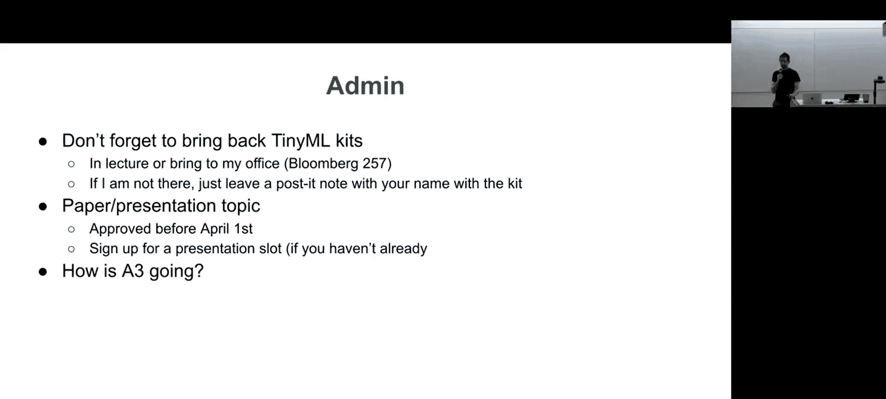

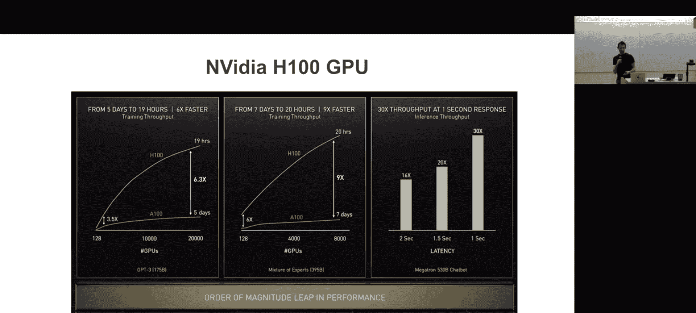

在本节课中，我们将要学习分布式训练的核心概念。当模型过大无法放入单个GPU内存，或训练速度过慢时，我们需要使用多个设备协同工作。我们将探讨两种主要的并行化策略：模型并行与数据并行，并了解如何通过梯度压缩和先进的网络拓扑来优化设备间的通信。

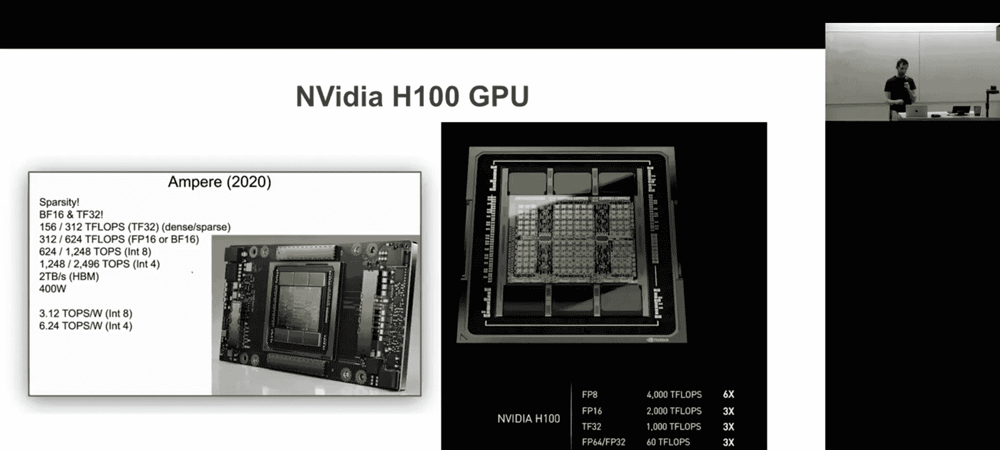

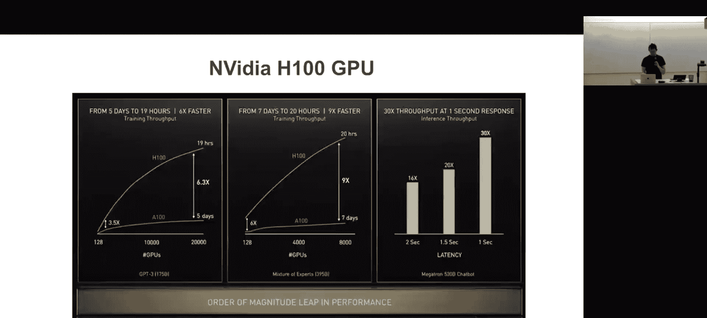

## 硬件发展背景与动机

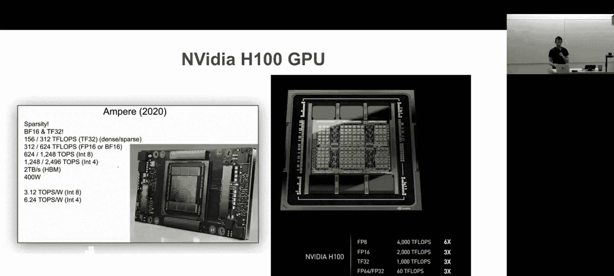

上一节我们介绍了大规模模型对硬件的需求。本节中我们来看看最新的硬件如何推动分布式训练的发展。

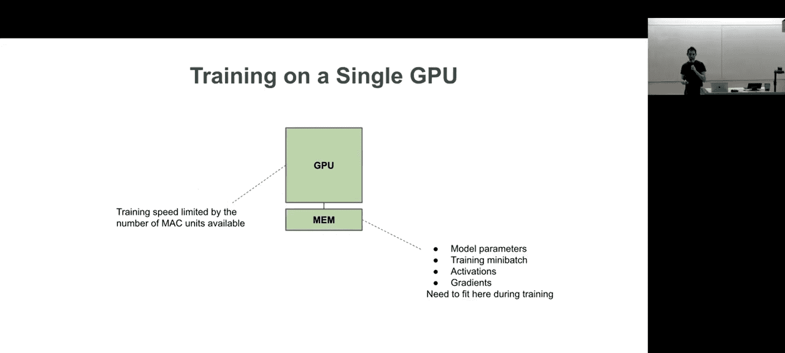

NVIDIA近期发布了基于Hopper架构的H100 GPU。与上一代A100相比，H100在训练如GPT-3这样的大模型时，声称能带来近7倍的性能提升和高达30倍的吞吐量提升。

性能飞跃的背后存在一些关键变化。H100的功耗达到了700瓦，远高于A100的400瓦，同时制程工艺从7纳米升级到了4纳米。这表明，部分性能提升是通过增加功耗和提升制程密度实现的。

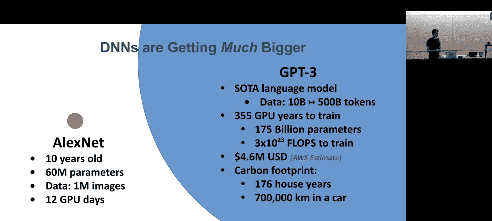

另一个重要转变是对数值格式的侧重。H100架构加强了对**FP8**（8位浮点数）格式的支持，这与传统的**INT8**（8位整数）量化不同。FP8格式包含指数和尾数，能提供更大的动态范围，但其在数轴上的表示点并非均匀分布，可以看作一种非线性量化。这种格式的引入是为了更好地适应现代大模型的训练需求。

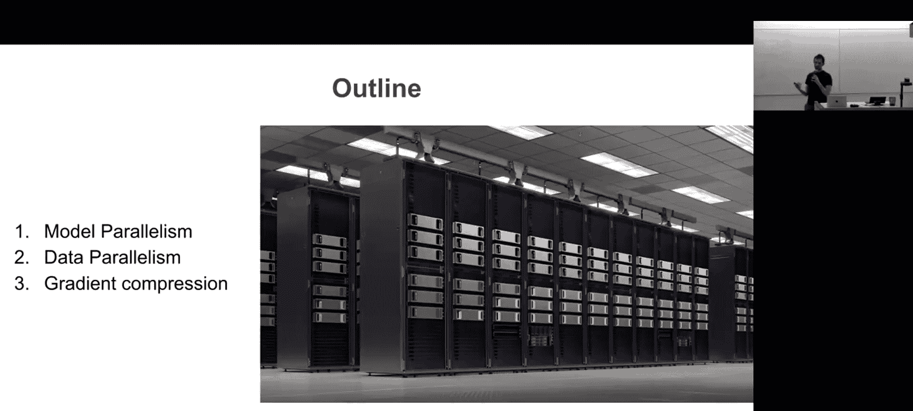

此外，如何将多个GPU高效连接成集群或超级计算机，也是当前硬件发展的重点，这与我们今天要讨论的分布式训练中的通信问题直接相关。

## 为什么需要分布式训练？

使用单个GPU进行训练主要面临两个限制：
1.  **计算速度限制**：单个GPU每秒能执行的乘加运算次数是有限的。
2.  **内存容量限制**：GPU的显存必须能容纳模型参数、前向激活值、反向梯度、优化器状态以及小批量数据。当模型过大或批量设置导致所需内存超过显存时，单卡训练就无法进行。

以GPT-3（1750亿参数）为例，其规模已远超早期的AlexNet（百万级参数）。为了训练此类大模型，或处理图像、视频等多模态数据，我们必须采用多设备并行训练。分布式训练已成为必需而非可选的技术。

## 分布式训练的三种核心方法

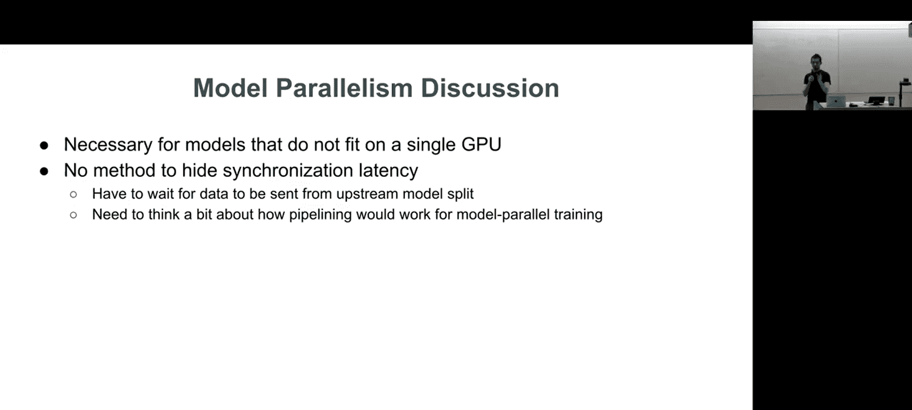

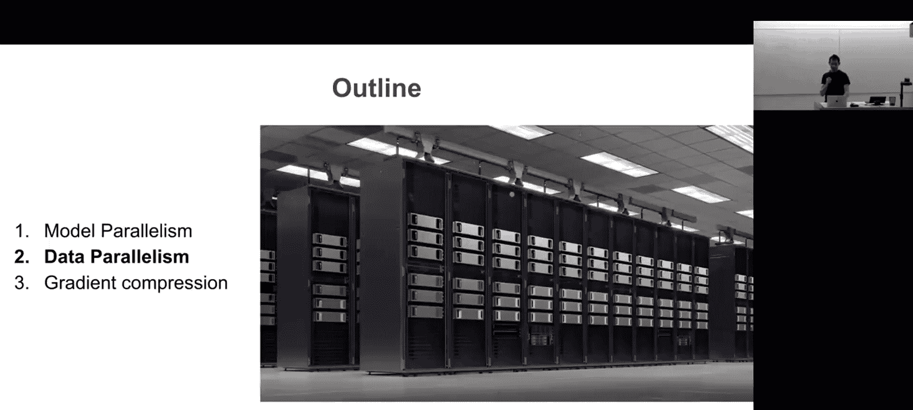

以下是实现分布式训练的三种核心思路。

### 1. 模型并行

当模型过大，无法放入单个GPU内存时，我们需要使用模型并行。其核心思想是将模型的不同部分放置在不同的GPU上。

具体流程如下：
1.  将输入数据移至GPU0。
2.  在GPU0上计算模型第一部分的前向传播。
3.  将GPU0输出的激活值（一个大张量）移至GPU1。
4.  在GPU1上计算模型第二部分的前向传播，并计算损失。
5.  在GPU1上开始反向传播，计算梯度。
6.  将GPU1上的梯度移回GPU0。
7.  在GPU0上完成剩余部分的反向传播。
8.  更新所有参数。

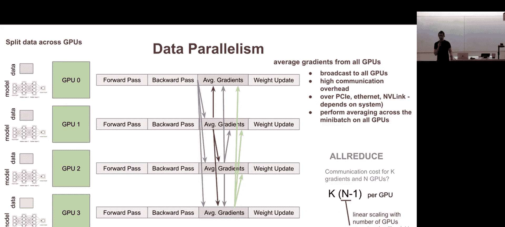

在代码中，使用PyTorch时，通过 `tensor.to(device)` 命令（如 `tensor.to(‘cuda:1’)`）可以方便地在设备间移动数据。一个简单的模型并行代码示例如下：
```python
# 将网络的第一部分放在GPU0上
net1.to(‘cuda:0’)
# 将网络的第二部分放在GPU1上
net2.to(‘cuda:1’)


# 前向传播
input = input.to(‘cuda:0’)
intermediate = net1(input)
intermediate = intermediate.to(‘cuda:1’) # 移动激活值
output = net2(intermediate)
```
模型并行的主要挑战在于：
*   **通信开销**：设备间移动激活值和梯度需要时间。
*   **设备闲置**：由于计算依赖，GPU1必须等待GPU0完成计算后才能开始工作，容易造成设备利用率不足。
*   **负载均衡**：需要手动划分模型，尽量使不同GPU上的计算负载均衡。

因此，模型并行通常只在模型无法放入单卡内存时使用。

### 2. 数据并行

当模型可以放入单个GPU内存，但希望通过增加批量大小来加速训练时，我们使用数据并行。其核心思想是将一个小批量数据拆分到多个GPU上并行处理。

具体流程如下：
1.  将同一模型副本复制到每个GPU上。
2.  将小批量数据平均分给每个GPU。
3.  每个GPU独立进行前向传播和反向传播，计算本地梯度。
4.  聚合所有GPU的梯度并计算平均梯度。
5.  每个GPU使用平均梯度更新其模型参数。

关键问题在于如何高效地聚合梯度。最初的方法是**All-Reduce**（全规约），即每个GPU需要将自己的梯度广播给所有其他GPU。如果有 `N` 个GPU，每个梯度大小为 `K`，那么每个GPU需要发送 `K*(N-1)` 的数据量。通信成本随GPU数量线性增长，扩展性差。

为了改进，人们引入了**参数服务器**架构。指定一个或一组GPU作为服务器，工作GPU将梯度发送给服务器，服务器聚合梯度后再将结果广播回所有工作GPU。这减少了工作GPU的通信量，但服务器的通信负载变为 `K*N`，仍存在瓶颈。通过使用多个参数服务器（`S`个）可以分摊负载，使每个服务器的通信量降至约 `K*N/S`。

目前最流行且扩展性更好的方法是**环全规约**。它将All-Reduce操作分解为两个阶段：**Reduce-Scatter**（规约散播）和**All-Gather**（全收集）。
*   **Reduce-Scatter**：每个GPU将自身的梯度数组分成 `N` 块。通过环状连接，GPU依次传递并累加这些块。经过 `N-1` 步后，每个GPU拥有完整梯度总和的一部分。
*   **All-Gather**：每个GPU将其拥有的那块总和部分，再次通过环状连接广播给所有其他GPU。经过 `N-1` 步后，所有GPU都拥有了完整的梯度总和。

环全规约的优点是每个GPU的通信量约为 `2K`（发送和接收各约 `K` 数据），且与GPU数量 `N` 无关，具有极佳的扩展性。主流框架如Horovod即采用此方法。

数据并行还有同步与异步之分：
*   **同步训练**：等待所有GPU计算完毕，聚合梯度后再更新参数。这是最常用的方式，收敛行为可预测。
*   **异步训练**：任一GPU计算完梯度后立即更新中心参数服务器，其他GPU使用可能过时的参数进行计算。虽然延迟更低，但可能影响收敛速度和最终精度，目前较少使用。

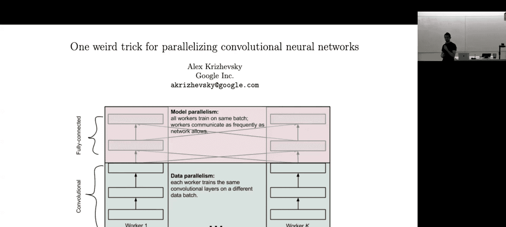

### 3. 梯度压缩

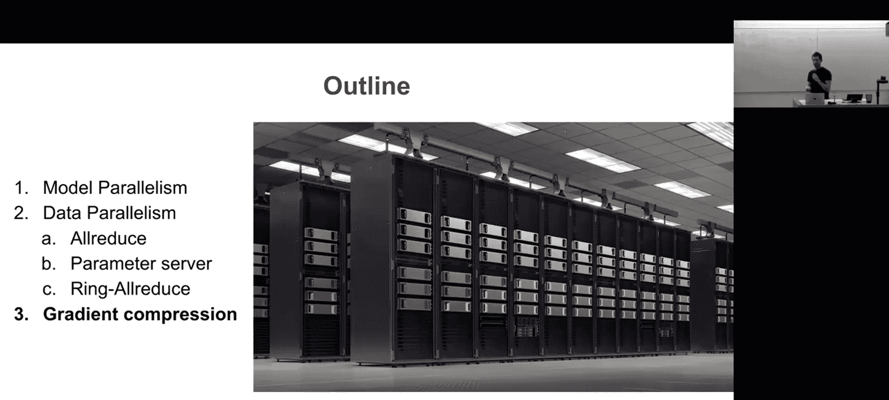

即使采用环全规约，通信量仍与梯度大小 `K` 成正比。梯度压缩技术旨在减少 `K` 的有效大小，从而降低通信开销。主要方法有：
*   **量化**：例如，将32位浮点梯度量化为8位或4位进行传输，训练完成后再恢复。这通常能带来约2倍的加速，有时还能起到正则化效果。
*   **剪枝**：只传输绝对值较大的梯度，将小梯度置零。由于零值可以高效压缩（如游程编码），能大幅减少通信量。研究表明，即使剪枝90%的梯度，模型精度也可能基本不受影响。

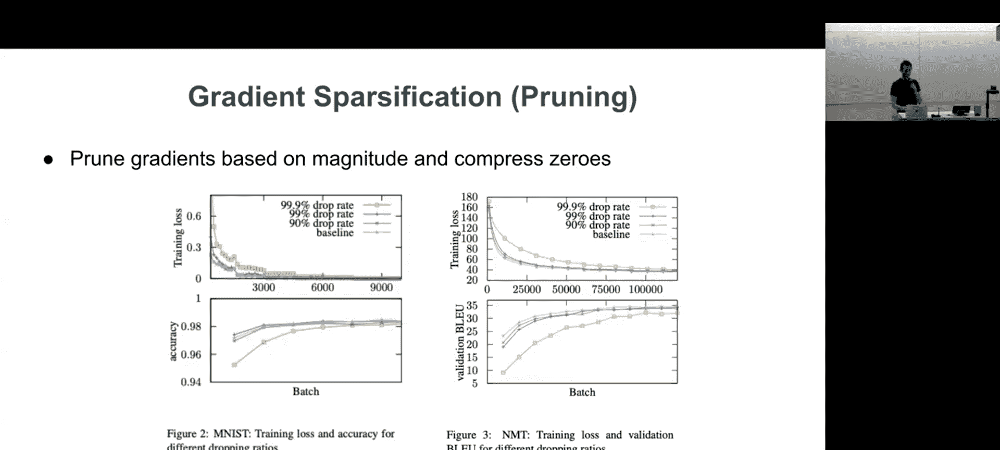

## 前沿架构与总结

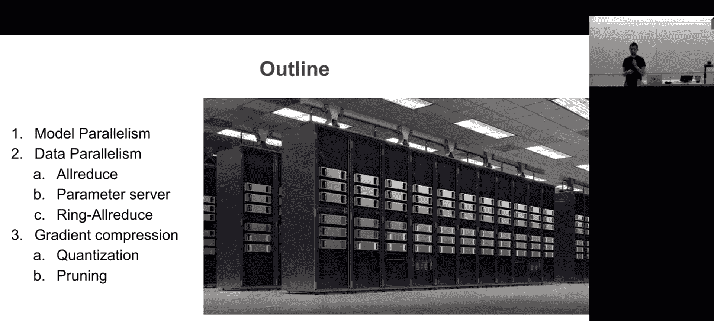

传统的加速器（GPU）通过CPU和PCIe总线连接与通信。新兴的架构试图改变这一点，例如微软在数据中心部署的FPGA方案，将FPGA直接置于网络交换机上。数据在到达CPU之前即可被FPGA处理，计算结果也可直接通过网络发送给其他FPGA，避免了CPU和PCIe的延迟与不确定性开销。

NVIDIA的新方案也体现了类似思路，推出了将GPU直接与网络接口卡相连的产品，旨在优化分布式训练中的通信路径。

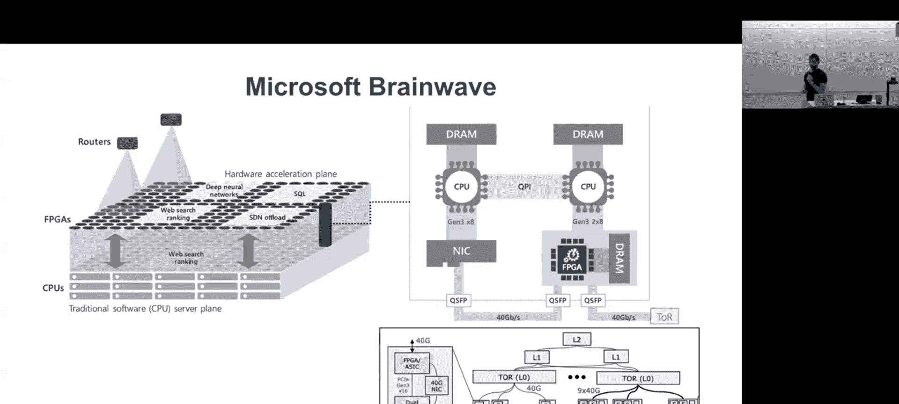

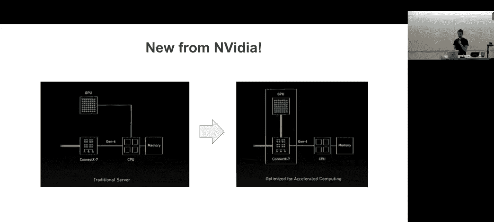

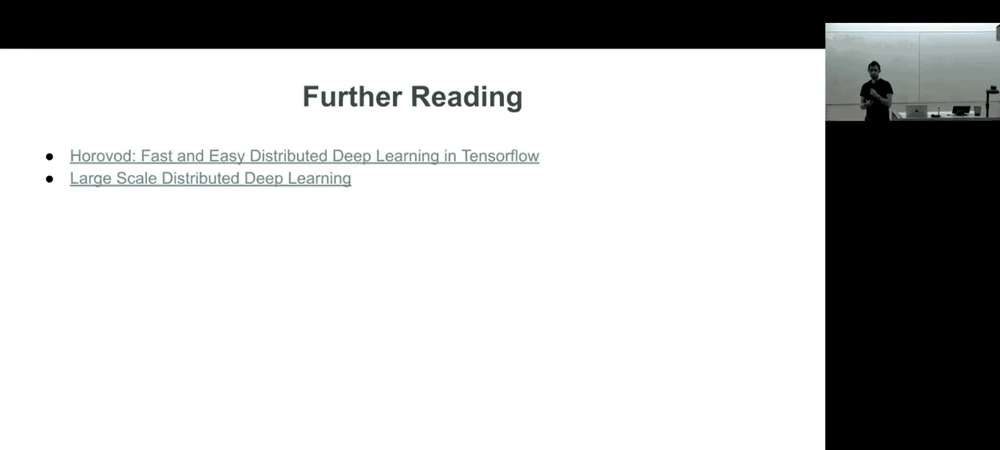

本节课中我们一起学习了分布式训练的核心方法。我们了解到，**模型并行**用于解决内存不足问题，**数据并行**用于加速训练，而**环全规约**是高效实现数据并行的关键算法。此外，通过**梯度压缩**可以进一步减少通信开销。最后，硬件架构的演进（如直接网络连接）正在为超大规模分布式训练提供新的可能性。掌握这些知识，是理解和设计现代机器学习系统的重要基础。