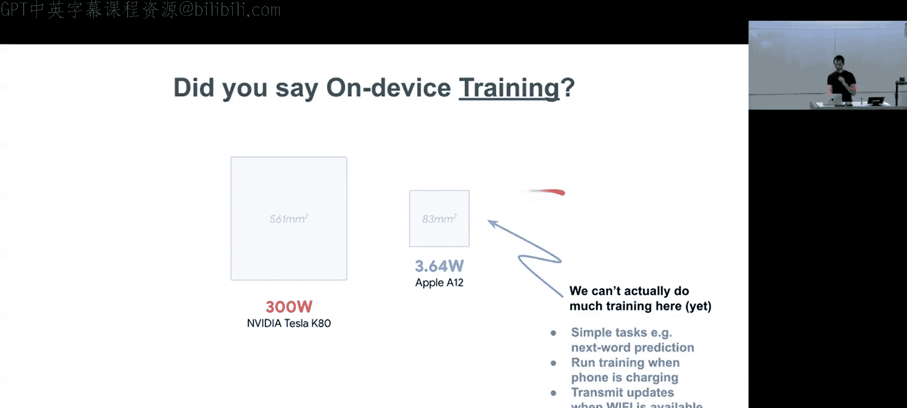
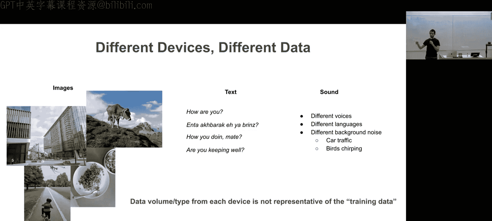
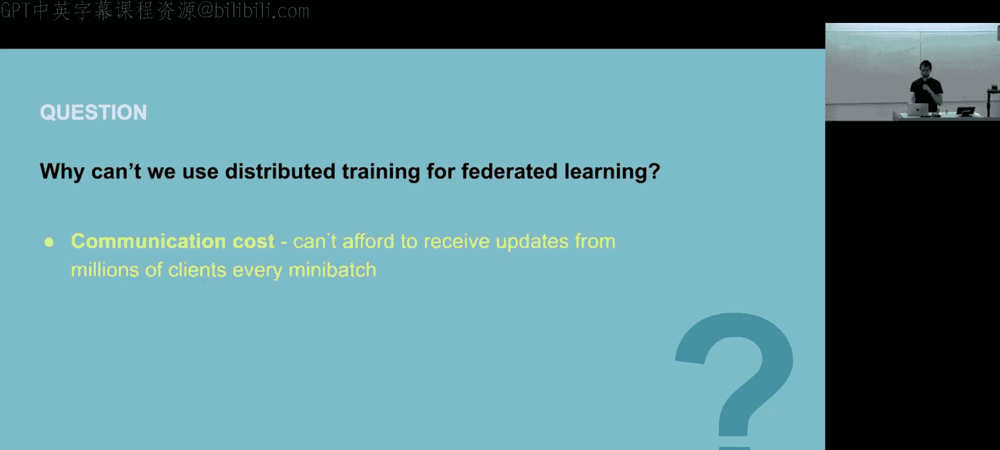
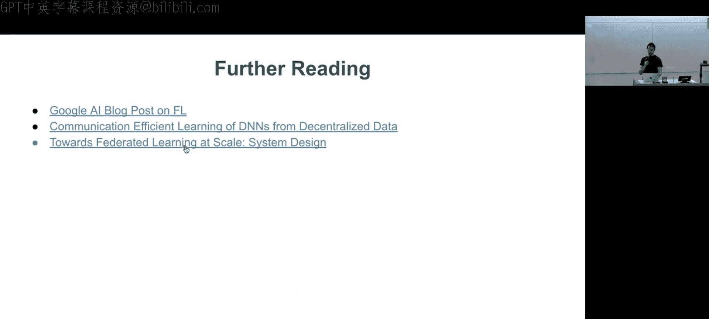

# 机器学习硬件和系统：018：联邦学习

在本节课中，我们将要学习一个非常有趣的主题——联邦学习。我们将探讨它如何将分布式训练的思想扩展到更多设备和用户，并了解其独特的要求和挑战。

上一节我们介绍了分布式训练及其通信成本问题。本节中，我们来看看联邦学习，它本质上是分布式训练的一种形式，但具有非常不同的要求和应用场景。

## 联邦学习概述

联邦学习是一种分布式训练方法，其核心思想是利用大量用户设备上持续生成的数据来训练一个中央模型，而无需将原始数据上传到中央服务器。

## 联邦学习与分布式训练的区别

以下是联邦学习与分布式训练的主要区别：

*   **设备异构性**：联邦学习中的设备类型差异巨大，从旧款手机到最新智能手机，甚至智能手表和增强现实眼镜。
*   **通信链路**：设备可能通过Wi-Fi、3G、4G或5G等不同网络连接，且连接不稳定、不可靠。
*   **设备数量**：联邦学习面向数百万甚至数十亿台设备，规模远超分布式训练中通常的数十或数百个GPU。
*   **数据分布**：每个设备上的数据分布通常不同且不具代表性，这被称为**非独立同分布**数据。
*   **设计目标**：联邦学习强调**数据隐私**和**系统可扩展性**，而分布式训练更侧重于**训练速度**。

总而言之，联邦学习的目标是在无法直接访问数据、且能扩展到海量设备的情况下，利用持续生成的数据训练模型。

## 设备端训练的挑战

在深入算法之前，需要认识到设备端训练面临硬件限制。目前，手机等设备可以进行推理，但进行复杂模型训练的能力仍然有限。训练通常在设备充电且连接Wi-Fi时进行，以节省电量并降低通信成本。

## 联邦平均算法

联邦平均是联邦学习的基础算法，其核心步骤是减少通信频率。以下是该算法的步骤：

1.  **初始化**：中央服务器初始化一个全局模型。
2.  **选择设备**：在每一轮训练中，服务器从数百万设备中随机选择一部分（例如几千台）。
3.  **分发模型**：将当前全局模型发送给选中的设备。
4.  **本地训练**：每台设备使用本地数据对模型进行多轮训练，更新本地模型参数。
5.  **上传更新**：设备将更新后的模型参数上传至服务器。
6.  **聚合更新**：服务器收集所有更新，并根据各设备的数据量进行加权平均，更新全局模型。

该算法的关键优势在于，通过让设备在本地进行多轮训练后再通信，将通信成本降低了10到100倍。

## 联邦平均的改进：FedProx

联邦平均算法存在一些缺点，FedProx算法对其进行了两项主要改进以提升效果：

*   **处理掉队者**：不直接丢弃未及时完成训练的设备，而是接受其部分训练结果。
*   **限制参数变化**：在本地训练的损失函数中增加一个正则化项，限制本地模型参数与全局模型的差异，防止某些设备的更新过度影响全局模型。

这些改进使训练过程更稳定，在存在设备掉队或数据不平衡时表现更好。

## 隐私、安全与通信优化

尽管联邦学习将数据保留在设备上，但隐私和安全仍是重要考量：

*   **隐私风险**：研究表明，从共享的梯度甚至模型参数更新中，也有可能反推出原始数据信息。
*   **安全增强**：采用安全聚合等技术，例如在加密状态下对模型更新进行聚合，以进一步增强隐私保护。
*   **通信优化**：应用模型压缩、量化和剪枝等标准方法，减少传输数据量，节省带宽和设备电量。

## 数据标注的挑战

监督学习需要标注数据。在联邦学习场景中，获取标签主要通过以下方式：

*   **利用用户反馈**：例如，用户纠正语音识别的转录文本或图像分类标签。
*   **激励用户标注**：引导用户参与标注，如相册应用询问照片中的人物或地点。
*   **探索无监督学习**：采用不需要显式标签的学习方法，这被认为是未来的发展方向。

## 其他替代方案

除了联邦学习，还有其他利用用户设备数据训练模型的方法：

*   **数据卸载**：直接将数据发送到云端服务器进行训练。优点是避免设备端训练的限制，但牺牲了数据隐私，并需要强大的云端基础设施。
*   **协作式机器学习**：一种新兴范式，旨在在没有中央服务器的情况下，通过设备间直接交换更新来协同训练模型。这更具挑战性，目前尚未成熟。

## 总结

本节课中我们一起学习了联邦学习。它是一种利用海量设备数据训练中央模型的方法，核心步骤包括分发模型、本地训练、聚合更新。我们探讨了联邦平均及其改进算法FedProx，并了解了联邦学习在隐私、安全、通信优化和数据标注方面面临的挑战及其解决方案。最后，我们还简要了解了数据卸载和协作式机器学习这两种替代方案。