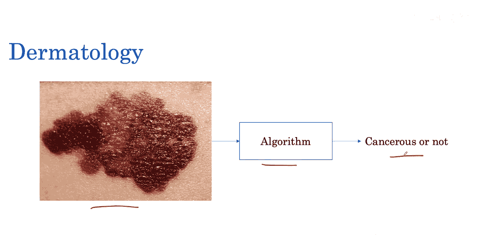
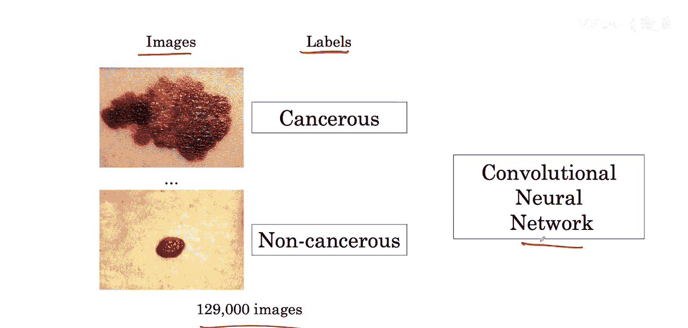
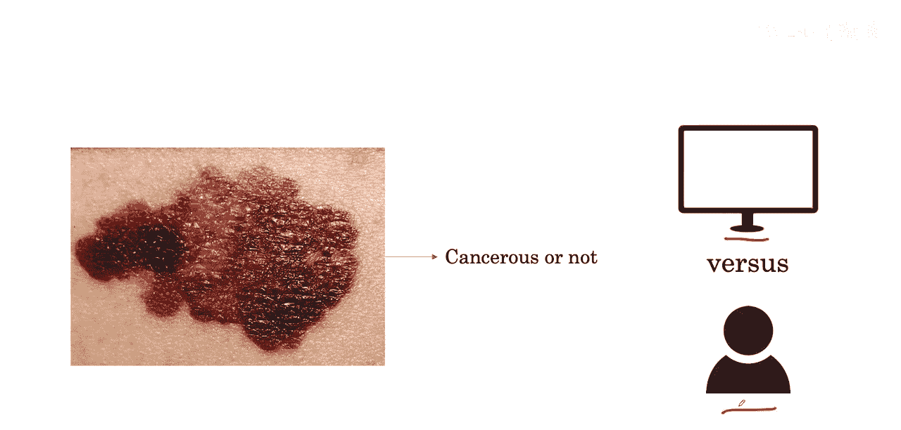
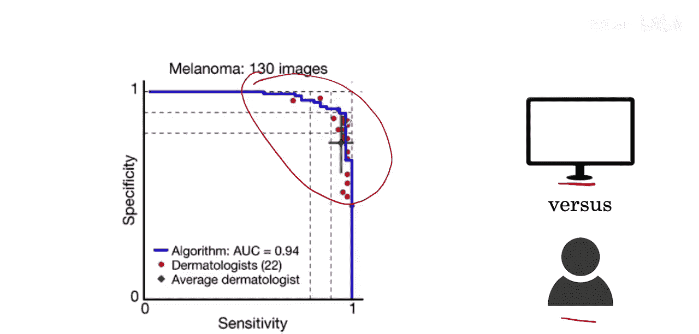

# deeplearningai【中英⚡AI 医学诊断｜AI for Medical Diagnosis】 p04 P4 01_医学影像诊断 [BV1kyYbzDEJk_p4]

This week， we'll be diving straight into building a deep learning model for the task of chess X ray classification。

Many of the ideas that you will learn through this example are broadly applicable across many medical imaging tasks。

 This week， we'll start by looking at three examples of medical diagnostic tasks。

 where deep learning has achieved incredible performance。

 will then jump into the training procedure for building AI models for medical imaging。😊，Finally。

 we'll look at the testing procedure for evaluating the performance of these models on rail data。

Our first example is in dermatology。 Drmatology is the branch of medicine dealing with the skin。

One of the task dermatologists perform is to look at a suspicious region of the skin to determine whether a mole is skin cancer or not。

Early detection could likely have an enormous impact on skin cancer outcomes。

The five year survival rate of one kind of skin cancer drops significantly if detected in its later stages。

In this study， an algorithm is trained to determine whether a region of skin tissue is cancerous or not。

Using hundreds of thousands of images and labels as input。

 a convolutional neural network can be trained to do this task。

 We will look at the training of such an algorithm in the course。

Once the algorithm has been trained， the algorithm's predictions can be evaluated against the predictions of human dermatologists on a new set of images。

In this study， it was found that the algorithm performed as well as the dermatologist did。

 Don't worry too much about the interpretation of this graph right now。

 in a future week of the course， we will look at the evaluation using such a curve。

 The main conclusion you'll be able to draw from this graph is that the algorithm's prediction accuracy was comparable to the prediction of human dermatologists。

